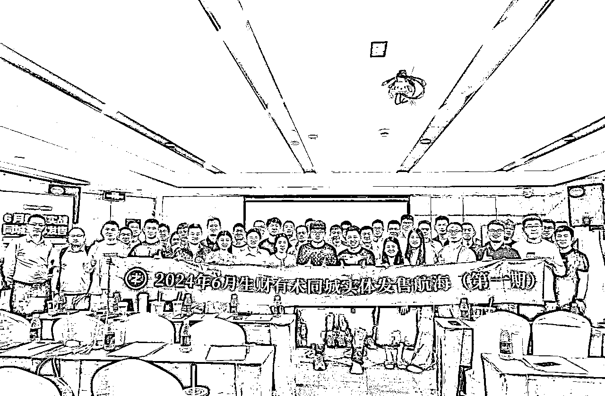
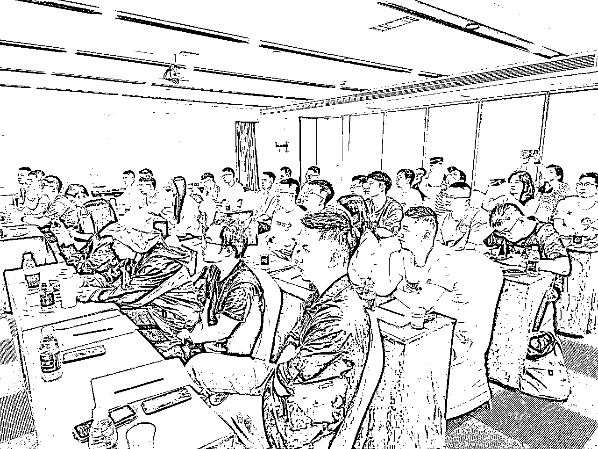
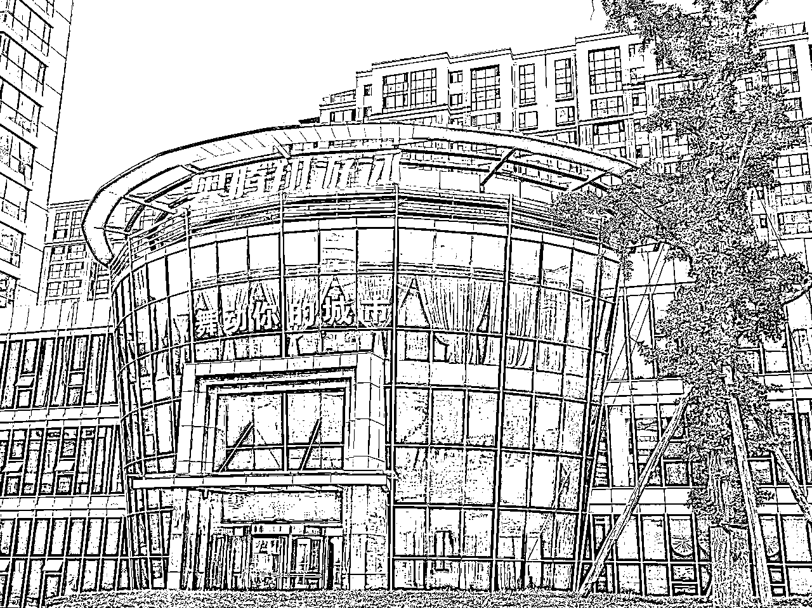
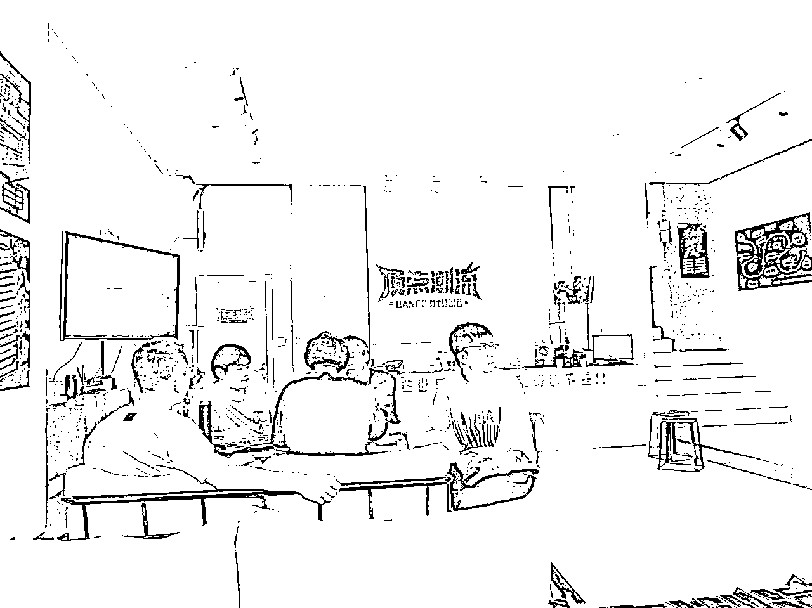
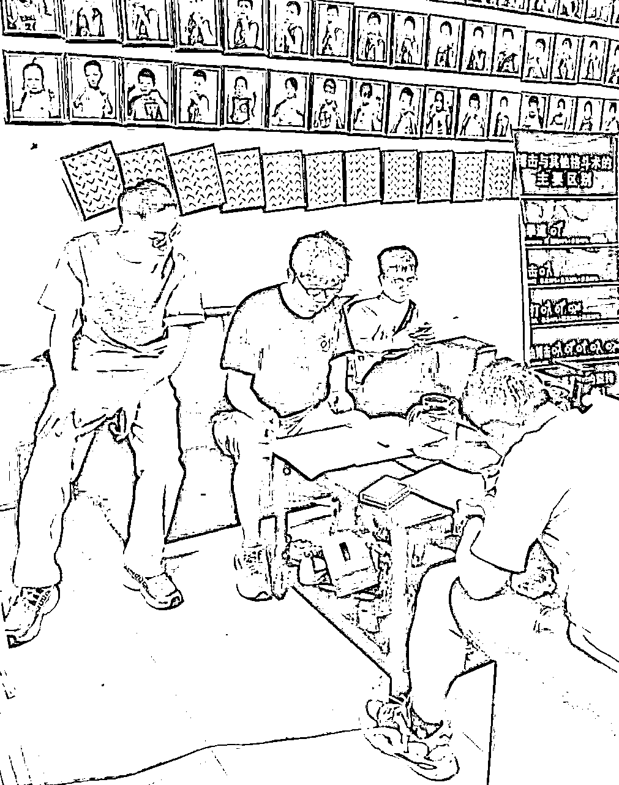
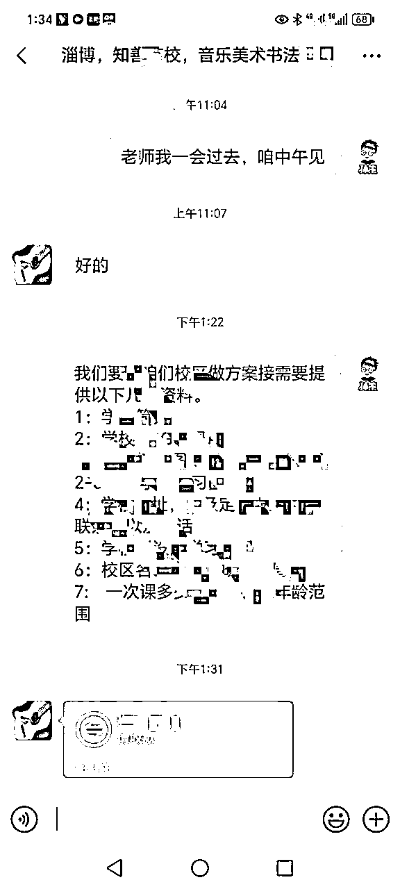
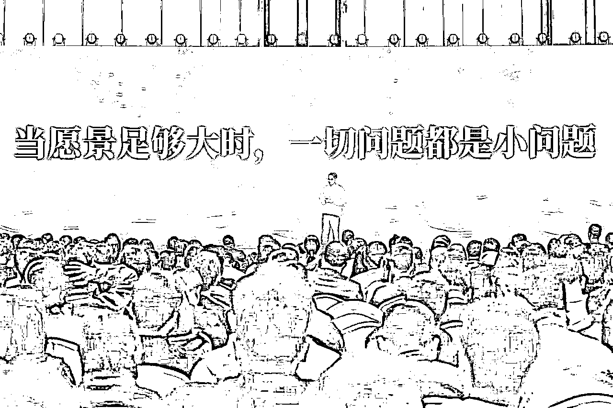
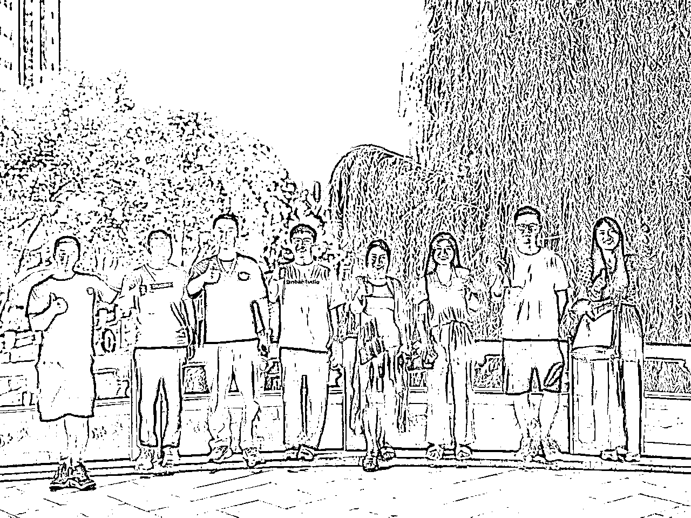
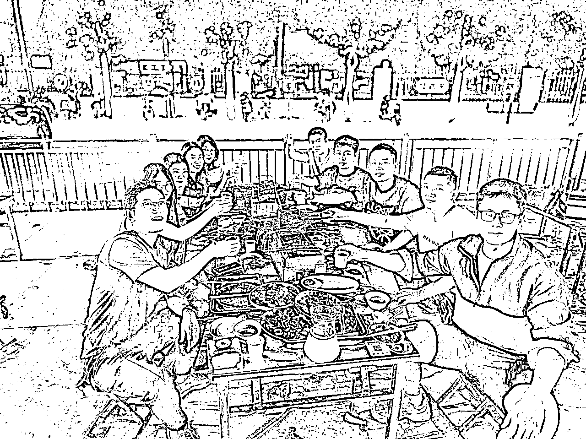
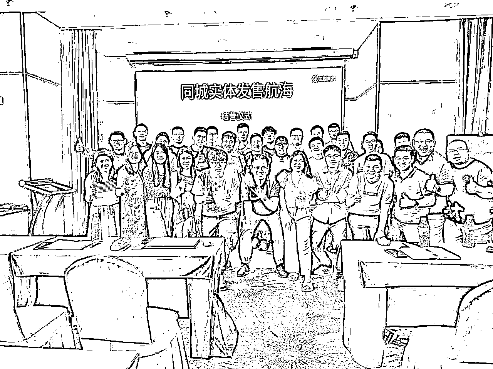

# 实战一个月，揭秘同城实体发售航海：昙花一现 or 机会所在？
作者：龙哥

混赚钱社群的人都知道，很多项目看起来热闹，实际跑起来是另一回事。六月那场实体商家发售的线下活动结束后，我想用自己的三十天经历，给还在观望的朋友一些真实信息。

先介绍下自己。我的名字是李李，在家居领域做了八年，既是设计出身，也担任过管理岗，帮近三十家企业把产品从概念做到落地，还陪着门店一家家开起来，其中四家已经在股市挂牌。目前我是斯坦福人生设计教练，兼职教瑜伽，离开职场后正折腾人生的下一个版本。

六月初，我成了“同城实体发售”首批航海团的一员，三十一个人像一群候鸟飞到济南。两天培训后，立刻被分到不同城市开始实操。三周我签下十五单，项目进账三万多。虽然那阵子是行业淡季，这个成绩在同期伙伴里也算靠前。

# 一、为什么会一眼相中它

那时我辞职刚满三十天，给自己留了一年的空窗期。我想试试新赛道，也想把老本行家具设计结合起来。看到航海通知里“同城实体发售”六个字，我立刻有了感觉。做了多年线下生意，我始终在想，店铺要怎么借力网络实现精准引流。这个项目似乎就是来回答这个问题的。

我去查了项目主导人孙策的履历，也就是大家口中的孙总。看完他的打法，我觉得和自己的判断合得上，就报名了。

# 二、这一个月到底在做什么

这个项目可拆成三段：签约、转化、服务。

先说签约。我们主要靠陌生拜访，目标客户是艺术、体育、学科类培训机构的老板，以后会拓展到医疗美容、健康产业。具体动作就是到店找人聊，摸清对方现在怎么获客，然后给他提出一套营销方案，收一笔诚意金，把合作意向敲定。方案细化后，再跑一趟和客户确认时间和细节，接着交给后端同事去执行。

转化这块由后端的大部队操办。他们同时启动线上流量平台、线下地推、老客户转介绍，短时间内替商家拉来新面孔，再促成高价位成交。客户服务则由前后端的人一起负责。在排兵布阵上，我们集中火力先打一个区域，拿到一个城市后再往旁边扩散，最后希望覆盖全国每个重点市场。

这个玩法很直白，学起来容易，反馈来得也快，但人确实累。也正因为直白，它才具备快速铺开的潜力。

# 三、三十天里，我经历了什么

培训结束，大家直接开干。老队员带新手跑了半天，之后就各自出门跑客户。团队很快有人开单，到收尾时，三十一个人没有一个留白。

等到了第五天，我才终于签出第一单，在队里属于慢热。复盘以后我发现，问题不是技巧，而是心态。我从没做过陌生拜访，也没有专门干过销售。头两天，我心里反复嘀咕：我干得成吗？这个方向能做多久？有没有别人模仿不了的壁垒？说到底，是放不下身段，拉不下脸皮，连踏出门的勇气都没有。

队友李智一直在给我打气。看到别人一个接一个开单，我也生出一股“他们可以，我也必须可以”的劲。团队的节奏会推着你忘掉杂念。有天晚上，李智特意陪我在外面跑客户到八点多；李刚又帮我把流程和话术从头到尾理了一遍；懒羊羊还主动说，下一轮他带着我一起跑。

靠着这些善意，我迈过了心里那道坎。次日，我拿到了第一个订单。有了这次正反馈，后面就越来越顺。

这就是线下行动的魅力：把你丢进真实的战场，身边人的斗志、负责人的步伐、相互拉一把的默契，都会推着你往前走。心里那道坎一旦跨过去，后面就顺了一半。

有些人参加线上项目拿不到结果，并不是本事不行，而是心里始终有怀疑，做不到彻底信任、全心投入。涛哥有句话说得透彻：看见，是相信的前提；相信，是看见的动力。看到周围已经有人做出数据，你选择信；当你坚定地信了，不再内耗，专注做事，回报就会慢慢出现。

谈到“道”与“术”的分量：这条路的“道”，是孙总花了三年时间反复打磨出来、已被团队验证过的体系。我们下场后能切身发现，商家确实需要这种服务。眼下最重要的事，就是照着打好的谱子唱，主动去跑。而“术”的部分，在每天的实战中提升得飞快。我好几次签到最后差点黄了，就是因为不会促单。但线下每天都有总结会，任何问题当场丢出来，第二天就能带着新招数去试。这种进步速度，线上很难做到。

这事的起点很低。只要紧跟队伍，把每一步走扎实，前期用次数博概率，后期靠技巧提质量，结果不会差。

# 四、为什么八月我还接着干

六月项目结束后，我几乎没犹豫就和团队定下八月继续。理由听我一条条讲。

第一，它有长期沉淀的价值。本地生意本来就能越做越深，模式也能快速复制到其他城市，这是吸引很多人的地方。

第二，带头的人值得信任。孙总给我的感觉是话不多、做事实，自己始终泡在一线，以前带队也打过漂亮仗。所以我们当时参训的十六个人，全都愿意接着跟他干。

第三，分钱的方式透明，给到的比例也高。出来做项目，赚钱是第一位的。孙总在第一天就把利润怎么分、分多少说清楚了，每个人对自己能做到多少业绩、拿到多少回报心里有数，跑起来自然有劲。

第四，我们这群人处得太舒服了。能凑到一起，既靠这里独特的磁场，也靠线下天天见面的生活。十几个人慢慢成了既能互相学习又能并肩冲锋的小队。这种一起流汗的感情，隔着屏幕永远体会不到。

有了这份默契，往后协作会顺畅得多，队伍也会越来越壮大。

第五，上升空间很清晰。教育训练这块业务打通以后，可以把同样方法搬到其他行业，或者在某一座城做深做透。等手上积累了足够的客户资源，玩法还会更多，上限会不断抬高。从个人签单到带小团队，再到负责整座城市，这条路看得见。

第六，个人成长快得肉眼可见。这个玩法会强迫你跟大量小微店主打交道。我以前最多一天跑过三十家店，见到十二位老板，和三十分钟以上的深聊有七次。这么密集地跑下来，你会很快摸透一个行当的规律，对生意的判断也准了。

核心竞争力方面，涛哥来交流时，我当众问他：这个项目里最重要的是什么？他回答得很干脆——销售。很多前辈也反复讲，销售是个人能力的基本盘。不管是否带过销售岗，这样跑一期，你能把人说服的本事、思考的条理、表达的分寸都练上去。长期待在某一个行当里的人，还能借这个机会，亲眼看见那些街边小店是怎么把网络和实体结合起来闯出新路的。

第七，还能顺便把一座城市住透。这算我的一点私心。辞职以后，我盼着每个月都有新鲜事，能在不同的地方待一阵。这个项目恰好满足了我换跑道、长见识、换环境的心愿。

# 五、哪些人适合来

对照看看，中了任意一条，都值得考虑。

第一，时间上至少腾出三十天，能出差，也舍得全力投入。这期间七成精力都要放在项目上，如果被别的事挤占，会很吃力。

第二，会骑电瓶车。上次跑客户，我们主要靠电瓶车代步，穿街过巷都方便，想停就停。来之前把平衡练好，帽子、冰袖也得备齐。

第三，有商务拓展经验，或做过陌生拜访，或者你有信心肯尝试。老手很快就能找到手感；新手只要愿意下功夫，也会在结营时带走一门能一直用的手艺。

第四，天生招人喜欢，容易跟人混熟的“E人”。我自己性格偏内向，但确实，能快速赢得信任的人，谈单优势太大了。

第五，正在琢磨换个赛道。如果手上没有更合适的事，又被这个项目戳中，花三十天小成本试错，很值得。

第六，靠自觉容易泄劲、需要一群人带着跑的人。要是以前参加线上课总是一个人闷头学、最后不了了之，那可以来感受一下集体冲锋的感觉。

# 写在最后

收尾那天，涛哥送了一句话：信任，是最大的能量。

我们要做的，是找对引路人，选对方向，把手上每件小事做扎实。然后，结果会一步步靠近。

但愿这篇分享能帮到关心这个项目的你。八月九月是旺季，期待下一期我们能在同一个队里联手冲锋。

