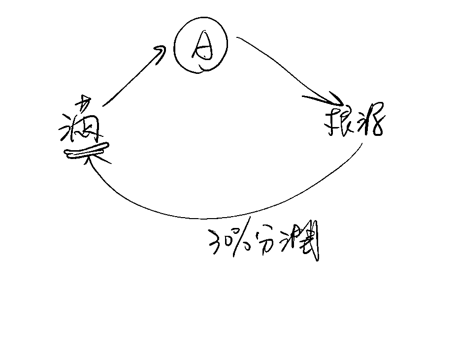

# 副业收入反超主业？别急着All in，先弄明白这20个真相！

> 全文约6,700字，读完大约7分钟。

你好，我是龙哥。

这两年多，我一直泡在知识付费和私域运营这个圈子里，和几位伙伴一起经营俱乐部，成绩还算拿得出手，会员的增长和复购数据都比较稳定。

前阵子，经常有圈友来问我关于副业的事。说实话，这个话题我挺有发言权的——从2012年开始，我就没上过正儿八经的班，一直是自由职业状态，到现在已经超过12年了。

我的一个很重要的感受是：**大多数人做不好副业，真的不是输在能力上。**

而是输在两件事上——**没有好的习惯，以及对副业这件事本身的认知有很多偏差。**

所以这篇文章，我想把过去这些年我自己踩过的坑、攒下来的经验和大家聊透。希望能给正在看文章的你，带来一点实实在在的启发。

欢迎看完之后，咱们评论区接着聊。

---

## 一、副业做不好，别急着怪能力

我发现一个现象：很多人副业没做出成绩，第一反应永远是——我是不是能力不够？

然后呢？然后就想着报个课、学个技、补个短板。总觉得能力学得越多，副业就越能做起来。

但事实真的是这样吗？

我真不这么认为。

把事情做成的核心，往往不在于你“会多少”，而在于你有没有那么几个好习惯：

- 今天的事，会不会拖到明天？
- 遇到问题，是下意识逃避，还是主动解决？
- 昨天哪些事没做好，今天会不会回头复盘？
- 复盘之后发现这错以前犯过了，会不会逼自己今天比昨天进步一点点？

这些，才是做事的底层习惯。

能力是最好补的——看文章、刷视频、上个课，每天花半小时、一小时，能力自然能上来。但为什么很多技术很牛的人，在公司是稳定骨干，一做副业就歇菜？

原因很简单：他们只会在职场的框架里被推着走，却没有把那些好习惯迁移到副业里来。

**副业做得好不好，拼的从来不是能力储备，而是日常习惯的养成。**

---

## 二、别动不动就想辞职

很多人动副业的念头，是因为什么？

主子业太无聊、老板太压榨、同事太讨厌……说白了一个词：想逃离。

于是脑袋一热，工位一退，第二天开始全职搞副业。

相信我，这条路大概率走得很惨。

做副业的前提，是你想多一条现金流，加速人生朝好的方向走。而不是主业干不下去，拿副业当退路。

当你把主业辞掉的那一刻，原本固定的现金流也就断了。这时候，你的心里会迅速被不安全感填满——没钱的压力、生存的压力、各种不适应的压力，会一起向你涌来。

副业在这种状态下，怎么可能做得好？

有个段子说得好：你以为离开主业，人生就有光了；结果全职搞副业，人生彻底全黑了。

所以，刚起步做副业的人，真的别急着把饭碗砸了。

**多一份副业，是为了更快到达目标，而不是为了逃离当下的痛苦。**

---

## 三、别当孤狼，找好环境，抱对大腿

刚开始做副业，最容易犯的错就是：一个人埋头干，不找圈子，也不找人带。

真的不建议这样。

从一开始，你就应该找一个人带你，或者找一群同路人一起走。

因为副业起步时，你一定会走弯路——这是必然的，除非你在主业时就有独立做成项目的经验。但问题是，这些弯路真的有必要一个人全部踩一遍吗？

完全没必要。

有经验的人带一带，真的能让你少走特别多冤枉路。所以，如果你决定认真做副业，一定要找一个大家都在做类似项目的地方——一个社群、一个圈子，或者一个师傅带你。

这样的话，你能更快得到反馈，也能更快养成那些能把副业做好的好习惯。

---

## 四、目标一定要清晰

上班和做副业，最大的不同是什么？

上班，你只要把老板交代的活干完，到点拿钱就行。

副业？没人告诉你具体要干什么、要达到什么收入水平，全得你自己规划，自己执行。

所以，决定做副业的那一刻，你就必须给自己定下——年度目标是什么？每天做哪些事？

我当年刚去杭州时，准备找房子。第一次打开58同城，我整个人是蒙的——十几万条房源，怎么挑？

完全不知道从哪下手。

后来我给自己加了几个限制条件：只找萧山区、只找四房以上。筛完才发现，整个萧山我能选的房子，只剩下三间。

瞬间清晰了。

我花了一天时间看房交押金，当晚就住进去了。

就这么快。

所以，如果你不明确自己当自由职业这半年到底想赚多少钱，你就永远不知道，你的副业应该做什么样的转变和取舍。

---

## 五、目标要小到能“嚼碎”

很多人副业一开始，心里就特别烦躁、不安。

原因往往是目标定太大了：

- 我要赚到第一个1000块
- 我要成交十个人
- 我要快速做好一门课

目标一大，达不成，就失望，一失望，就容易放弃。

那什么叫“嚼碎”目标？

很简单。比如：早上6点到7点，我必须准时起床，花一小时认真完成副业任务；晚上8点到10点，我雷打不动把所有杂事推开，专心做副业，10点后才能休息。

这种小目标是你逼自己一定可以完成的。

当你开始把目标嚼碎去执行，你会每天都产生成就感。这种成就感，别人给不了你，只能自己给自己。

再比如，今天必须写完1000字文章。听起来微不足道，但一个月下来，每天都完成自己的小目标——你就开始有自信了。

有自信，做副业就顺了。因为一件事能做得好，核心秘诀之一就是：**你能不能长时间让自己的心情，保持在一个相对愉悦的状态。**

目标定小一点，完成它，你的能量就会保持稳定，自信也会累积起来。

这时候，出成绩就快了。

---

## 六、固定时间，做固定的事

副业刚起步时，有两种干法：

一种是，今天啥时候有空，啥时候干副业。

另一种是，每天给自己定一个固定的时间段，比如早上6点到7点，晚上8点到11点，雷打不动，到点做副业。

哪一种更稳？

毫无疑问是第二种。

因为你一旦随意调整做副业的时间，就说明你还没有形成对自己时间和日程的掌控力。

副业一开始要的，不是快速出成绩，而是让你的身体产生生理记忆——时间到了，我就该做副业了。

就像上班一样：你每天9点上班，8点自然就醒了。因为你的身体知道，9点没到公司会被扣钱。

做副业也是同理。时间一到，身体就提醒你——该干活了。

这是一种心理暗示，也是你自己给自己的一个决心：既然要认真做副业，那我就要想办法在固定时间之外，把其他所有事搞定，腾出完整的时间，心无旁骛地去做副业。

这事儿，真的特别重要。

但很多人会觉得：不就是个副业吗？我想啥时候干就啥时候干。

结果呢？身体在初期根本适应不了“还要干副业”这件事。一直不在状态，副业做出成绩的时间，也就一拖再拖。

---

## 七、想全职干？先准备好“增量”

假设你做副业，本来月入目标是1万到3万。但你准备全职干副业，目标却只想做到原来的两倍甚至更多。

那意味着什么？

意味着你得准备好：**你的能力要提升两倍、你每天找用户聊天的数量要超过原来的两倍以上。**

这件事，用“量”来衡量最快。

假设你这半年完全不成长，成交率也不变，那你能做的，只有增加工作量、增加时间。

你准备好了吗？

在能力不变的情况下，你能做的只有一件事——**大幅增加投入副业的时间**，把它填满。

只有这样，当你真正离开主业的那一刻，你心里才不会慌。

这一点太重要了。很多人从主业转到自由职业的时候，恰恰就是没准备这个，于是日子过得很难受。

这个准备没做好，说难听点，就只有死路一条。

---

## 八、每天留一小时，雷打不动去学习

你再累，也要留出固定时间学习。

因为副业是一个全新的领域、环境、甚至全新的做事习惯。只要每天拿出一小时专门学习副业知识，一定不吃亏。

学什么无所谓——🛰️群里的文字课件也行、某个老师的直播也好、整理一下过去的笔记都可以。

重点是要保证每天至少一小时。

为什么这么重要？

因为如果不持续输入新东西，你的眼界会停滞、你的旧习惯很难改，更麻烦的是：**你没有一个可以对照的标准。**

每天学习，其实就是一个天然的对照机会——

- 老师说的某个方法，我今天是不是忘了做？
- 老师提到的习惯，我今天是不是又没做到？
- 老师上课说的坑，我是不是上次听了，这次又踩了？

学习不只是进入某个场景而已，而是在跟一个比你优秀的人做对比，看看你们之间在做事的过程上到底差在哪。

要不然，你很容易被副业的忙碌冲昏头，又回到本能模式，用惯性做事。

所以，这件事非常重要：**每天给自己至少一个小时的固定学习时间。**

---

## 九、别只学专业，副业要的是复合技能

副业这个事，它是一个复合型的技能。

你只会专业，副业根本干不起来。

专业再好，你不会推广、不会曝光、不会介绍自己，有什么用？

没用。

所以副业不能只学一个方向。这也是为什么我一直提醒：选老师要慎重。

你不能只找一个只教专业的老师。一个好的老师，应该既教你专业，也教你推广、曝光、怎么做个人介绍。

如果一个老师能搞定全部，那就认准一个。如果这个老师只擅长专业，但你实在很喜欢，那你就找两个老师——一个教专业，一个教推广。

就拿知乎好物来举个例子：

你要不要写文章？要不要会看数据？要不要懂产品？

那你想一下：你会不会需要别人来找你？你的知乎粉丝量多不多？为什么这篇文章有人看、那篇没人看？

这些都需要你练。

那你再想一下，这是专业赛道还是推广赛道？

所以你在学专业过程中，学了3个月，是不是自然而然也把推广能力一起练出来了？

会的。

副业本来就是什么都要会。因为没人给你派活儿，你的工作本来就得多样化。

---

## 十、别把“学习”当成“做副业”

我发现很多人，把学习和副业混为一谈。

常见场景是：花了一两千块钱去学一个技能，就告诉自己“我在做副业”。结果时间花了一大堆，却一直停留在“学”的阶段。等真正要上场开干时，才发现副业根本没动起来，然后感慨一句：果然副业难做。

但学习和副业，完全是两回事。

学习是吸收。副业是不仅要吸收，还要输出。

学完之后你得去跟别人讲，你得真的去实战老师教的东西：

- 每天日更📕；
- 每天日更视频号；
- 每天去找5个人，说“我准备转型做副业，你可不可以给我个机会，听我介绍一下我的新产品？”

这些才是副业。

但很多人学完之后不行动，只是用学习来安慰自己：

“我今天上课了，我进步了。”
“我又坚持上了第二天课，我太棒了。”

然后呢？

学到很多知识，却没有实实在在的成绩和获得。

所以，做副业之前，先想清楚一个根本问题：**你到底是来学习的，还是来做副业的？**

---

## 十一、严控学习成本

副业，本质上是一门生意。

一个正经的生意人开店时，为了物料能便宜一块两块，愿意多花一天去比价。因为那是实打实的利润。

但一到副业上，很多人完全忘了这件事。

“反正副业嘛，不会就去学；不懂就花钱买。”

结果呢？钱一笔一笔花出去，账上却一分钱也没进。越花越慌，越慌越花。到最后，副业做没做出名堂不知道，反正存款先搭进去了。

所以，一开始做副业，你就要严格控制学习成本。

比如我花了一笔钱跟了一个老师，发现他有99元的课、399元的课，还有3000元的课。

如果你的需求还不明确，我的建议是：**先从便宜的开始学。**

一边学便宜课，一边筛选这个老师的讲课风格你是否喜欢、内容你是否需要、能不能落地实操。

刚开始就带着这个观念，可以帮你省下很多不必要的钱。

我以前有一个习惯：**一次最多只花两笔钱，这两笔钱没赚回来，我绝不花第三笔。**

哪怕现在副业相对成熟了，我依然控制成本——每年必花的钱只有一笔，比如“龙哥盟”的续费。第二笔一定用来试试新环境或旧圈子续费。

每年最多两三笔，绝不多花。哪怕知道这个东西很重要很必需，我也忍住。

我的原则就是：一年只允许自己付三笔钱。

今年到现在，其实我只付了一笔，另外两笔都还没动用。

初期搞副业，控制成本，真的是关乎生存的大事。

---

## 十二、花钱前，先做好评估

贵的课程，真的不一定更好。

很多时候我们想买贵的，是因为心里有个顽固的习惯——**太便宜的东西不珍惜。**

但在副业起步期，“控制成本”才是更重要的行为准则。

很多时候，你买一个老师99元的课，和买699元的课，内容其实是一模一样的。区别只是后者换成了打卡营、训练营的形式。

但99元的东西已经足够你用了。

所以，在花钱之前，你可以先花时间找一找：能不能用更小的代价，获得同样的内容、同样的技术？

注意，我说的不是让你去找盗版，而是——看看这个老师有没有更便宜的课？他有没有👸号、📕这些地方，可以先免费学知识？

先看、先评估、先确认这个老师的风格你喜不喜欢。

等你真的确定——就是他了，他是我见过最合适的老师——再把所有评估点都走完，再去花那笔大钱。

但在早期，我的建议不变：**能少花的尽量少花，能省的就省。**

因为做副业从来不是头脑一热就拍板的事。尤其在你还不太懂这个领域的门道之前，更要谨慎。

---

## 十三、记录你从零到一的全过程

上过班的朋友应该都清楚一个东西——**日报。**

每天回家，把今天干了什么、哪些做得好、哪些做得不好，在公司系统里写下来。一方面方便自己复盘，另一方面也是给主管看——你的全勤奖，跟这个直接挂钩。

为什么做副业也要记录？

因为只有记录下来，你才知道自己今天到底干了什么、哪些该干没干、哪些做得不对。

尤其是刚开始做副业的时候，有了记录，你就能随时反省：

“我昨天明明说要完成123，怎么做了一堆456？难怪没成绩。”

哪怕你以后不会去翻它，但写下来的这个过程，本身就逼着你思考：

今天副业没起色，是不是因为我根本没按目标做？还是说，我没按老师教的步骤来？

你要知道，人在本能状态下做事是最可怕的。不记录，你就永远不会发现自己在凭惯性做事。

所以，记录这件事太重要了。

不记录的话，副业前1-2个月可能完全出不了成绩；就算出了成绩，做着做着你也会发现——奇怪，我不是应该越做越高效吗？为什么卡在一个地方一直不动了？

答案很简单：你没有记录，没有复盘。

每天不用多，写个三五百字，写完再睡。这件事，看起来小，但真的能极大提升你做副业赚钱的效率。

---

## 十四、每天写下清晰的待办清单

每天早上，一定要有一份“今天干什么”的待办清单。

当上班族不难，因为公司给你安排好了——早上开早会，小主管发日报，你照着步骤一项项做完就行。你根本不需要花精力想今天要干什么。

但做副业，很多人不会把这个好习惯迁过来。

他甚至不觉得，公司里那些看起来很烦人的流程，其实很有用。

如果你已经确定了一个副业方向，那我建议你：每天早上，把当天要做的事写下来。

或者再进一步——每天睡觉前，写下明天必须完成的几件事，一项一项列清楚。

一天哪怕只列5项，只完成5项，副业也会有巨大进步。

但只要你没列，你就会陷入一种“我今天到底干了啥”的虚无感，甚至像无头苍蝇一样，不知道还剩什么没做，不知道进度到了哪。

所以，每天列待办清单，尤其是对副业来说，真的太重要了。

---

## 十五、培养自己“静下来”的能力

这个时代，什么都在加速。

资讯每天铺天盖地地涌过来，今天一个新玩法，明天一个新平台，后天一个新风口。

信息越多，人越容易焦虑。你总觉得不赶紧跟上就会被甩掉，然后越来越急，越来越燥。

但你真的静下来想一想：

资讯越多，并没让你变得更充实，只会让你更慌——因为永远有追不完的风口，学不完的技能。

做副业这件事，其实非常需要一种“静下来”的能力——在喧闹的信息洪流里，保持自己的节奏，该干嘛干嘛，不被外界干扰，才能听见自己真正的声音。

---

## 说在最后

其实你会发现，副业做得好不好，和天赋的关系真的不大。

真正拉开差距的，是每一天的习惯、每一次的选择、每个岔路口你踩没踩对。

如果这篇文章能让你停下来，重新审视一下自己做副业的方式和心态，那我就很欣慰了。

愿我们都能在拥有主业的同时，经营出一份让自己安心的第二收入。

我在这里，等你的反馈和讨论。

当生活里突然多出一整块时间，要用来做全新的事情时，你首先要学习的不是怎么拼，而是怎么让自己真正沉住气。

每个人让自己安静的方法不同。有人选择闭眼打坐十分钟；有人出门跑步半小时，回来洗个澡，就觉得这一天被理顺了；有人用游戏或短视频来放空；也有人像我，拿一副扑克牌在手里玩上二十分钟，心就沉下来了。安静之后再去处理事情，效率会明显更高——因为情绪越稳定，产出越可靠。

帮你平静的方式很多，找一个自己顺手又喜欢的就够。不必强迫自己用别人说好的办法。如果坐着冥想十五分钟反而越来越困，那就换掉。回忆一下，从小到大做哪些事会让你心情变好、内心平稳，那就把它当作你的“切换按钮”。事情本身无关大小快慢，只要能让你恢复平静就行。

这就像视频剪辑中的过渡，从A镜头切到B镜头，中间总需要一个缓冲。旋转、慢放、菱形收尾……开始一项副业之前，也需要这样一个“过渡”。

我自己常用的过渡有三种：
1. 趴在桌上睡个十五分钟的午觉，注意别平躺着睡，容易睡过头；
2. 拿扑克练上几分钟手法，注意力一集中，杂念就散了；
3. 清掉手机游戏里当天的日常任务，大约十分钟，心也就定了。

等心定了，再去做下一件事。

* * *

# 人际关系的储备很重要

九成以上的兼职项目，本质都在卖东西：卖课程、卖产品、卖服务、卖软件……名字不一样，本质一样。既然是卖，就要先想清楚卖给谁。

很多人做兼职卡住，不是因为能力，而是因为身边没人可卖。临时去认识一堆新朋友，从陌生到信任需要时间，初期很难有正反馈，自然做不下去。

所以刚开始的时候，一定要花时间维护人脉。老朋友之间要有互动，新圈子里也要有参与。最基础的标准是，随便就能拉出二三十个人聊聊天。有这个基本盘，项目才转得动。

关系维护得好，项目的启动速度就快；平时不联络、不寒暄，启动就会慢很多。

* * *

# 从低投入的方向切入

关于发展方向，我一直建议先做投入小的。什么时候开始都不晚，关键在于你会不会利用零碎时间。

这是自由职业者必备的能力：把有限的时间安排得明明白白。

投入小，试错成本就低，发现方向不对随时可以调头，不会被沉没成本拖着走。

* * *

# CPS是最容易启动的模式

CPS，也就是分销，是门槛最低的一种启动方式。帮别人卖东西，自己拿佣金。我的课程也开了CPS。很多人做不好，原因只有一个：卖出后就不再提供任何服务。

打个比方，我的学员推荐朋友小张来买课，成交后学员拿三成分润。这个模式本身很健康，所有东西都能做分销，赚钱路径也清晰。

问题出在成交之后。学员把小张推给我，就默认自己的任务结束了。拿到分润，后续服务全部甩给我，也不再过问小张的情况。

哪怕我把小张服务得很好，让他后来又多次复购，这个学员也分不到任何好处。因为他压根没有参与服务，自然没有复购收益。

所以想靠CPS持续赚到钱，必须继续服务客户。最可靠的办法是：推什么课，就先去学什么课。最好是你正在上的课，这样你既懂内容，又能切身体会到它的价值。

如果只想过把瘾赚快钱，做分销就够了。但要想做长久，服务才是根基。分销最大的价值在于，你在服务别人的过程中，会慢慢沉淀出属于你的产品。

* * *

# 能开口谈钱，是第一步

很多人对兼职有一个误解，觉得自己得先有超强的能力、清晰的定位、正确的方向，其实都不需要。

所以，启动兼职的关键，不在于你能拿出多好的作品，也不在于你能力有多强，而在于你有没有勇气向别人提出收费。这完全是销售能力的范畴，跟你会不会做课程没有半点关系。那些“先学会做课再开始”的说法，全是误导。愿意谈钱，才有开始。

* * *

# 兼职背后的逻辑：真正销售的是你个人

有人觉得兼职卖的是专业知识、商品或内容，我不否认这一点。但我想再往前推一步：兼职真正销售的，是你个人。

只有别人信任你，东西才容易被接受，事业才做得大。拿我自己来说，我没有公司背景，就是一个普通的个人。自我介绍很难，因为你说自己很厉害，别人问依据是什么，你拿不出来。唯一能做的，就是透过各种方式不断建立信任。这也是兼职和个人品牌的核心。

* * *

# 尾声：我是谁

我叫根源，龙哥盟第四期圈友。深耕心理辅导领域多年，处理过两万多个真实案例，有十二年线下销售和团队管理经验。2022年开始转型线上，尝试线上内容变现。过去发表过一些文章，你能看到这里，想必对内容有共鸣，欢迎阅读我写过的历史文章。