# 放弃千万年营收的软件公司，我靠淘宝导流+私域成交，实现双端盈利

各位好，我是龙哥，90后。

我曾是典型的社恐程序员，后来机缘巧合创办了一家软件公司，连续三年年销售额破千万。创业四五年后，公司运转趋于稳定，2023年底我开始寻找第二增长曲线，正式切入知识付费赛道。

仅仅7个月时间，通过淘宝售卖虚拟资料、🛰️私域推课，从零跑通全链路，拿到知识付费的第一个50万。

加入龙哥盟已四个月，圈里前辈的干货分享让我跃跃欲试。明知自身成绩与头部差距明显，我还是花了一周构思、熬了几个通宵，完成了在赚钱的首篇分享。

过去我是比较传统的互联网从业者，今年才接触知识星球，才了解到赚钱。起初预期不高，但大量阅读精华内容并参加航海后，我发现这里极其“真诚”，分享毫无保留，全部可落地。因此也想把自己创业路上的经历、踩过的坑，以及如何误打误撞进入知识付费并取得初步结果的过程，分享给同好，希望有所帮助。

因有四五年的创业沉淀，我在做知识付费时感受并不难，反而推进很顺。

先晒一下2024年的收益情况：

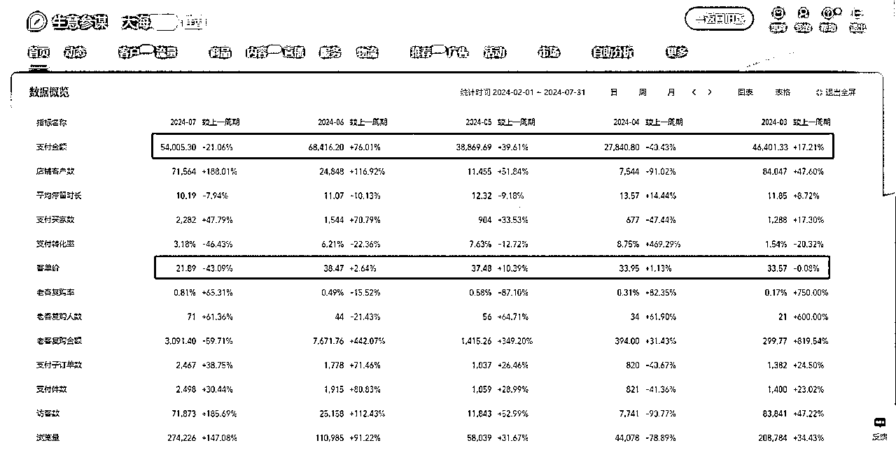

淘宝店铺纯虚拟资料收入，近五个月22万，净利约15万；把1-2月算上，净利约20万

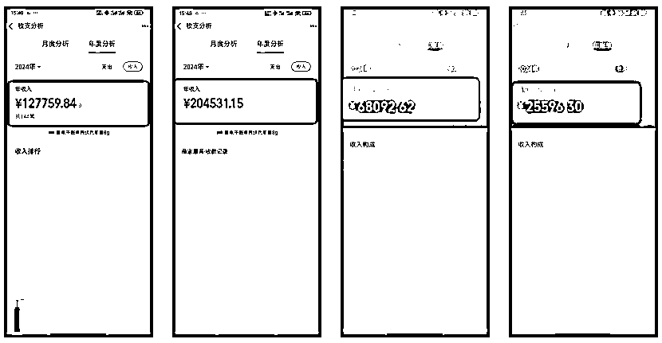

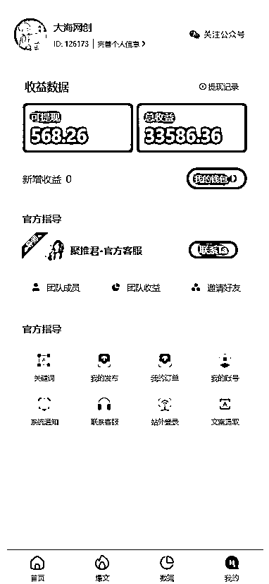

私域收入约41万，净利30万以上。另售卖虚拟资料期间网盘拉新奖励3万

合计2024年年度净利53万。

# 一、为什么要从千万级公司转做知识付费

看到我软件公司年销售额过千万，你可能会问：为何要把一年只能赚几十万到一百万的生意当成第二业务线？这就得从第一次创业说起。

## 1. 第一次创业

我出身程序员，所处西北城市薪资不及北上广深，因此一直想通过副业提升收入。好在当时工作压力不大，我利用业余和上班的碎片时间接了不少外包私活，这段经历给我很大信心。

2018年时机成熟后我辞职创业。首选软件开发，主要在淘宝接外包订单。业务增长后2019年注册公司，并邀请两位投资合伙人。

以下截图都是当年朋友圈的真实记录：

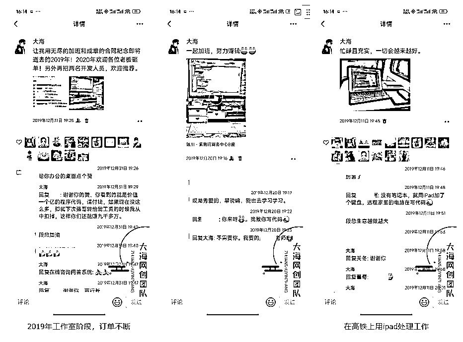

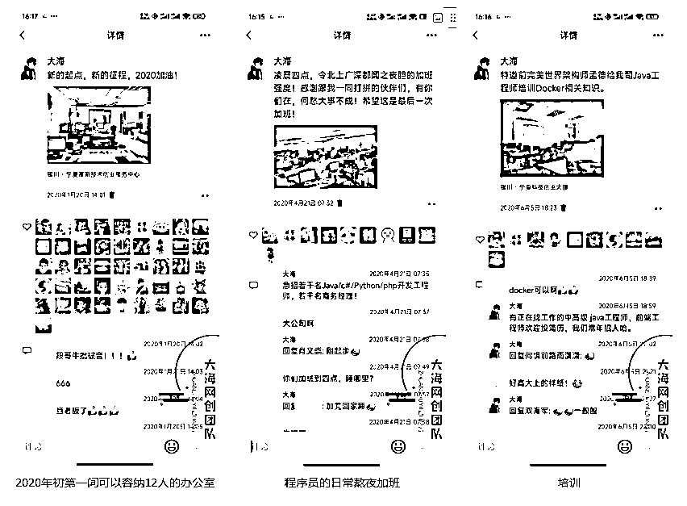

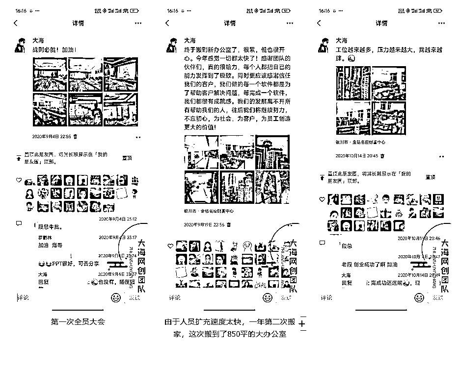

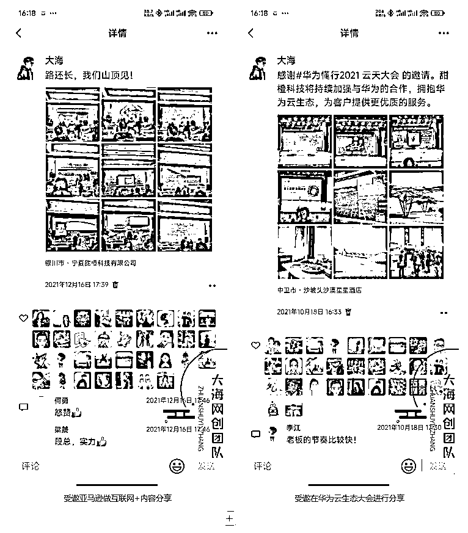

2018到2023年的历程表面很漂亮，2020到2023年均销售额都在千万以上。

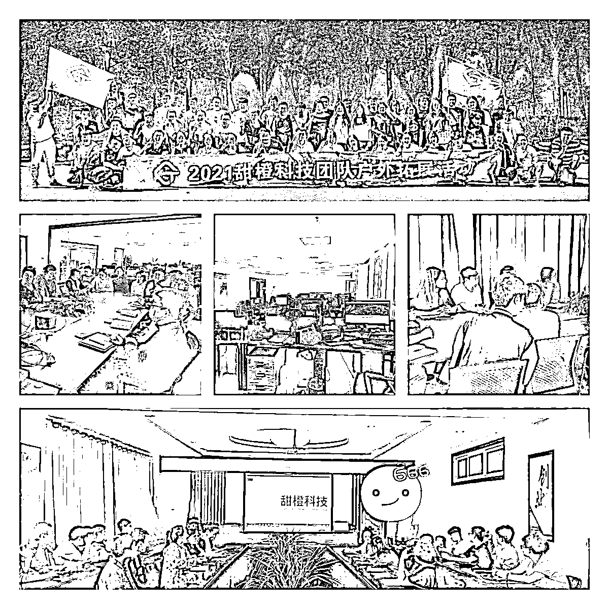

## 2. 光鲜背后的难题

但繁华背后问题不少，最让我头疼的是交付。

了解软件开发的人都清楚，开发流程极其复杂，至少要六七个角色协同，还需强管理与成本控制才能保利润。放一张流程图便知有多繁琐：

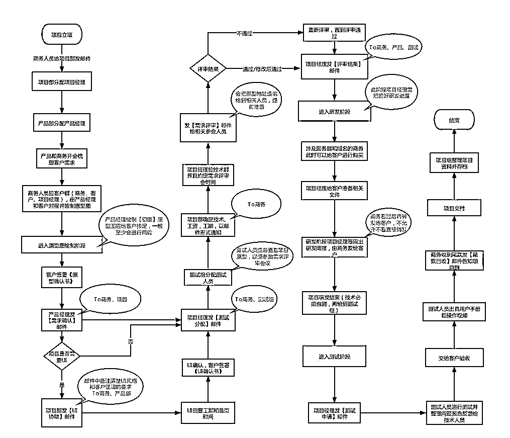

公司现行的软件开发流程，中间涉及产品经理、UI设计、后端、前端、项目经理、测试、运维等多岗。

IT领域各岗位薪资都不低，即便在三线城市，程序员月薪也近1万，还要13薪加奖金。而以上仅是交付环节，不含获客和销售的CRM流程。

表面上年销售额千把万，管理六七十人的团队成本极高。每月人力支出70多万，一年800多万，再加其他管理费用，落到手里利润仅一两百万，且多为应收账款。高强度让我身心俱疲。

这与我想象的轻资产创业相去甚远。

不过人生每一步都算数。结合这些年的经验和决心，我与合伙人商量后决定将公司业务完全交由合伙人运营。

而我则开启一段全新的、彻底all in的、真正轻资产的创业。

## 3. 被“割”的经历与感悟

创业前我做了调研。抖音上不少做知识付费的“老师”教图文带货、直播带货，先把用户从公域导到私域再转化。我也付费参与过几个项目，初衷很简单：学会技能后像他们一样去教人。

一段学习摸索后发现，普通人很难靠这些项目赚钱，尤其自媒体竞争激烈，成功率更低。

下面两张记录，是我与所谓“老师”的沟通，让大家感受一下：

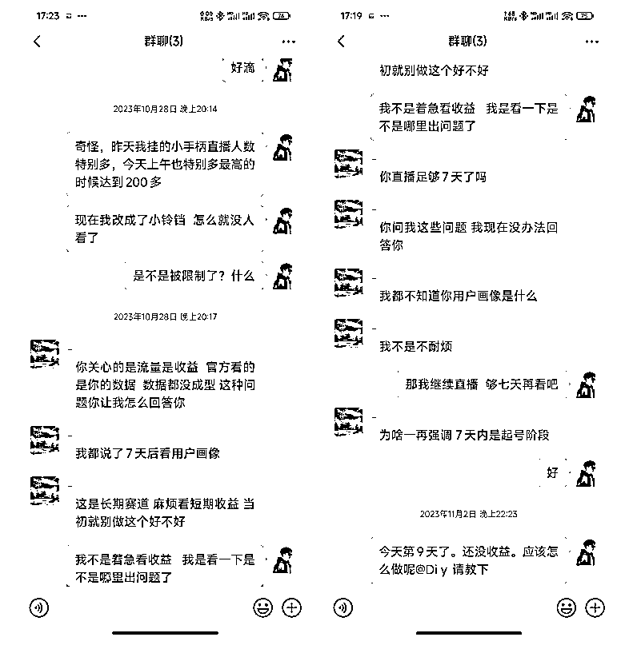

这是我跟一位老师学习无人直播，我每提一个问题，他都回一些空话，后来干脆不回了。

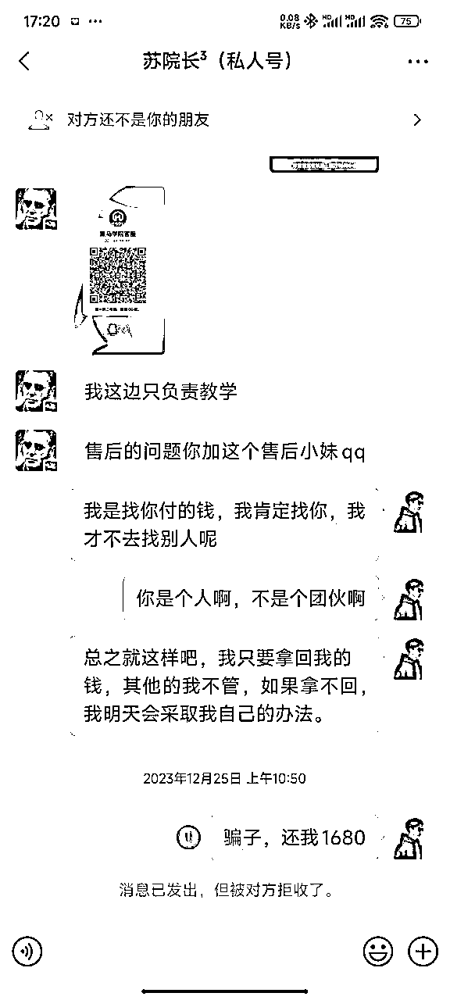

这位更离谱。我跟他学淘宝虚拟店铺运营，却不知我本身就是电商老手，从2013年到2023年整整十年淘宝经验，我的软件业务基本盘也主要靠淘系引流。

我跟他学虚拟店运营本意是快速复制他的教学模式，自己整理SOP太慢，花1680买一份靠谱SOP也行。

结果再次被“割”，不如说是被骗。

他让我上架五十多个商品，价格几毛钱。第三天他派人把我店所有链接都拍一遍，并告诉我“出单了”。

普通人可能真以为出单了，但我懂平台。我发现新店第三天访客1人，转化率却100%，立刻明白被忽悠。理论几句，他直接拉黑。

这便是我入局知识付费交的第一笔学费。

钱不多，但打击很大，让我一度觉得这行全是套路。

当然成长型心态让我从每次被割中学到东西，也总结了几条常见割韭菜手法：

1. 宣称一对一指导，实则是害怕拉群，怕学员互通消息闹事。
2. 朋友圈疯狂晒无脑收益，宣称有手就行日入四位数。
3. 过度承诺，三天买车七天买房等。

核心都是利用想快速拿到结果、想做副业赚钱的急迫心理。

即便如此，相比第一次创业也不算什么。我彻底放弃在抖音找师傅的想法。既然跟人学走不通，就自己探索。

我仔细拆解了私域知识付费的关键环节：获客-私域运营-成交-交付。

首先要解决获客，我自然选择熟悉的阵地。2020-2021年在淘宝做软件定制业务，连续一年多都是头部，于是把淘宝定为主引流渠道。

# 二、选品、上架与基础配置

## 1. 开店

打开 https://ishop.taobao.com/ 点击0元开店

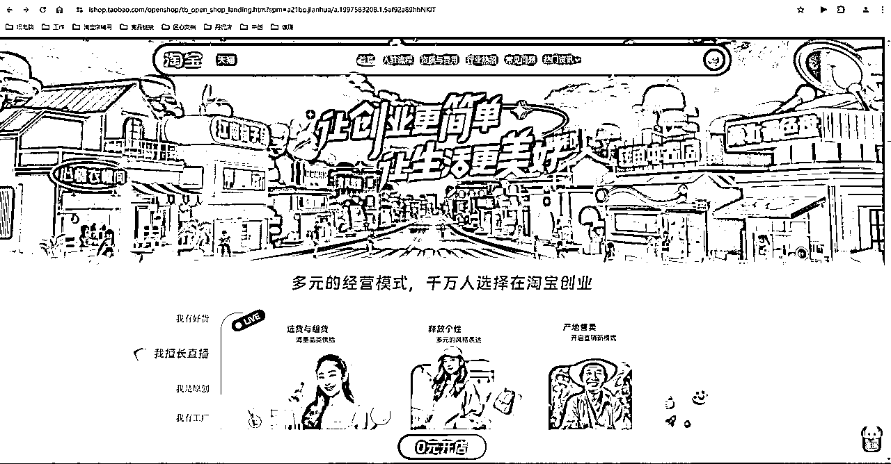

免费注册，填手机号即可。也可用现有淘宝账号作为商家账号，注册后选个人店铺，完善资料，全部如实填写。

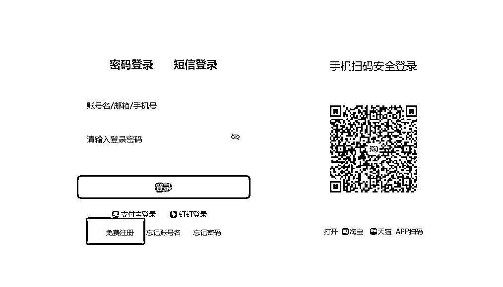

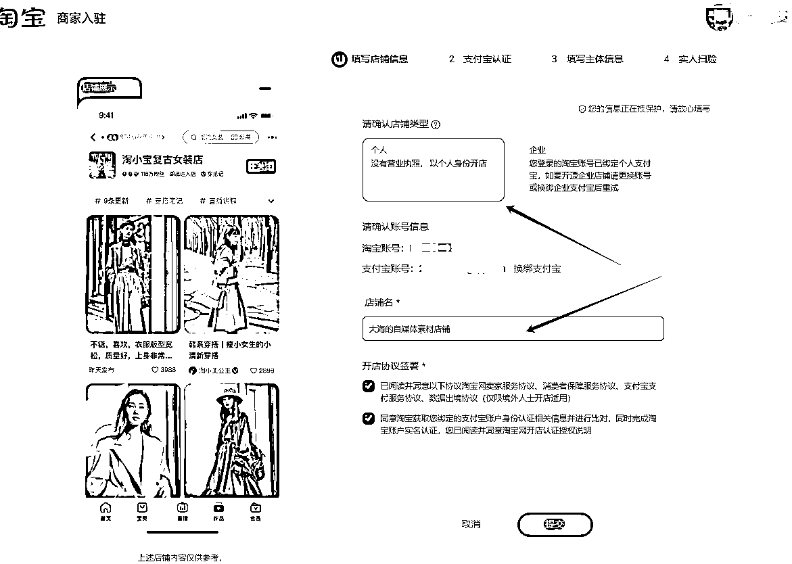

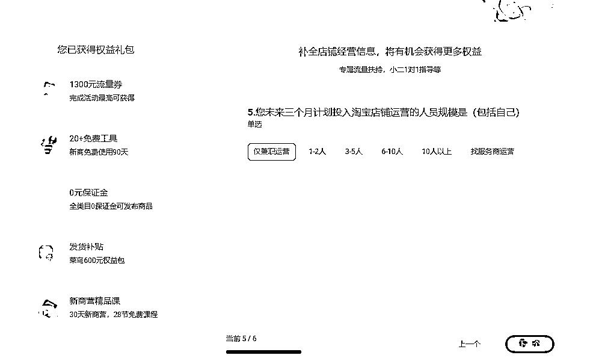

按流程完善即可。

初期无需交保证金，出单后再交。

注册后下载千牛PC版和手机版，用注册账号登录，后续商品管理、客户接待、订单处理都靠它。

## 2. 选品逻辑

很多人把想做副业、网赚、自媒体的人都归为创业粉。我认为真正的创业粉应是小团队，圈内所谓的创业粉大多是想做副业、做自媒体、在网上赚钱的个体，所以我做区分：

网赚粉：想靠互联网赚钱的群体，如喜欢挂机项目、薅平台收益、玩游戏赚钱的人

自媒体副业粉：想通过抖音、📕等平台赚钱的人

名字不重要，关键是理解用户画像，才能找到合适的钩子商品和后端产品。

电商人都明白，选品占七成，运营三成。我们要选品类自然是能吸引想做副业、网赚、自媒体的人。

我最初定两个方向：一个店铺主做网赚教程，一个店铺主做自媒体素材和教程。

先看淘宝上网赚教程的价格，普遍偏低：

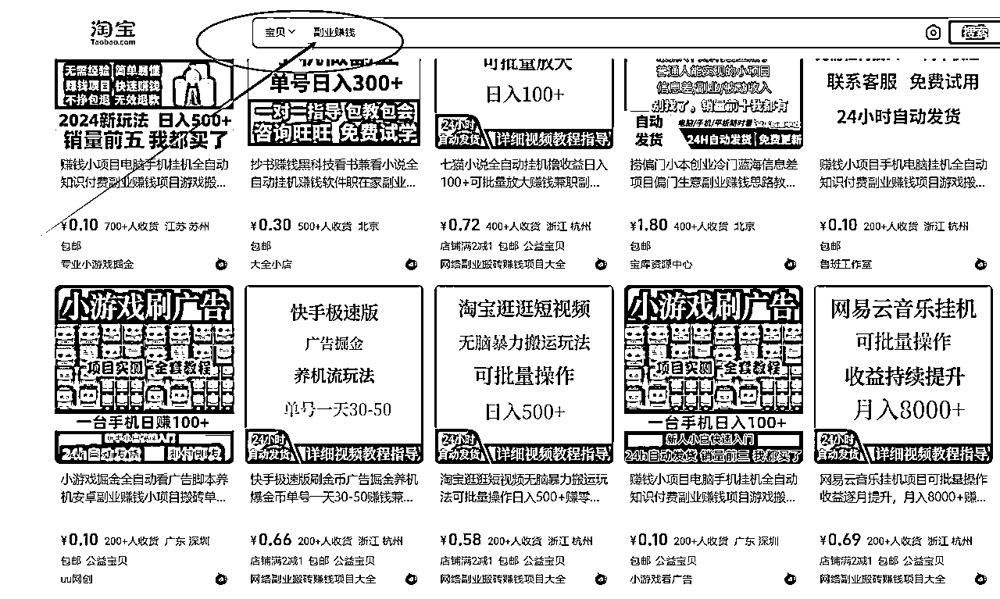

价格低就意味着吸引的多是贪便宜的白嫖党。

从付费意愿看，白嫖党的成交概率更低。而且低客单商品评价区很容易被同行截流，如下图：

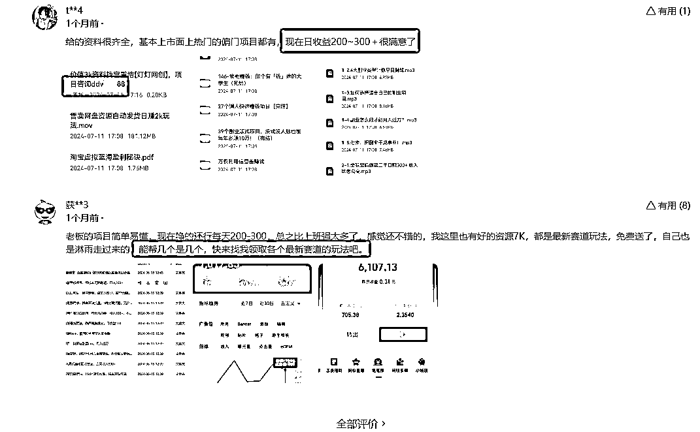

这也算一种引流思路：去淘宝买几毛钱的同行教程，写带图评价时附上自己的🛰️，哈哈。

言归正传。我测试一个月后发现，网赚教程店铺引流来的用户质量不高，多是白嫖党，幻想不劳而获、挂机暴富，显然不是我想要的画像。

同期测试的第二个方向，自媒体素材和教程，效果远超预期。

先看竞品：

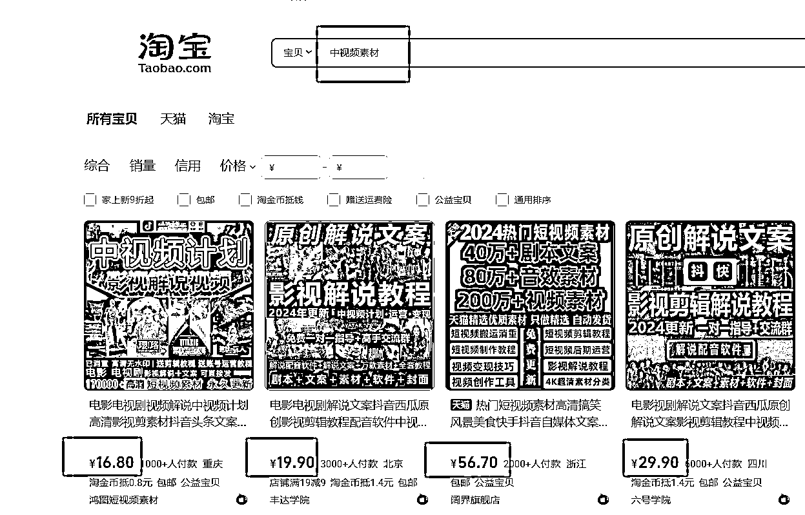

客单价高，月支付人数达四位数，十分夸张。我们在引流时，钩子商品单月就能带来几万收入，再加后端转化，几乎是王炸。

因此选品方向确定：以售卖自媒体素材与教程为主。

中视频、图文带货、小说推文、直播背景素材、搞笑素材、风景素材，可选品类很多。

## 3. 素材怎么来

记住一字“抄”。普通人要学会借鉴，我们没有生产素材能力，直接对标即可。

淘宝上售卖的素材多无版权，你把别人热卖的商品买回来，改个名字就变自己的。

别舍不得十几二十块钱，实在舍不得就去多多买，卖完申请仅退款。买销量评价最好的素材，对标做标题、主图、详情页。

## 4. 标题制作

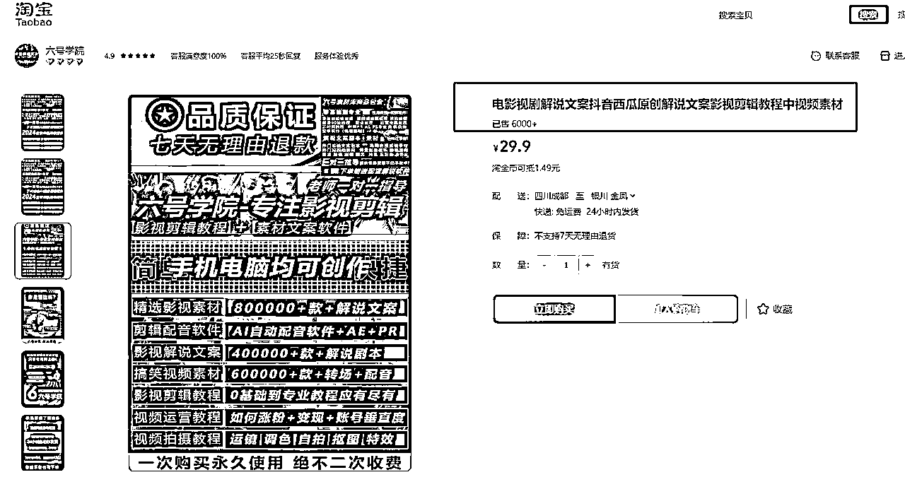

以此商品为对标，注意不要选天猫店，天猫竞争更大。先做标题，淘宝是搜索电商，关键词很关键。

要先找到该品类的核心引流词。

可借助官方生意参谋，2024年4月后所有店铺都能用。按图示添加竞品：

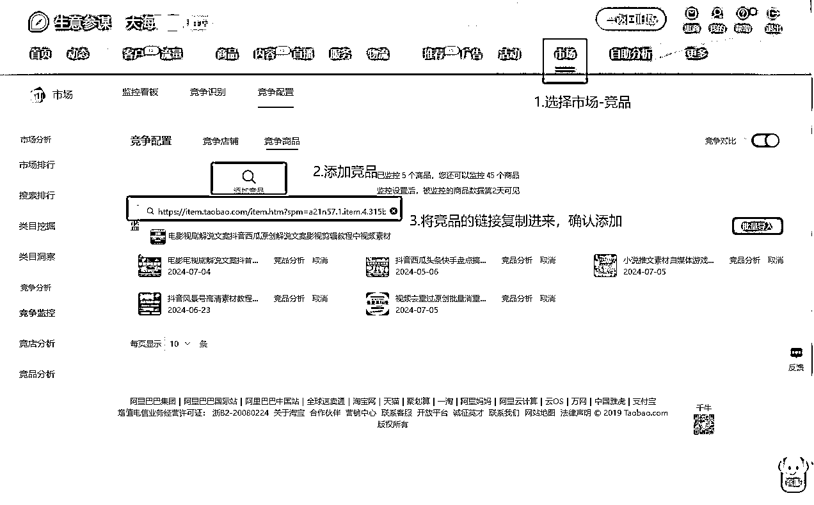

进入监控列表，选中竞品，点击竞品分析

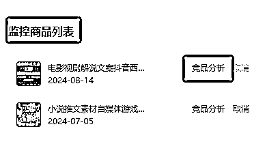

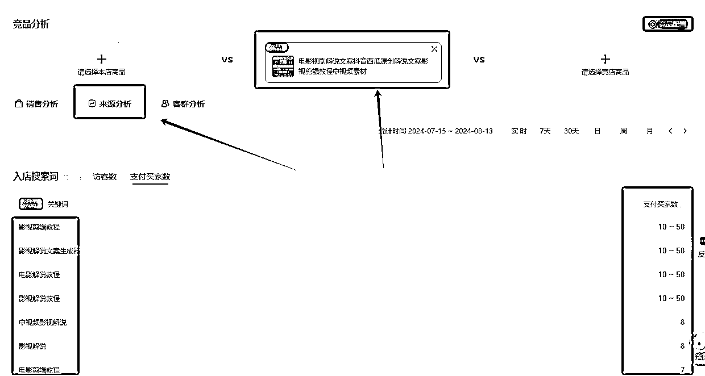

在竞品分析页的来源分析中可看到核心成交关键词，一定要点支付买家数，访客不等于成交。

把核心关键词复制保存到表格：

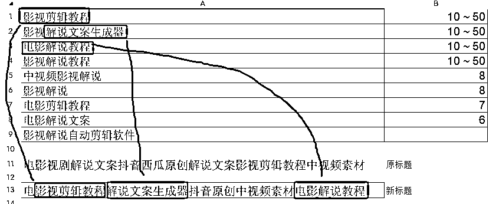

制作标题时，把排名靠前的核心词放标题开头和结尾，因淘宝搜索优先匹配两端。

注意避免关键词重复堆砌，比如“影视”很重要但不要反复出现，除非标题字符尚有余量，最多60字符。不够就要想办法补满。

标题制作方法很多，但我们是抄别人，别人已优化好，我们只需调整顺序并根据关键词销量微调，相对简单。

## 5. 主图与详情页制作

PS不适合新手，我用稿定设计。搜索“稿定设计”打开网站：

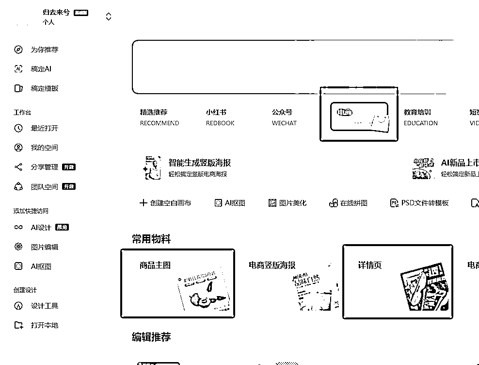

选稿定设计因模板多。进入电商板块，物料选主图或详情页，找到心仪样式或与竞品相似的图片。

虚拟商品主图多为汉字，清晰醒目即可，无特殊要求，一般模板美观度足够。下面我选一个模板并录操作视频。

产品多时，详情页可直接搬运竞品，稍作处理。可用360浏览器批量抓取套图：

## 6. 上架流程

打开千牛PC控制台，选择商品-我的商品，点击发布新商品

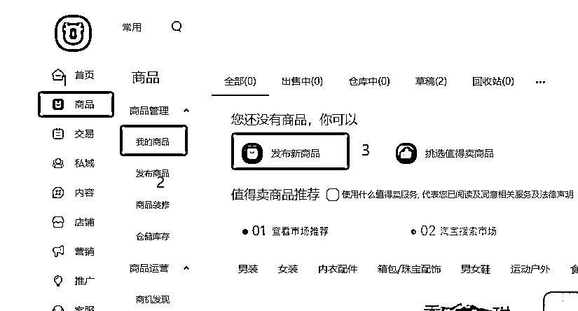

类目选：商务/设计服务-设计服务-设计素材/源文件  或  商务/设计服务-设计服务-样图/效果图销售

区别在于前者不可付费推广，后者可付费推广。

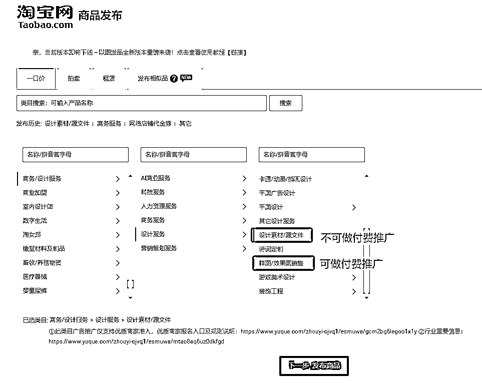

下一步发布商品

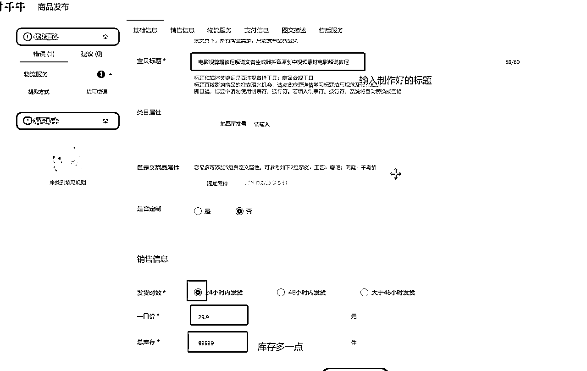

输入制作好的标题，发货时效选24小时内，我们自动发货基本秒发。

一口价可写实际售价高30%-50%，后续讲打折操作。

因是虚拟商品，无运费。首次添加商品需先创建运费模板

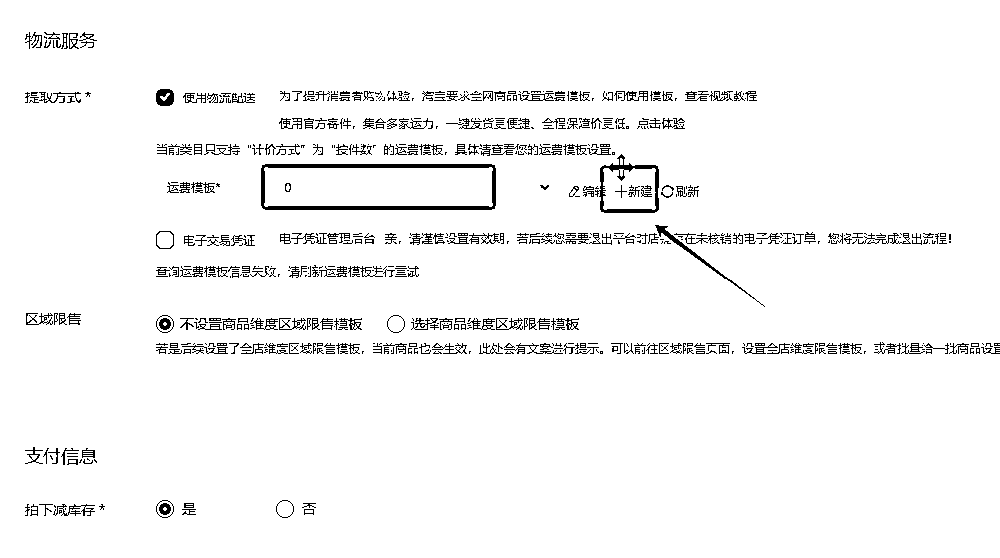

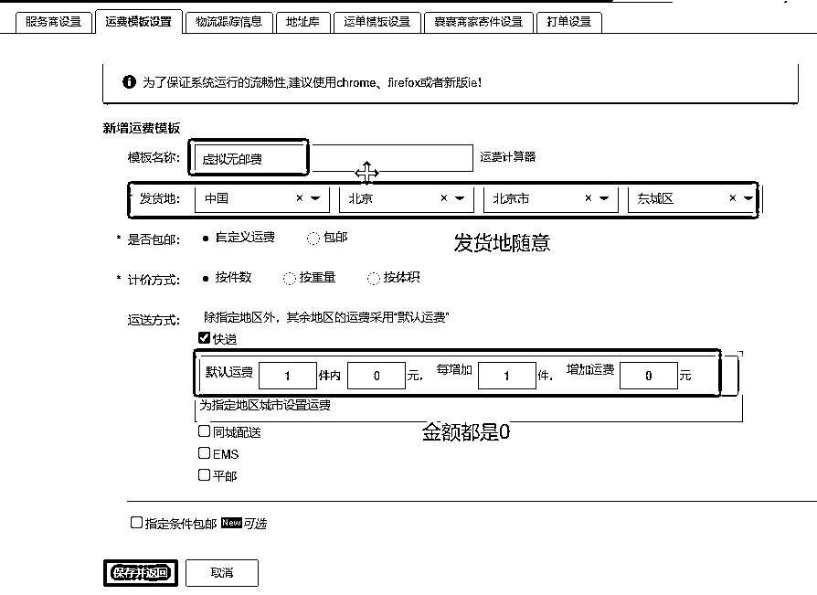

创建后刷新即可显示，选择自建的包邮模板。

主图共五张，首图最重要，要把素材卖点说清。若经常改价，主图上不要标价，否则需频繁换图。

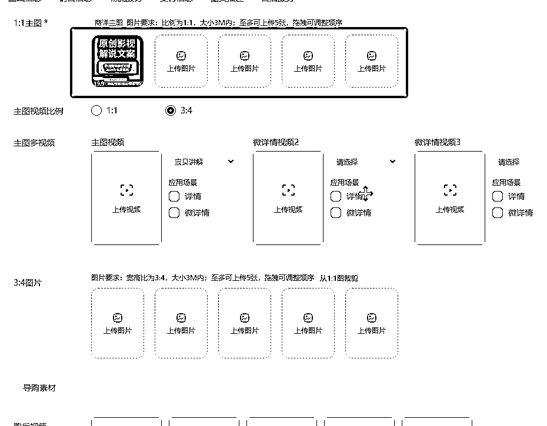

主图视频、3:4图等视精力上传，影响不大。详情页上传完点立即发布。

发布2小时后，用全标题在手淘搜索，看能否搜到。搜不到可能是标题或图片问题，需排查修改。无问题即可开始次日运营部署。

## 7. 自动发货配置

自动发货我们用阿奇索。千牛工作台-服务-服务中心搜索阿奇索

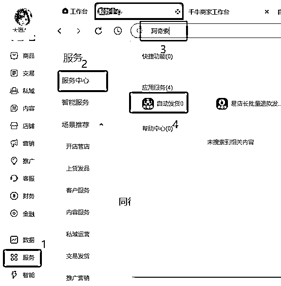

阿奇索收费但便宜，一个月15元，一季度38，半年68，每天可发500单，对普通店铺足够。

购买后开始配置

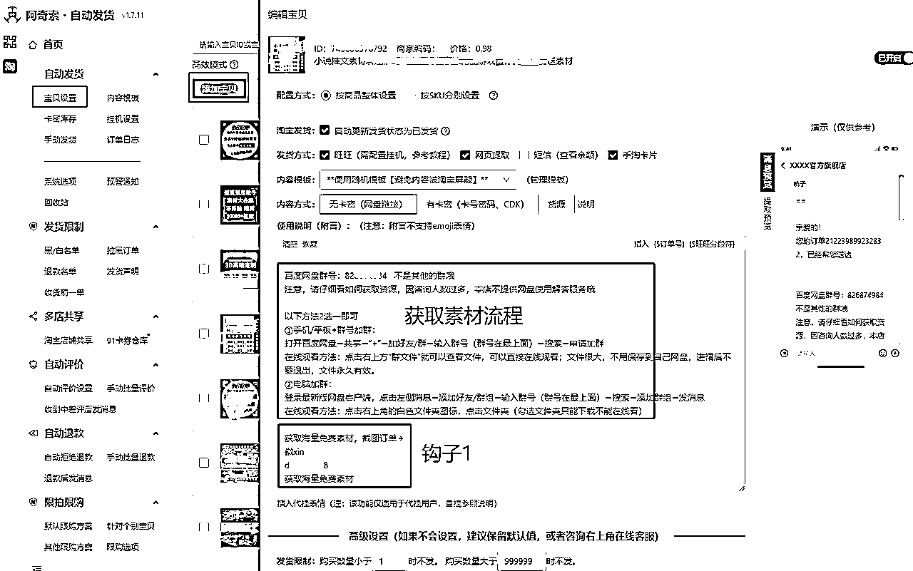

点击宝贝设置-首次设置添加宝贝，把网盘链接或网盘群号填入使用说明。用户付款后，阿奇索会自动发小卡片到淘宝聊天框，用户点击领取后可查看完整说明。

可在此设置引流钩子，如加🛰️赠送素材、教程或一对一教学。🛰️关键词可写成徽xin等用户能读懂的形式。

## 8. 网盘群与钩子设置

售卖虚拟资料必用网盘，常用百度网盘和夸克网盘。若想靠拉新拿佣金可选夸克。

但同行素材多在百度网盘，我们需转存到夸克，且同行更新时需及时同步，比较繁琐。

常规做法是用网盘链接分享，但链接体积大时无法一次性转存，用户需多次打开获取。所以我采用网盘群方式。

网盘群还有好处，可在群内发消息直接触达用户。

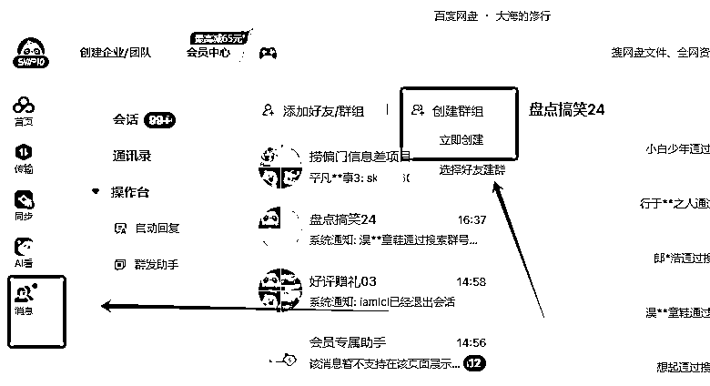

打开网盘PC版，选择消息，点击创建群组-立即创建

创建成功后在设置里把群名改成与素材相关，并设置全员禁言：

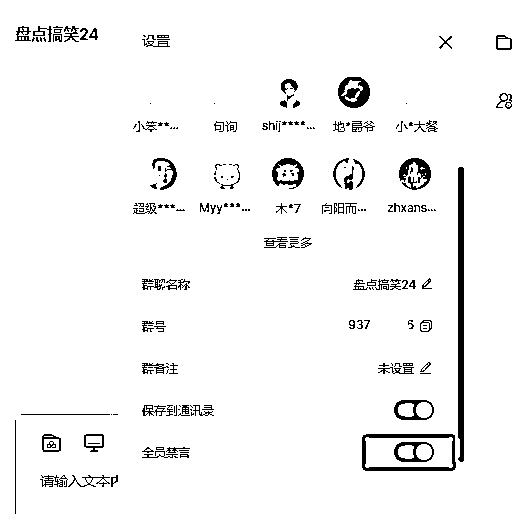

然后在聊天框选网盘图标，把售卖的资料发到群里

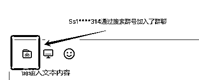

素材资源里可放一张图片做钩子，一般以免费赠送素材、教程或交流群为诱饵。用户看到“交流群”或“免费”多会加好友。

做虚拟资源这行，定价普遍压在9.9到39.9之间，买家其实很在意内容质量和配套服务，所以钩子别贪多，放太多反而让人烦，体验差了就得不偿失。

下面聊聊淘宝店铺怎么运营。说白了，曝光、点击、转化这三个词是绕不开的命门，它们环环相扣，直接决定宝贝能卖成什么样。

先说曝光。曝光就是宝贝被人看到的次数，这是成交的起点。什么影响曝光呢？一是搜索排名，排名越靠前，看见的人越多，这跟销量、评价、点击率、转化率都有关系；二是付费推广，比如直通车这类工具，花钱买位置，让宝贝在特定场景或人群面前多露脸；三是店铺和宝贝的权重，权重高的店和商品，平台自然更愿意推；四是商品信息优化，标题、关键词、类目、价格这些基础信息弄好了，搜索推荐里就更容易冒出来。

前面标题关键词那些基础工作已经搞定，剩下的就是靠人为干预销量、评价、点击率、转化率了。

关于基础销量和评价，电商圈有句话流传很广：做电商的，十个里有九个靠补单，剩下一个在拼命补。所以新品上架后，一定要找渠道做点基础销量和评价，这算是行业里默认的潜规则。前三天做这些动作，基本不太会引起降权。新手可能不知道去哪儿找补单的人，我教大家一个土办法：去抖音搜讲淘宝电商的视频，翻评论区，经常能看到发“主持找商家”的人，这种就是专门做截流中介的。你在底下回一句，自然有人来私信你，加🛰️就能对接上了。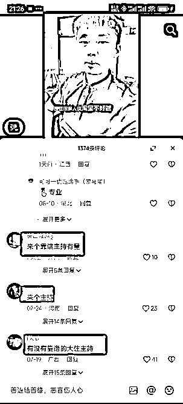

补单价格一般一单8到10块，也有5块的便宜货，看自己预算。但一定要选能包评论的，先合作一两单试试水。

前三天用非搜方式操作。非搜就是不走搜索渠道，比如淘口令、二维码、链接，或者直接搜店铺名进店再找到宝贝下单。把这些发给放单的主持，每个宝贝每天操作三单。第四天开始陆续收货和写好评，可以做个表格记录一下。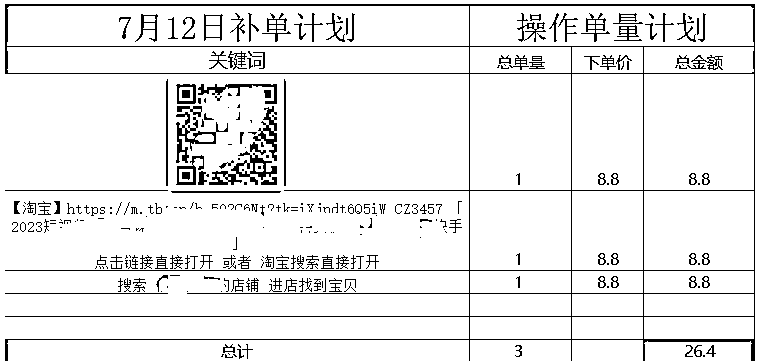

做单的账号有要求，一般是3心实名以上，注册满半年。过程中要模拟真实用户行为，主宝贝浏览一分钟，副宝贝浏览30秒，千万别截图，这些淘宝后台全都能监测到。

到了第四天，就可以开始介入搜索渠道补单了，用搜索+非搜结合的方式。我常用的节奏是这样的：第四天全标题2单，非搜2单；第五天全标题2单，非搜3单；第六天半标题2单，全标题1单，非搜1单。如果第六天半标题搜不到，就继续用全标题操作。

这里有个小技巧，很多人不知道但特别好用，叫炮灰词。就是在标题里塞两个生僻字，比如“弢劼”，把原标题“电影视剪辑教程解说文案生成器抖音原创中视频素材电影解说教程”改成“电影视剪辑教程解说文案生成器弢劼原创中视频素材电影解说教程”。补单时候，把半标题或核心关键词跟炮灰词组合，比如搜“影视剪辑教程弢劼”，因为全网只有你一个宝贝带这词，一下子就搜到了。这样反复操作，核心关键词的权重就慢慢养起来了。等直接搜核心词能搜到宝贝，炮灰词的任务就完成了。

补单搞到第七天左右，要看看流量数据，判断宝贝有没有入池。指标很简单：访客数大于补单数，就算入池了。一般选竞争不太激烈的产品，七天都能顺利入池。入池后，可以小量补核心关键词，但别超过真实订单量的三分之一。订单稳定后，就可以逐渐停掉补单。

基础销量和评价做完三天，也可以考虑用付费推广来拉权重。好处是不用担心降权，而且虚拟产品成本低，只要推广费不超过销售额就是赚的。原来的直通车现在改成了万像台无界，入口在千牛工作台，推广-关键词推广-点击新建关键词推广。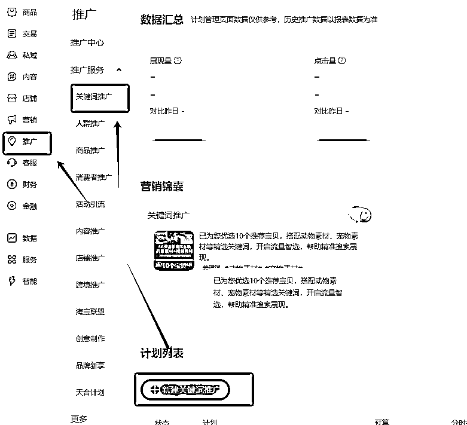

按下面这样选。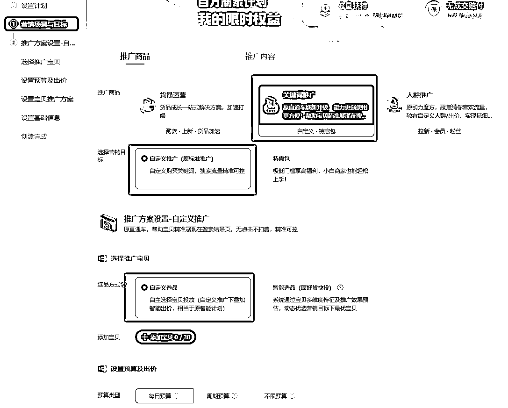

然后添加要推广的宝贝，推广方案这里一定要选“添加自选词”，下方推荐的词包和关键词统统不勾，继续点“更多关键词”。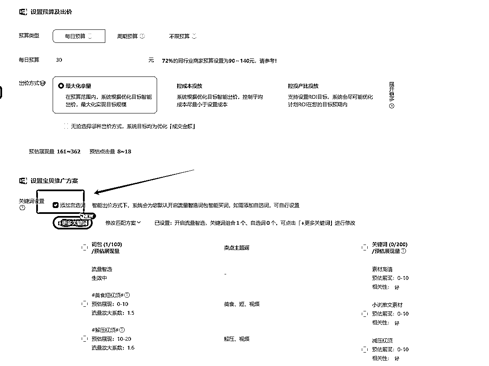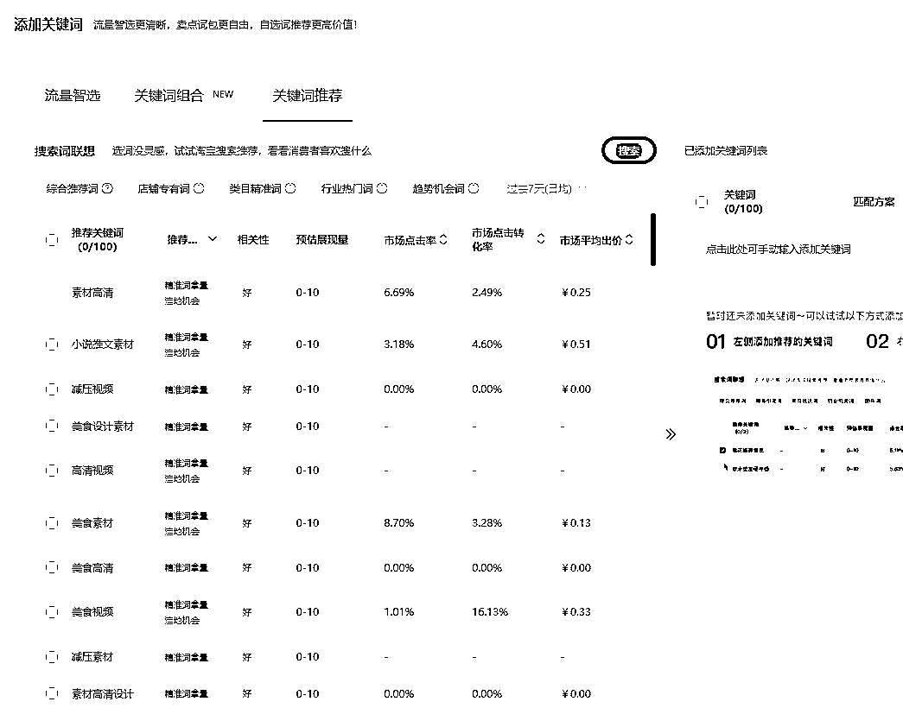

在推荐关键词里找跟我们产品匹配的核心词，没有的话就自定义搜索联想。一般用生意参谋做竞品分析统计出来的核心词都能出价，匹配方式选精准匹配。这样用户搜这个词，我们就有机会出现在首页推荐里。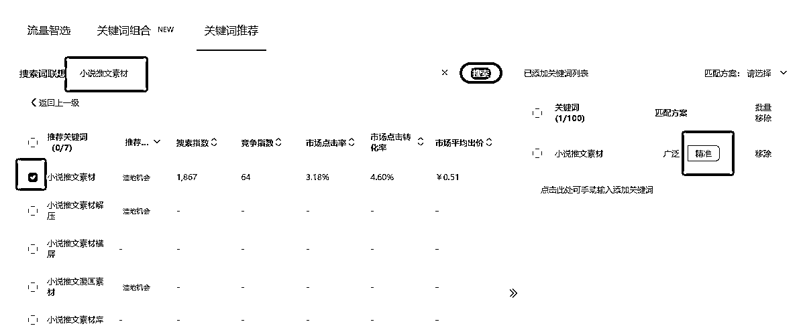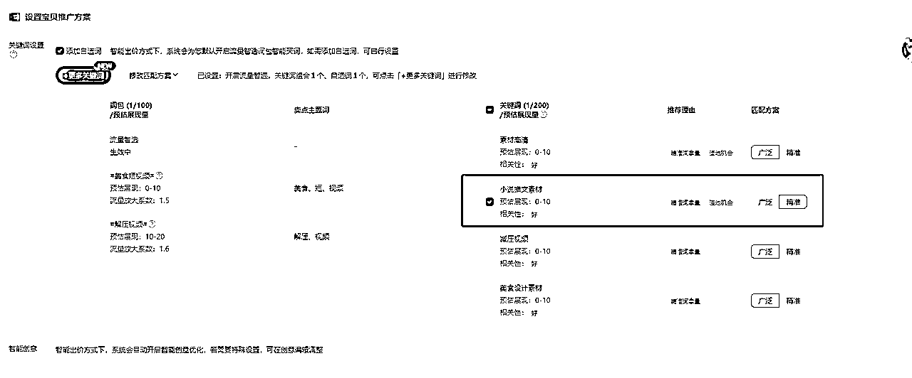

计划建好后，可以在计划里看关键词的点击和转化情况，也能随时添加或修改关键词。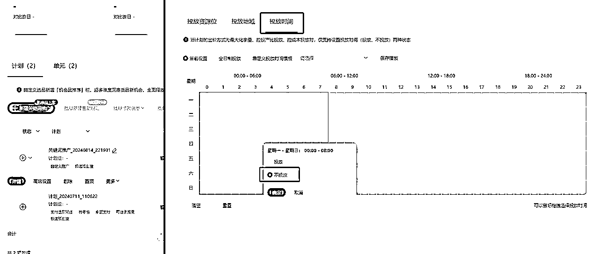

计划高级设置里可以设投放时间，一般0到8点不投放，省点广告费。当然不同产品不一样，有些东西半夜成交特别高，那就可以重点投深夜。

关键词推广是按点击扣费的，前期要盯紧数据：如果曝光多但点击少，那得优化点击，具体方法下一节讲；如果有点击没转化，就要优化产品和服务，下下一节讲。

再来说点击。点击就是买家看到宝贝后，愿意点进去看详情页。影响点击的因素，第一个是主图吸引力。主图是买家第一眼看到的东西，清晰、好看、卖点突出，点击率自然高。对我们虚拟素材产品来说，核心卖点关键词一定要醒目，排版整齐，重点突出。第二个是价格竞争力。同条件下，价格更实惠的商品更容易被点。所以得看竞品定价，在销量和评价不如人家的时候，价格不能比竞品高，不然没吸引力。第三个是销量。高销量容易赢取信任，提高点击率。不过淘宝现在展现形式变了，新品展示的是“已支付数量”，老产品展示近一个月完成交易数，所以销量低的影响已经没那么大了。

再说转化。转化就是买家看完详情页，最后决定下单。影响转化的因素，第一个还是价格。定价合理才能激发购买欲，太高太低都不行。虚拟素材这块，定太低了用户会怀疑质量，而且吸引来的多是贪便宜的白嫖党；定太高又把人吓跑。所以找个合理区间很重要。第二个是详情页设计。清晰美观、描述清楚的详情页能提升购买体验。我们可以把网盘资源截图放上去，让用户一眼看到主要分类。第三个是用户评价。大部分人都看评价再下单，所以做基础评价时一定要用心，图片和文字都写真实点，别用AI生成，AI写的一眼就能认出来，显得特别假。这地方不能偷懒。第四个是客服。有人咨询时，要及时响应、准确回答，也能提升转化率。

以上就是我操作店铺的基本路数。当然实操的时候要综合各种因素。我觉得一个真正好的运营，应该具备这些特质：一是对市场和产品有理解力，做自媒体素材虚拟资源，就得了解新玩法、盯紧同行动向；二是数据分析能力，善于用生意参谋、万像台无界这些工具，观察流量和转化率的波动，也得常盯着竞品数据；三是创新思维，不断尝试新的营销手段、促销玩法和内容形式，让店铺保持活力；四是持续学习能力，这年头淘宝也在推短视频、直播，不学习就会被落下。

接下来说引流到🛰️。做知识付费，引流太关键了，没有流量，后面全白搭。前面已经讲过两种下钩子的引流方式，这里回顾一下，再补充两种，重点说第四种。

第一种是阿奇索引流。在阿奇索的发货信息里，以赠送资料素材教程的名义，留下🛰️号。

第二种是网盘引流。在用户购买的网盘资料里留联系方式，以赠送资料、教程、交流群为诱饵，把人引到🛰️。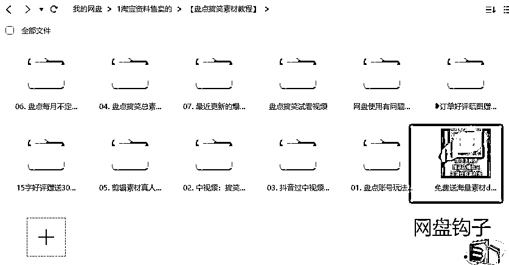

第三种是店铺欢迎语引流。用户咨询时，第一眼看到的就是欢迎语。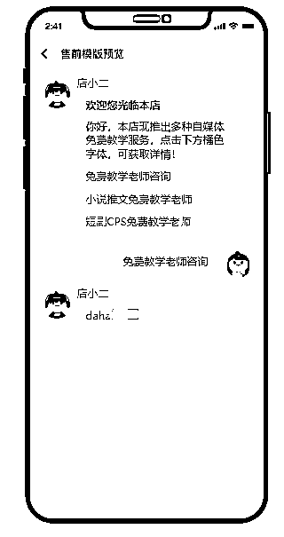

我们可以在欢迎语里设置钩子信息，吸引用户点击，然后顺势把🛰️号发给他。设置方法是：千牛工作台左侧客服-接待工具，在欢迎语话术里填想展示的消息。比如我设置的是“几个项目免费带”，用户来咨询就能看到，哪怕他不买东西，也可能加我🛰️。这样咨询访客也被我们截流了。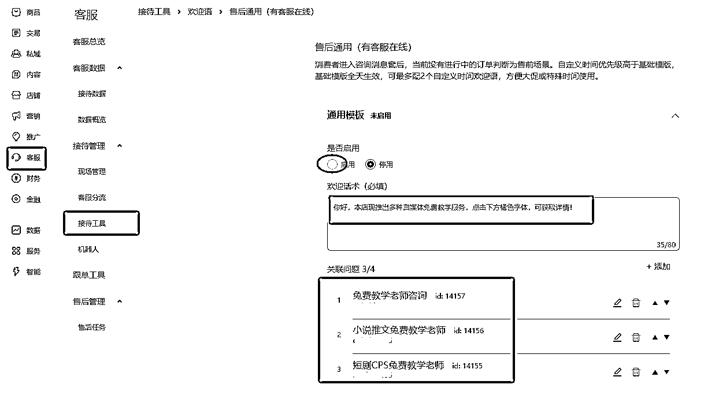

第四种是店铺活动引流，也是我要重点讲的。这个方式厉害的地方不在于引流数量有多猛，而在于它能顺带建立信任，后面成交会特别轻松。

我们的素材基本没成本，但用户一般只买一个，几乎不重复购买。于是我想了个玩法：店铺里加一个会员VIP商品。其他商品定价大概29.9，会员只要19.9，好处是能免费获取全店素材。当然有规则。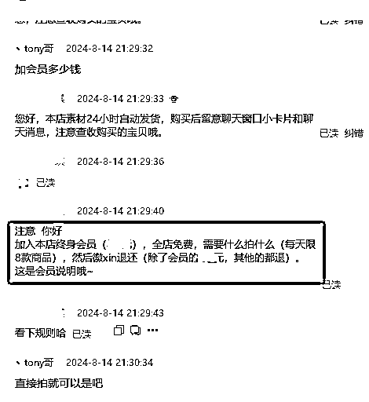

用户先花19.9买我们的VIP产品，然后加🛰️。接着他可以把店里喜欢的产品下单，等收货给好评，我通过🛰️把多余购买的钱以红包形式退给他。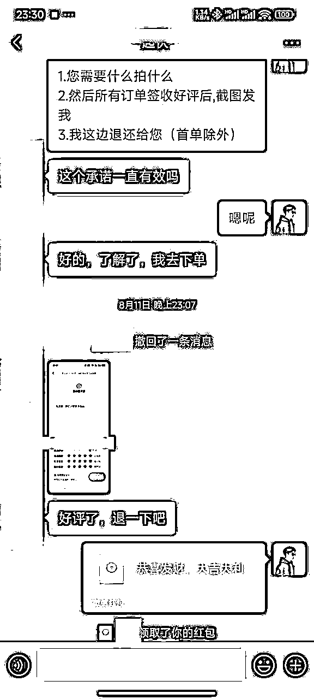

这玩法有三个好处：

第一，利用人爱占便宜的心理，把人引流到🛰️。第二，用户享受VIP权益的同时，还帮店铺做了销量和好评，这笔账太划算了。平时找刷手又花钱，人群标签还不精准，这可是精准的真实用户！第三，经常和用户互动、发红包，一次几十块钱，用户的信任感蹭蹭涨，后面私域成交就容易多了。

事实上，我正是靠这个办法，把私域陪跑服务卖给了不少伙伴。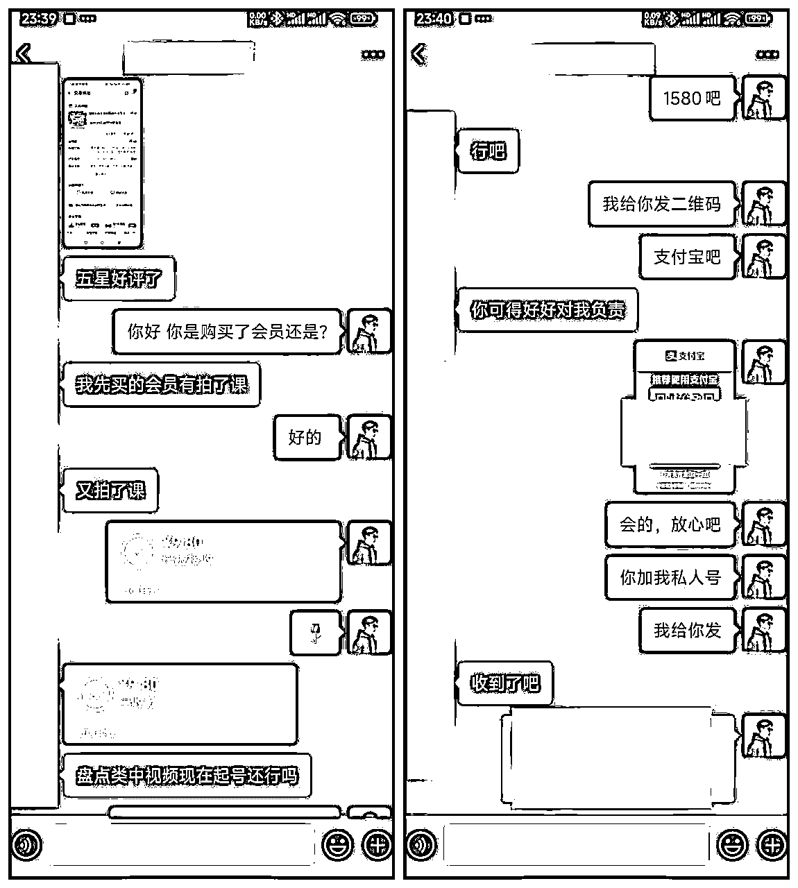

上面这几个案例，都是先在店里享受优惠活动、办理会员，我多次给他们发红包，慢慢建立信任后，人家才愿意付费找我学习。还有些伙伴，买完商品加🛰️后，我经常请他们帮点小忙，比如做个销量、写个好评，我发几块钱红包，一来二去信任就建立了。

反正，无论哪种引流方式，引到🛰️后都要做养粉动作。通过一些小活动让用户从你这里得到好处，慢慢建立信任。信任是付费的基础，总有一部分人愿意跟你买课学习。

再聊私域产品和转化。说实话，我从去年底开始引流，一直做到今年初，两个多月过去了，私域一单都没成交！不是没产品，而是我一直在找合适的产品，找一个能长期坚持做、真正能为用户创造价值的项目。期间也走过弯路，付费跟一些所谓的大佬学习，结果要么项目周期太短，要么学习体验差、交付太烂。

但最后我还是找到了方向，就是把我团队的能力复制给别人——这总没错吧。于是我去学了抖音、📕、👸号的引流方法，等团队跑出结果后，把产品包装好，正式招生，教学员做流量、做IP。又花钱对接了几个团队，挑出几款能供学员分销的产品。没想到在朋友圈推了一段时间，付费的人还挺多，大部分都是淘宝过来的用户，这给了我极大信心。

于是2024年我就坚持主做这一个产品。后来接触知识星球的一些大佬，才听到一个新名词叫“合伙人”，原来我误打误撞做的，跟别人干的是差不多的事。

关于私域经营，早在2019年我做软件开发创业时就接触了私域概念，一直靠私域做“软营销”，分享自己努力写代码、帮用户解决问题的日常，那段时间促成了很多订单。2020年公司成立后，我给销售培训时也重点强调私域，但当时用户增长太快，个人🛰️短期接不住，就改用企业🛰️，攒了大概8万私域用户。

这过程中我发现，企微比个微能加更多好友，但论触达用户，个微明显更好。所以这次创业我全程用个微，去年底注册了八个🛰️，我本人管3个，员工管5个。

然后就开始养号和私域运营。

第一，立人设。最好的人设，就是坚持做自己。千万别觉得做知识付费就得假装高冷、装大佬，把自己伪装成另一个人，连你自己都不知道怎么跟用户聊天。比如我，本来就不是高冷的人，每个朋友来咨询我都会热心回答，哪怕问题再小白，也认真回复。不做自己，会很累，也容易露馅，用户感知也会差。所以我的看法就是：做自己，真诚的自己。

第二，怎么发朋友圈。我一直觉得不能发“强营销”的内容。有些人在朋友圈秀不切实际的收益图，配上“上车”“嘎嘎赚钱”“月入几万”这种low图，如果是我，肯定不会给他们付钱。因为在我看来，这种文案只能吸引互联网小白，而且没有思想深度。作为一个有血有肉的人，朋友圈一定要真诚，能感染到用户。

所以我给自己的标准是：宁缺毋滥。当然我也下了不少功夫，有自己的一套玩法。

一是打卡+感悟类。我习惯早上发这类朋友圈，因为我有运动和听书的习惯（读纸质书时间少），每天运动完或听完书，把感悟配图发出去。早上大家赶时间，通勤或吃早餐时刷手机，所以别写长文。

二是教学反馈。自媒体有句话叫“酒香也怕巷子深”，有道理。想赚私域的钱，就得让用户看到你的产品、服务和成绩，别不好意思秀肌肉。2020年我曾在朋友圈晒了公司和中国石油大学的合同，紧接着就有好几个高校联系我们合作。一个朋友圈，真的能帮你促成好几单。

三是好评+感谢反馈。在电商平台买东西我们都会看评论，有差评会很影响购买决策。但朋友圈是我们自己做主的地方，当然要秀好评。好评可能是一句话、一个红包，日常工作中要善于发现营销素材，用户给好评时及时截图，整理好，编段话术，征得同意后打码发出去。

四是日常生活+感悟。作为一个真实的人，日常生活也得晒，但占比别太大，一两天一次就行。当然，必须是真实生活，千万别去网上找什么坐迈巴赫喝咖啡、夜店搂美女的视频，用户都不傻，一眼就能看穿。同时，分享日常生活时也要让用户感觉到你依然重视用户，可以把生活和工作结合：比如休闲时不忘处理客户问题，出行时在朋友圈说一声消息晚点回复。

五是反面教材+感悟。林子大了什么鸟都有，有时会遇到奇葩来怼你，或者输出一段看不懂的言论，很多人可能气得不行。但在我看来，这都是不可多得的素材。反面素材能吸引朋友圈的注意力，当你发一条“被人拉黑、删除、骂了一顿”的朋友圈开头，大部分人都会停下来看看发生了什么。

用户自带判断力，当你把自己的体悟也融进对话里，对方对你的信任感往往会水涨船高。

#### 6. 用劝退来破局，用感悟来立人

并不是所有人的需求我们都承接得起，这也是劝退内容存在的意义。

比如需要电脑操作的变现路径，对方只有手机，效率根本扛不住；比如负债想靠一个小项目起死回生，这种预期本身就不现实；再比如只想一夜暴富的人，只要你承诺得夸张，他转头就付钱。

这类情况，正常做事的人都不会接盘。把这些劝退的真实沟通截取出来发到朋友圈，配上自己的心里话，就能让读者感受到你不是来收割的，是真心劝人别走弯路。

上面是我常在朋友圈轮换的六大内容角度，归根结底就一个字——真诚。只要你持续输出真诚的内容，不管你是走高冷路线还是热情路线，终究会筛到一批跟你频率相同的人。

## 3. 如何把信任变成成交

之前讲的人设、朋友圈，本质上都是在为成交铺路，让用户愿意为你的产品和知识买单。

在日常沟通里，有几个细节也直接决定成败。

### 1）拒绝群发，尊重每一个个体

圈子里多数人都是兼职做自媒体，时间和精力都很有限，私域里的人也不多。所以要把每个用户当人看。

群发是团队玩法，在流量堆满的时候靠数量换转化。小个体一旦群发，换来的大概率是取关和拉黑，成交率几乎为零。

### 2）沟通别急，解释要透

用户第一次来问，先别想着推单。把产品逻辑讲清楚，让他有充分的时间去消化。需要时可以主动说先回去研究，理清了再聊付费。

上来两句就逼单、直接问要不要买，只会激起抗拒，最后什么都没有。

### 3）该劝就劝，用真诚筛选

对于想躺赚、一夜暴富的人，必须把话说在前头：没有不劳而获的好事，任何变现都需要投入和坚持。如果还没准备好，就别贸然做IP、做知识付费。

能听进去这句话的人，后续被坑的风险会小很多。等他真正准备好了，自然会回来找你。

### 4. 活动要做得有理由、有节奏

做促销必须给一个合理的名头，比如到期涨价，或者限量名额倒计时，让人产生紧迫感。

活动前至少预热一周，让关注你的人心里有数。活动当天开始倒计时，这几天可以适当提高发布频率，晒付款凭证并配上剩余名额的提示。

当用户感受到稀缺，才更可能下单。

关键是活动必须真实，说涨价就涨价。到期不涨，下次再玩同样套路，信誉就毁了，已买和还没买的人都会对你失望。

活动频率要看产品客单价。客单越高，活动间隔就越长越珍贵。

私域成交最终靠的是IP的势能。朋友圈、👸号、短视频只要用对了，都能放大你的影响力。

以上就是我对转化的一些实操想法。

说实话，我的销售方式比较佛系，只能吸引到和我同频的人。成交的大多是认知在线的，他们明白付出才有回报，懂得选对方向长期深耕。对我来说，能筛到这样的人，反而让这份工作更顺心，这也是一种赚到。

# 六、结语

创业这几年，摔过跤也走过弯路，成长就是在坎坷里堆出来的。要给创业者建议，我能写上万字，以后有机会再详细聊。

不过我想强调的是，坚持和学习很重要，但最重要的是先出发。

一个粗糙的开始，就是最好的开始。想做就先糙着干，别纠结完美。互联网有句话叫：不是大鱼吃小鱼，而是快鱼吃慢鱼。

等你想明白了，机会早就凉了。想得越多，越不敢动。

别追求一开始就完美，先干起来一段时间，你会发现自己进步飞快，能力也在不断增强。迈出第一步，后面就会越来越熟练，成绩自然会出现。

从量变到质变，先完成再优化。烂做总比不做好。

我的分享就到这里。

我是大海，路还长，山顶见！