# 闲鱼选品别再迷茫！这5个方法，帮你把月收入冲到5000+
作者：龙哥

大家好，我是龙哥，一名85后宝妈。全职带娃11年，线上副业做了9年，其中在闲鱼电商上深耕了5年，目前是万人闲鱼社群的选品官和指导老师。之前还担任过赚钱3月和6月“闲鱼高客单价航海”的航海教练。

做过闲鱼的人都知道：选品选得好，基本就赢了大半，运营只是剩下的那一小半。可是很多伙伴跟我抱怨，一打开闲鱼，脑子里就一片空白，不知道上什么，好不容易上架了几件商品，订单却寥寥无几。其实选品方法不需要贪多，把一招两招真正用好，比收集一堆技巧管用得多。今天我就把自己常用的免费选品方法整理出来，帮大家少走弯路。

## 方法一：跟着同行“抄作业”

同行是我们最好的老师，放到任何副业赛道都适用。我每天会花半小时左右，专门在闲鱼逛逛同行的店铺。

具体操作是这样的：

第一步：先在手机上打开闲鱼，点一下界面右上角的“分类”。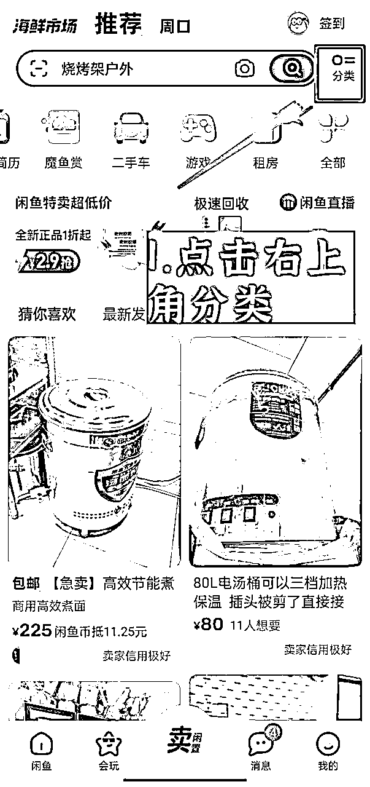

第二步：进入分类页后，选一个你自己正在做的类目点进去。比如你做“家用电器”，就可以从这里进。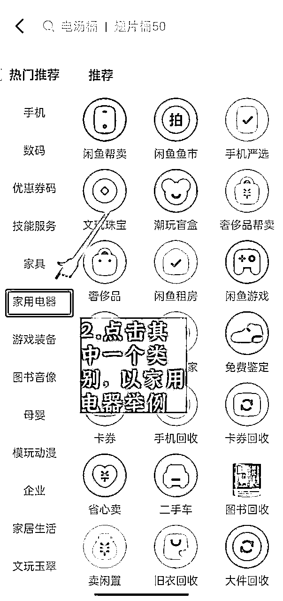

第三步：点进家用电器后，下方会出现很多细分品类，随便挑一个，比如“消毒柜”。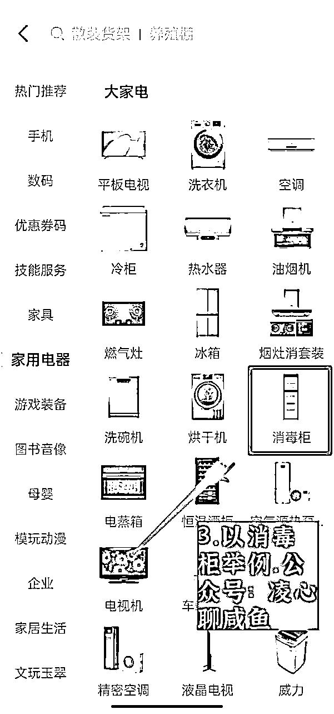

第四步：点开消毒柜，会看到不少相关产品。优先点开“我想要”数量超过100的链接。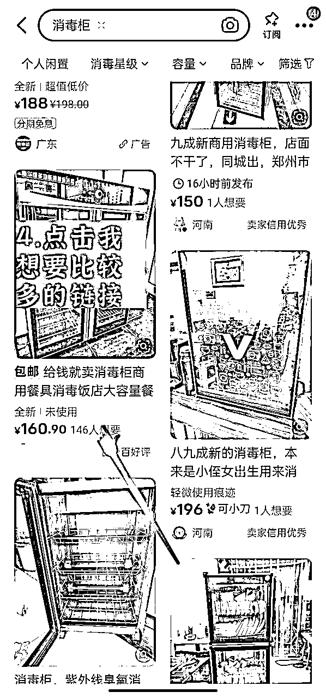

第五步：点进去后，留意“刚刚来过”或“来过时间”。只要对方最近来过，都可以拿来对标；如果显示已经很久没来，就算“我想要”数量再多，也建议别碰。这点太关键了。之前有位朋友跟我说，他盯着一个“我想要”上千的产品，上架之后却没有曝光。我让他把链接发来一看，对方已经200多天没上闲鱼了。这种品，参考价值真的不大。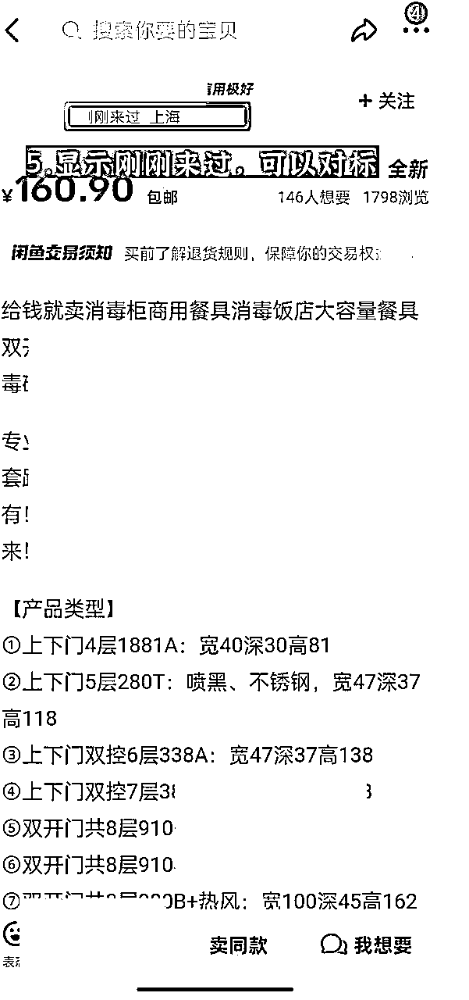

第六步：再往下拉一拉，看看对方来闲鱼的时间和卖出数量，这些细节也可以辅助判断。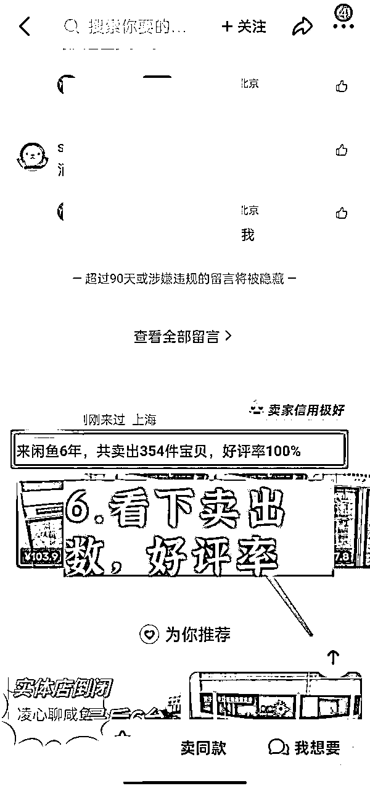

第七步：要是能翻到对方的动态，就更好了。可以观察同行最近什么时候上新、哪些东西卖得好，顺便再看看他店里其他表现不错的品。如果看不到动态，翻评论区也能获取不少参考信息。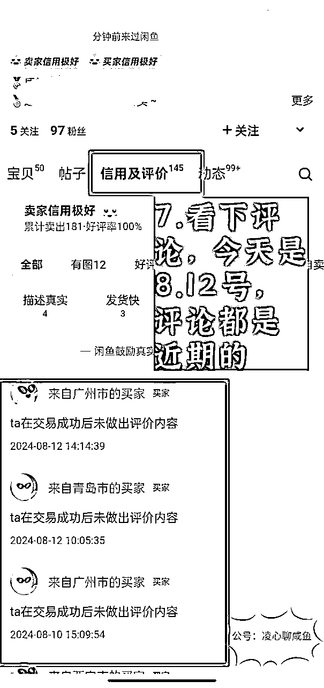

第八步：重点看看带图的评价，留意评论时间。如果近期评论很多，说明这个品最近卖得不错。图片要是清晰完整，还可以顺手保存下来备用。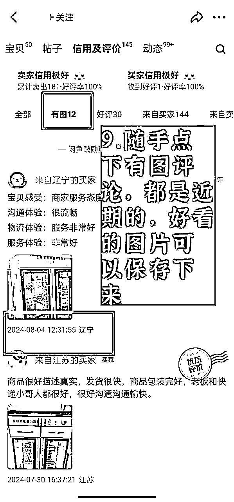

另外，同行的“关注”列表也值得看看，里面往往能发现一些靠谱店铺和新的选品方向。

## 方法二：从主流电商平台批量“挖品”

拼多多、淘宝、京东、抖音、阿里巴巴这些平台，都能给你选品灵感。如果没能拿到厂家合作货源，我依然建议在拼多多下单，因为它的售后在同类平台里真的非常省心。

以拼多多为例来说：

第一步：先进入拼多多客户端，点击首页最上方的任意分类，比如“家具”。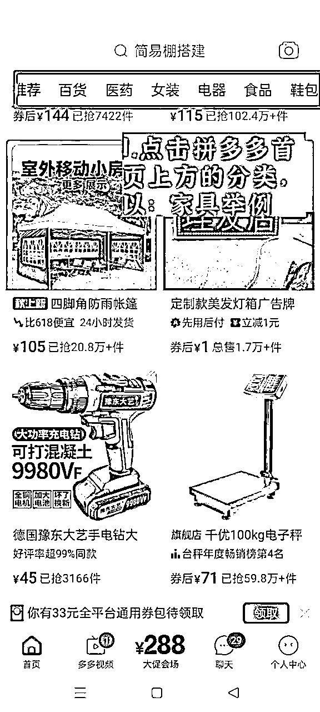

第二步：进入家具频道后，会看到每日更新的排行榜、小编推荐，而且每个分类下面还有子类目。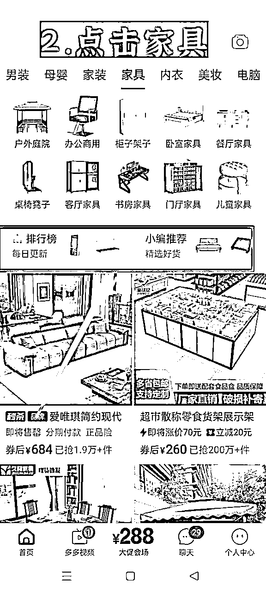

第三步：点开“排行榜”，进入住宅家具的日榜，里面包含柜子架子、卧室家具、办公商用等子分类。挑一个看看就行。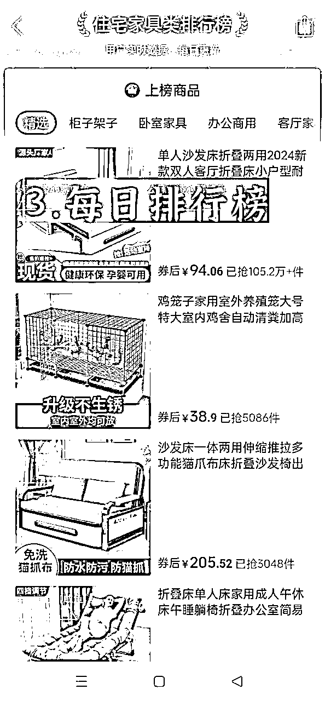

第四步：比如点“柜子架子”，就能查看这个类目的日榜。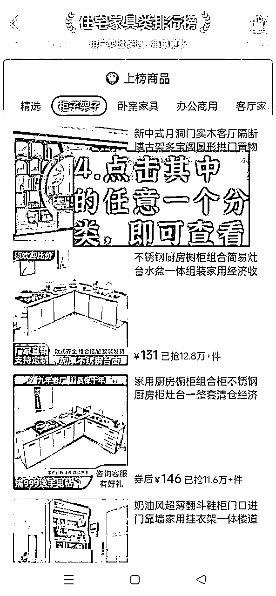

第五步：切回第二步，点“小编推荐”，同样能找到一些不错的选品灵感。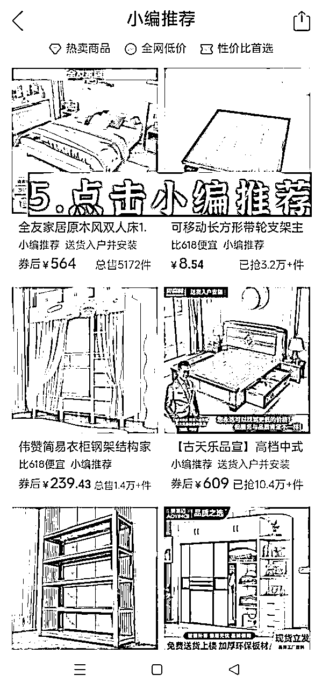

第六步：再切回第二步，点“办公商用”，然后进入其中一个子类目。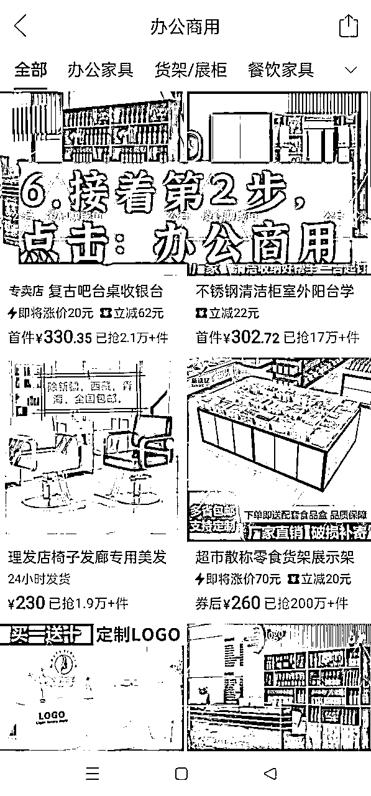

第七步：拿“办公家具”举例，点进去后就是对应的选品界面。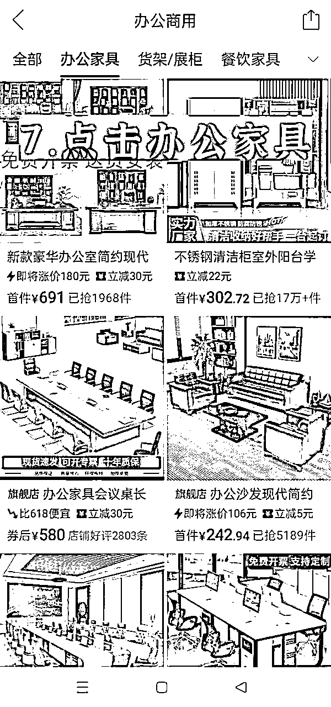

其他平台的操作逻辑也都差不多。选出品后，记得再回闲鱼搜一下，看看这个品同行的“我想要”数据怎么样，近期销量怎么样，心里更有底。

## 方法三：关键词选品法

这个方法适合所有电商平台，还是拿拼多多说。

你在搜索框里输入不同类型的关键词，系统就会顺势推荐对应的类目和产品。找到符合自己店铺定位的类目，点进去看就行。

比如输入“农产品”，下拉框里会跳出农用工具、土特产展示架、农产品加工机械与设备等，有些品类其实卖得很不错，点进去就能看到。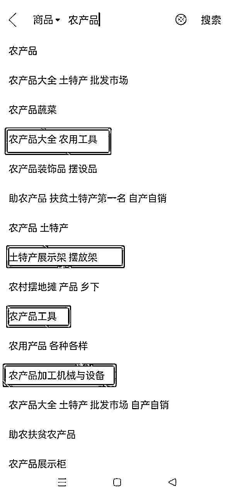

再比如换“不锈钢”“畜牧用品”“海边旅游”这些关键词，也能筛出不少好选品。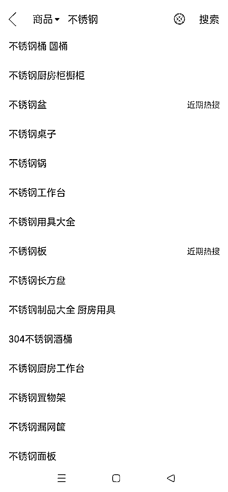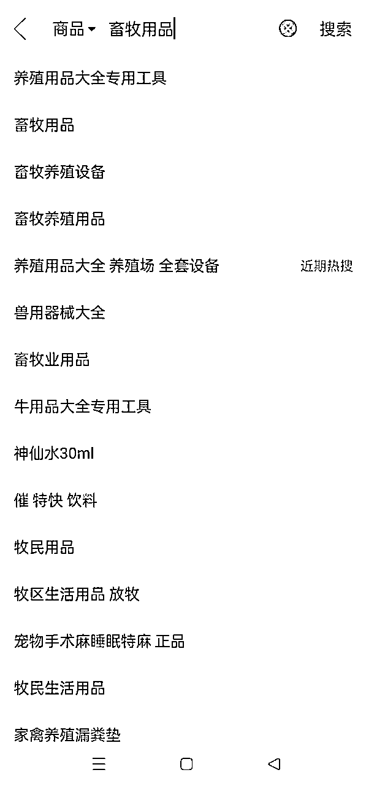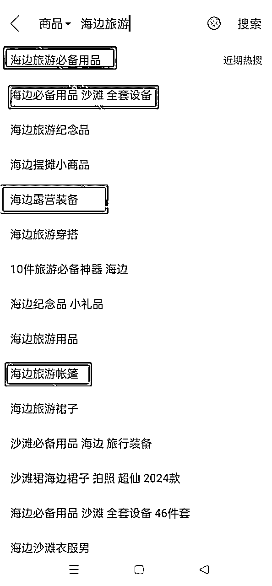

## 方法四：热点选品法

热点虽然不常有，但只要你抓住先机，就能顺势赚上一波。比如开学季快到了，拉杆箱这类学生刚需品可以提前上；打印机和周边配件同样值得关注；自行车、电动车等出行装备，也是不少大学生的刚需。紧接着是9月10日教师节，节日礼物同样可以备起来。

热点选品法如果搭配关键词选品法，效果会加倍。平时卖的都是常规品，可一旦有热点加持，可能就是意外的惊喜。

## 方法五：季节选品法

这个方法最简单，完全是跟着生活节奏走。像夏天，风扇、空调、冰粉手推车、摆摊推车、车载冰箱、防晒用品、工业风冷机都能卖，而且一个选品还能延伸出一串周边产品。

如果不知道卖什么，也可以去百度、知乎上搜一搜，灵感很快就有了。比如我搜“夏季家里必备居家好物”，出来一堆推荐文章，车载遮阳伞、即热饮水机、无叶电风扇等，你之前可能压根没想过，但放到闲鱼上说不定就是爆款。只要不是闲鱼规则里禁止卖的品，都值得上架试试！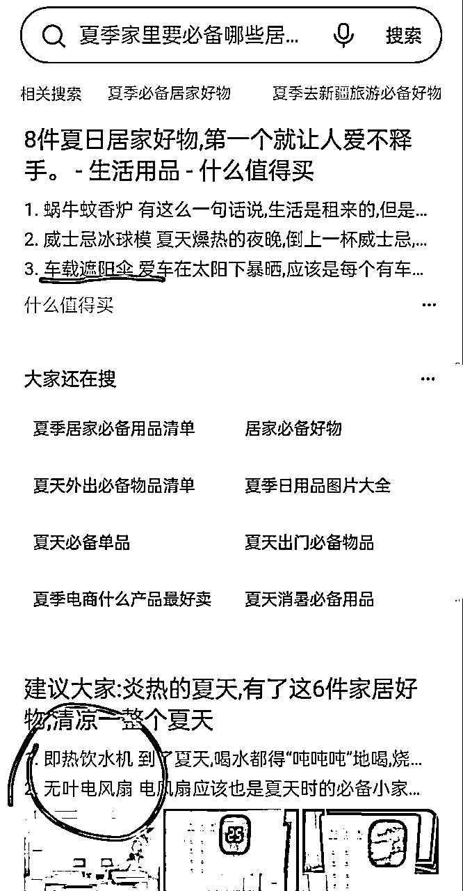

另外，用开放的AI工具搜索当参考，也是一个不错的思路：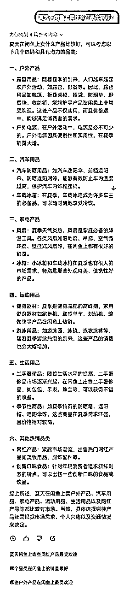

以上五种方法，随便挑一种开始练手，再举一反三，一定能选出好品。希望所有做闲鱼无货源、正在为选品纠结的朋友，都能找到自己的方向。祝你们大卖！

之前我在赚钱还分享过一份完整流程的实操手册，想要的话直接点：https://t.zsxq.com/MdNEA （每月多赚5000+的闲鱼卖货实操流程）