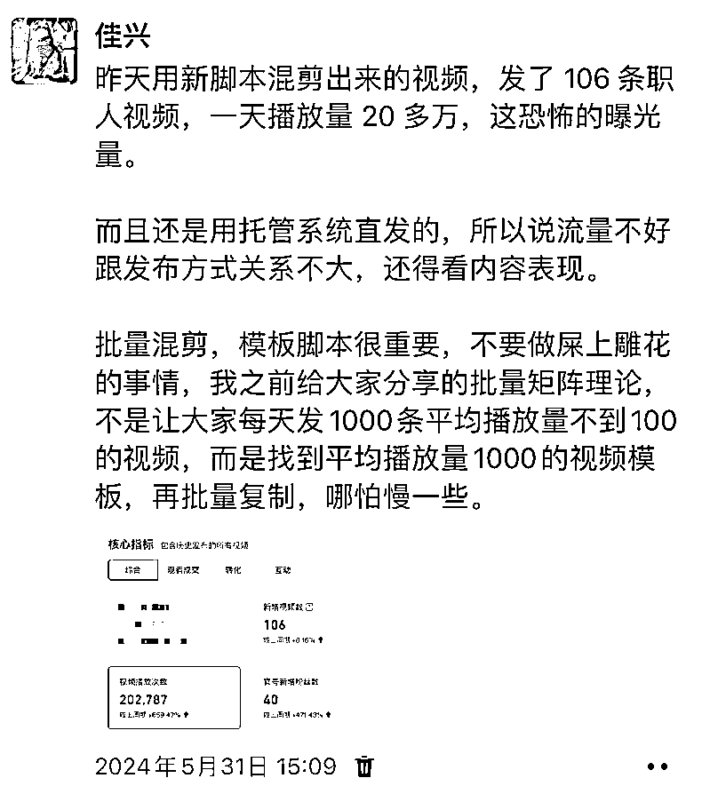
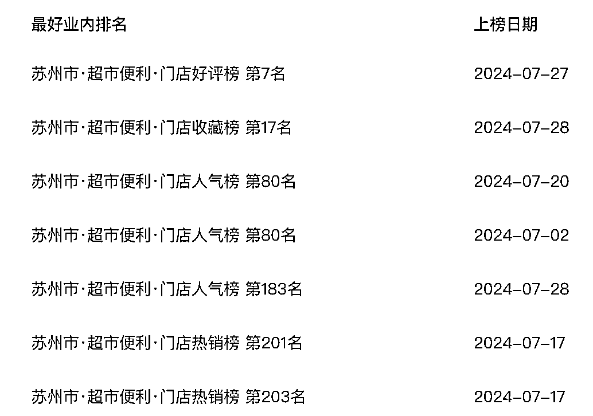
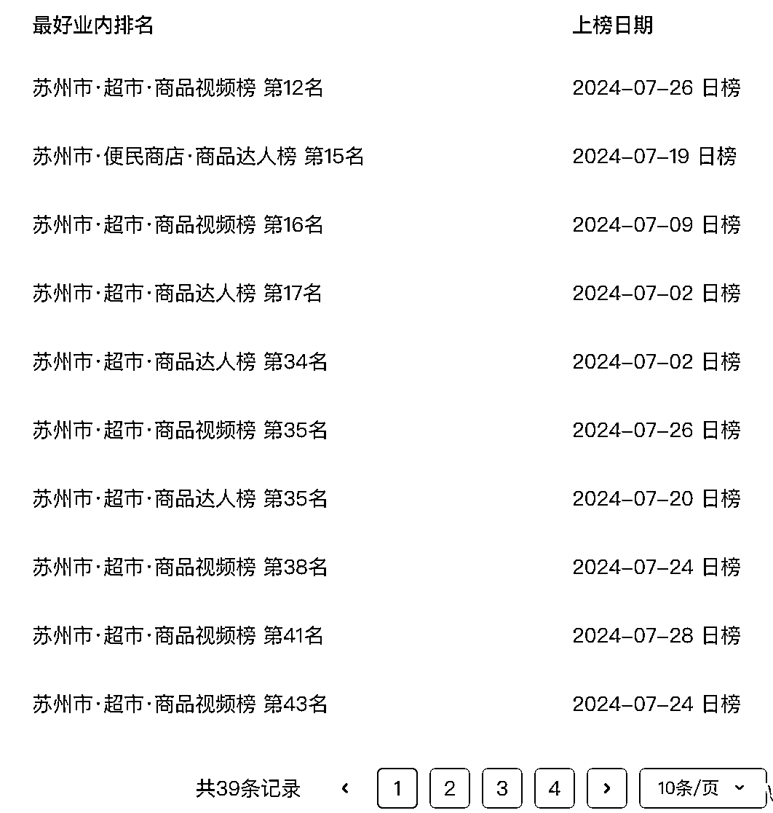
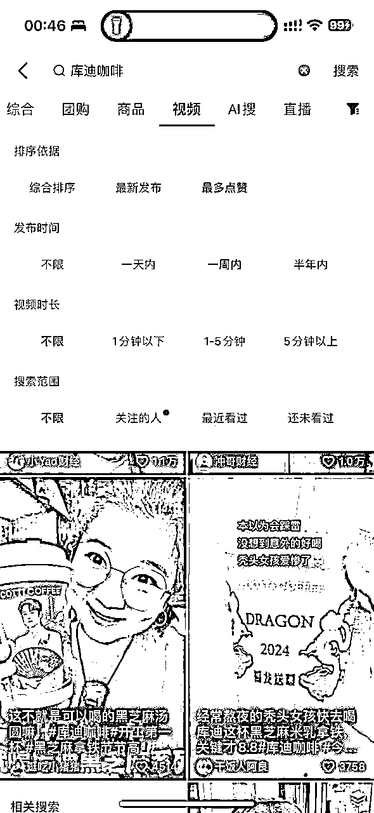
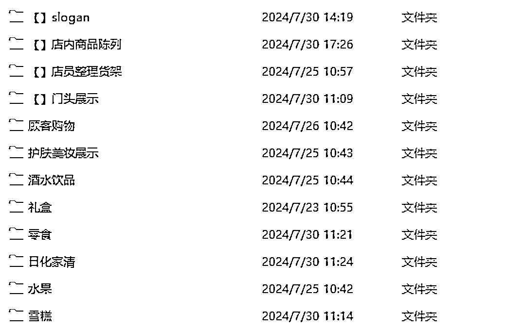
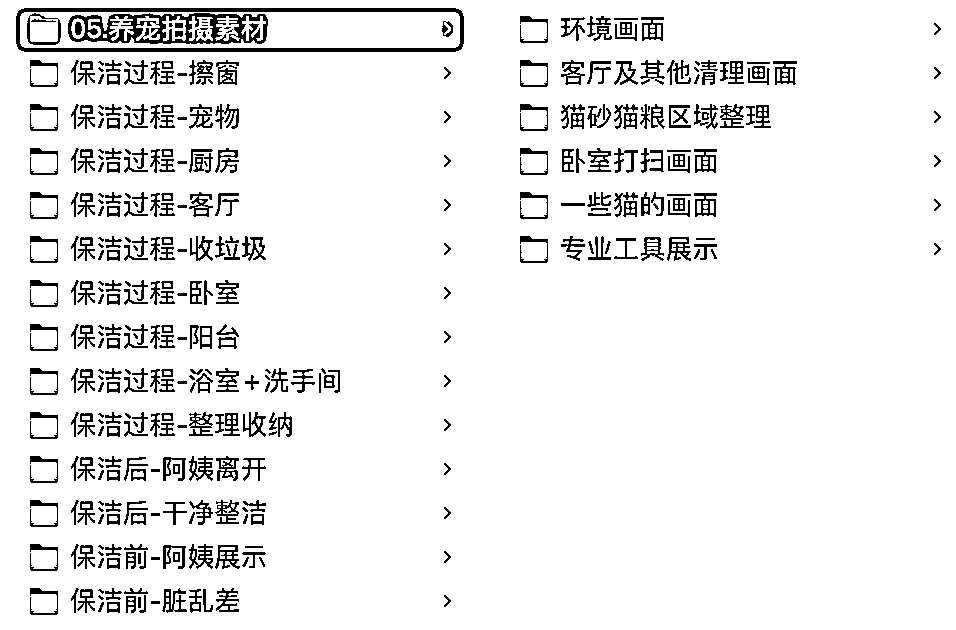
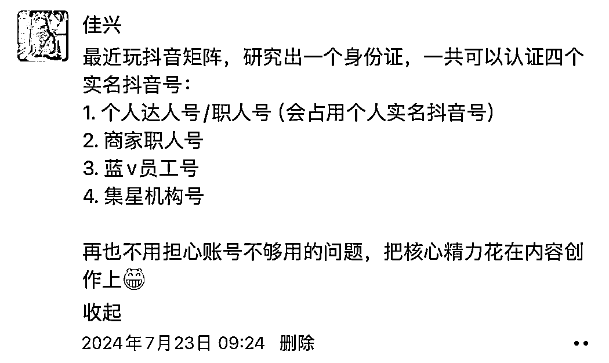
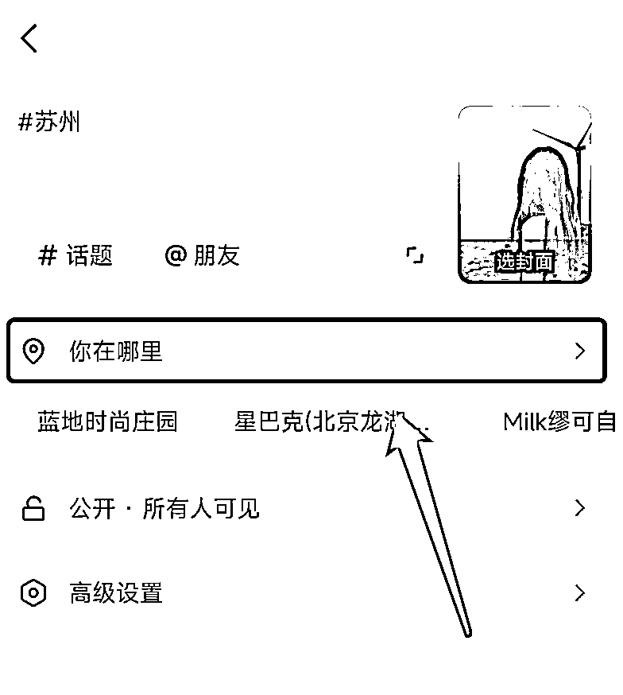

# 2024 年本地生活商家实操手册·终极版（赚钱专享）

# 前言

月内投放十万条抖音短视频，单城用户全覆盖，种草到成交一条龙，月销售额做到七千一百万，这就是我过去一年的一个操盘样本。

大家好，我叫佳兴，主攻本地生活流量增长。2023 年我操盘了两家家政连锁，均依托抖音本地生活完成十倍级增长，相关的复盘之前也分享过：

* 实战复盘，如何用两个月时间从零打造一个热卖 10 万单的抖品牌

自然流收割配合本地推通投，是打造抖音本地生活头部品牌的常规打法。

2024 年我又从 0 到 1 起盘了苏州一家便利店连锁，目前月度投放预算压在五千元左右，主要是探店达人车马费。内部配备三人，人力成本合计不到四万：

* 我，负责抖音来客搭建、账号矩阵、品类策略、脚本创意与内容生产体系等基础设施；
* 一名剪辑师，按我的要求完成成片，日均可产 500-1000 条；
* 一名商品运营，负责多店商品套餐的组建、上架与迭代，目前负荷不足，我正培养她兼任官方主播，每日抽空开播。

进度上，五月初组队，第一周完成 106 个职人矩阵号绑定，第二周跑出爆款脚本，日自然播放冲到 20 万，目前稳定在每日 3-5 万播放，120-150 人到店核销。

不提成交额的原因是超市单品毛利极低，比如百岁山在抖音渠道只卖一块钱，流水数字好看但不重要。关键是到店后的加购，以及体验后的复购。

除一家新开加盟店外，其余 11 家直营门店均已上榜城市榜。

商品套餐同样频繁上榜。可惜目前品类局限在零食、饮料、家清、日化等标品，鲜食熟食等高流量品类未上架，也没拿到像“冰杯”这类适合 DIY 组品的优质供应链。若能补齐，营销端的效果至少还能再放大数倍。

我能进入抖音本地生活赛道，完全受益于龙哥盟圈友的分享。去年入行也是靠加入圈友公司拿到结果。饮水思源，今天把最新一线经验整理出来分享。

文章围绕商家低成本内容获客展开，共五部分：

1. 商家短视频底层逻辑：抖音如何高效发传单
2. 无编导背景下如何产出有效内容脚本
3. 无摄影基础也能拍出可用剪辑素材
4. 人手不足时如何完成视频批量生产
5. 无预算请达人时如何低成本分发

# 一、商家短视频的底层逻辑：如何在抖音高效发传单

方向错误再努力也是空转。实体商家做抖音，最核心的不是追求高赞爆款，而是把短视频当传单来投放。

爆款并非无用，只是 99% 的商家不具备做 IP、做爆款的能力，盲目追爆款很容易因无反馈而放弃。

商家做抖音的目的只有一个：让本地目标用户看见、记住、进店消费。

所以首个命题就是：实体商家做抖音，本质是换一种形式发传单。

线下传单流程大家熟悉：设计内容-印刷-找人发放-用户接收-阅读-丢弃/保存-咨询/到店。

抖音发传单的逻辑一致，只是载体变成短视频：

脚本设计-视频制作-素材拍摄-成片剪辑-账号分发-用户刷到-观看互动-滑走/完播-点赞评论收藏-点击 POI 查看门店-购买团购券-到店消费。

看起来复杂，拆开来看并不难。

# 二、没有专业编导，如何高效创作有效内容脚本

脚本决定数据。

先统一认知：平台鼓励的是真实可信、声画精良、有用有趣的内容。我认为的有效内容是易制作、可过审、能转化。

能做平台优质内容当然最好，条件有限时先做能赚钱的有效内容。

实体商家很难稳定产出平台认定的顶级内容，否则还开什么店，直接做网红。

因此脚本需满足三点：

1. 结构简洁，适配自动化剪辑
2. 合规可过审
3. 转化能力强

### 2.1 探店达人提供现成模板

抖音本地生活里大量生产带货短视频的群体是团购达人。最省事的做法是邀请本地 5-7 级具备短视频创作能力的实探达人探店，我通常直接选当地短视频榜单达人，单条费用 300-1000 元不等。

联系渠道是抖音来客 App 的达人带货功能，进入达人广场挑选。

目前我每月合作 10-20 位榜单达人，要求交付 30 秒以上主片和 10 秒左右副片。发布后结合数据表现筛选，一般能提炼出 3-5 个可用脚本模板。

预算不足时，可采用“对标+二创”。

### 2.2 对标同行

用行业关键词、品类关键词、品牌关键词在抖音搜索对标内容。

### 2.3 脚本拆解维度

新手建议对标的脚本特征：

* 画面：场景简洁，镜头稳定
* 音频：纯配音/BGM，无口播对白

找到合适的对标后，将文案和素材替换为自有即可。

例如我今年 4 月为某慕斯蛋糕品牌做的分镜脚本即为此思路。

# 三、没学过摄影，如何拍出合格剪辑素材

### 3.1 八字口诀

素材决定转化。

剪辑素材是用于剪切组合的片段，成片质量与素材质量强相关。

我常用的口诀是：推拉摇移，远中近特。

“推拉摇移”为运镜方式，“远中近特”为景别，下面展开。

### 3.2 运镜

* 推镜头：镜头逐渐靠近主体，画面放大，制造聚焦与期待感
* 拉镜头：镜头逐渐远离主体，画面变小，展示更大环境
* 摇镜头：机位固定，镜头左右或上下转动，常用于拍门店环境
* 移镜头：机位沿直线移动拍摄，呈现跟随感

### 3.3 景别

* 远景：展示全景或大环境
* 中景：人物腰部以上，探店常用
* 近景：聚焦人脸或物件
* 特写：聚焦眼部、唇部、手部等细节

### 3.4 常用拍摄手法

开场介绍：固定或轻微摇镜头，中景；
外部环境：远景+移镜头；
入店过渡：推镜头，中景；
店内环境：移镜头/摇镜头，中远景；
特色展示：近景+特写；
菜单介绍：推镜头，特写；
制作过程：跟镜头/推镜头，中近景；
品尝体验：近景+特写，捕捉表情与质感。

# 四、剪辑人力不足，如何高效完成视频生产

下面是我们团队的 SOP，可直接复制。

### 4.1 剪辑思路

批量混剪的核心是固定模板+素材排列组合。

精细混剪与简单混剪两种模式。

### 4.2 素材整理

每月集中 1-2 天拍摄 1000 条以上素材，分类归档并定期更新。

### 4.3 自动化剪辑

在剪映制作模板后使用自动化工具批量生成，日均可出 300 条。模板要素：

* BGM
* 配音
* 字幕
* 首屏标题
* 去重贴纸/滤镜/画中画

### 4.4 职人矩阵分发

使用 100 个矩阵号分发，人均日更三条。

团队仅一名应届生剪辑，短视频工作由我俩完成。日产 300 条是门店承接上限，而非产能上限。单城 12 家店覆盖有限，发太多无意义。保守估算我俩产能是当前十倍，日产 3000 条也可承受。

关于批量工具，我已测试市面上主流产品，发现工具并非关键，核心在剪辑思路。早期无工具时，按奇杰老师航海课思路手剪也能日产 150 条。

# 五、没钱请达人，如何低成本分发

### 5.1 账号越多越好

视频产出后需要分发渠道。过去一年我在分发上投入数百万，高峰期每月对接 5000+ 达人任务，有一定经验。

按归属角色划分：

* 探店达人：最直接有效，有抽奖属性，前置成本高，新店和连锁必备
* 云剪达人：连锁起盘利器，多为三四线宝妈，红利期性价比高。平台后对高重复搬运打击，低质账号大批出局。小商家不建议，大品牌仍可维护出单账号
* 门店员工与亲友：职人功能体现去中间商，实体店至少一个员工可建两个职人号，个体户可借助亲友账号
* 门店客户：到店发视频领礼品，参与度高

* 同城兼职：大学生、宝妈等，自行招募
* 无实名本地号：核心在于能否挂载正确 POI，无实名号也能挂本地位置，特别适合单城矩阵

### 5.2 POI 与话题

1. 视频挂载门店 POI，抖音会基于定位优先推送给周边用户
2. 非达人号也能挂位置
3. 连锁需开启智能内容推荐
4. 统一文案与话题标签，增强精准推荐与搜索曝光

# 六、结语

我从赚钱圈友的家政项目鲸致生活入行，到操盘天鹅到家团购短视频登顶抖音家政榜，再到创业做本地生活服务商三个月收官，随后回职场负责连锁品牌线上营销。

一年间经历抖音本地生活从爆发到内卷、规则变动再到市场冷静的全周期。

曾被拒的求职者被龙哥鼓励创业并受邀航海家大会分享，社恐上台险些翻车。正当自负时后院起火。

顺境时觉得自己天选，逆境时又抑郁躺平。

“那时她还太年轻，不知道所有命运馈赠的礼物，早已在暗中标好了价格。”

近期心态平稳，不再执着结果而是多播因。

回看一年多实操，GMV 数据惊人，却难见利润。流量型从业者常陷入有流水无利润的陷阱，看似火热实则难赚。

拿家政举例：3 小时日常保洁 139 元，算 140 元：

* 阿姨成本 90-120 元
* 平台抽成 7 元
* 达人佣金 11.2 元
* 税务 3-5 元
* 保险 1-2 元

突发事故风险仍由商家承担，如天鹅到家月嫂事件。

利润在哪？甲方无利，服务商更难盈利，这是零和博弈。

编导、剪辑、达人运营、直播、主播、投流等成本，最终谁来买单？做决策前先算清这笔账。

做下来才明白，这行本质上是在为整个生态做贡献：

平台的KPI好看了，社会的就业盘活了，员工的薪水有着落了，服务阿姨拿到报酬了，带货达人也分到钱了。唯独最累的那个操盘手，口袋空空，哭笑不得。

一开始扎进本地生活，是觉得线下实体像块好啃的肥肉。那会儿的我们互联网思维在线上嗨翻天，觉得认知碾压、玩法花样多得很，想招商家就做招商推券，想卷连锁就整云加盟，玩不转就转身卖课、带培训、接代运营，多体面。

现在还在本地生活里扑腾，是因为这份工作踏实靠得住。对比起干净清爽的纯互联网，实体服务是真的脏是真的累，可正是这份累，让你能靠一手过硬的服务把生意慢慢养起来，让客户的口碑一点点沉淀下来，最后沉淀成一个真正能打的品牌。这种踏踏实实做成的成就感，比刷数据爽多了。

于是把身上的那点互联网傲慢收起来，放下偏见，用点爱和尊重重新看待本地生活。

实体的门槛肉眼可见的高，回本慢、赔钱概率大，对那些习惯了快钱、快回报的互联网人来说，确实不香。

而纯互联网是赢家通吃的战场，头部一家独大，内卷到骨子里。我不是那种能杀出第一的怪物，所以我选了一条更普惠、更容易活下去的路。

人间烟火气，最熨帖人心。

向每一个苦心经营店铺、认真交付的商家致敬，也向每一位反复打磨手艺、活在细节里的手艺人致敬！