# 用AI做冰淇淋建筑 最简单高效的保姆级教程

最近刷📕的朋友，一定都刷到过那些超火的“冰淇淋建筑”——粉粉嫩嫩的城堡、甜筒做成的塔尖，简直让人挪不开眼！这类账号涨粉速度惊人，后续不管是接广告、带货、做培训，还是转型旅游类博主，都很有搞头。

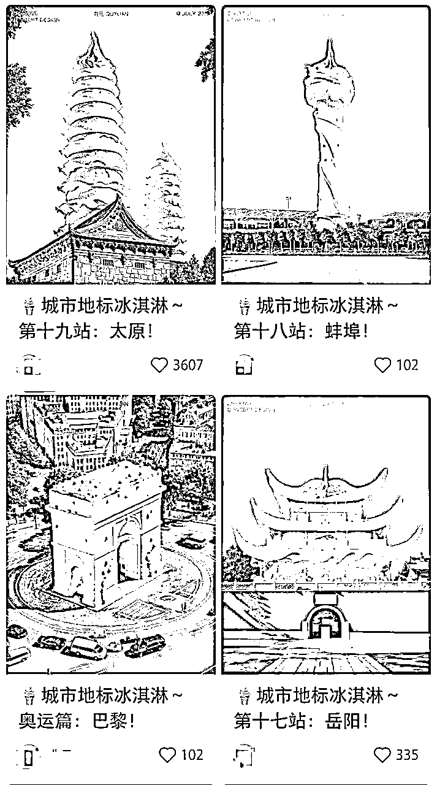

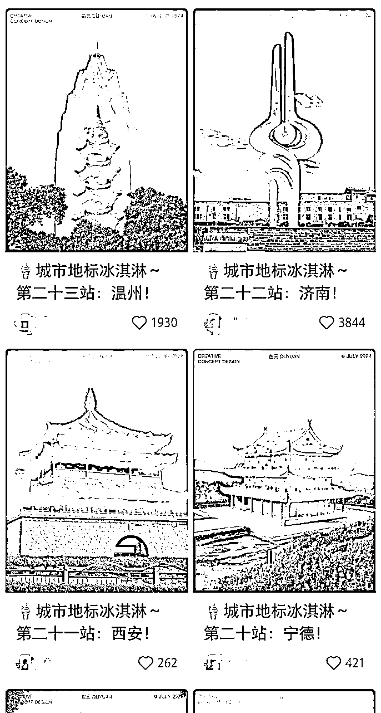

很多不熟悉AI的朋友看到这些图，第一反应都是：这到底怎么做的？其实懂AI的人一眼就能看出来，这完全是AI生成的杰作。

那具体怎么操作呢？别急，下面这份保姆级教程是我整理过最简单、最省事的版本。只要你会AI基础操作，看完就能上手；就算你是纯小白，跟着步骤一步步走也没问题。要是中途卡住了，随时来问我。

先给大家看看我们做的几组成品：

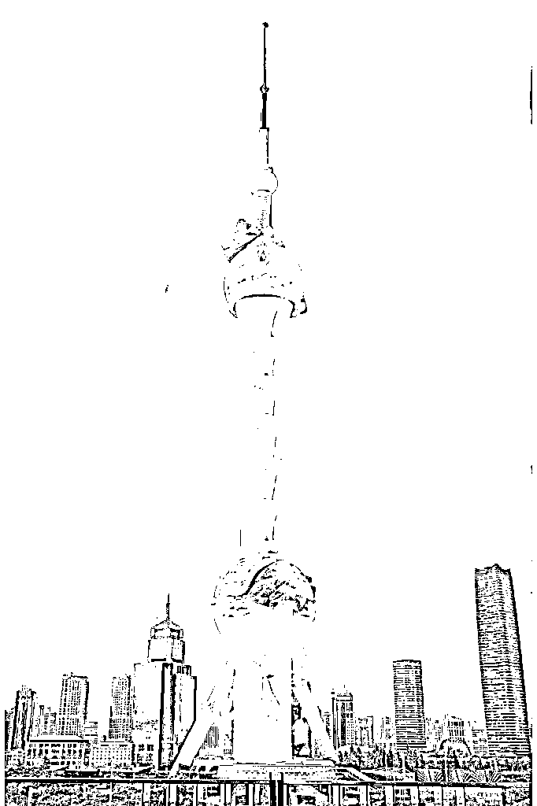

这些图是我们拿上海地标建筑试的。当然，方法学会之后，全国各地的建筑你都能玩出花来。

# 一、开工前的准备

### 1. 打开“即梦AI”官网，注册并登录账号

https://jimeng.jianying.com/

### 2. 想清楚你的设计方向

- 先构思一下冰淇淋建筑的风格、外形、配色和细节特征。
- 可以提前找几张参考图，或者列出几个关键词，这样后面生成时思路会更清晰。

# 二、输入描述词

### 1. 进入“即梦AI”首页，点击“智能画布”。

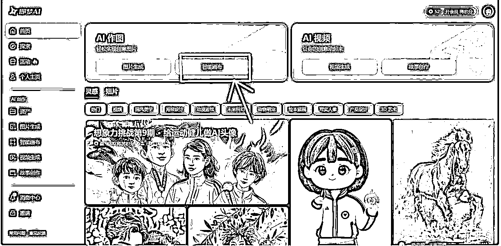

### 2. 在画布界面选择“上传图片”，把你想改造的建筑照片传上来，同时调整好画布比例。

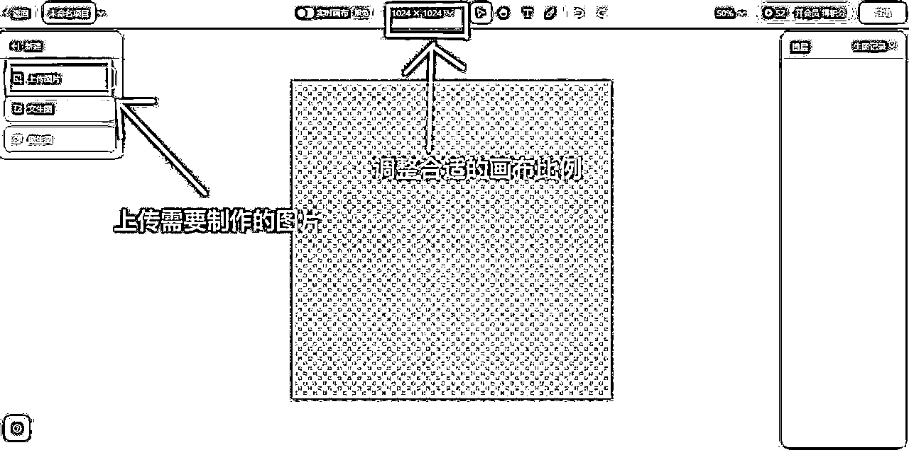

### 3. 切换到“图生图”模式，在描述词框里，用尽量具体、有画面感的语言来描述这栋冰淇淋建筑。

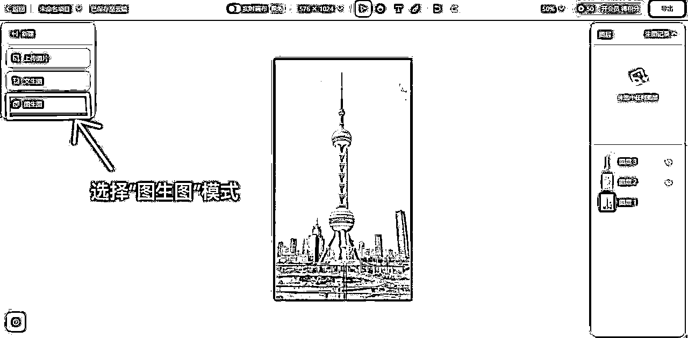

- 举个栗子：“一座由草莓冰淇淋、巧克力冰淇淋和香草冰淇淋叠成的城堡，尖顶是彩色脆皮甜筒，墙壁上嵌满糖果和坚果，四周还环绕着冰淇淋做成的花朵和喷泉。”
- 可以多换几种说法和形容词，这样AI给你的惊喜也会更多。

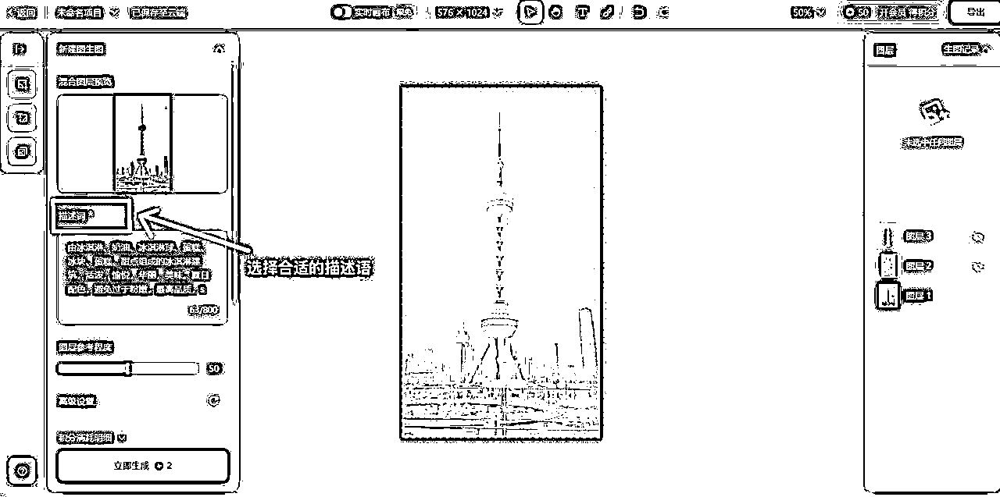

### 4. 往下找到“高级设置”，在“风格参考”里上传你想要的参考图。

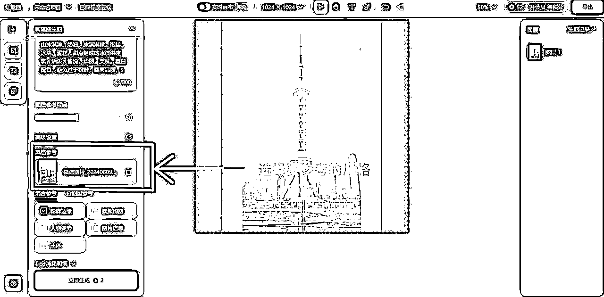

### 5. 选择“混合参考”，把“轮廓边缘”打开，参考程度建议设在60–80之间。

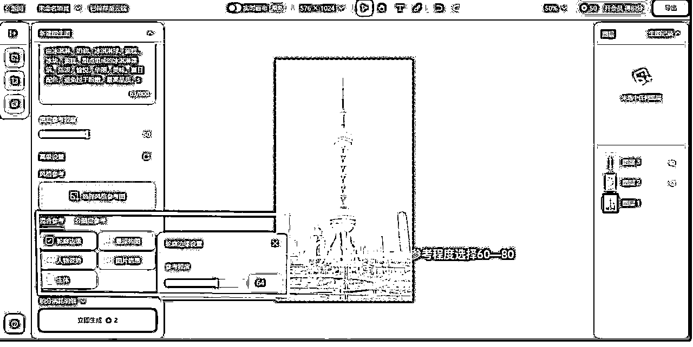

# 三、生成图片

### 1. 点击“立即生成”，等几秒，AI就会把冰淇淋建筑交出来。

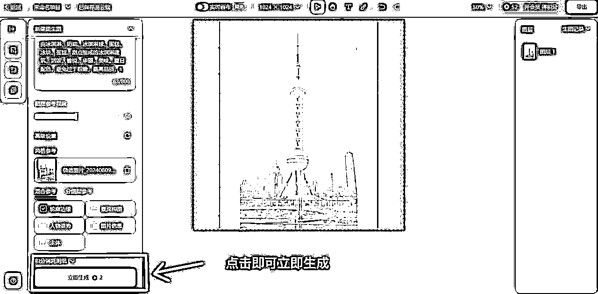

# 四、挑选与优化

### 1. 生成后看看效果，挑一张你最顺眼的留下。

### 2. 如果都不满意，就回去改改描述词，重新生成，直到满意为止。

# 五、细节精修

### 1. 点一下“HD无损超清”，画质瞬间拉满。

### 2. 再点“抠图”，把生成的主体单独抠出来，叠加回原来的照片上。

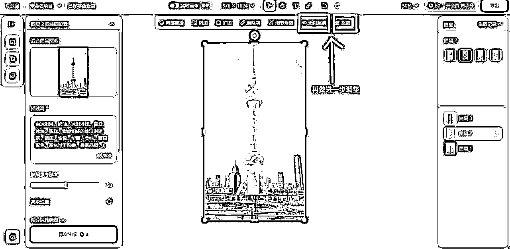

### 3. 最后用“局部重绘”或“消除笔”微调画面里的瑕疵，让整体更协调。

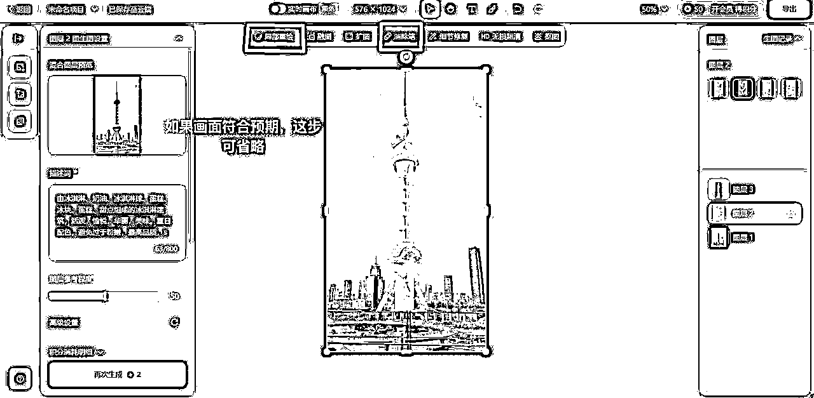

# 六、导出图片

### 1. 导出时选JPEG格式、2x尺寸，导出范围选“当前画板”，然后点下载。

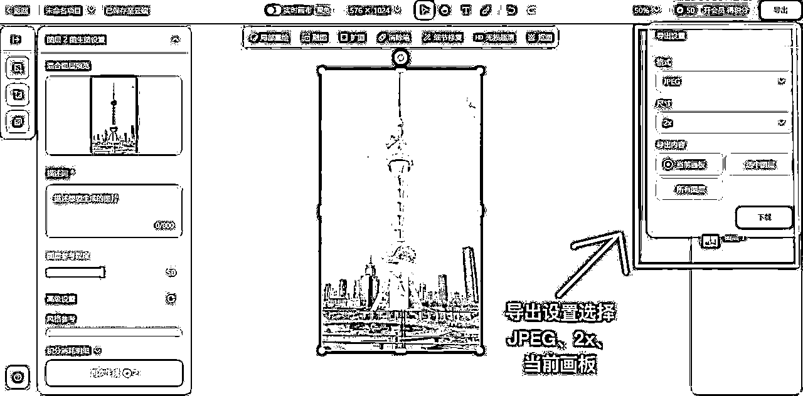

### 2. 到文件夹里就能看到存好的成品图了。

# 七、后期加工（可选）

### 1. 如果有更高要求，你还可以用Photoshop这类软件再做进一步的修饰和精修。

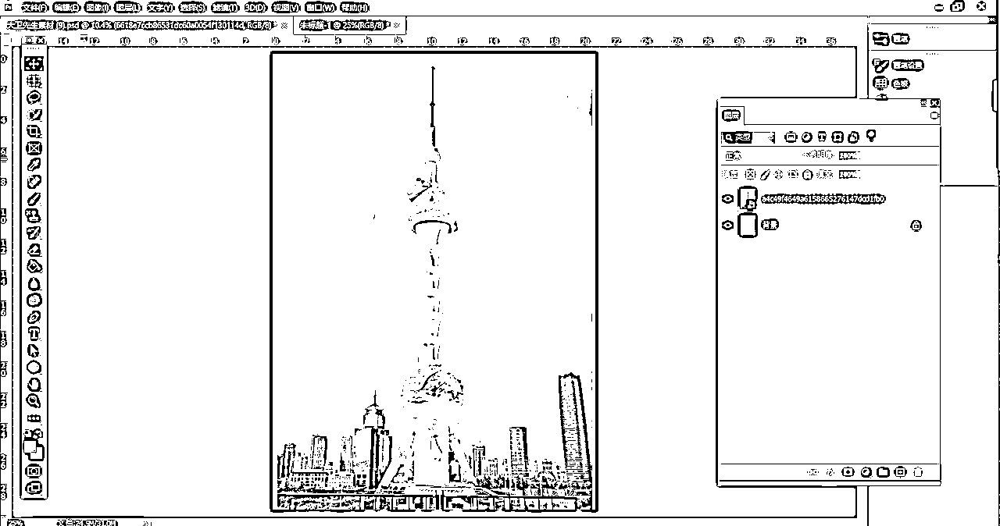

走完这套流程，你就能用AI做出超惊艳的冰淇淋建筑了。大胆去试、去玩，你会发现每一次组合都可能带来意想不到的惊喜！

以上就是我整理出的最简单高效的完整教程，感兴趣的小伙伴赶紧动手试试吧！哪里没看明白的，欢迎来找我，咱们一起交流～