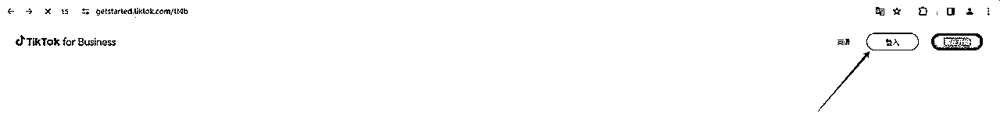
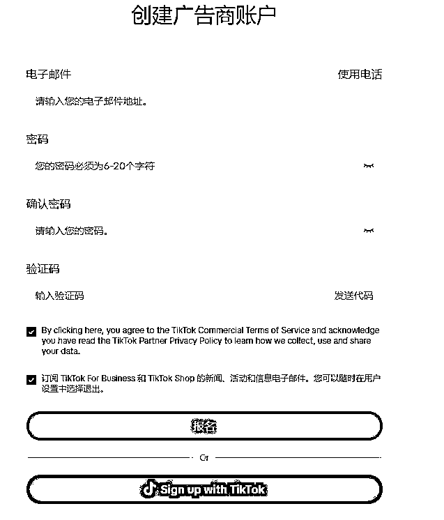
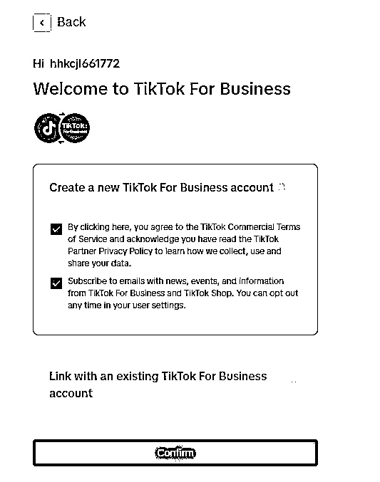
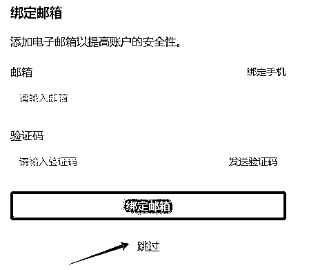
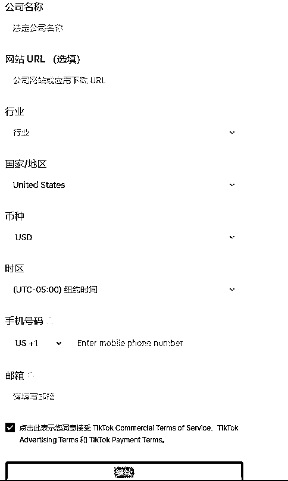
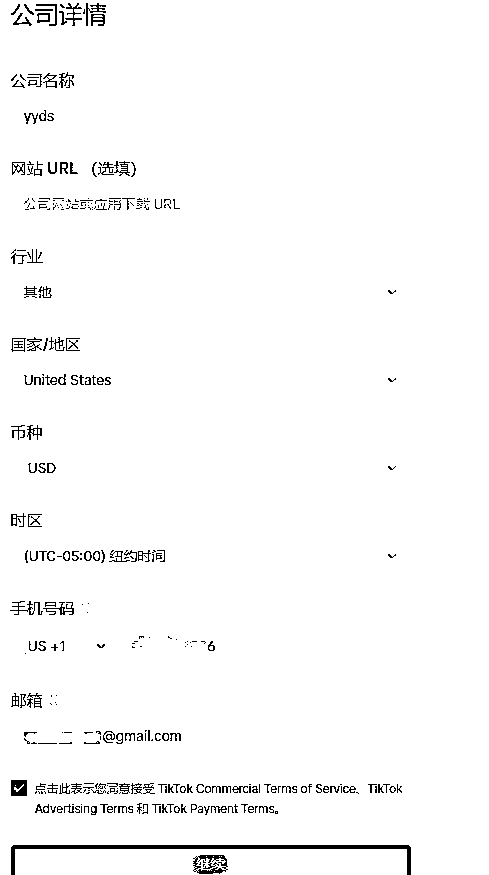
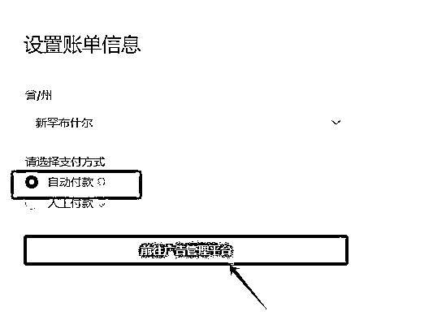
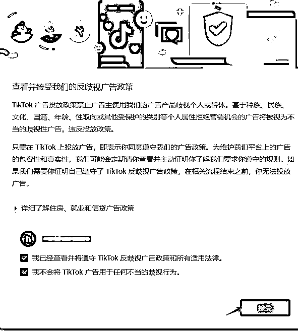
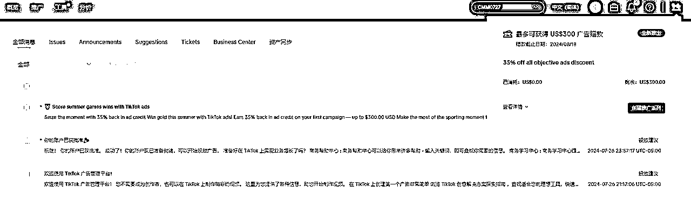
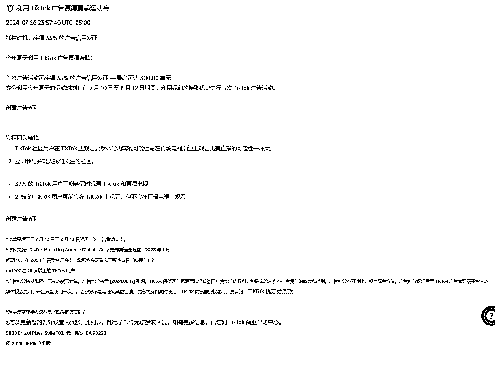

# 用 TikTok 个人号撬动广告返现：35% 返利，单个号最高返 300 美金的操作全拆解

# 错过了四年，再次回头发现 TikTok 依旧香

说实话，TikTok 广告我已经快四年没怎么深度用了。一直就被搁在角落里，直到今年 6 月 Facebook 迎来大面积封号潮，团队里不少人直接进入半躺平状态。同期 TikTok 企业户的审核也并不宽松，这才让我重新想起个人广告户这条路。

试下来发现，个人户的体验确实不一样：上手门槛低，没有数量上限，充值和退款都相当灵活，风控强度也明显比企业户友好。更关键的是，现阶段新开的个人户可以拿到 35% 广告花费返现的权益。机会摆在面前，不整一下说不过去。

废话不多说，直接进入干货部分。

# 开工前需要准备的工具包

**官方申请入口：http://getstarted.tiktok.com/ 记牢这个链接**

* 一个美区 TikTok 账号
* 一款指纹浏览器，可自行搜索免费方案
* 🪜环境，推荐 Socks5，美区节点
* 虚拟信用卡，418122 开头的卡种口碑不错，自行搜寻
* 美区虚拟手机号，用于接码
* 一个常用邮箱，Gmail / Hotmail 都可以

# 实操步骤，一步步走

第一步，用指纹浏览器新建一个干净环境，并把🪜设定好。环境搭建不熟的伙伴可以去 YouTube 或 Google 找教程，这里就不展开了。环境就绪后打开 http://getstarted.tiktok.com/ 进入申请页。

没有提前准备 TikTok 账号也能直接用邮箱申请，不过我更建议先注册一个 TikTok 账号登录后再申，账号养上个一周左右更稳。当然流程本身很简单，想快的话直接跳过养号也可以。我的做法是直接用 TikTok 账号登录。

登录后系统会弹出授权提示。

授权通过后会提示绑定邮箱，这个步骤可以先跳过不用填。

## 重点信息填写

公司名称随便填几个字就行，网站栏保持空着不填。行业选择 线上电商 - 其他。

国家默认选美国，想投其他区域也可以自行切换，注意对应时区是否匹配。我这里就保持默认。手机号和邮箱各准备一组即可，同一个号码后续多开多个户也能复用。

信息填完点继续，进入下一页。

## 付款方式判定

申请时如果没有出现自动付款选项，建议直接放弃本次申请。出现不了通常有两个原因：一是国家选择和时区冲突，二是🪜 IP 不干净，可以换个 IP 再试。

自动付款属于后付费模式，花费累计到阈值后才从绑卡扣款，起步 5 美元，风险可控。人工付款则是先充值，户挂了充值金基本拿不回。

等真正要投放时再绑定信用卡即可，卡里预留 10.5 美元用于验证，半小时内会原路退回，无需担心。

至此广告后台就进来了。

到这一步，账户的注册流程算是完成，但别急着开跑。

# 提交后静等 24 小时

我们只是完成了提交，还需要等官方审核。个人经验是放一天最稳妥，实际往往几个小时就通过了。审核通过后会收到站内消息通知，同时会明确告知你已获得 35% 广告费返还资格，通过率基本接近 100%，个别失败就多申几个即可。

## 关于 35% 返现的规则说明

活动仅针对 7 月 10 日至 8 月 12 日期间创建的账户，且只返第一支广告的消耗，返现比例为花费的 35%，单个账户封顶 300 美元。

我也是最近才注意到这个福利，Facebook 封号搞得我之前有点摆烂，真是对不住自己。剩下的时间窗口，感兴趣的伙伴可以批量操作，100 个户就是 3 万美元的返利额度。投放技巧方面赚钱社区已有大量优质内容，我就不重复造轮子了，日后有需求再单开一篇聊投放。虽然手有点生，但基础还在。以上内容仅供参考，欢迎交流共进，一起把生意做起来。

