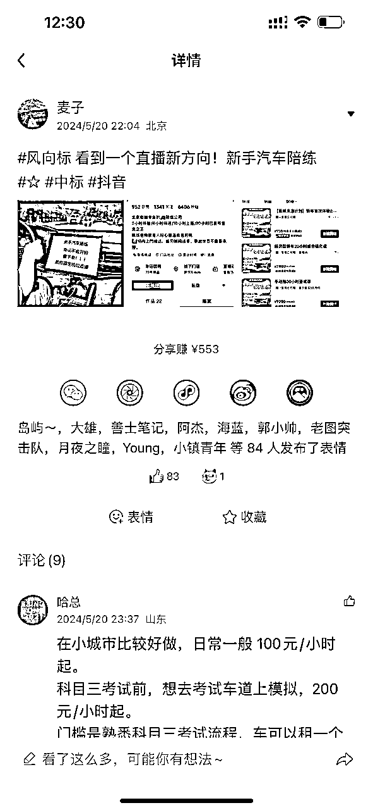
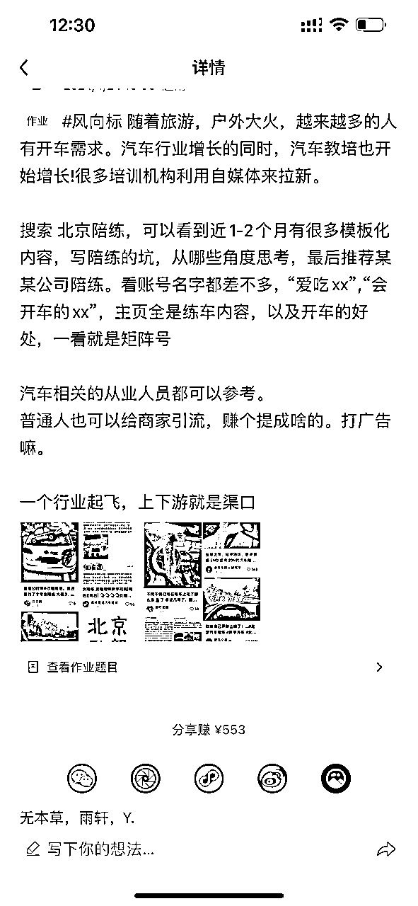
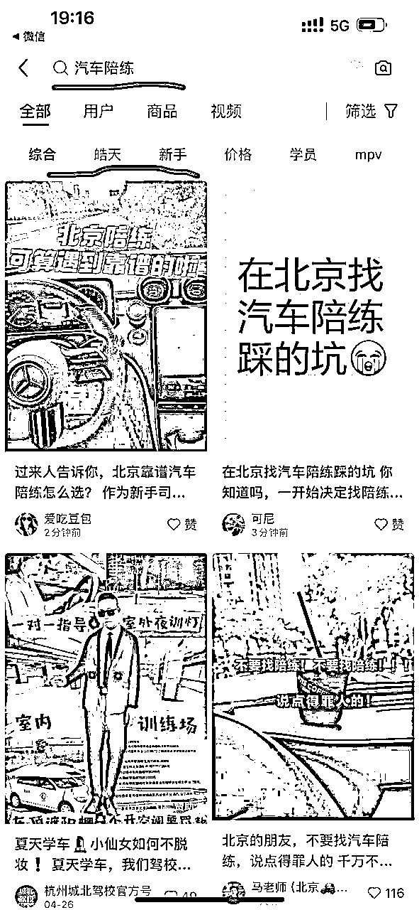
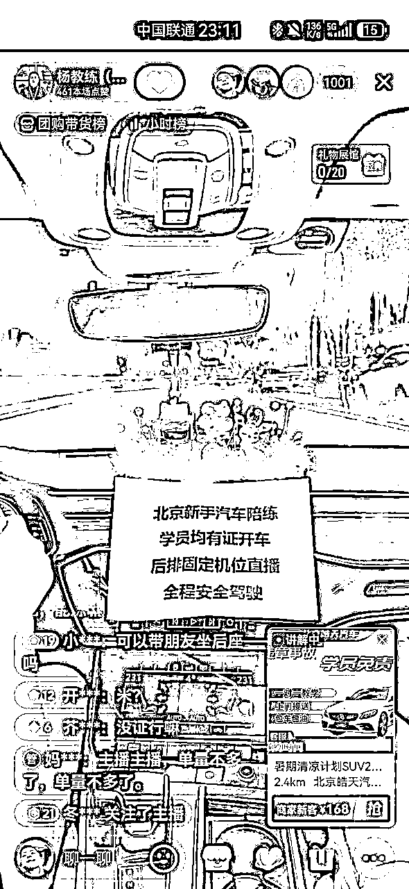
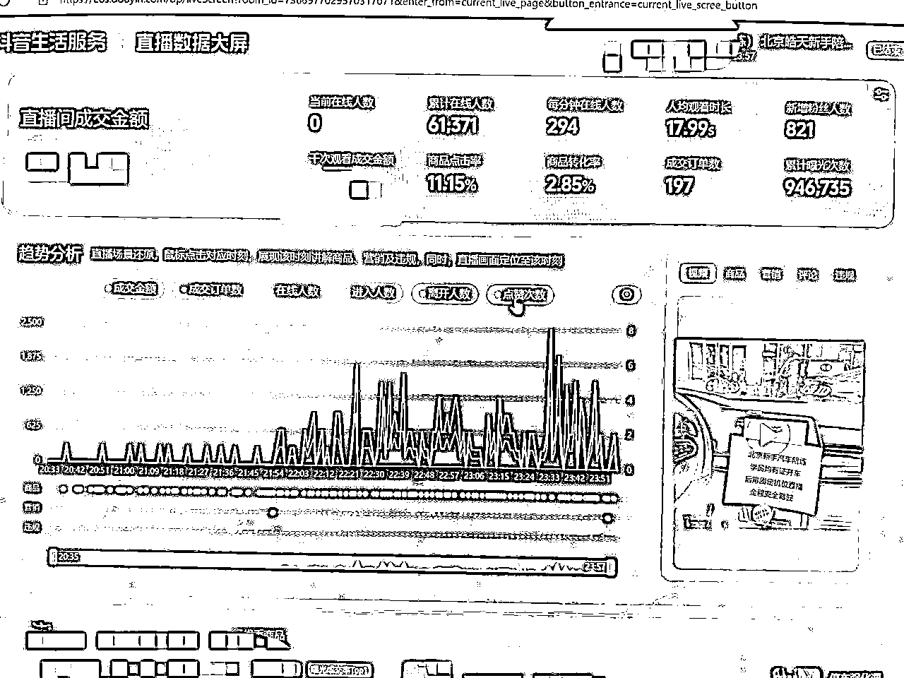
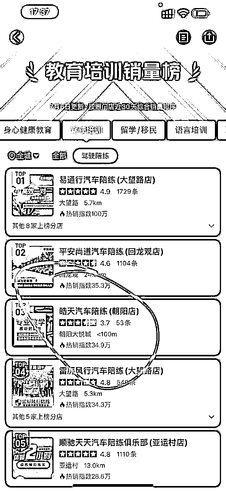
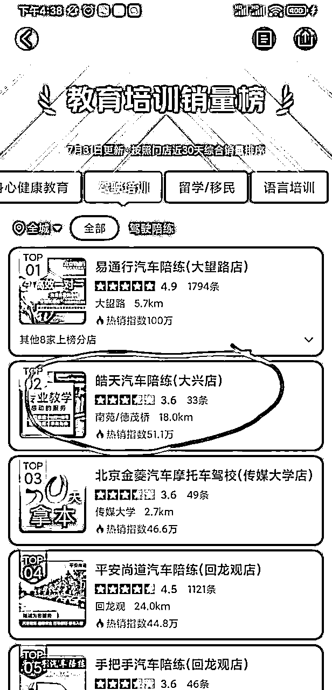
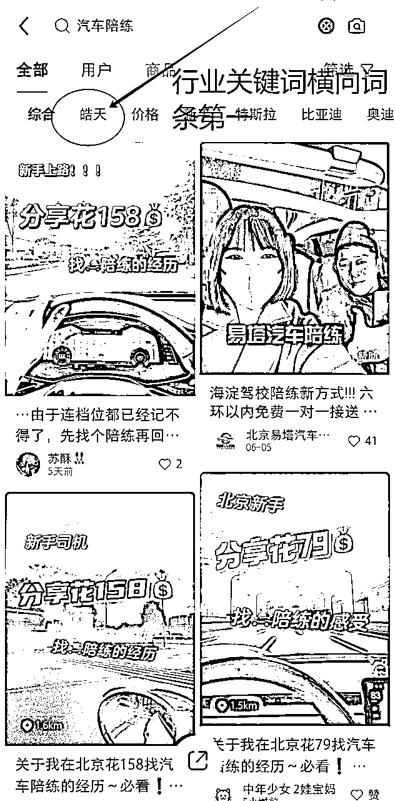
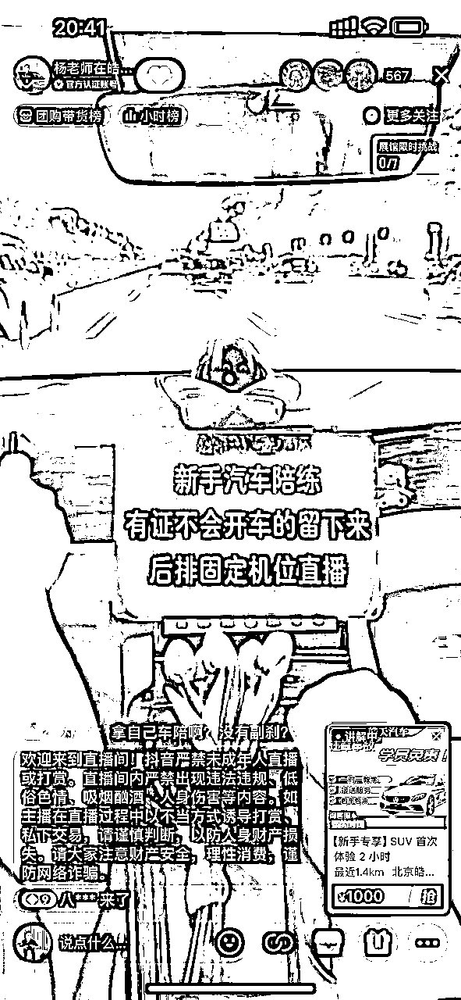
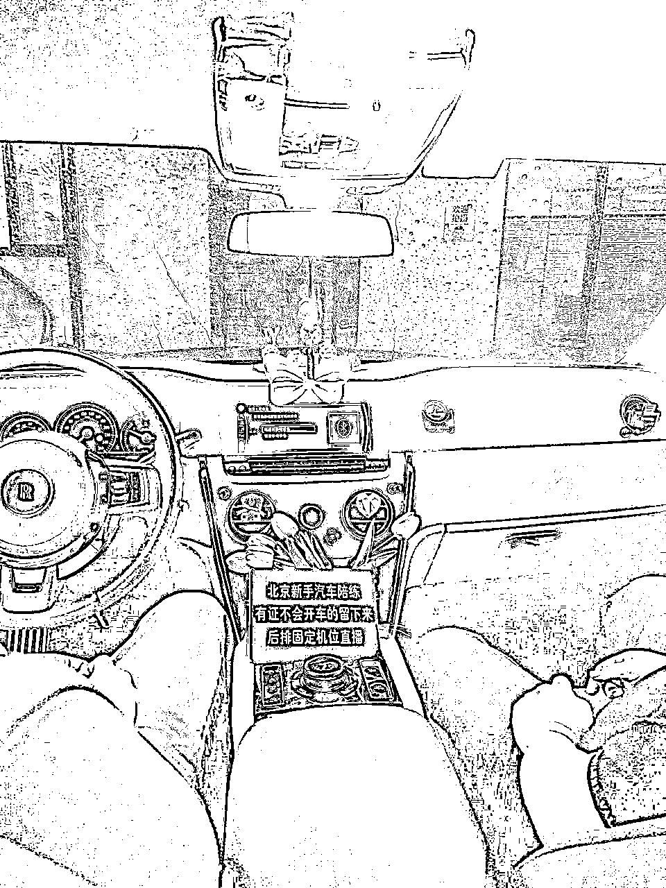

# 试错二十万，撬动千万盘面：一个冷门陪驾品类的城市起量复盘
作者：龙哥

老杨先自报家门。团队今年绝大多数时间都在测区域型项目的获客体系。反复验证下来的结论很直接：二十万以内的启动资金，配上成熟的公域打法，能在本地属性的生意里撬动千万级利润。选项目时我们只问自己两个问题：第一，投入产出模型是否健康，总预算不超过50万；第二，年度利润能不能瞄到千万。拿北京市场举例，我们靠一套组合式获客机制，两个月出头就把一个原本没什么人注意的细分品类拉了起来，按当前速度，全年做到5000万收入是大概率事件。与此同时，上海/杭州/深圳/郑州/贵阳/太原等地的联合运营方，也都按同一种路径从0走到了10。要认为这只是常见的项目包装，建议把这篇看完——后面写的每一环都是实操体感，大概率会打破你对区域生意的旧有认知。

内容不含水分，全是能复用的方法论。单人创业、零基础入门，或者团队想找扩容方向，都可以参考。2024年是城市级生意的爆发期，只要前端拉新解决得好，单一城市的起盘速度远比想象中快。

## 01 具体赛道：路面陪驾

上周一位朋友发来几张截图，有人在圈子里传播团队目前正在做的项目。没想到这个产品线出道没多久，就火出了原来的小圈子。既然大家好奇，就把项目做个完整拆解。

先谢过各位朋友的认可。有关这个生意，多数人的直觉是刚把驾驶证拿到手的人才有需要，但数据给出的真相完全不同：愿意掏钱的主力，是驾驶年龄超过五年的女性，年龄集中在三十岁往上的区间，占到九成比例。说白了，我们是帮“有本儿不敢开”的人重建驾驶自信，由教练在副驾全程带教。假设你所在的城市还没听到过这个品类，那正好说明这里存在空白点。需求很硬，后续再往更高价的产品延伸也非常顺。

## 02 60天真实战报

项目是3月底启动的。首个星期，种草渠道就做到了单日30个试学预约。5月转到短视频平台做放大，现在一天的预约量维持在200个上下。北京原先的行业第一，去年全年营收4000万，日均试学预约也就是30个的水平。我们从进场到吃掉对手一个星期的量，不过用时60天。不信的话，可以在点评软件里看同品类的历史数据。

在大家眼里这是个极窄的品类，但我们在种草平台开屏的非广告区域，几乎把三个内容位全部占住了。

短视频直播的画面也可以看一下：这个偏门品类，凌晨时段在线人数居然能突破1000，团队是北京第一家能在主流直播形态里稳定拿到免费流量的。冷启动时期同时在线只有十来个人，订单稀疏；后来多账号滚动直播，早中晚三个时段覆盖，引流款保持一天200单上下的水位。这一路踩坑无数，也挨过同类对手用各种方式围堵，但最终交付结果说明了一切：每月6000个订单，相当于老牌玩家一整年的累计量。这套作战模型放到实体生意里，几乎都是碾压局；这座城市里，我们已经拿下接近九成的份额。

这套模式被验证后，各地陆续出现复制者，但多数只是照搬文案、仿冒画面编排，并没有真正理解门道。用户对同质化内容很快产生疲惫，市场也被拖入低价竞争。现在这套玩法迭代到了2.0版本：光靠免费流量会有波动，想持续放大必须以付费投放做骨架。团队为此打磨出一套低成本获客工具，借助种草平台的聚光系统与短视频平台的同城推送通道，把单个客户成本打到极低。免费内容和付费流量并行推进，才从满屏仿品和无休止打压里撕出一条上升通道。

## 03 线索端：通吃逻辑

前面提到的试学预约只是导流入口，真正的利润在二次销售：后续产品均价超过3000元，从试学用户到正价用户的成交比例高于五成。目前除点评平台之外，北京线上渠道的客源我们掌握了八成以上。全国化复制也正在进行，按现有增长推算，年内冲击5000万并不是空话。

## 04 护城河：交付侧

这类项目拉新端非常简单，谁拿方法都能上手。真正的难点集中在规模变大之后的交付环节。交付侧有两堵墙：第一堵，作业流程是否统一。我们参考了该领域排行前十公司的流程，耗时两个月整理出一套涵盖招募、培训、日常督导的系统文档；第二堵，交付队伍能不能批量扩大。优秀的陪驾老师不是短时间堆出来的，时间本身就是壁垒。那位八年沉淀的老牌玩家，二次成交均价能做到5000以上，成交率近七成，老客转介比例超过三成，这种成绩背后必须有强大的后端支撑。

我们4个月打通了流量端，但交付侧无法短期复刻。于是北京后端的订单被拆给几家服务合作方，其他城市沿用同样的合作架构。这个项目最隐蔽的Bug是：销售和教学都系于同一位司机身上，飞单风险和服务质量非常难控制。团队在防止跑单和保障体验上付出了巨大的管理成本，好在后来找到了对策。

全国范围内的标杆团队就在北京，用八年时间积累了80多位陪驾老师；我们四个月只从招聘网站、内容平台等渠道凑出三十多人。但从实操经验看，只要后端能稳住十个人，就足够在任意一座城市快速打开第一个局面。

截至今年7月31日，我们在点评平台的评价热度位居第二，线上销量位列全城第一。

## 05 两套核心打法

种草平台的策略不复杂：用数量碾压。这个品类每月新增笔记不过五百篇，我们就用账号矩阵成倍地生产内容，把核心词的搜索入口占住，优化内容自然排序，再叠加小额投放。最终拿到两个结果：第一，自然搜索暴露量九成以上都归我们，单日发稿量约等于同行的月度总量，属于压倒性优势；第二，做出自有产品词和品类词的专属话题，两个多月冲到该类目横向词条下的品牌话题第一。

短视频平台的打法向本地电商看齐：多开店铺认证、多产视频、多做直播、多铺达人探店。基础动作做完，又制造了一些自带冲突感的话题，例如直接开来几辆私家车停进直播画面，当作陪驾展示的道具，不仅把手头资源盘活，聊天室热度也带起来了。

## 06 对同行的四点优势

**第一，流量速度战。** 竞争逻辑已经从“大企业吃小企业”换成“快动作吃慢动作”。团队能在这座城市拿走八成以上线上客源，靠的是对新兴渠道的敏感度和内容分发效率。总部的线索能力会反哺给各区域合作方，前期合作方不用操心拉新，总部的客源导流就能支撑起订单量；做一段时间后，再配合点评自运营和本地直播，就能形成自己的获客闭环。此外我们会给出一套门槛很低的跨平台操作手册。

总部自己也在持续升级获客方式，最近正在测试拦截打法：盯着同行的评论区，把表达过购买意向的用户引导过来，实测到的线索精准度极高。很多同行总抱怨没客源，其实顾客总量没有消失，只是入口换了很多个。团队按天循环做数据复盘，每天都逼自己跟上新变化。

**第二，用户池运营。** 用户池不只是一个联系方式列表，它代表用户所在的触点；运营的核心不是管账号，而是理解人。我们要拆解用户从哪里认识我们、有什么消费经历、在什么场景下会做决定，再按这些差异设计动作。业务转化效率不是靠群发消息提上去的，而是靠不同人群匹配不同内容换来的。不少大额订单在用户还没上试学之前就成交了；即使暂无成交，加了联系方式躺在池子里，后续30天内用多样内容持续触碰，也会慢慢变成客户。更细的执行条目包括：社交动态人设怎么呈现、一天发消息的条数和排版、回复客户时的语言风格、二次回访和三次回访的节奏、成员线上活动怎么设计……全都沉淀成了标准化文档。把每一处细节做细，整体成交率才会起来。

**第三，全渠道布点。** 从点评软件到短视频平台、种草社区、二手交易平台、🛰️视频生态的账号体系，哪里有人在，我们就会去测哪里。免费内容、拦截动作、商业投放，只要跑通其中某一种方式，就立刻进入放大阶段。

**第四，付费打法的效率差。** 投手团队最近打通了一套种草平台聚光体系下的精细投放模式，实测出的单条线索成本比市场平均值低五成左右。这个效率意味着什么？15到30天就能把一个新区打透，拿到的顾客数量可能是传统门店的十倍甚至百倍。

## 07 复盘与判断

未来五年，城市本地业务的确定性很高。把前段拉新、私域沉淀、线下履约扣在一起，是一个极有价值的商业闭环。评估任何项目时，都应该拉长到三年维度看它能不能持续存活，而不是只看当下风口。我常对团队说：选创业方向，必须找到自己能形成降维优势的战场，不要和实力高出自己太多的对手正面消耗；就算赢了，常常也赚不到钱。更聪明的路径是寻找那种低门槛、人人都觉得好做的领域，快速冲进去，用速度扫清散兵游勇，或者干脆收编。风口期要全力积累优势，等行情转向，也要有果断撤退的清醒。对稍微懂点获客的人来说，城市本地项目就是典型的降维标的。除了陪驾，我们还在同步测试儿童体能训练、短途旅游、月子护理与家政，它们都具备快速拉新和复制放大的潜能，之后会再写详细复盘。

当前的经济周期已经不适合押上重资本去创业，选项目时要格外冷静。我们目前重点测试和扩展的，也全部集中在这一类。要是你手里藏着更值得做的方向，欢迎来聊。

## 08 致谢

最后感谢平台，也期待结识更多同频的伙伴。大家彼此给力、相互成就，把利他放进做事的原则里。