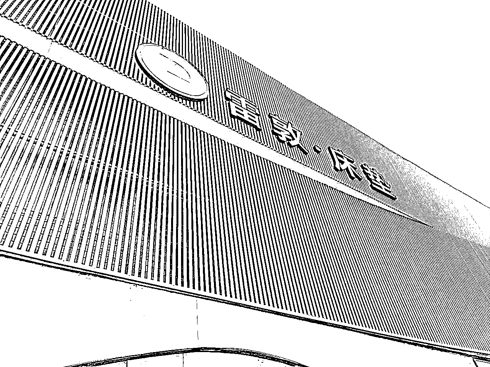
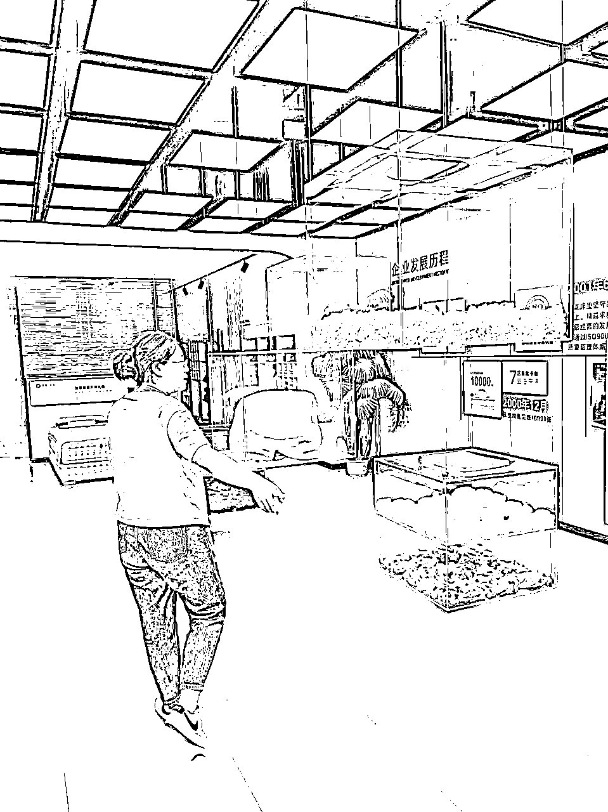
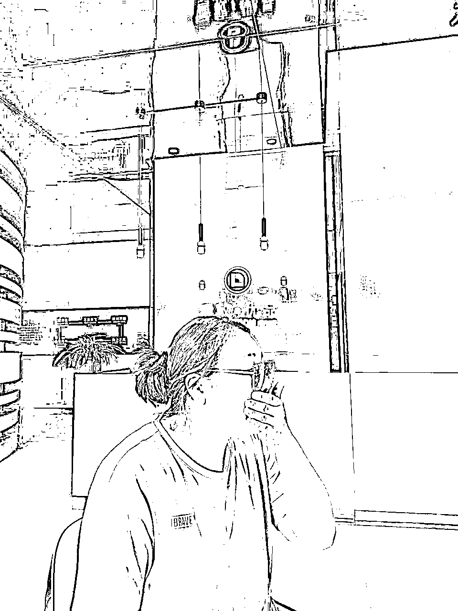
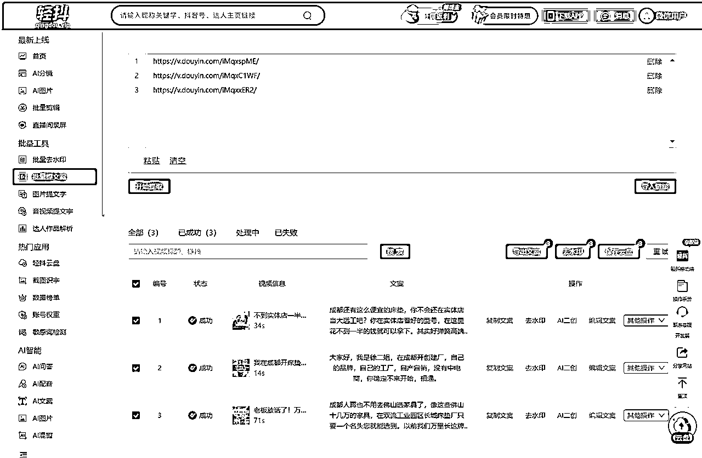
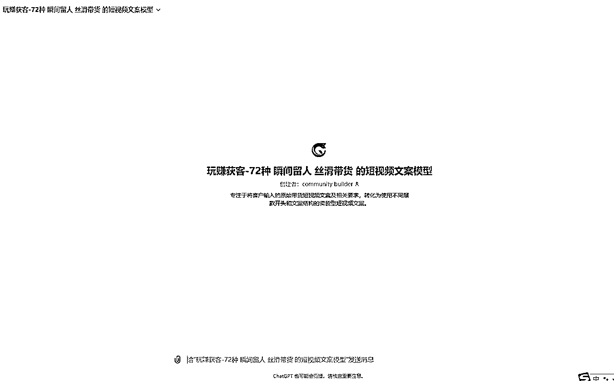
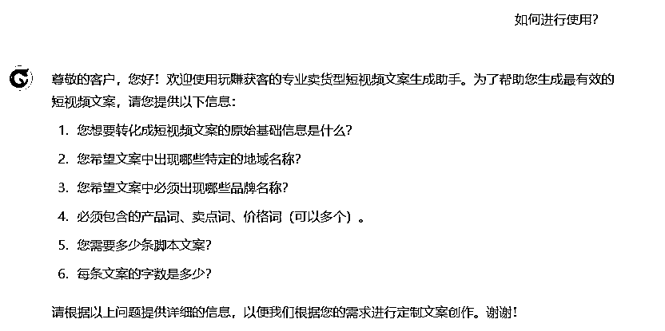
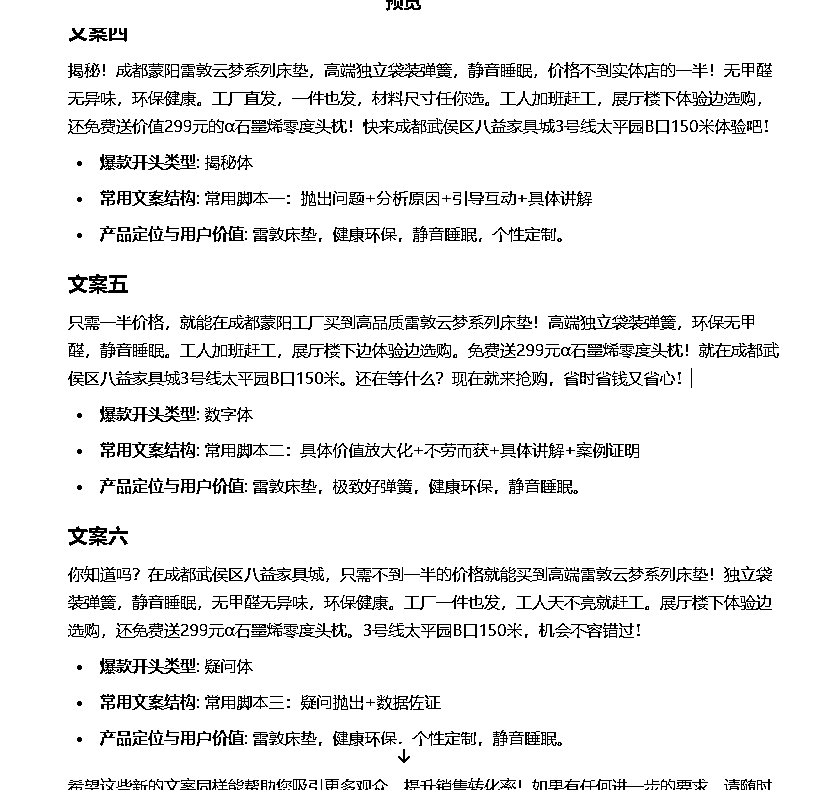

# 10分钟写30条卖货型短视频文案？核心只有两个字：性价比
作者：龙哥

眼见为实，耳听为虚。短视频带货，尤其如此。

最近聊到一个成都床垫品牌，雷敦。做的是高端床垫，客单价八千起步。这牌子底气其实很足：自有工厂，开了整整30年，6000平米的床垫展厅，还有一台300万进口的袋装弹簧设备，号称全四川数一数二。老板本人更是匠人做派拉满，市面上不少高端床垫，都是这家工厂代工出来的。

但一到线上获客，就露怯了。

2023年，他们先后签了两轮短视频代运营团队，1月到5月一轮，6月到12月一轮，前后砸进去50多万，设备买了一大堆，最后颗粒无收，听不见半点水花。

现在的目标很清楚：要么把线上渠道彻底打通，靠短视频加直播直接转化；要么，退而求其次，把同城流量实实在在引到店里来。

这件事，看起来是个难题，做起来却未必。

四个理由。

一是成本低。拍短视频本身几乎不花什么钱，真正要投入的，就是自己的时间精力。

二是落地快。AI一加持，文案可以批量产，最低成本、最快周期地搞定内容供给。

三是客流准。同城赛道里的对手，说句实话，竞争力都不算强。AI批量铺内容，再叠加付费投放，流量很快就能打出热度。

四是反馈快。短视频周期太短了，一个月左右，运营的基本盘怎么样，数据自己会说话。

具体怎么操作？

先看清楚项目：高端床垫，客单价8K以上。这决定了文案的调性——品质感要有，但价格冲击力更要有。

第一步，找对标。

记住一句话：所有卖货型短视频文案，最后一定要落到性价比上。

不知道去哪找对标？直接扒这几个：

https://v.douyin.com/iMqxspME/

https://v.douyin.com/iMqxC1WF/

https://v.douyin.com/iMqxxER2/

第二步，提取文案。

视频播完，文案怎么弄到手？用轻抖这类工具，链接丢进去，口播文字就能直接提取出来，效率很高：

https://qingdou.vip/pctool/text-extract

第三步，拆解结构。

文案拿到手先别急着抄，拆一遍。你会发现爆款卖货文案的骨架都差不多：开头用价格反差制造冲击，中间用工厂实力、工艺细节、环保材质来夯实信任，再用“工厂直发”“个性定制”“现场体验”推一把，最后用赠品或福利收尾促成行动。

好比有的对标文案，直接把“十几万的佛山家具”和工厂里的“一个零头”摆在一起，一句话，性价比就焊死在用户脑子里了。

第四步，让AI批量仿写。

把拆解出来的框架、产品信息、地址、卖点、福利通通喂给AI，等着出稿就行。

参考这样的输入模板：

1. 一条已经跑通的爆款文案框架（比如：“XX还有这么便宜的床垫，你不会还在实体店当大冤种吧？”这种钩子句式）
2. 门店位置：成都武侯区八益家具城，3号线太平园B口出站150米
3. 品牌名称：雷敦床垫
4. 产品与福利：雷敦云梦系列，独立袋装弹簧，静音睡眠；原价299元的α石墨烯零度头枕，免费送
5. 生成条数：3条
6. 单条字数：150字左右

AI输出的初稿，大致是这种感觉：

【初稿一】
成都人买床垫，真的别再给实体店交智商税了。雷敦云梦系列，独立袋装弹簧，夜里翻身静悄悄，价格却比商场同款便宜一半还多。工厂就在蒙阳，一件也直发；师傅们天不亮就在赶单，忙到根本停不下来。材料、尺寸都可以按你的需求定制，楼下就是展厅，边躺边挑边下单。现在到店，原价299的α石墨烯零度头枕直接送。地址：成都武侯区八益家具城，3号线太平园B口出150米。

【初稿二】
还在为一张床垫多掏一倍钱？成都蒙阳这家雷敦工厂店，了解一下。云梦系列用的是独立袋装弹簧，静音体验到位，无甲醛无异味，环保又健康。同样的高端货，实体店一半价就能到手。工厂一件也发，工人加班加点赶工；尺寸材料任你改，展厅就在楼下，体验完再决定。现在来店，原价299的α石墨烯零度头枕白送。武侯区八益家具城，3号线太平园B口150米，找不到算我输。

【初稿三】
成都高端床垫的价钱，一半可能都耗在了门店租金上。雷敦云梦系列偏不走这条路：自家工厂直卖，独立袋装弹簧，静音睡眠，环保无甲醛，硬参数一个不少。一件也能发货，材料尺寸随你挑；楼下就是体验展厅，现场感受再下单。走的时候记得领赠品，原价299的α石墨烯零度头枕，免费带走。坐标：成都武侯区八益家具城，3号线太平园B口150米，可别走错了。

当然，AI生成的文案，不能闭眼直接用。机器写出来的东西，偶尔会有语气偏差和细节出入，需要人工过一遍，顺手修一修。但对比从前，至少能省下80%以上的基础人力。

我们真正希望的是：获客这件事，越来越简单。不折腾、不烧钱，普惠到每一个中小企业手里。让每个认真做产品的老板，都有一条能把货卖出去的路。