# 单条视频点赞4600+、引来上百人私信，这种“吸金内容”是怎么用ChatGPT写出来的？

最近我刷抖音，刷到一位做高考志愿规划的博主。他的账号从零做起，46天涨粉过万。粉丝还没到4000的时候，一条视频突然火了，点赞4600多，收藏近4000，私信来咨询的人超过一百。

这种数据背后，是实实在在的商业价值。高考志愿规划的收费通常在2000元以上一条，所以这条视频带来的潜在收益，可能比很多人一个月工资还高。博主自己也说，这条内容后来被同行搬运，照样拿到不少曝光。这样一套“能引来客户”的视频内容，在任何行业都稀缺。我去招聘网站搜了搜，专门负责产出这种内容的人，月薪给得很高。

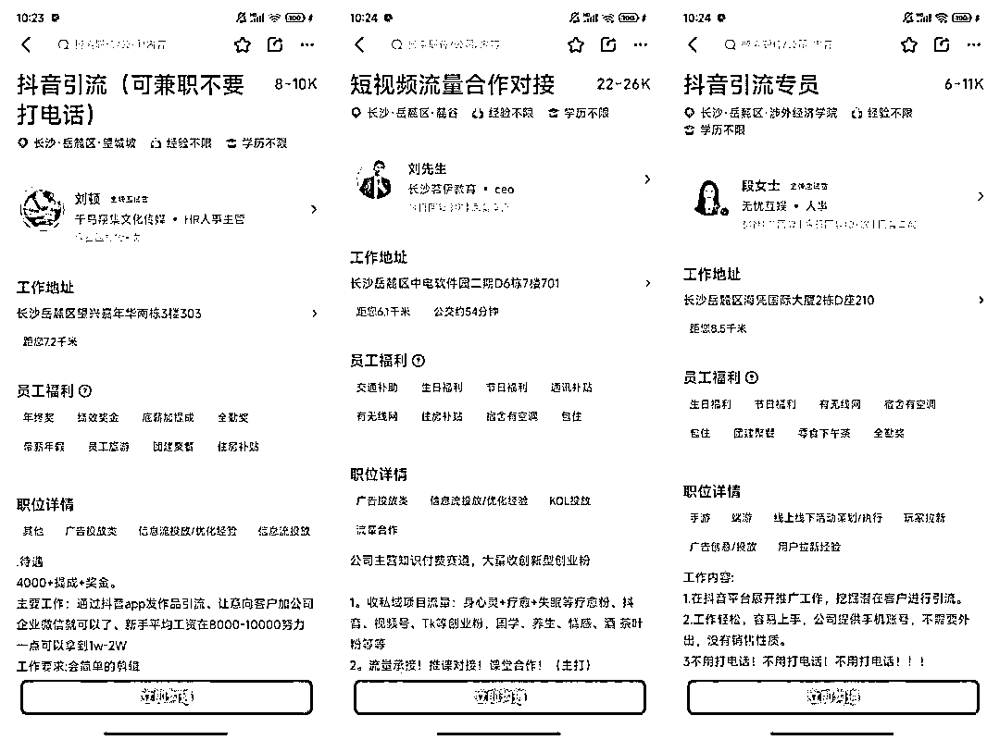

那这种内容到底怎么量产？关键在底稿。我做了13年营销，天天研究怎么用文字拉动咨询，今天就把自己的方法完整拆给你。

先看那条爆款视频的叙事套路。它的核心是：让用户意识到自己原本的认知是错的，再给他一个简单可执行的解决办法。视频先提一个问题，大意是：家里条件普通，孩子是不是就和好工作无缘？然后又替观众回答：很多人觉得是因为没背景、没资源。接着马上反转：这不是真正的原因。真正的原因是很多父母根本不了解招人消息从哪些渠道放出来、有哪些门槛、何时报名。随后，视频拿“少数家庭早就掌握消息”作对比，把差距摆出来，然后给出几个官方消息来源，再落到“提前做打算、选对方向、就业更稳”这个美好结果上，最后收尾时带动大家关注这个号。

接下来你会发现，这条视频的每一步都有明确的“心理控制点”。我总结成了一套方法：

- 开场提问：要问观众心里最慌的事，比如“你家孩子将来能进好单位吗？”
- 替观众说出误区：比如“你是不是也觉得，没有门路就无缘？”
- 否定这个误区：直接说“不是你想的那样”。
- 给出本质原因：原因要具体，最好包括时间、条件、途径，让观众觉得你很懂。
- 制造对比：讲一讲掌握消息的人得到了什么，而没打听过的人错过了什么。
- 降低难度：告诉观众，这事靠“获取消息的途径”就能解决，不需要特殊关系。
- 引导互动：请观众把这条内容保存下来，顺手点个赞。
- 公布具体方法：把渠道名录一条条说明白。
- 关联自己的服务：说明这些信息能帮观众解决更多相关问题。
- 描绘未来：用“如果能提前了解，就可以……”来激发向往。
- 收尾关注：一句话说明“关注这个号，你能持续得到什么”。

如果你想亲手试一遍，可以用ChatGPT来做。我拿护肤领域示范一次：博主做护肤科普，观众是年轻女性，服务是护肤咨询，干货是“反复长痘，可以外涂A酸类产品”。让AI按上面十一个要点生成，它给出的初稿是这样的：

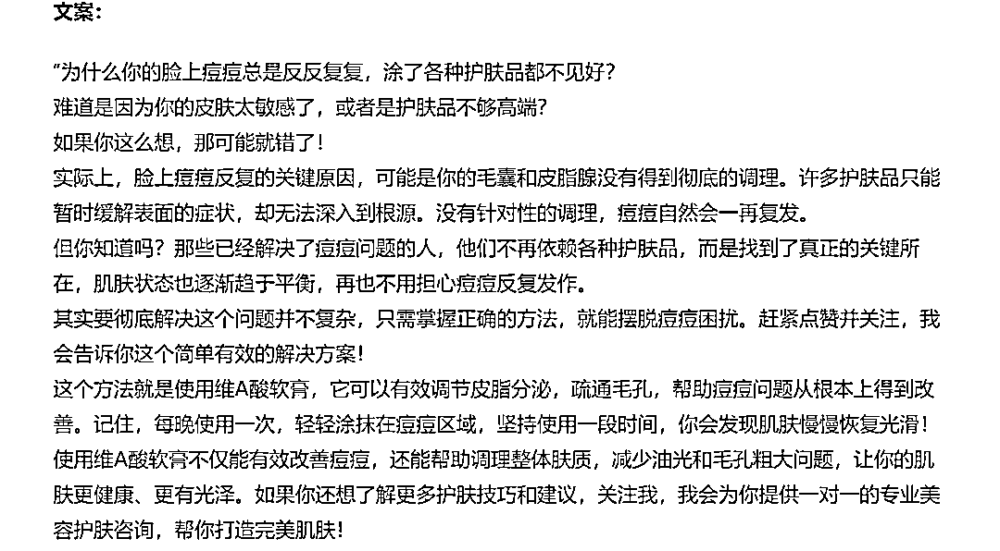

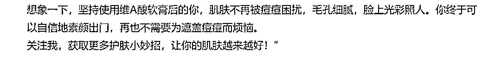

注意这只是初稿，你可以再根据专业细节优化。

要让ChatGPT稳定输出，关键不是让它自由发挥，而是给它一个清晰的“工作流程”。我整理了一个Prompt模板，你可以直接用：

**角色**：你是一个视频内容创作者，擅长抓住观众的情绪，用提问、反转、对比和行动指令来组织口播稿。

**执行步骤**：你先问清楚我的领域、观众、服务和干货。然后按以下顺序创作：
1. 用一个悬念开头，让观众带着“这和我有关”的感觉看下去。
2. 说出观众心里可能存在的错误想法。
3. 直接说这个想法不对。
4. 解释真正的背景和原因，尽量讲细。
5. 举一个对比案例，让观众产生“我不想落后”的感受。
6. 指出解决这件事其实不难，并请观众点赞保存。
7. 给出解决所需的具体清单或步骤。
8. 说明掌握这些后，还能得到哪些额外的好处，并自然联系到我的服务。
9. 描述照做之后的好结果。
10. 用一句话说明关注的价值。

**要求**：每一步生成后先问我“可以吗”，得到肯定再下一步；所有步骤完成后，把内容自然拼接成一段口播稿，不要有遗漏；语气要像在聊天，多用“你”“咱们”这样的词。

**开场**：当我说“开始”，你先问我三个问题：你的视频主要讲什么？想吸引谁？你能提供什么服务或建议？

把这段Prompt发给ChatGPT，它就会一步步带你完成。我也用ChatGPT4o实际跑了一遍：

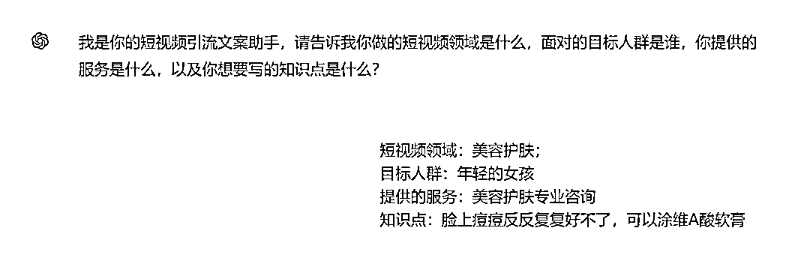

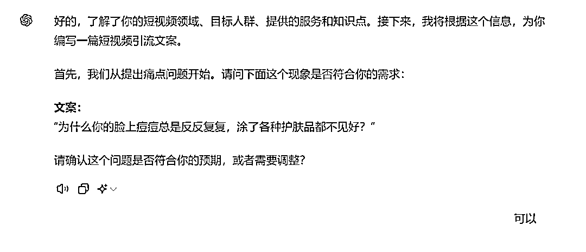

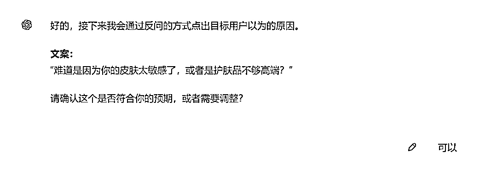

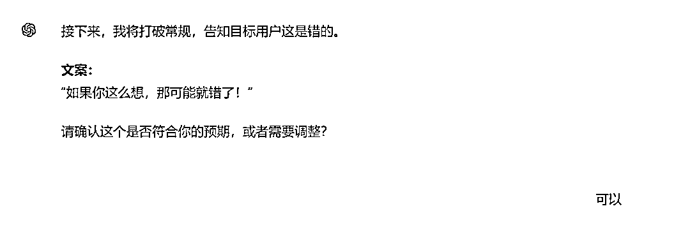

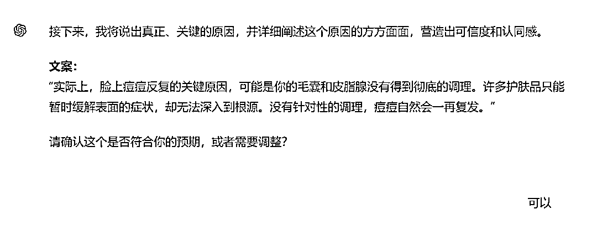

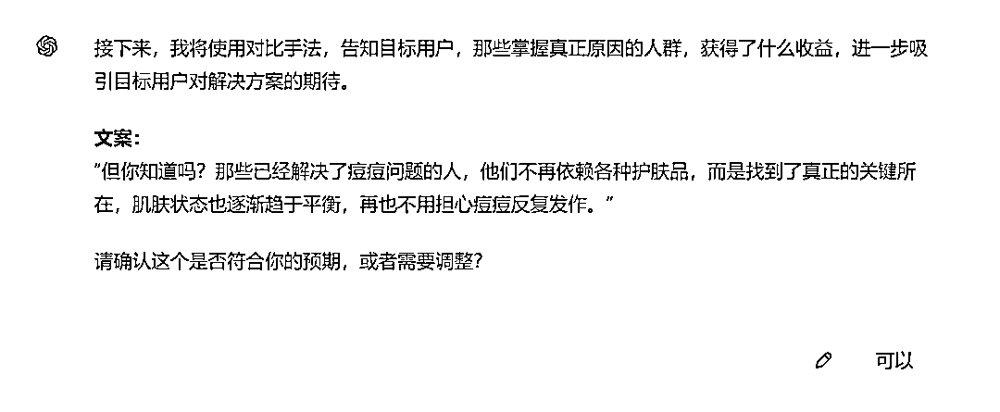

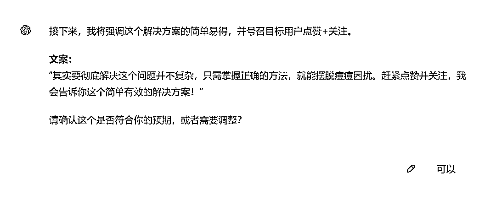

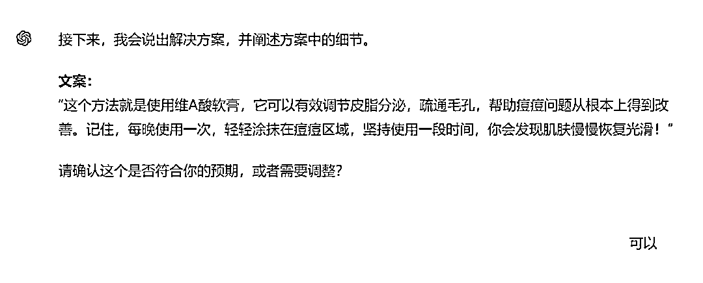

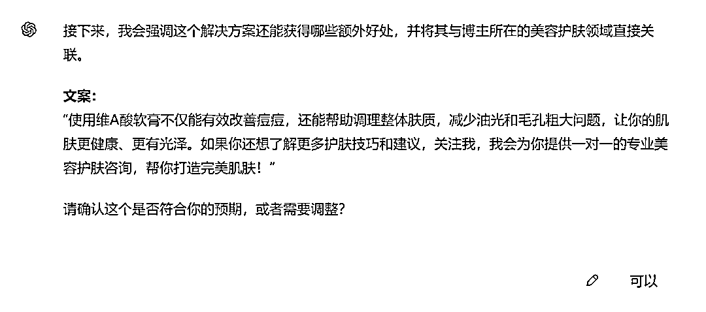

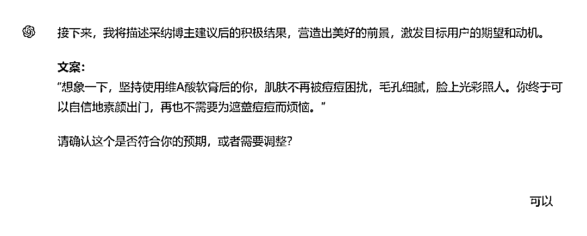

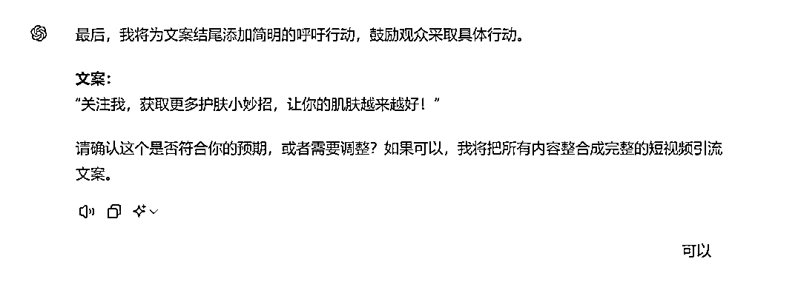

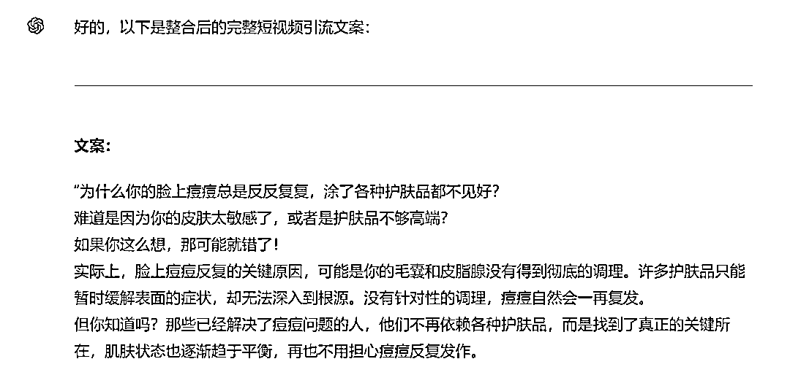

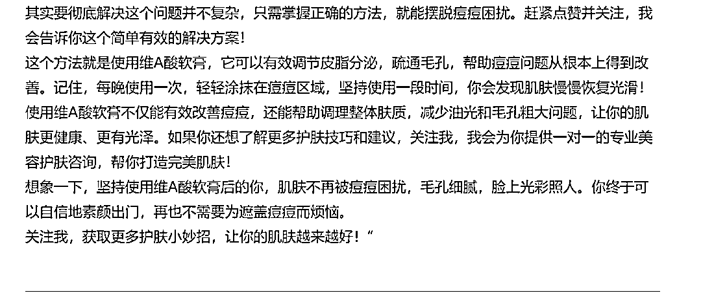

看这里的对话记录，AI每完成一步都会先征求我意见，再继续往下走。最后它拼出的成稿，基本符合我们拆出来的结构。

所以，想让AI写出有获客力的内容，不要再用“帮我写个稿子”这类模糊指令。你先把爆款底稿的“心理钩子”拆给AI看，再让AI按流程一步步填充。这样，它生成的内容才能真正替你带来咨询。

这就是我的完整方法。如果你也在做视频获客，不妨打开ChatGPT，按这个流程试一次。