# 视频号带货：从实战航行到结果兑现
作者：龙哥

# 用数据说话的航行

2024年，电商赛道整体承压，平台波动、竞争加剧成为常态。外界普遍认为做带货更难了，而我们发起的视频号带货航海训练营却选择逆势前行，并交出了一份超出预期的成绩单。

“长风破浪会有时，直挂云帆济沧海。”站在训练营尾声回望，整段实战航程让人振奋。非常荣幸担任本期视频号带货航海的主教练，与大家并肩同行。相较以往，本期首次将21天的常规周期延长至47天，以长期深耕的模式进行首轮测试，市场反馈非常积极。

本次集结共1189位船员，共同驶入视频号的蓝海。历经多次试炼，最终814位圈友顺利完成上岸任务。大家累计发布150条以上的带货视频，整体出单率稳定在85%左右，合计创造约350万+的成交总额，人均出单达3554元。期间全员共完成24582次打卡，产生6349件好事。

# 真正的认知，来自持续实操

为何要把周期从21天拉长到一个半月？因为从0到1的方法论，21天足以建立框架，但把方法落地成稳定订单，需要更长的子弹飞行时间。长期作战才能真正打磨对平台、对用户、对产品的理解，并在细分赛道里沉淀下来，进行账号、类目、产品的反复测试。

往期不少朋友结营后会说，我出了单、我小爆几百单。21天打通思路后，真正动手的时间却很紧。尤其大部分参与者以副业身份在测试项目，工作之余还要兼顾选品、拆解、找素材、拍摄剪辑、发布运营、直播等一系列动作，时间明显不足。将周期拉长，意味着实操密度提升，成果更可期。

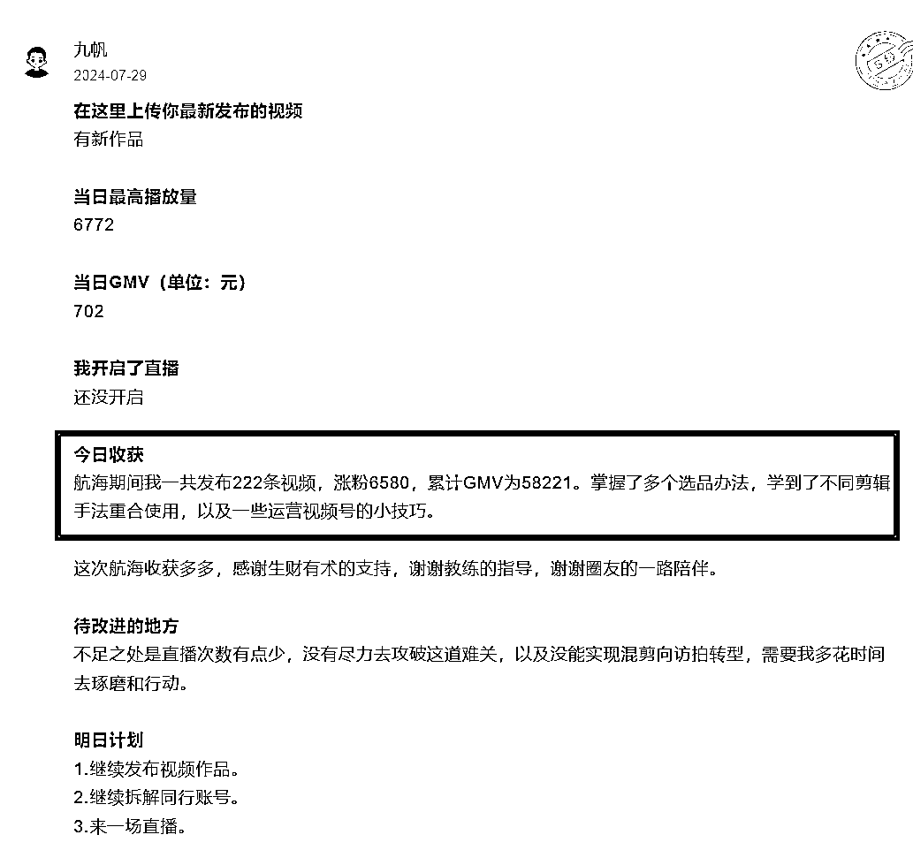

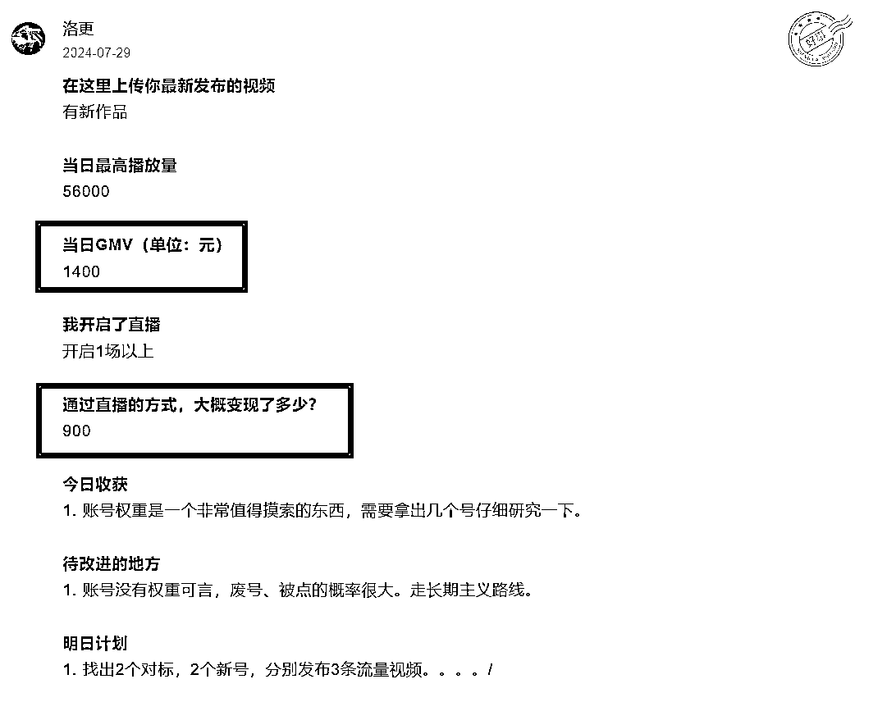

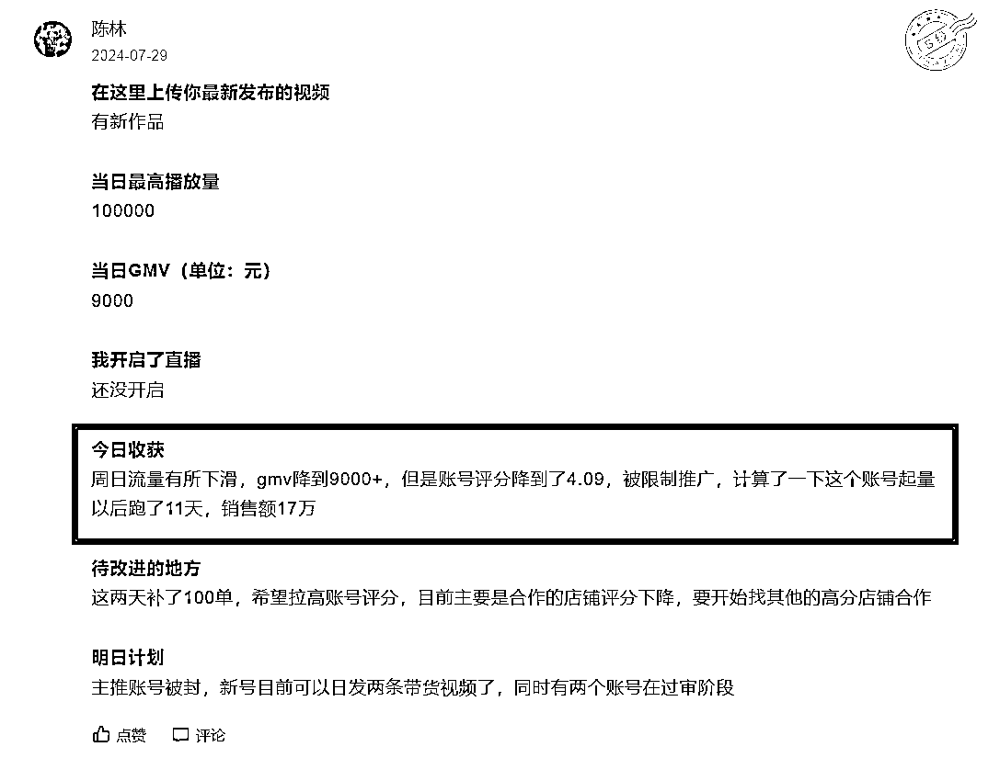

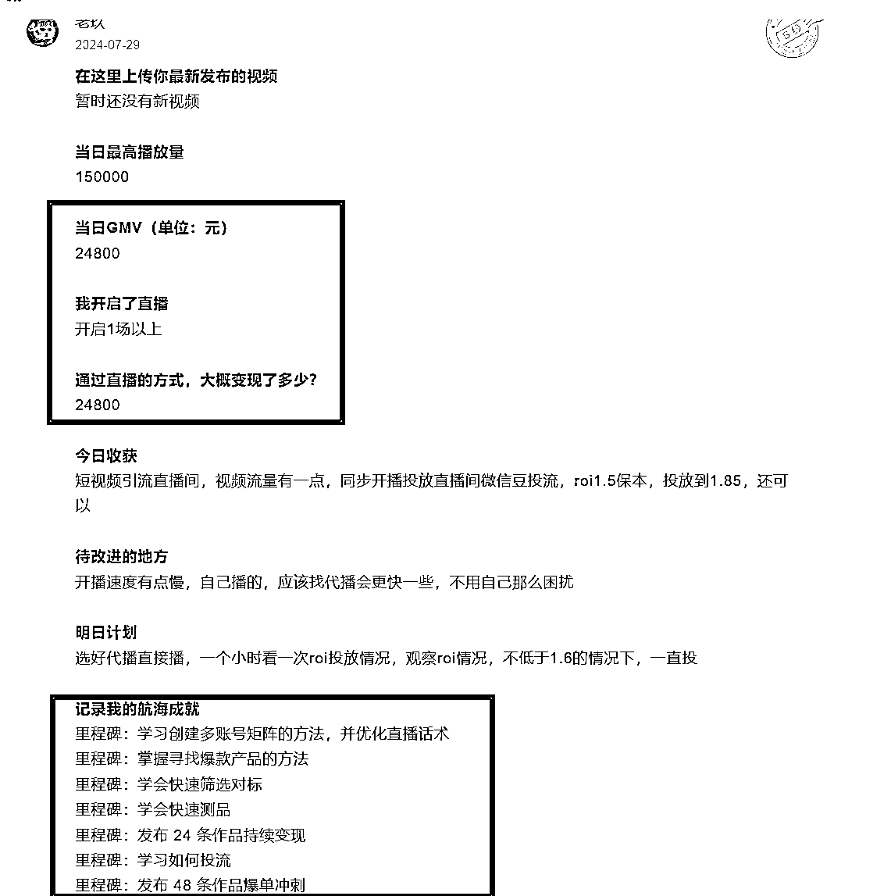

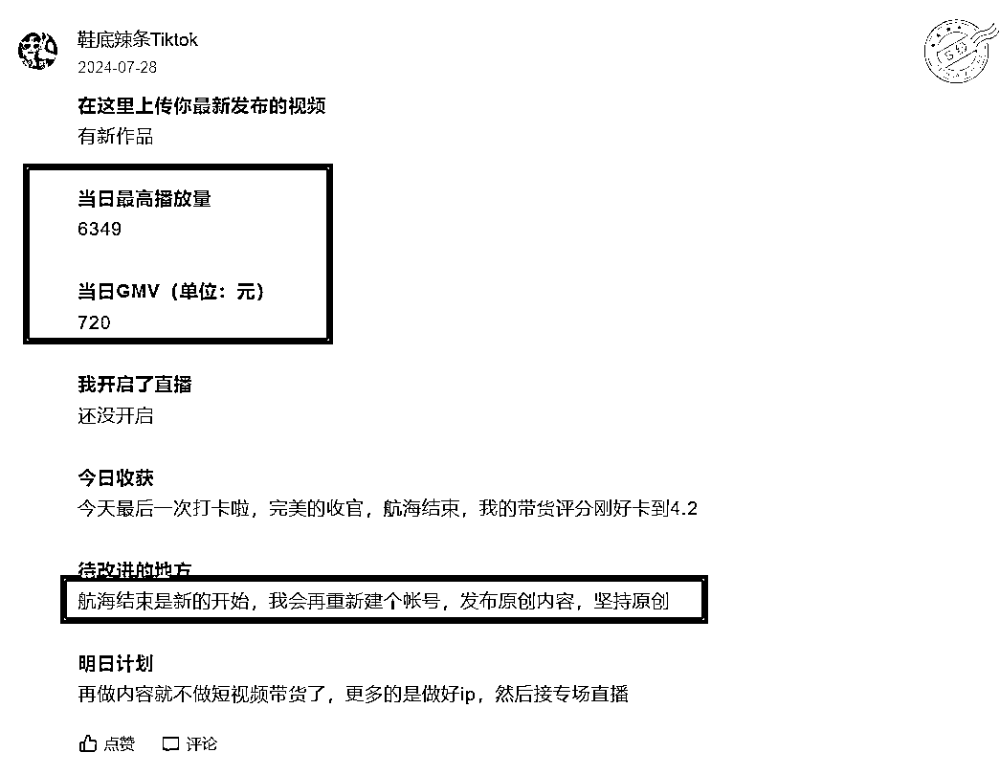

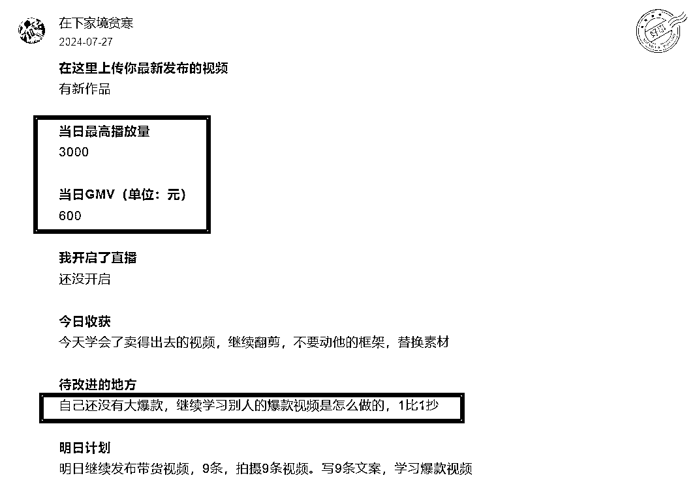

本期我们也做了另一项调整：每人限报2个项目。过去可报3个甚至更多，但精力分散往往导致实战效果打折。此次在第六次直播分享时，已有圆友坦言公司项目刚告一段落才正式加入航海。我当时回应，不必焦虑，虽然已过半程，后半个月仍足够聚焦，完成上岸并拿到结果。

# 航海体系：五大核心利器

人无我有，人有我优，驱动高产结果的正是这套实战系统。

航海手册 —— 《武学入门》
这是视频号带货的基础心法合集，为新手提供清晰的入门路径，相当于一本系统性的视频号百科。

高手领航 —— 《武学讲堂》
航海期间共进行8场直播领航，带领大家逐章拆解手册内容，并针对最新实战问题现场答疑。

群内答疑 —— 《群雄解惑》
每个战队配备专属答疑教练与领队，选品困惑、运营难题，都能在群内即时获得解答。

作业点评 —— 《剑谱点评》
学员将每日打卡日志整理成“剑谱”，教练团队会逐一复盘点评，并同步给全员共同提升。

高手分享 —— 《江湖传经》
优秀圈友现场复盘自己的实操路径与避坑经验，让后来者站在前人肩上加速成长。

# 精进是常态，坚持是底色

本期航海给我最深的感受是参与者的执行力。最终814人上岸、24582次打卡、6349件好事发生，47天里每天都有人在复盘当日进展、沉淀思考。

圈友航海日志打卡部分截图

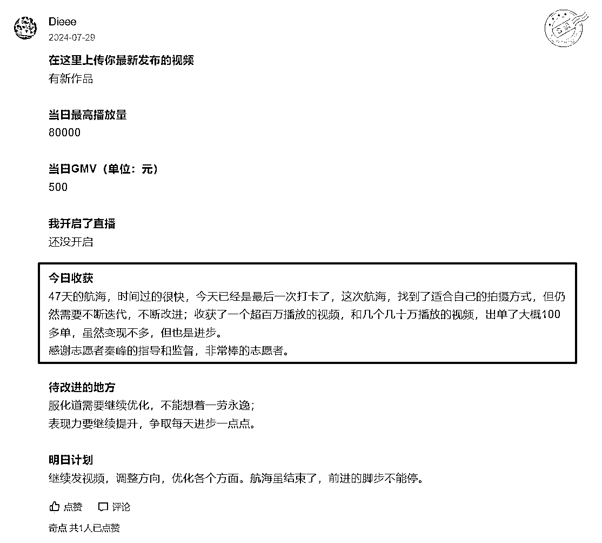

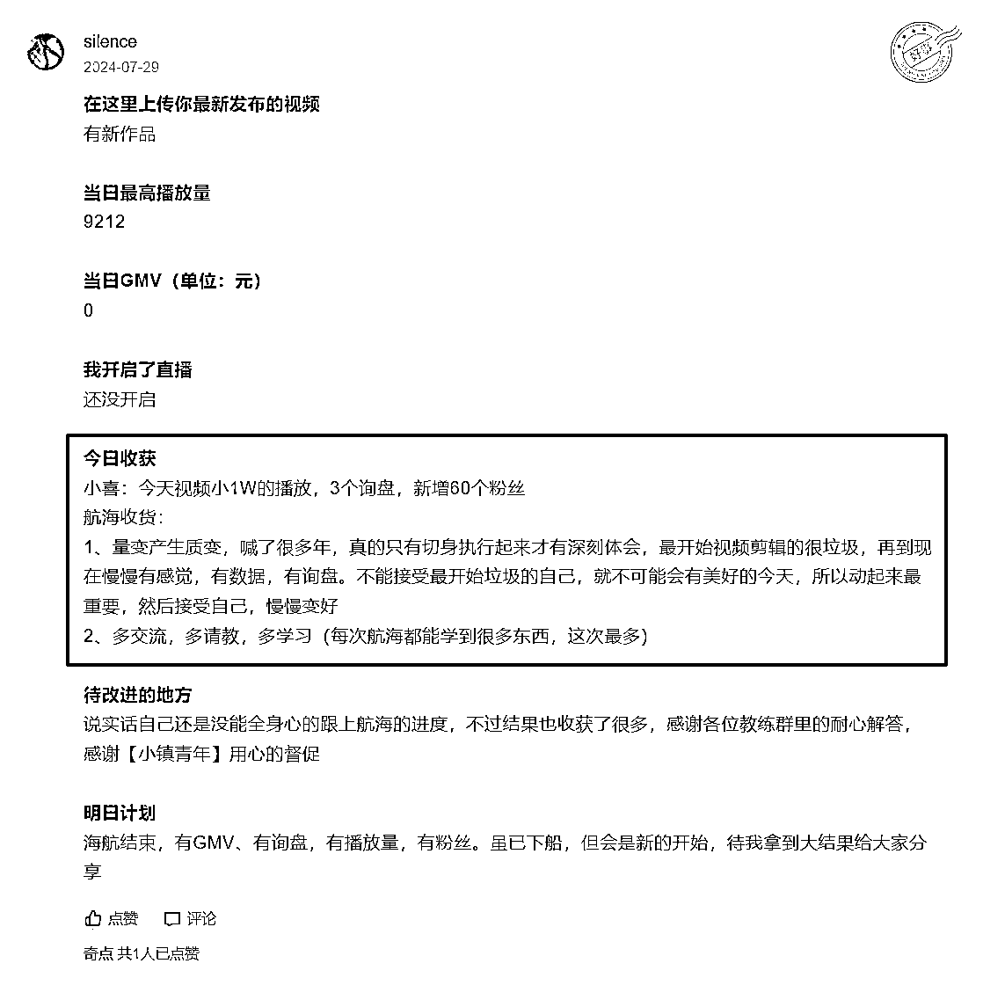

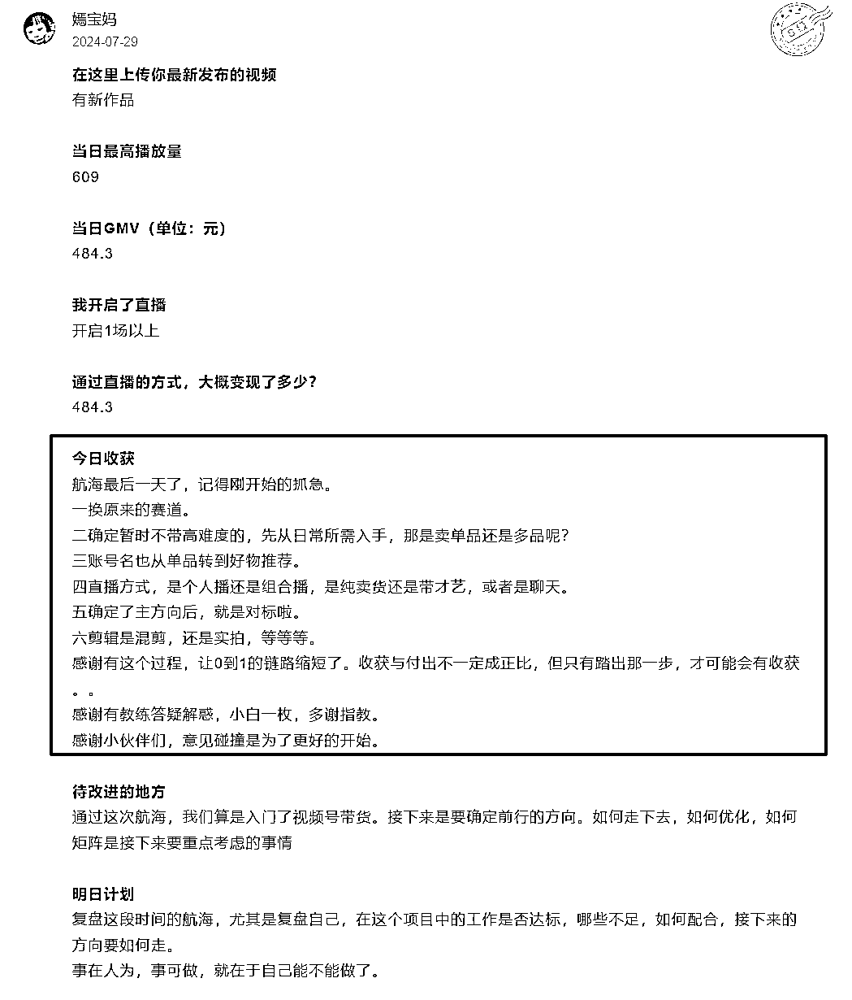

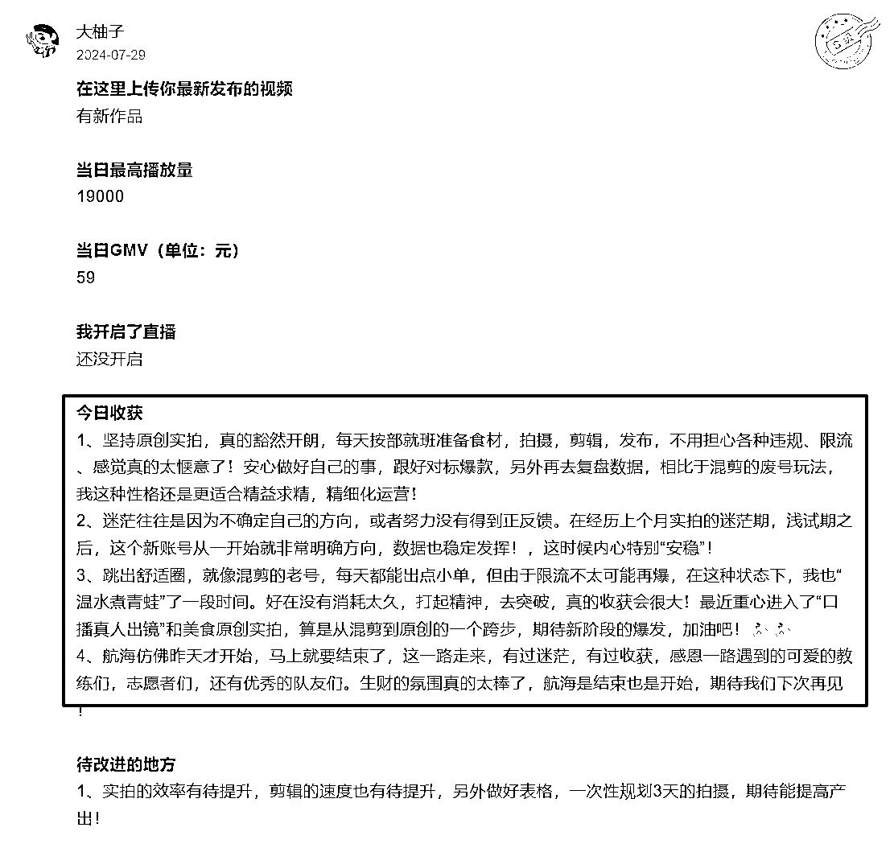

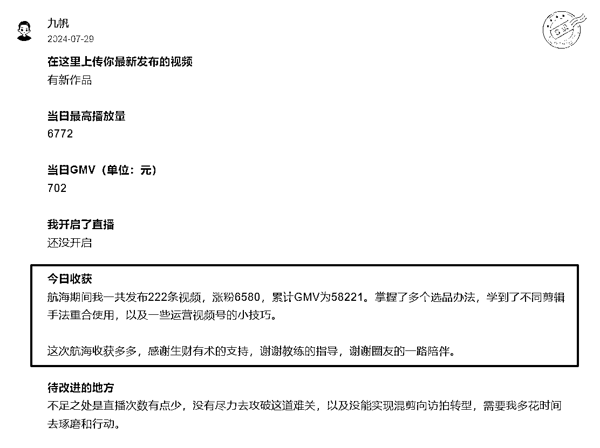

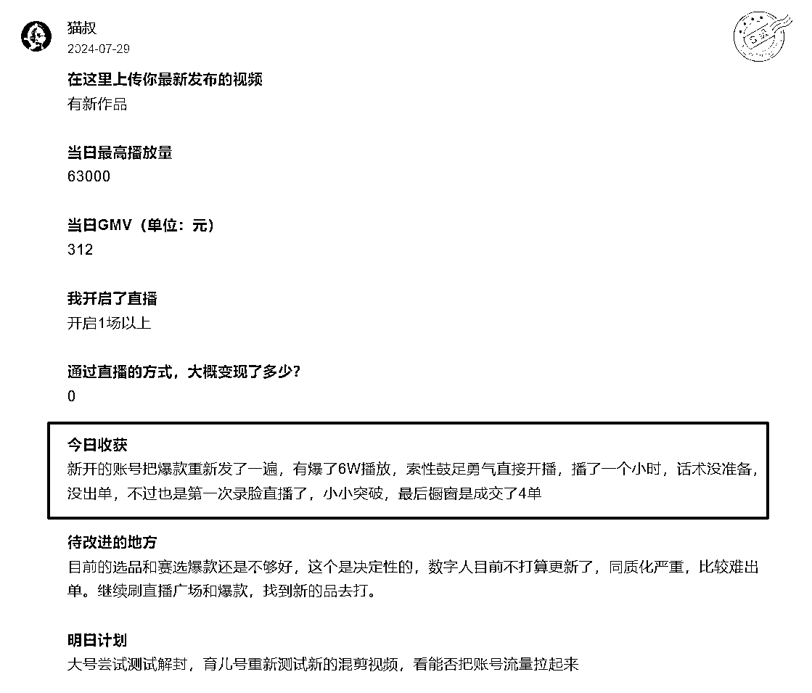

# 一个值得长期深耕的赛道

*   资金门槛：启动成本极低，单账号仅需100元保证金即可起步。
*   技能门槛：选品、素材、剪辑、运营、直播，均无需达到全平台顶尖水准即可跑通。
*   时间投入：每日2-3小时利用碎片时间即可掌握核心技巧，众多圈友从副业验证逐步搭建团队放大。
*   市场前景：依托国民级应用🛰️，视频号商业流量仍有巨大增长空间，细分赛道仍存在大量机会。诸多在抖音、快手、📕早已爆过的产品，在视频号仍能重现热度。

视频号带货完全可以作为3-5年以上的长期赛道深耕，尤其当下细分品类带货内容供给仍然不足。

# 实战带来的核心能力

本期航海聚焦落地快、见效快的实操技能。

*   选品策略：学会分析爆款逻辑、市场趋势与用户需求，提升转化效率。
*   内容创作：掌握从素材整理到剪辑混剪、拍摄到直播带货的完整内容生产链路。
*   流量获取：理解平台规则规避限流封号风险，掌握推流算法与爆量逻辑，获取更多自然曝光。

# 结营只是新征程的起点

47天说长也长，说短也短。一个月半的时间验证一个玩法，判断是否适合自己，无论作为副业试水还是项目验证，都能获得清晰的结论。

航海结束并非终点，而是下一次发力的起点。江湖路途风雨交加，短暂的沉寂是为了更强的爆发。每一次尝试都在积累内力，每一次挫折都在淬炼心态。沉下心来研习打法、洞察市场、把握时机，下一次你也能一剑封喉。

*   小试牛刀（100单内）：
*   复盘：若数据表现平平，先自检是否严格执行手册与航行指南。若因工作家庭原因参与度不高，属正常情况。47天建立认知后，可在下一期再次挑战。

*   选择：若实操后发现对选品、剪辑、运营兴趣度低或存在抵触，也是一种价值 Clarity，明确自身更适合图文或其他形态。

*   崭露头角（100-1000单）：
*   精进：订单已有但波动较大，这是大多数人的状态。电商竞争激烈，需持续优化内容与产品，探索出属于自己的细分打法，把不确定转为确定，爆单只是时间问题。

*   出类拔萃（1000单+）：
*   放大：已在视频号跑通需求判断与内容打法，建议乘胜追击，在同一赛道或玩法上做深做透，实现模式复制。

最后感谢赚钱团队与领队志愿者的付出，每一次航海都是共同成长。期待下一程再见。我的🛰️95644261，欢迎交流。

一起龙哥盟！