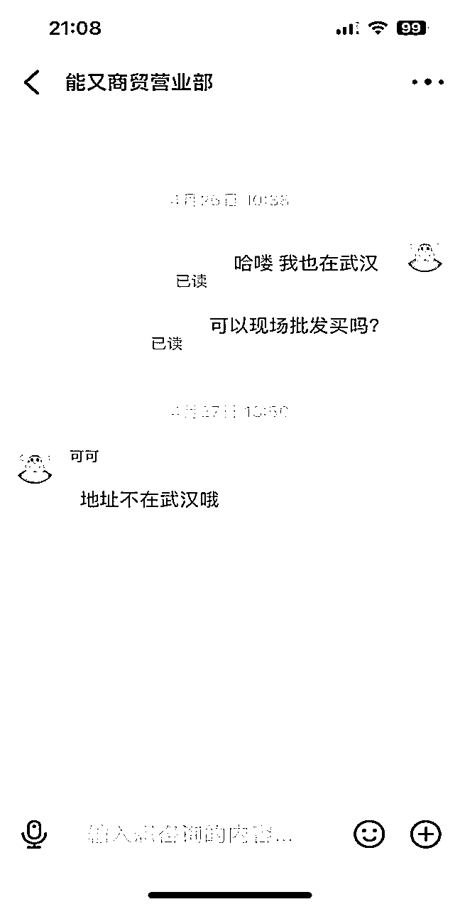
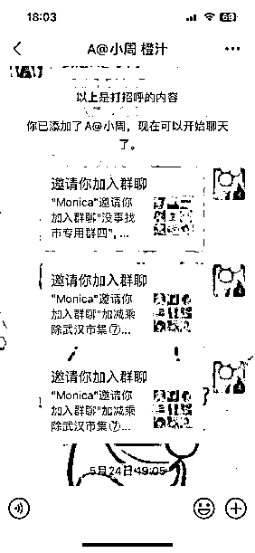
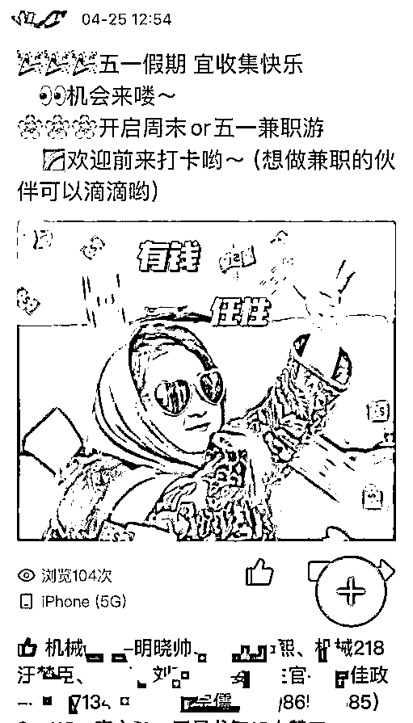
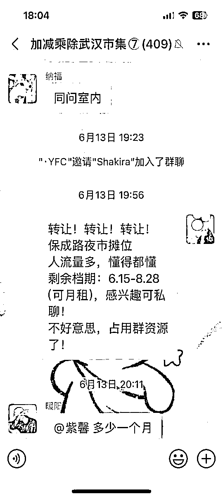
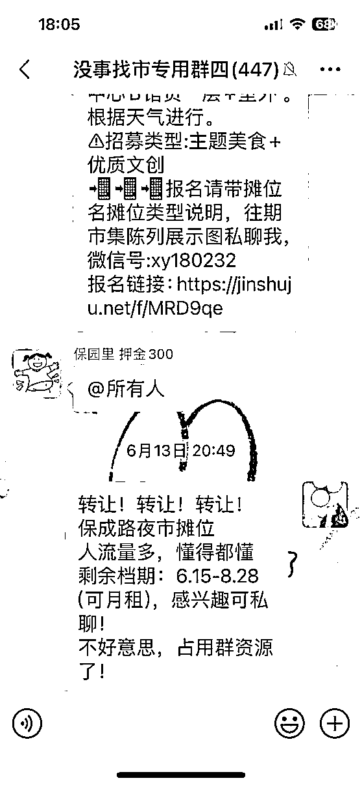

# 零零后裸辞摆摊如何一天赚回半个月工资-拆解复盘

这个00后不卷了，去摆摊卖漆扇，结果一天利润顶上别人半个月工资。我把她的完整玩法拆给你看。

先晒个成绩单：她那一天开了三个摊位，加起来收入怎么算？摊位一1038.4元，摊位二810元，摊位三664元，减去团扇310元、摊位费80元，再减去三套物料的成本——大漆46.95元、一次性手套12.5元、印章8.79元、桌布14元、广告布29.29元、展示架20.45元、中号盆37.37元、吸纸巾25元，全部×3。最后净利润是1539.35元。一天赚回半个月工资，不是开玩笑。

漆扇是什么？说白了，这是非遗项目，把传统漆艺和现代市集玩法结合起来了。它既是纳凉工具，又好看，有文化底蕴，还能让顾客亲手做一把，体验感直接拉满。

为什么会选这个项目？她平时爱搜搞钱信息，刷📕时刷到“夏天摆摊适合卖手工橙汁和非遗漆扇”的视频。站在顾客角度想了想，橙汁不新鲜，漆扇倒是没见过几回，又漂亮又应季，还能自己做。再加上她在赚钱社区一搜，发现漆扇正热，风口来了，赶紧上。

线上火不代表线下火。她在武汉，先跑江汉路地铁站考察，那里刚好有一家漆扇摊。她二话不说花钱做了一把，顺便学手法、看摊位怎么摆。然后躲进旁边的咖啡店，从人家开摊盯到收摊。结果发现人流相当夸张，几乎每10个路过的人就有8个掏钱，围观群众更多。这一趟下来，她确定：能做，回去备货。

备货不是一帆风顺。她本来在1688上精挑细选，看到满100有优惠，直接买了100把团扇。结果一上手，上色不均匀，扇子还开裂。第二天就要出摊，这太要命了。不过她没慌，开始疯狂自救：先搜1688上的武汉本地供应商，有一家显示在汉阳国博，客服却说不是武汉发货；又去📕、抖音搜同城进货资源；实在不行就去汉正街碰运气，或者问同行进货。靠着搜商，她找到一个线下采购帖，问出汉正街有批发。第二天一家家找，找到四家。这次学乖了，每家买一把回来试，其中一家贵三毛的反而效果最差。最后锁定了靠谱供应商，批发完下午照常出摊。

漆料也有讲究。便宜的是腰果漆，有毒；贵一点的大漆无毒更安全。她进货时没犹豫，直接选大漆——“挣钱得对得起良心”。

没摆过摊，咋找场地？答案全在网上。她搜“武汉摆摊”“武汉市集”，出来一堆招商信息，扫码进群、投作品报名。另外，摆摊早的前辈肯定手里有群，她就抱着利他心态去聊天，互相分享市集信息、互换对方没进的群。信息越多，报名越早，越能赶上活动红利。比如五月份青山江滩有国际沙排比赛，她一知道就马上报名。有活动就有流量，有流量才有生意。

四月底她先自己摆了一次，证明能赚到钱，这就算最小MVP。为了抓住五一、六一、端午节的客流，她决定矩阵化操作，再加两个摊位。一个靠发兼职信息招到人，另一个是自己的表妹。她把话术整理清楚，培训手法，练多了之后，顾客都以为她们是美术生。

再说风险管控。保成路夜市在汉口人气旺，来的多是女性和年轻人，跟漆扇的目标用户很匹配。她提前考察，发现那里只有一家漆扇，位置还偏。为了赶上六一端午，她直接找夜市办负责人，加了两个摊位老板的🛰️，等空位出来就搬进去。后来真等到一个一米摊位，季租3600元，拿下。接着搞摊车，咸鱼淘宝上的都要1000左右，还不一定结实。她问老爸，老爸托熟人打听到古田四路二手市场有材料，于是框架、底座、KT板全程自己组装。结果本钱赚回来了，一出摊就下雨，心态有点崩。看新闻看天气，后面还有梅雨季，不出摊每天固定亏40元，剩下两个月还要支出2400元。她赶紧在之前加的市集群里发转租信息，筛选了几个意向者，还故意制造“已经有人特别想租”的氛围。这招挺有用，从发布到签合同只用了三天。

复盘下来，她对未来有几个延伸想法：一，没做线上引流，以后可以直播做漆扇，引导下单；二，没好好拍视频经营账号，可以考虑和靠谱供应商合作，分销材料拿提成；三，用优惠或小礼物让顾客扫码加🛰️，把粉丝群和朋友圈养起来，老顾客就能线上下单；四，跟活动方合作，承接团建体验、研学项目。

最后是她的几点心得，特别实在。

第一，有效信息非常值钱。知道哪里办活动、哪里招商，赶在别人前面报名，比守在一个地方死扛强太多了。

第二，情绪价值要拉满。每做完一把扇子，她都会夸一遍，从颜色搭配一路夸到意境——“一半天成，一般人成”。就算顾客自己觉得做得不好看，情绪给到位了，人家照样买单。

第三，摆摊最关键的两件事：选址和选品。人流再大，品不行也白搭；品再好，没人路过也没用。

第四，心态要稳。不是每天都能破千，有时候守到快收摊才开第一单，有时候可能挂零。别焦虑，个别几天说明不了整月的情况，遇到问题解决问题就好。

第五，要灵活变化。比如价格：江汉路的顾客多是大学生、年轻人，消费力不高；华发那边是居民和商场环绕，消费力高。她在华发前两天用原价，每天只卖四五把。回去一想，数量一样，不如把单价提上去。于是普通款从29元调到39元，折扇从39元调到59元。结果营业额立刻涨了。再比如位置：第一次在三环外的商场摆，一天只卖两把。但江汉路明明卖得很好，说明不是品的问题。她回去路上就给市集负责人发消息，第二天换到二环内商场，生意渐渐有了起色。

第一次在赚钱发帖，写得不好的地方请各位圈友多指教。这套玩法不一定适合所有人，但思路绝对值得借鉴。感恩相遇～