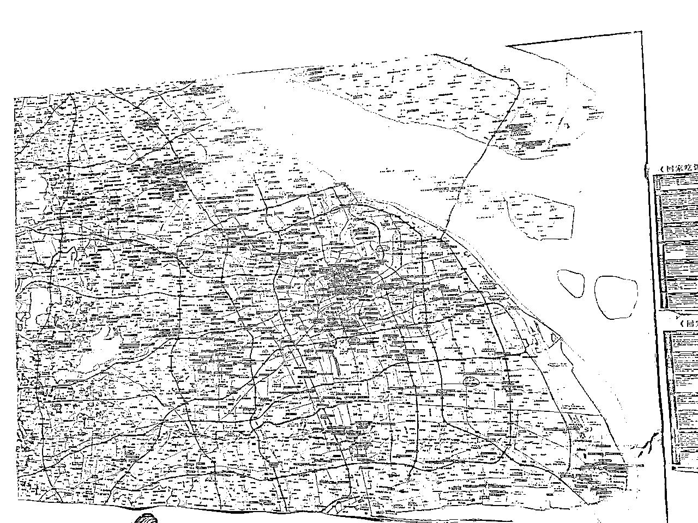
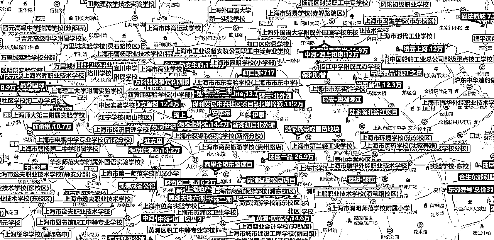
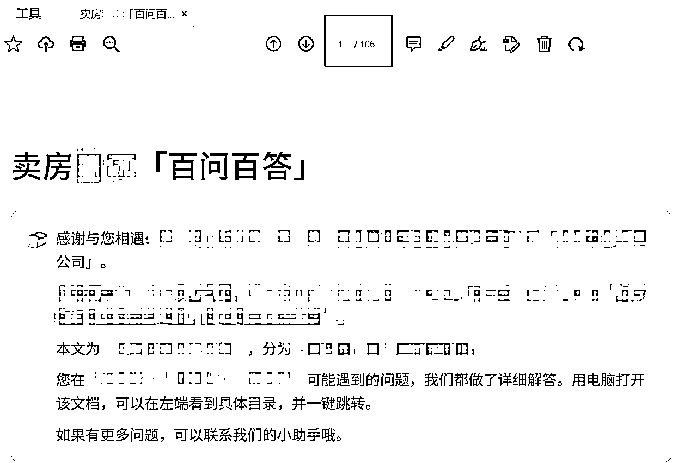
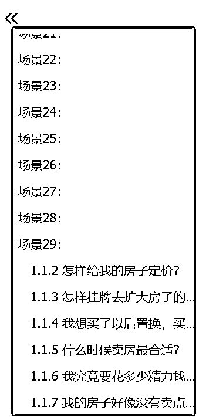

# 从留学赛道杀出来，我们用2个月在新蓝海赚到一个小目标

2024年，这批行业和岗位的业绩已经在掉头，或者正在掉头的路上。

留学、金融、英语培训、健身房、宠物尤其是猫生意、设计、奢侈品、传媒、音乐、艺术、戏剧、咖啡馆、理发染发美发店、动刀的医美、酒吧、KTV、影院、高尔夫、轻食、卖天价面包……

统称男剪女布。未来十年，这个方向只会继续萎缩。

如果你正卡在上面，现在就该考虑换赛道了。

我接下来会拆开讲清楚两件事：
1）这些赛道为什么掉队
2）钱到底流向了哪里

先做个自我介绍。我是珍妮子，22-23年和合伙人陈铭Ivy在📕做留学项目，一年营收2700万。察觉到风向不对后，我们提前撤了，去了一个客单极高的新方向。

想看我们转行过程的老板，可以翻我们之前的笔记：
1️⃣https://t.zsxq.com/DT1SJ
2️⃣https://t.zsxq.com/aPL7f
3️⃣https://t.zsxq.com/XXl6X
4️⃣https://t.zsxq.com/Fvvr8
5️⃣https://t.zsxq.com/LhyXR
6️⃣https://t.zsxq.com/2Wg9U
7️⃣https://t.zsxq.com/49u9r
8️⃣https://t.zsxq.com/r7CMz

转行才两个月，Ivy和我这边已经签约11套房源，7套成交，合计近一个亿。分别是2000多万、800多万、700多万、4000多万、200多万、1400多万、400多万那几单。剩下4套还在为房东匹配精准买家。

我之前因为写了《老板避雷手册》和《📕留学赛道趋势》，被大家关注。随后大量留学同行私信我，说团队被裁、8月只剩一个人运营、公司直接关门、老板去花几万上自媒体课亲自做IP。

这些都是雪崩前夜的抖动。怎么救都晚了。

因为疫情这几年，社会心态被“石化”了。可以这么理解：

人们不再像20年前那样追逐享乐。
不再痴迷旅游、搬家、出差。
不再为中产的符号买单：豪车、名表、奢侈品、整容、国际学校。

取而代之的是：
要平淡、看得见的稳定。
喜欢待在家里，留在本地。
物质欲望降温，存钱优先，不为“想要但用不上”的东西付费。
中产开始极致性价比，男剪女布那种靠溢价收割的模式，中产不买账了。

底层依旧踏实干活，口罩期间甚至有人闷声发财。但他们不玩男剪女布游戏，所以看不见。财富没有消失，只是转移了。有一部分人已经赚得盆满钵满，只是他们不爱发声。

就像京东、淘宝的体量在被拼多多吃掉一样。钱没有没了，只是换了个口袋。

我前面说的那些下行的赛道，流失的钱，被石头赛道和被石化的男剪女布拿走了，比如：收纳师、上门烹饪阿姨、正骨医生、发质养护、 中医调理、体质营养师、上门私教、好吃平价的包子店、科技公司等。

再往下分，钱还集中在这些人手里：
人工智能工程师、物联网工程师、大数据工程师、云计算工程师、农业经理人、物联网装调员、智能制造工程师、VR工程师、电器环保检测员、康复辅具咨询师、集成电路工程师、食品安全管理师、电子数据取证分析师、碳排放管理员、数字化方案设计师、口腔卫生技师、有色金属现货交易员……

回到开头，几乎所有留学同行都在烧投放、半个月10万打水漂；或者卷运营卷不出水花；或者硬撑到倒闭。

而我们和Ivy从2023年4月就开始悄悄撤离、提前布局。所以今年别人降薪裁员、撑不下去时，我们这家创业三年的小公司，营收反而稳步上扬，躲过了创业三年大概率死亡的魔咒。

下面分几块讲清楚，无论你在不在上海，都能用上。

1. 珍妮和Ivy转行后在做什么
2. 这个赛道到底是什么
3. 业务的优劣势
4. 为什么做了2700万还毅然换项目
5. 上海的伙伴欢迎加入

# 转行后我们做了什么

起初我们只做代运营，只接客单上万的老板，收2万/月服务费+提成。用低门槛服务费去接触高客单项目，再技术入股。

项目必须由Ivy严格筛选。虽然有些项目客单也在万级，但增长天花板不够，我们会直接拒绝续费。代运营只是引流工具，我们要的是下一个能快速做到2700万的标的。

今年找到了。
我们现在给卖房房东提供卖房营销咨询，陪跑+全案落地。

对大多数房东来说，几百万甚至上千万的房子，是他一生里最大的交易之一。面前站的买家，也是他能接触到的最大客户。但很多人面对最大一笔交易时，既没经验也不懂谈判，很容易少卖几十万，甚至卖不掉。

房东急需专业团队来操盘。

讽刺的是，这两年房产经纪行业房子难卖，行业却没有人去思考“怎么更好地服务房东”，反而都在抢买家。于是出现了一个还没被专业公司占据的蓝海。

我们没有任何IP孵化，纯公域引流，就靠📕几个新号，两个月获客上千组，实现七位数变现。

# 这到底是不是房产中介

有人会问：这不就是房产中介吗，很累我不干。

不是。我们做的是卖方代理。

卖方代理是单边代理模式，源自美国，已在全球成熟化。它让经纪人拥有独立立场。

我们只代理委托我们卖房的房东本人，完全站在房东这边做营销策划、全城推广、销售反馈，帮房东快速成交。换句话说，不代表买家利益。

和传统中介比，卖方代理的好处很明显：

1）时间自由，按自己节奏工作，佣金也更高。传统中介要受公司排班限制，佣金还要被公司分走。
2）服务个性化全方位，不受公司流程束缚，能按客户需求灵活调整。
3）先收咨询费再作业，有足够时间打磨能力，收入和能力同步提升。传统中介没收钱就要先推盘，最后一年卖1-2套是常态，做大量无用功。

作为卖方代理，我们用专业能力和行业资源，帮助房东理清思路并落地执行。

举例来看专业能力需要什么：

1）识别客户真实需求并及时止损
有的房东会隐藏真实需求，浪费时间还可能让自己亏损。
2）做市场调研
很多信息不透明，口耳相传的往往是错的。
3）提炼房源卖点
光靠房东自己说不出来，也不能完全信中介。需要跟踪带看反馈综合判断。
4）设计宣传物料
宣传页放什么不放什么，朋友圈、🛰️群、👸号、📕、抖音、视频号的排版和核心信息怎么设计，才能出爆款扩曝光。
5）整合中介资源
怎么找到手上有目标买家的中介？50家中介里只有5家会真推，怎么锁定核心店长？房子条件一般时如何让中介愿意主推？
6）自媒体精准曝光
不同信息优先放哪个平台？标题、封面、标签、定位、发布时间怎么配？不同房源怎么拍、什么音效、口播还是采访更有效？
7）谈判桌上护盘
比如买家同时看我们房东A和别人家B。甲品牌中介想成交B，就派假客户套路A。我们怎么识别假客户？怎么设计计谋扰乱B房东心态？
比如乙品牌中介为了快速拿佣金，把770万的房子砍到710万卖。我们怎么反向影响买家心态，让房东以750万甚至原价成交？
8）扰乱买家砍价心理，促成当场定金
判断我们的房子是否是在同预算里买家能买到的最好选择？如何让买家信服并立刻下定？
9）处理二手房的法律、金融问题等。

再举个识别客户需求的真实教训：有个房东聊天很投缘，我们没收前置费就去家里看房。小助手跑两趟，房东拉家长里短，最后只给了150块红包。我们果断放弃，并立规：没有预付款不去看房。

后来他又各种咨询绕回来，我们依然不接单。错误客户不仅浪费精力，还可能要赔钱。

市场调查要看的包括：房源真实卖点、房东真实心态、小区楼栋户型优劣、装修品牌、卖房紧迫度、同板块同价位竞争盘是谁、开发商物业水平、买家画像：年龄、婚否、职业、常去商圈、是否需要跨城引流、竞品优势劣势、异常低成交价背后的原因，避免买家产生捡漏错觉。

再说行业资源：想知道目标买家会出现在哪个商圈住哪里，就要摸清商圈里所有中介的市场占有率，优先联系头部。

但不是所有中介都会真心推盘。有人觉得房子太破不值得推；有人想独吞2%佣金；有人团队内部不配合。

二手房还涉及税务、贷款、装修、收纳师等环节。贷款我们能帮房东省钱自己也多赚，装修找对团队能让房子焕然一新堪比医美。所有这些，都需要极强的个人综合能力。

# 卖方代理的优劣势

优势1：上升赛道。

过去几十年卖房不难，小区门口挂牌就能卖。 现在房子越来越难卖，竞争盘多、买家观望、刷自媒体找房成为主流，中介手上买家有限，反而逼着中介帮买家砍房东价，房东被屠龙刀。

很多房东的房子被同小区几十上百套平平无奇的挂牌淹没，雪藏一两年都卖不掉。但大多数房东希望3-6个月内成交，而不是拖三年。

于是卖方代理的需求被放大。它能包装房源、放大曝光、找到高出价客户、在谈判桌上保护房东不贱卖。这种需求未来几十年只会增长。

用个比喻：70-80年代女人素面朝天，村花稀少，找对象简单。现在女人化妆做医美，一线城市男少女多。如果一个女生不打扮、不医美、学历性格平平、社交圈窄、加班到深夜，她去婚恋机构要付上万服务费，而本地男人可以免费。

放到房产上也一样。现在有些小区房子已被卖方代理占据，有些小区还是素面朝天，挂牌泛滥，出彩房源少，房东又没时间找优质客户、没精力做曝光，那房子就会难卖、难卖好价。

有硬伤的房子，比如户型差、泡过水，在各种不利叠加下，没有卖方代理基本卖不掉。就像脾气差、长相差、有感情黑历史的女生，若不学习情感知识，几乎不可能进入好婚姻。

被代理的房子会更整洁、装修舒服、价格合理、优缺点透明、用户素质告知清楚，买家更愿意买。因为这好比在男少女多的城市，女生打扮得体、性格好、彩礼10万不离谱、背景透明，男人更愿意娶。

房子一旦买了就很难换，老婆也一样。

有人会想：我买没被代理过的房子往死里砍价不就好了？类似PUA一个不化妆不医美的女生，不给彩礼还要婚前加名。

理论上可行，但现实中， 再平平无奇的房子也有它的买家圈层，而那个买家圈层一旦被教育“找卖方代理才是靠谱交易”，市场天平就会倾斜。

这就是我们从留学转到大蓝海的原因，也是两个月内能做到一个小目标的原因。

当一个女生身边找不到可以商量的对象，连被PUA、被低价压价的时候都没有人提醒她，那她的处境基本是有问题的，往往是情绪像个无底洞，负面能量爆棚，周围人都不想搭理，待一秒都觉得窒息。

更致命的是，她不仅缺少朋友，还缺少对外求证的路子。互联网这么发达了，她却连入门的渠道都摸不到。

把这件事放到房子上，逻辑完全一样。一套房子如果因为没有卖方代理，就能被轻易乱砍价成交，那这房子本身该有多差？又有谁会真的想买进这样一套房子？

再看另一个趋势，市面上的【买方代理人】会越来越多，他们只为买家说话，专门帮买家把好房子压到最低价。

这就好比在男少女多的城市里，突然冒出一批人专门教【泡妞技巧、如何让女人三天为我花20万】。面对这种情况，女方或女方家长，哪怕觉得自己女儿/自己很普通，只要想嫁得好，也必然会去补情感知识。同理，作为房东，只要不想房子被砍到贱卖，就一定会请卖方代理人。

所以，能真正把自己嫁出去、进入好婚姻、不被渣男PUA的女人，一定会在颜值、情商、性格、学历、厨艺等各个维度卷自己。

未来能把房子真正卖掉、卖到好价钱而不是被贱卖的房东，也一定会卷自己，并且会找卖方代理人。

这就是一个极其清晰的上升赛道需求。

当然也有人选择躺平。有些女人觉得太累了，直接摆烂，嫁给渣男也没事，大不了离。也有房东直接擺烂，让房子烂在手里，卖不掉就当养老房。但这批人，本来就不是我们的服务对象。

其实卖方代理这个模式在国外尤其是美国早已成熟。美国已经演化到房东需要为成交支付6%的费用。

越来越多的房东需要专业卖方代理来包装、宣传房子，帮自己维护利益、尽快以合理价格成交，而不是像传统中介那样为了成交而帮着买家砍价。

优势一：赛道目前几乎没人做好。

这个模式十多年前就有人碰过，但没人做成体系。

主要原因有三点：
1. 十多年前拿过卖方代理授权的中介，只是靠和房东关系好拿到资格，并没有形成方法论，操作不成体系。
2. 当年做中介的多是没选择的人，缺乏咨询和项目统筹能力。而现在的卖方代理本质上是为房东搭建一个快速以合理价卖房的智囊团，没有高等教育背景很难胜任。现在行业正缺高素质人才。
3. 以前一些卖方代理人会向中介收钱，自称“房东信任我才把代理权给我，成交后我会从你这抽钱”。中介当然不愿意。而现在我们合作的团队是从卖家收1%，不从中介手里抽钱，中介依然能拿到0.69%-3%的常规佣金。这就从对立变成了合作共赢。

基于以上，市场上真正能做这个的人少得可怜。

优势二：当下市场风口正对卖方代理有利。

买房是重决策，需要周期。想买房的人天天刷房产内容却在持币观望，还没下到线下，中介就会觉得今年买家很少。

而我们能从各大二手房挂牌网站看到大量卖家。于是中介觉得挂牌太多，卖家多买家少。一个中介手里几十上百套房，注意力被分散，绝大部分房源会被遗忘。我们做过调研，80%的中介会遗忘房源。

再加上中介觉得买家少，为了拿到佣金，就会跟着买家一起砍房东价格。

房东挂牌一年甚至一年半还没动静，好不容易有人来看房一上来就是屠龙刀，气到想喷人。房东急着卖，就一定会找到卖方代理来聚焦精力、快速合理价成交。

现在市场对卖方代理极其有利，因为需求在，且真正懂体系的人很少，能完爆潜在对手。

另外私下说一句，上海真正值得买的房子看似十几二十万套，去掉有硬伤和价格离谱的，能剩下的好房子永远只有两三万套。一个小区三四十套在卖，真正没硬伤价格合理的，一两个星期就没了。卖不掉的房子，大多需要卖方代理，否则在20万套的竞争里很难活下去。

优势三：先入者能吃到转介绍红利。

手里有一套甚至两套房的人，往往还有七八套，身边同事朋友也同样。把一套服务好，房东会把其他房子全交过来，甚至把人脉介绍过来。

到那时就不再依赖线上流量，靠存量老客户就能赚得盆满钵满。

而且房东有置换需求时，我们可以切换成【买房单边代理】，只对买家负责，帮房东淘到最合适的价格。

优势四：客单价高，收入无天花板。

中国富人很多，一个富人身边还有N个富人，他们爱买千万级房子，就算几百万的小房子家里也多套。服务好一个客户，就有下一个转介绍。

富人卖房看重省时和好价钱，客户素质也高，不像低客单价产品那样难伺候。

以前有个案例，房东觉得2100万能卖就不错了，我们帮他卖到2195万，扣掉中介费和给我们的1%，房东照样赚，还高兴请吃饭。随后房东转介绍两个卖房业务，又委托我们租房子，还让我们帮他找买房标的，说买下后装修也考虑委托。

做下来买房加装修，一个客户能创造近80万收益。

房子的终身价值也很高。结婚买房、上学换学区房、置换大房、去郊区养老，周期很长。国外很多卖方代理做到60、70岁还在做，因为年轻时积累的客户还在，只要几十个客户持续买卖租赁，吃喝就不愁。

逻辑像卖保险，但房产是刚需，不买房也会租房。

如果你也想别墅靠海、海景大平层、住到周杰伦隔壁听演唱会，就来做这个赛道。单从视角看，比做留学赚钱太多。

优势五：收益确定性强。

传统中介给多家中介挂牌，最后只有一家成交拿全部佣金，其他人白干，常年忙活年底零收入。中介像无脚鸟，不知道下一秒会怎样：房子维护好了没客户、客户不买、房子先被卖、价格高跑单、市场下跌客户撤…

卖方代理不同，房东一开始只选一个代理人制定营销方案对接所有中介，谁成交代理人都有收入，有根基。

我们目前是签约时收1万前置费，成交后收成交额1%。

优势六：工作自由。

卖方代理不是为中介公司打工，可以自由安排时间，提成高。性质类似私人律师，可一人作业也可组小团队做经纪事务所。

优势七：门槛低但护城河深。

行业看似简单，实则复杂。就像📕运营，看似简单要做好却处处变量。一套房的变量远超运营：房东性格、心态、是否说真话、房子硬伤、是否需装修、保洁收纳、中介是否配合、买家在哪家中介手里、如何搞好关系、如何调动中介带看、签单时房东反悔、跳单风险、如何防白嫖、如何帮房东多拿到钱、个别中介不惜自降佣金也要阻碍代理人赚钱等。

变量叠加，难度极大，必须具备咨询和项目统筹能力。传统中介过去靠信息匹配赚钱，很少有人发展出这种能力。入门两小时能看懂，但实操会遇到无数坑，护城河因此很深。

劣势一：对人素质要求极高。

这是咨询型工作，要帮房东处理几百万上千万的非标资产，地段、小区、户型、楼层、装修、朝向、竞品、市场变化等要求很高。没有学习力和自驱力的人不适合。

劣势二：交易周期长。

一套房成交少则一月长则半年一年，需要极强耐心。小白前半年可能零收入。我们现在能短期赚钱是靠📕流量做到了极致，且合作房产公司老板沉淀4年。刚入行者不适用。

劣势三：行业配套资源不成熟。

蓝海赛道，配套资源少。行业近两年才在国内起步。我们合作方说过，开发一个新城市建立配套资源至少两百万起。上海小伙伴可以直接用现有资源，其他城市可再等等。

劣势四：自由但不好混。

拥有自由后有人会浑浑噩噩，不洗头不刷牙，熬夜三点，身体垮掉。脱离底薪后心态易不稳，一天忙下来到头来两毛五。Ivy和我虽两年营收2700万，但每天争分夺秒，怀孕时间都要轮流算，避免耽误进度。

自由不是摆烂。我们的工作强度是去年的3-4倍，但做的是喜欢且在上升赛道的活，所以每天开心。

劣势五：并非所有中介都愿配合。

我们从房东收1%，不碰中介佣金，本是双赢。但过去有卖方代理人从中介口袋抽钱，导致中介一听“做代理”就远离。所以我们必须主动沟通清楚：不拿你佣金，你的佣金全是你的，带看还有额外红包等好处。

为什么两年做到2700万，却只在这个项目上停留？

Ivy和我只服强者。我们挑客户也挑项目。我们遇过很多来派单或续费代运营的老板，但只彻底停留在卖方代理上，准备深耕至少10年，就像当年深耕8年留学。

合作方在运营打通环节给足资料，一开始就指明正确路径，而不是让我们在错误逻辑里试错。

做2700万那两年主要靠自营和代运营，自营年gmv仅100-160万，其他靠代运营。24年5月AI和平台打压，自营业务基本死掉，等于我们一直靠送流量给别人赚钱。

直到合作方出现，降维打击我们：不要只做送流量的人，流量不值钱，系统才值钱。以前的保险公司和近年的保险团队，都是靠系统团队作战赚钱。做流量终有卷的一天，做系统不会。因为23年被交付端坑过，我才写出《老板避雷手册》，之后只和踏实做事的人合作，而不是嘴上一套做事一套的人合作。

后端如果不够靠谱，Ivy和我连代运营的报酬都不敢收，这精力根本划不来。做代运营，本质上是为了后期能参与技术入股，走长期。

很幸运的是，这次的合作方，是一个做事极度踏实、真正在践行【华与华正道】这套价值观的老板。他愿意带着我们一起把系统搭起来，对我们来说简直是天大的缘分。机会来了，就要死死抓住。

于是，Ivy和我的内部小队立刻进入房产冲刺模式。

我们把上海房产圈几个核心👸号和视频号近半年来的内容一口气刷完，还补完了得到App上徐姑姑的【房产经纪人】课程，以及【贝壳经济学堂】的体系课。

我家客厅墙上还挂着一张两米长的上海地图，晚上哄娃睡觉时顺手就把各大板块、标志性建筑和学区位置过一遍。说实话，实际用处有限，但仪式感拉满。

接下来我们把销售团队和客户的所有腾讯会议录音全部过了一遍，从中提炼出29个高频典型对话场景，并在此基础上扩写成了【卖房百问百答】。目前的草稿已经有106页。

验证阶段，我们只先投放了第一篇📕笔记试水，结果直接炸了。团队立刻响应，全员开始写。

很抱歉，这篇里我没法把完整的打法拆解出来，有些东西只能对「想加入我们」的人开放。但有一点足够公开：卖方代理，就是一座还没被挖开的大蓝海。

卖出一套2000万的房子，佣金就是20万，这笔账不用算也知道有多香。

# 如果你人在上海，欢迎来聊

上海的朋友可以直接来办公室坐一坐。

不在上海也没关系，保持联系，我们下一步就会把业务复制到别的城市。

这大概是未来十年里，第一个真正意义上的大大大蓝海。

晚进来的，只能去红海里拼刺刀；先一步进来的，才能吃到最肥的红利。

Ivy和我用两年时间在留学赛道做到2700万营收，如今却已经决定转行。

如果你正身处以下行业：

留学、金融、语言培训、健身、宠物尤其是猫、设计、奢侈品、传媒、音乐、艺术、戏剧、咖啡、只做烫染不做护发白转黑的美发馆、动刀的医美项目、酒吧、KTV、电影院、高尔夫、轻食、卖天价面包的烘焙店

那就早点关注这个新蓝海，为你自己提前铺好路。给十年后的自己，多留一点选择权。

# 致谢

我知道我已经在之前的文章里感谢过很多次，但这次还是要再说一遍。

感谢我的合伙人陈铭Ivy，感谢一起做代运营的合伙人海里，感谢给我们派单的大Boss、我们的神秘合作方，感谢我们代运营团队背后每一个默默交付的小伙伴。

感谢梁靠谱梁医生的销冠群、芷蓝姐的玩赚合伙人、拱卒的创峰会、理白的乐活星辰会。

感谢龙哥盟。

宇宙的梦之端源头来自这里。

正是因为在赚钱学到了精华帖的打法，我们才顺利起家。

也是在赚钱遇到了给我们派这个项目的大BOSS，遇到了和我们一起操盘的神秘合伙人，以及一直在背后指点我们的梁医生、芷蓝姐、拱卒、理白。

从月入3000的雅思兼职老师，到首个年入百万，再到两年2700万营收，再到两个月卖出一个小目标的产品，谁能想象得到。21年我还是个创业小白。

命运的齿轮从22年初加入赚钱那一刻开始转动。

赚钱，永远是每个想搞钱伙伴的创业梦源头！！！！！！！！！！！！