# 7年做课经验沉淀：一套能直接拿去用的知识产品打造逻辑
作者：龙哥

我是龙哥，做知识付费课程制作这行已经很多年了。最近手头清闲，把今年立的Flag兑现一下，干脆把这些年摸索出来的方法论捋出来。目标只有一个：让普通人也能把自己的专业变成可复用的知识资产。

# 一、先搞清楚课程到底能带来什么

做一门爆款课，图的到底是什么？

是赚钱？

真的是赚钱？

还是真真的是赚钱？

先把目的对齐，再决定课程怎么造。目的不同，做法完全不一样。很多人做知识付费只盯着变现，思维就太窄了。事实上从古至今，知识都在换取价值。

## 【个人：靠知识换取的他们】

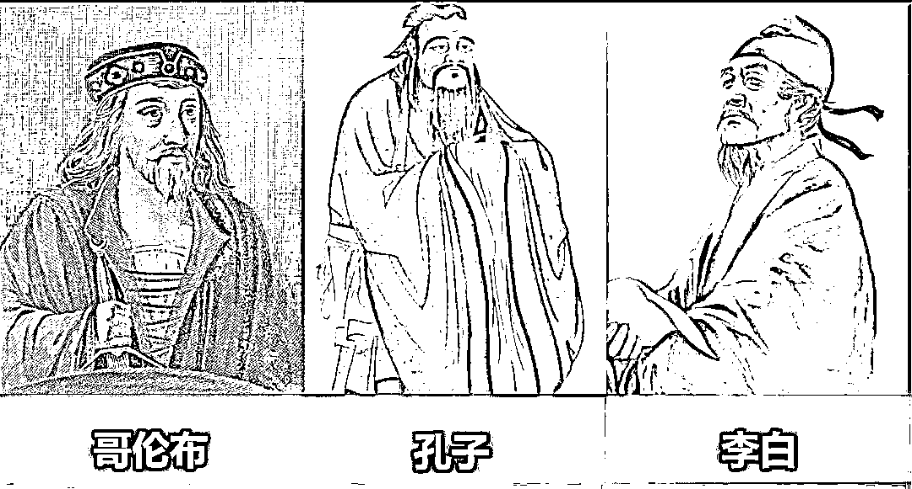

哥伦布：口袋空空，却用自己的航海见闻说服女王出资，知识换来了启动资金。

孔子：我前段时间去泉州孔庙，全国孔庙超过一千座。孔子周游列国做宣讲，靠知识换来的是名声和影响力。

李白：靠诗名俘获唐玄宗青睐，进了翰林院，知识换来了官位。

再看近一点的当代人：

张朝阳：最近《张朝阳的物理课》引发讨论。搜狐创始人本就已成功，却额外收获了“有书卷气、有情怀”的个人标签，课程成了人设加分项。

脱不花：CEO身份推出得到上的一门免费课《如何成为高效学习的人》。一个CEO时间何其珍贵，为何要做免费课？

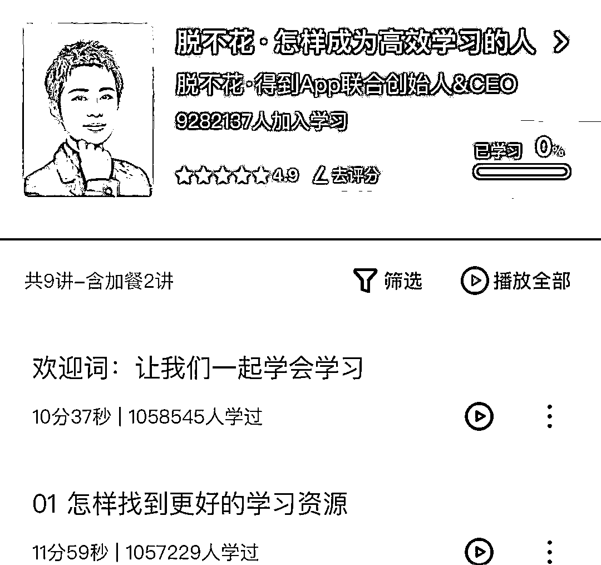

这门课的累计学习人数已破百万。也就是说，花一点时间做课，免费让百万人认识自己，这带来的曝光和信任是花钱买不来的。好课会给人贴上专业标签，日后有相关需求，第一时间就会想到你。

杨澜：知名主持人、企业家。近几年也开始做直播带课。与张朝阳、脱不花这类顶层精英相比，他们的收入与地位早已远超常人，做课卖课的核心动力并非增收，而是把课程当成营销工具。

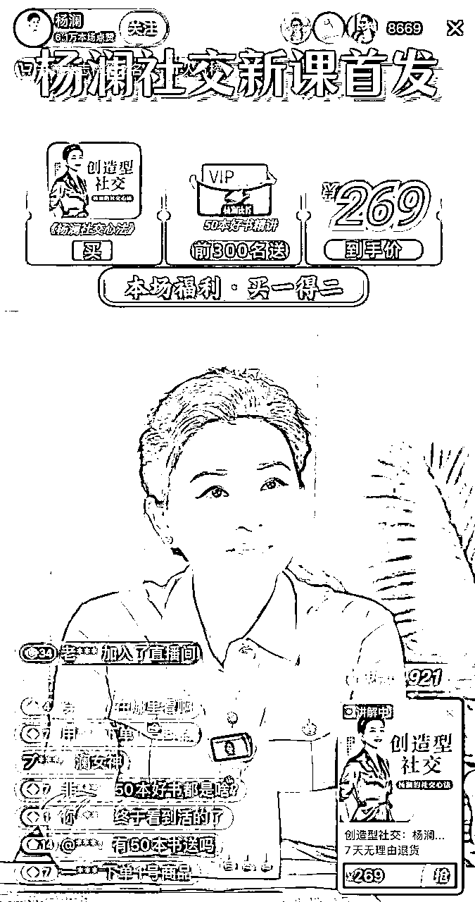

本质上，课程就是一张会自我传播的名片。它持续在不同平台、不同时间帮你建立声誉。而你只需投入一次制作成本。

而声誉是有复利效应的。最典型的例子是罗永浩。几亿债务、征信受限，最终靠个人信誉重返直播带货、接广告，完成“真还传”。换作普通人欠下几个亿，这辈子都难翻身。这就是声誉的直接力量。它还能带你进入花钱都买不到的圈层。

## 【行业：把知识产品当杠杆的生意】

说完个人，再看行业。为什么有些行业也一定要做一门课？

前段时间一个药企找我，想做一套免费课程。他们新药刚研发出来，打算用养生类内容做引流，把产品自然植入。

以前砸钱做广告，用户带着防备看你。现在做成课程，来的全是精准人群，还不用央求用户观看，是用户追着要更新。

保险行业同样需要教育市场。我之前给母亲买保险，她一口回绝“都是骗人的”。如果你所在的行业需要科普，一门不以盈利为目的的课程就能帮你省下大量解释成本，还能提升专业可信度，让客户更愿意信任你。

房地产也一样。教一套《如何挑学区房》《如何辨别物业优劣》《避坑指南》，先建立信任。后期手上恰好有房源，学员优先考虑的就是你。

还有一类人，做课并非为了对外，而是为了沉淀。我的亲身经历：把多年做课方法整理成文档去面试，薪资直接翻了百倍。把工作经验系统化梳理，跳槽一次多拿20-30万，划算得很。

# 二、4步打造爆款课程的方法

做课其实像女娲造人，分四步来造。

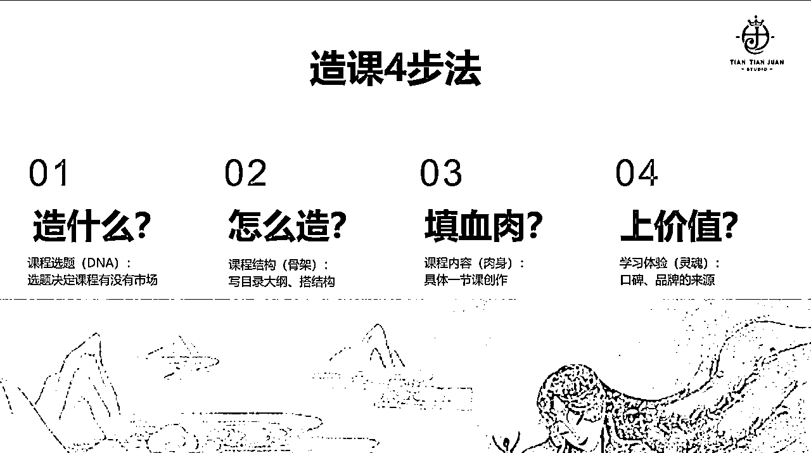

## 第一步：先定造什么

选题就是课程的DNA。你要清楚要造一个“男版”还是“女版”。选题定错了，课做出来也很难卖。所以选题优先。

选题决定了课程的天花板，决定了市场有没有需求、能卖多少钱。

怎么定选题？核心原则：好处要一眼看明白。

市面上常见的知识付费选题基本就三类：

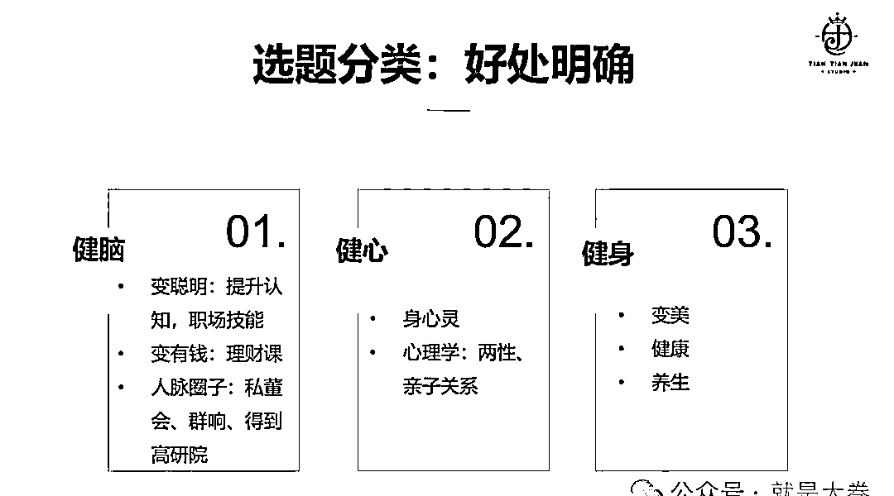

很多人会说：我不知道能做什么，工作平平，也没啥拿得出手的特长，下班就刷短视频追剧打游戏。

选题其实没那么玄：

* 你是否做过别人羡慕的成功事？
* 有没有哪件事别人觉得难，对你来说轻而易举？
* 你做什么最容易被夸、被请教？

## 第二步：怎么造骨架

课程大纲就像人的骨架，骨架定型了，课程的质感就定了。

搭建目录的核心问题是：这门课能帮谁，通过学什么，达成什么结果？

大纲要解决三个关键点：

1. 提升购买欲，促成成交
写大纲要先想用户有没有买的冲动。需求是起点，用户的问题大致分三类：

1）恢复原状。7天解决孩子拖延写作业，帮他回到正常状态。

2）预防问题。30岁如何科学护肤防皱抗斑。

3）追求理想。顶级课程制作人培养计划，帮你达到更高目标。

先判断你的课是帮用户恢复、预防还是进阶，再看市场是否成立。

2.  给学员一条清晰的学习路径
比如我要教0基础做课。现在用户现状：不会做课，零基础。我要做的事就是把差距补齐，规划出从0到会的一条路。

差距源于现状与目标的落差。我们要做的就是填补这段落差。

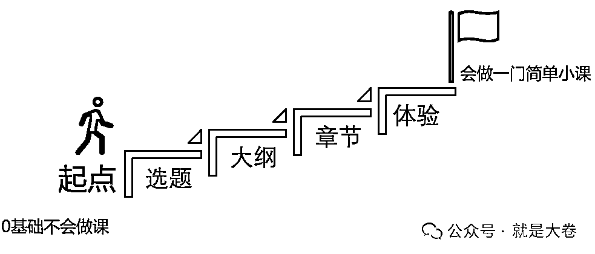

怎么填？教选题怎么选、大纲怎么搭、一节课怎么写、课程体验怎么设计。你看，从起点走到终点，每一步的盲区都被补上了。

总结起来就是：这门课能帮助零基础的人，通过学习选题、大纲、单节课写作、体验设计，实现0到1独立制作一门课程。

回答清楚这个问题，大纲就能开始搭。

3.  搭建知识结构
做法很简单，画个表：

把第二步梳理出的学习路径填在第一行，它就是大章节。

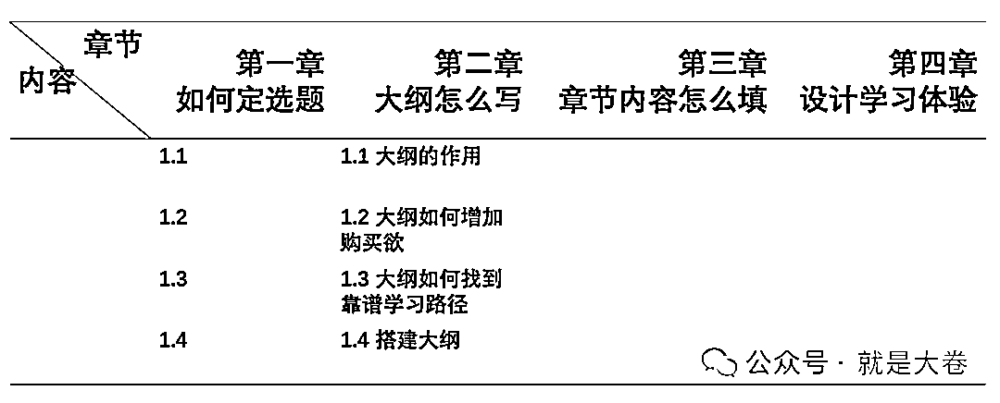

然后逐列填充，每个大章节下对应的小节。填写时自问：讲哪些内容才能完成这个大章节的目标？

以教大纲为例：

* 大纲的作用有哪些？如何落地？
* 大纲如何提升购买率？
* 大纲如何帮助用户找到学习路径？
* 大纲具体怎么搭建？

表格填完，大纲的“学名”就有了。接下来要给它们起个“艺名”，让名字更好听、更好传播、更好卖。

## 第三步：填血肉

骨架有了，还得有血有肉。每节课讲什么、怎么讲，才是关键。

做课公式=固定开场+问题/场景引入+解决方法+情感化案例+固定收尾

比如得到的《心理学通识》李松蔚，每一节开头都是“得到用户你好，我是李松蔚，欢迎回到……”

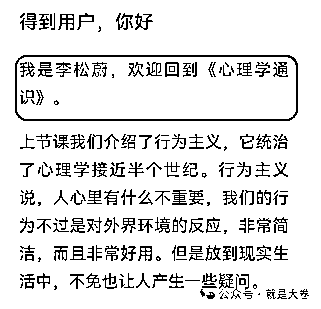

固定收尾通常是总结重点、布置作业。

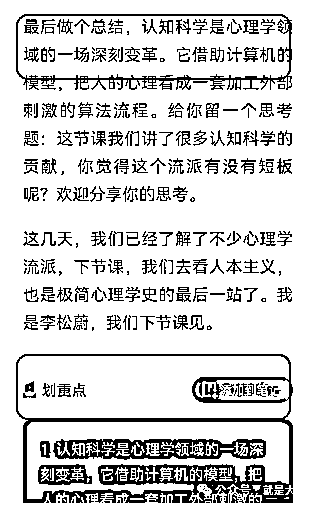

开场收尾确定后，中间怎么讲？记住：干货本身不值钱，别一上来就灌知识点。

先用冲突和问题或真实场景切入，勾起兴趣。

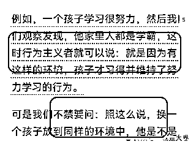

再输出干货+案例验证，让知识点可感知、可信服。

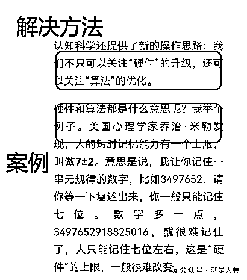

每一节都按这个结构写，时间久了就会形成个人风格。就像贝律铭说的“重复产生统一，统一形成风格”。用户听一句话就能认出这是你的课。

## 第4步：赋予价值

课程同质化严重，为什么有的课能卖三年，年入过亿，有的课两个月就凉了？核心差异在学习体验。

体验设计很少有人重视，却是拉开差距的关键。也可以通过你的课程体验来强化个人品牌。

可以参考宜家的体验设计。我父母买擀面棒被我推去宜家，结果两人回来抱怨说，进去了就出不来，逛了四层，结账排了超久的队。

但我觉得体验其实不错。为什么？

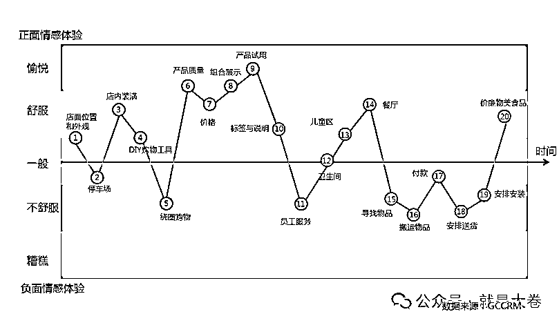

（宜家体验峰值）

逛街前心情不错，进门看到标志性的蓝色大楼、简约设计、推车购物袋，体验中性偏好。

逛的过程中，各式样板间能参观，还能找到喜欢的商品，体验回升。

逛久了人多想走，有人打卡拍照开始烦躁，却正好走到自助餐厅，价格便宜味道也不错，体验又被拉高。

最后结账排队体验又下降，但出门时甜筒、鸡肉串、热狗便宜又好吃，整体感受被峰终定律救回来了，下次还想来。

所以宜家的核心是开头和结尾体验绝对在线，哪怕中间有瑕疵，最后也能拉回来。做课程也一样，要把开头和结尾的体验设计好。

* * *

四步听起来简单，但每一步都有无数细节。把细节做到位，课程的生命周期才能被延长。祝你的课大卖。