# 把奔袭战搬到同城实体发售，我们这样打
作者：龙哥

先自我介绍一下：我叫孙策，是龙哥盟五年成员，也在私董会。

以前我们团队主要做线上获客，业务做到了全国前列，并带着几百位圈友拿到过几十万甚至上百万的结果。2022年，我把重心转向同城业务，帮本地实体商家做驻店发售和流量增长，公司只用了4个月就把单月营收推到100万。2023年，整套打法打磨成型，开始服务连锁品牌，其中一个连锁客户给公司带来超过200万的收益。2024年启动全国化，4月起通过孵化营模式，在各地寻找合适的合作方，撬动区域资源。

## 第一期同城实体发售实战营，成绩如何

第一期实战营放在山东，目前已经收官。下一站重点省份是江苏，目标是覆盖江苏绝大多数城市。

先看上半年三期孵化营的整体数据：前两期在临沂、济宁，超过七成的参与者个人月收入过万，其中20%到30%的人月入大几万。第三期在济南，也是升级后的实战版本：30名学员里，16人结营后进入孵化，2人申请复训，也就是说超过70%的人继续留在团队；全员开单率做到了100%；助教与学员佣金加起来超过60万；人均变现超1万——注意，这里说的是佣金口径，不是到手收入。

能跑出这个成绩并不轻松。学员要在两三天内消化项目逻辑、课包设计、执行要点，对学习能力要求很高。第三期赶上济南最热的6月，大家顶着近40度高温，一家一家跑商家、做方案，被拒绝几乎是常态。签约之后也不是结束，交付过程中商家的预期随时在变，预期管理极其耗人。

但大多数人还是咬着牙想办法，坚持冲到一线，最后拿到了结果。这里放几张现场照片：

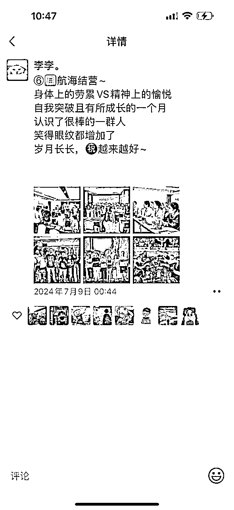
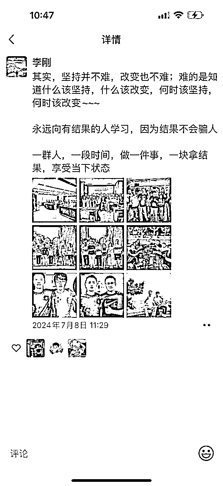
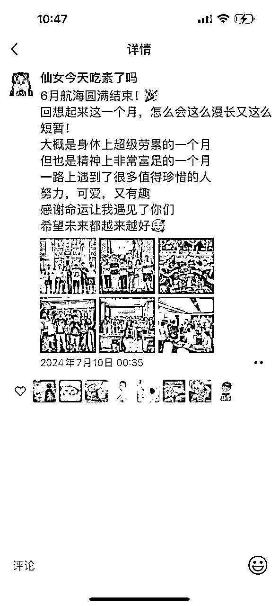

这次实战营和以往不太一样：一群原本不熟的人，来到一个陌生城市，一起做一个新项目。换个角度看，这就是远程高速机动、趁对方还没反应就完成突袭的打法，军事上叫奔袭战。我们索性把奔袭战的战术思想，直接用在城市实体开拓上。

## 不了解这个项目？

有圈友可能还不清楚具体逻辑，我之前那篇《同城实体发售，为什么一个城市可以做到几十上百万？毛利70%以上》已经写得很完整，这里不再展开。

## 6月实战营怎么打：30天重度陪跑

因为这个项目天然聚焦同城，我们采用30天闭关的形式：一群人集中到一座城市，用2到4周完成一批实体商家的开拓和交付，同时让团队成为该城市同类目中最有战斗力的存在。

选择这种模式，有三个好处：

第一，到陌生城市后没有退路，行动力会被逼出来，成功率更高。第二，优秀组织会产生“他律”效果，一批优秀的人会把偏后的成员带动起来，整体战斗力自然上涨。第三，能认识一批新战友，为后续长期合作打底。

从全国布局看，市场足够大，每个城市都能培养自己的合作方，渠道就能形成网络。具体执行上，30多人分成约5支小队，每队配一位经验丰富的助教；每个人从成交到交付都有1对1帮扶，确保跑通最小MVP；队员之间再组成两三人互助小组，一起出动，互相监督、互相打气。

所以，一期实战营怎么打，本质上就是一场奔袭战怎么打。我们总结出六条原则：

1. 目标统一，上下同欲
2. 集中优势力量，先胜后战
3. 以人为本，打造有战斗力的团队
4. 战而后定，占一座城就守一座城
5. 星星之火，反复奔袭更多城市
6. 全国化3.0，路径清晰、长期经营

下面逐条说。

### 1、目标统一，上下同欲

第一件事，是让所有人往同一个方向用力。

对30位队员来说，目标很明确：在20到30天里，拿下这座城市50%以上的同类市场份额。

想达成这个目标，需要两个共识：一是单位密度内合作的商家要足够多。本地实体店的客群基本来自周边3公里，周围竞争越激烈，老板越需要更强的营销手段，也就越愿意合作。二是用规模化案例撬动新案例。当实体老板看到身边已经有不少成功样板，他们会更容易下决心签约。

案例不是某个人私有的：我的案例你能用，你的案例我也能用，团队案例全员共享。大家是共生关系，真正做到了荣辱与共。

为了让目标对齐，开营前两天我们专门做了线下大课，把项目逻辑和核心优势讲透。上完课还要复盘，确保每个人真正理解。从现场状态和课后反馈能够看出，这门课是经过认真准备的。

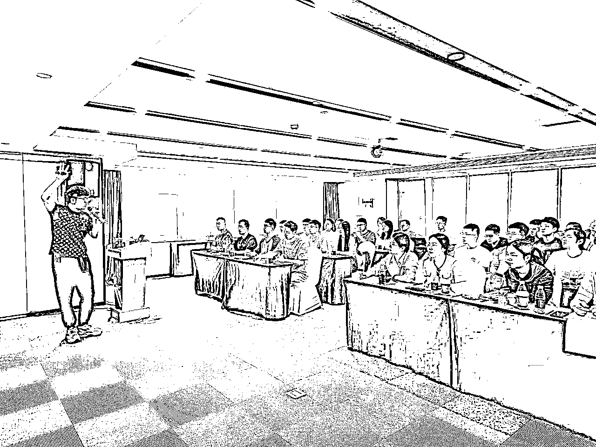
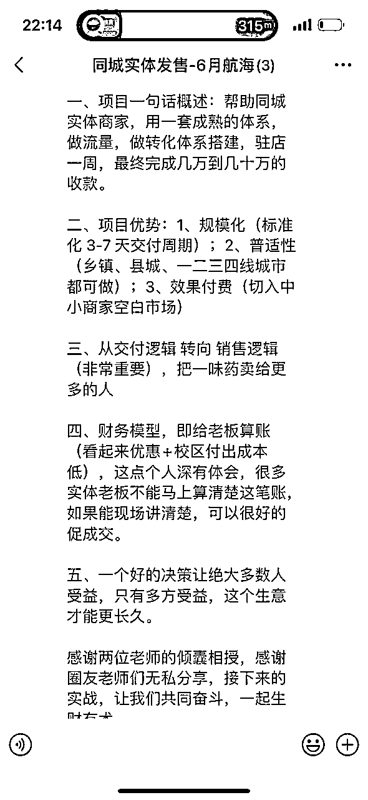
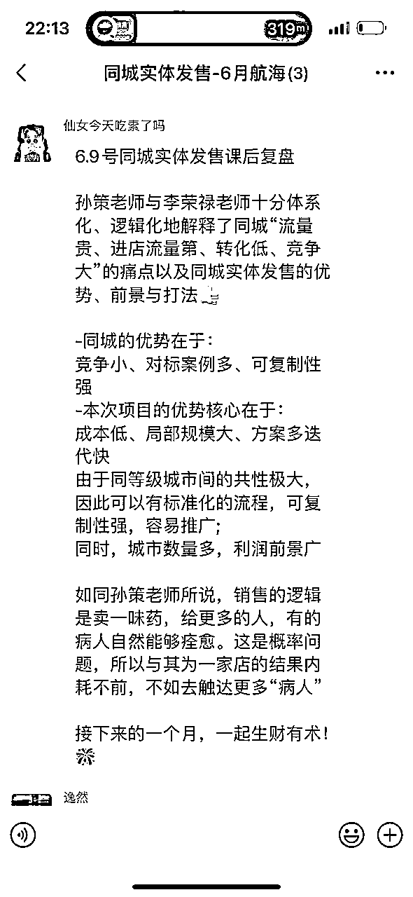
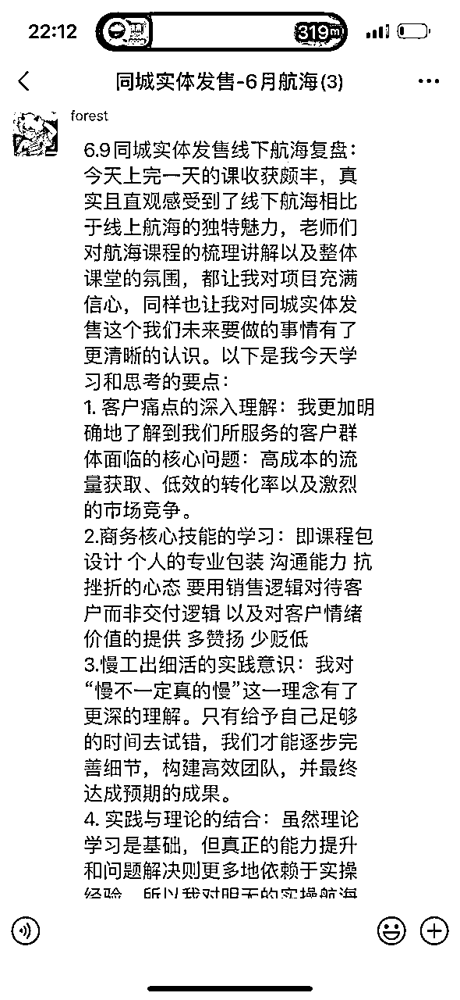
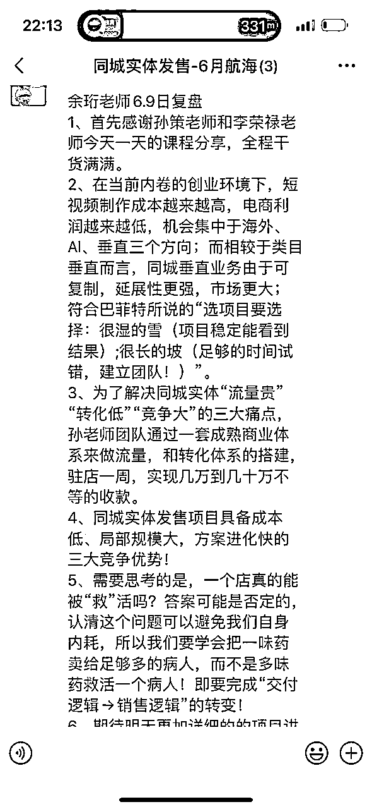

### 2、集中优势力量，先胜后战

奔袭战的核心是快速、突然、趁虚而入。进入一座城市后，当地很可能已经有团队在做同类业务，那就是我们的对手。想在对方还没反应过来时抢下最大份额，就必须人更多、专业更强。说白了，先确保能赢，再开打。我们的原则是：杀鸡也用牛刀。

具体到战场上：

兵力上，一个城市商务端投入10多人，交付端再配5到6人，人数层面已经形成碾压，本地团队正面很难打得过。

比如我们进入济南时，就是这样一支队伍：

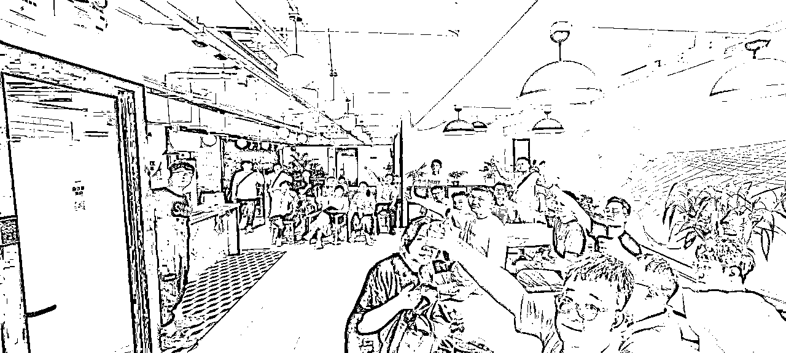

战斗力上，每天开复盘会，当天遇到的问题当天清掉，确保每个人持续进化。

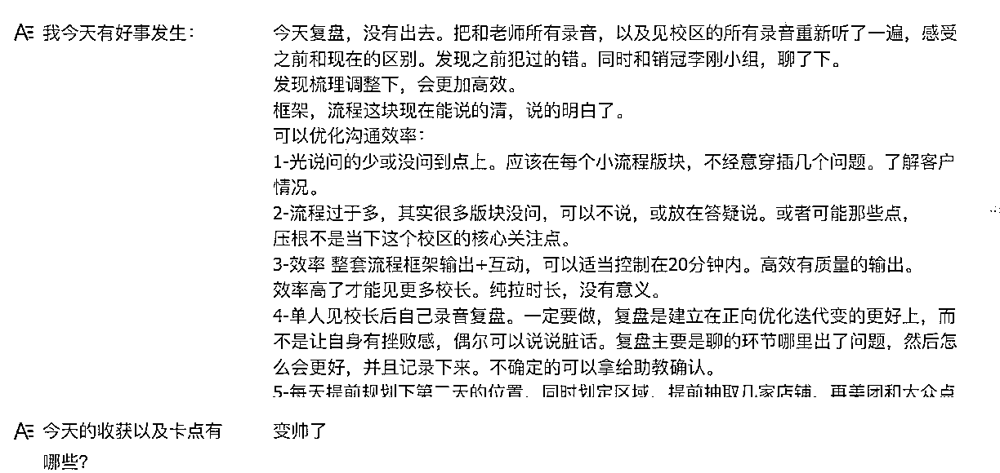
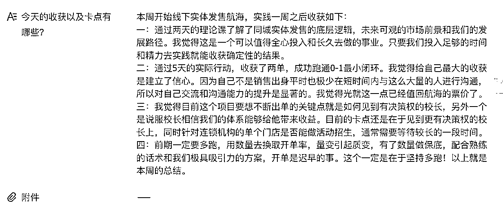

复盘会后的合影在这里，后面的电动车就是我们的战车。

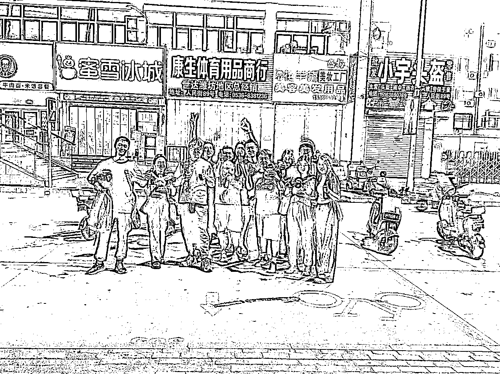

装备上，服务产品线覆盖抖音、私域，后续还会加AI、📕等，确保市场竞争力。

规模、战斗力、装备三方面全面领先，突袭一座城，对手来不及反应，团队人效自然就高了。我们还额外做了加餐，请涛哥来分享，相当于给团队补充弹药。

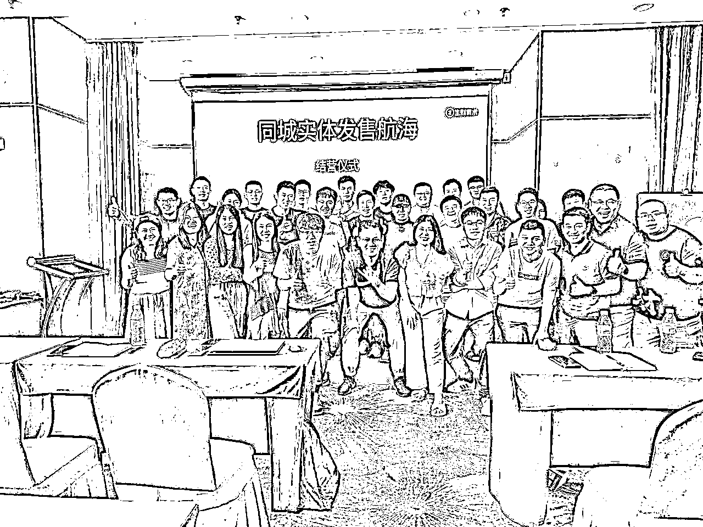

接下来的实战营会继续沿用这套打法，一边扩大规模，一边同时开更多城市。

### 3、以人为本，打造有战斗力的团队

商业竞争，本质上还是人的竞争。我们在实战营里尽量做到以人为本，让每个人不被杂事困扰，把优势发挥出来。

具体落在四件事上：

第一，让人更容易获客。接下来会把服务产品端补得更全：地推、抖音、私域先上，再叠加AI、📕、工具类产品线，让同城客户更愿意选择我们。

第二，让人更容易赚钱。核心是搭出能快速变现的产品组合。私域发售见效最快，但还不够多元，所以我们会补上抖音长期服务、私域沉淀、工具收入，让收益来源更稳定。

第三，让人更有长期价值。这个项目本质是同城商业增长和营销训练，从这套体系里成长出来的人，既懂实战又懂增长，本身就是稀缺资源。以后可以走专家人设路线继续变现。

第四，让人更高效。海报设计这类杂活有专人处理，一线人员可以把时间花在真正重要的事情上。

### 4、战而后定：占一座城，就守一座城

奔袭不是为了打而打，而是为了“定”而打。突袭结束后，要有人留下来接防，把城市真正占住。

所以我们会安排深扎团队，在当地持续深耕。占领一座城市，依靠两套体系：

第一套，实体赋能发售。8月产品线会更丰富：私域发售继续作为核心优势产品，帮商家直接创收；新增抖音服务，帮商家持续曝光和锁客，团队也能多一条收益线；再引入AI工具，帮商家提效，交付更轻松。

第二套，同城业务本身。当实体发售价在某个城市跑熟后，深扎团队可以横向延伸：线下渠道本质是一套网络，共享充电宝、支付这类同城服务都能往下放；优质的同城商业项目也可以共享。

这两套体系，足以支撑一个团队在一座城市长期运转。

### 5、星星之火：用奔袭战术，拿下更多城市

一个类目做到天花板后，就要寻找新类目。同城赛道的优势在于：一个城市打爆之后，模式可以复制到其他城市——国内的每个城市，本质上都是平行市场。

上一期我们在潍坊、德州、聊城、济南四地同时推进，取得了一定成绩。接下来的8到9月计划有两步：一是组建多个奔袭小队，同时在江苏4到5个城市作业，争取两个多月把江苏大部分城市过一遍；二是这段时间正好赶上开学旺季，对出海来说有明确的效益加成。

### 6、全国化3.0：路径清晰，长期主义者入局

我今年主推全国化，靠的是孵化模式。路径分三个阶段：

第一阶段，打造超级单兵，即懂整体商务逻辑的人。第二阶段，培养奔袭战队队长，要求既懂商务、又懂交付和管理，由队长带10到20人小队，在持续奔袭中扩充队伍。第三阶段，筛选合适的区域合伙人，懂所有产品线，能对城市做深度挖掘，最终实现多城市的“区域之王”。

走到那一步，我们就能在全国建起渠道网络，在实体赋能领域成为同城服务之王，在同城商业领域成为变现之王。

所以这不仅仅是一次实战营，而是一件能做几年的长期事业。同城生意，现在能赚钱，未来也能继续赚钱。

## 8月实战营，下一步怎么走

新一期的节奏已经确定：8月8日开启报名，8月24日开船。届时我们会组5到10支小队，在江苏多个城市同时开工，打新一轮奔袭。

开船之前，8月7日我们会在龙哥盟视频号做一次直播对谈，聊聊上一期的实战情况，详细拆解同城实体发售的机会、玩法和项目新信息。

感兴趣的同学可以扫码预约直播，一起探讨同城商业与新城市的机会。

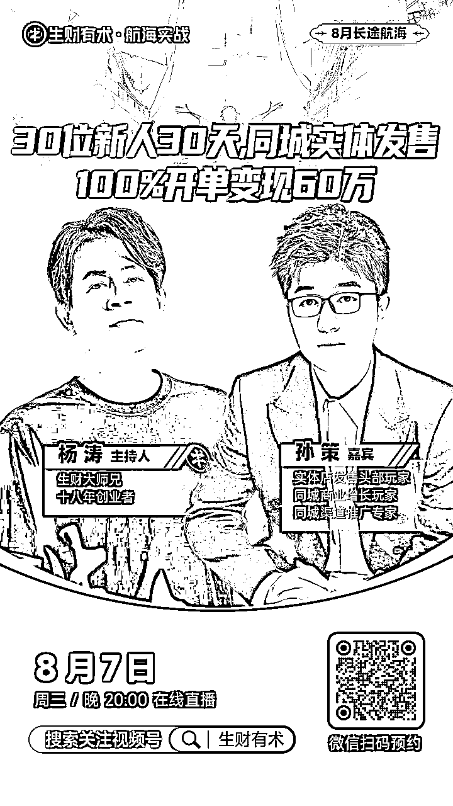

## 写在最后

这期实战营对我而言，更像一段关系的经营，而不是单纯的项目经营。

工作以后，人很少有机会从零出发，在一个相对纯粹的时间段里认识一群人。共同做一件事，会让其中一部分人结下很深的友谊，未来也可能因为另一个项目再次走到一起。

这次我重新认识了一批优秀的人，我确信能与其中一些人长期走下去。相信船员们也一样。

最后，和大家一起龙哥盟！