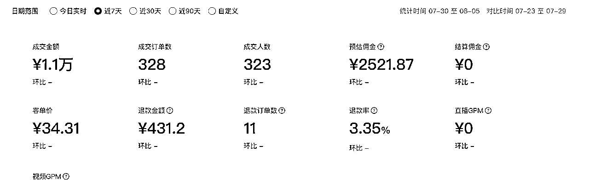
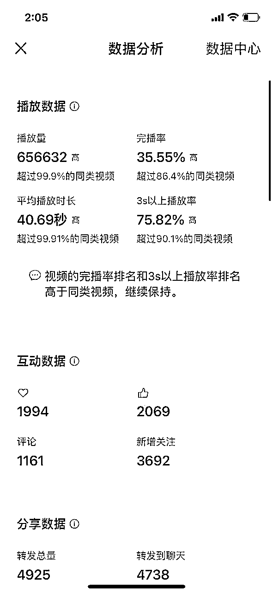
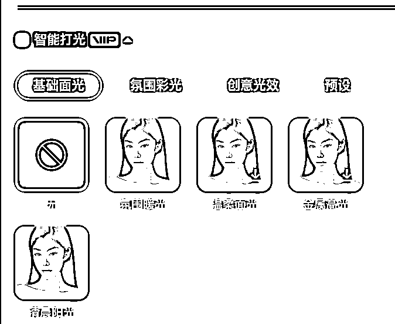
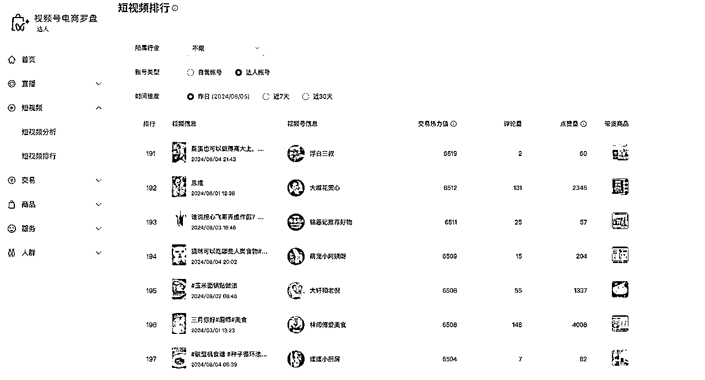

# 视频号口播实战：14天爆单300件，我的完整变现复盘

> 来源：一个前大厂人的真实记录

大家好，我是香君，今年30岁。以前在某知名短视频平台做直播公会运营，去年年底辞职了。辞职原因有点好笑——我害怕那句流传甚广的“35岁定律”，索性趁还能折腾，给自己一段空白期，研究自由职业的可能性，为后路做铺垫。所以当我后来听到文师讲他自己的经历时，真的有那种灵魂被击中的感觉。

今年3月加入生财，在这期航海之前，也跟过一期【小红书电商】航海。虽然闭环是跑通了，但变现效率实在不敢恭维。后来听说视频号口播航海第一期反响极好，当时就果断抢课了，于是有了这段经历。

没那么谦虚地说，这次的成绩还算拿得出手：最近7天累计带货GMV达到1.1万元。最高的那篇视频播放量冲到65.6万，而大部分订单，都是靠这一条爆款带起来的。

好了，成绩秀完，下面重点聊聊我的核心动作。

## 一、先看清自己，再定方向

因为之前的工作原因，我接触过各种大大小小的KOL，自己也亲自带过不少。所以我很清楚，再牛的人也要经历流量的“冷启动期”，内容再好也不可能一发布就全网爆火。十亿人里比我们聪明的一抓一大把，所以没必要自负，更不必自卑——先干起来再说话。但话又说回来，也不能蛮干。拿到项目以后，得先分析自己的底子，找准自己的路径。我把航海手册读完以后，开始拆解自己，做了以下分析：

我一直秉持“兴趣是最好的出发点”这个理念，绕来绕去，最后兜兜转转还是扎在了历史这个坑里出不来了。

## 二、从零起步的拍摄与剪辑

**（1）拍摄**

我是个镜头前零经验的新手，所以前期很听话，直接从文、鹏两位老师整理的口播稿库里面挑文案来拍。

我的口播录制流程，前后迭代了三个阶段：

1. **整段录**：刚开始天真地以为，为了保持视频的流畅感，应该整段话一口气录下来。但这个做法太坑了，问题有三：一是浪费时间，大段台词录完不满意就删了重录，一条视频少说磨一个小时；二是情绪精准控不住，往往只因为中途一两句气势不够，就全盘重来；三是剪辑效率极低，每次都要拖好几个素材去统一角度和音量，太费劲。

2. **用“说得相机”分句拍**：效率确实上来了，但问题也不少——App识别的断句位置不够准，经常把第一个字的开头音给裁掉一半，有时候干脆整个字都没了。

3. **一镜到底**：现在一直在用的方法。中间不管你错多少次，就硬着头皮一直说完，后面靠剪辑补救，整体内容连贯性一下子提升很多。

**（2）剪辑**

剪映的智能口播功能大家应该都会用，但粗剪以后还是会剩下不少气口。视频长了以后，一个一个去处理气口其实特别耗时。所以我自己写了一个python小脚本，核心逻辑是通过分贝大小自动过滤出有用的音频段然后拼接在一起。感兴趣的可以看看这个文档。

**（3）一些小建议**

我拍视频基本都做抠图处理，为了让人像抠出来更干净自然，拍照和剪辑时要注意几点：

1. 发型要整理，最好把头发压得实一点，尽量减少碎发丝在画面里出现，这样抠出来人更干净
2. 有条件就买一块绿幕，效果提升非常明显，搭配“取色抠图”+“智能抠图”双重操作，效果更好
3. 剪映的“智能打光”一定要用起来，调一遍光之后整个画面都会自然很多

## 三、选品：先追爆款，再考虑风格

目前我选品还处于追爆款的初级阶段。核心逻辑就一句：**只要是视频号上爆过的流量，你稍微改一改，极大概率还会再爆一次。** 所以最近我的选品都是去【视频号电商罗盘】里筛出所有图书类的SKU，然后再结合品类和文案风格来判断这条爆品适不适合我。

## 四、文案是一切的核心

出爆款之前，我曾被投诉过文案抄袭。后来看了大量文案之后，也开始觉得很多爆款文案啊，其实没那么多真正的爆点。所以我很早就开始拆解别人的文案了。

目前我的拆解逻辑是这样的：

第一，**黄金三秒必须炸**。很多文案库里的稿子在我看来根本不算爆。打磨逻辑有两条：一是爆点前置，把最吸引人的结论先放到最前面讲一遍；二是开头的两秒尽量加夸张的修辞——醒目的数字、抓人的音效、极致的形容手法，这些都能起到直接抓住眼球的作用。

第二，**完播率是生命线**。具体做法是：先讲故事，最后再拉出产品，避免用户在前中期就划走。另外，介绍产品的部分一定要短平快，不要拖泥带水。说实话这部分我自己做得也一般——不带产品的部分完播率还能保持在30%以上，一旦开始介绍产品就直接掉到15%左右。复盘下来，我觉得是因为述品后面垫了太多废话，本来述品就够伤完播率了，再加废话只会让用户加速滑走。

所以按照我的理解，打磨文案的整体思路可以拆成这样（仅供参考）：

1. **受众分析**——搞清楚你的用户画像
2. **受众喜好分析**——再深挖一层，了解他们到底爱看什么

3. **文案结构**
- **开头**：用悬念、硬核数据或引人好奇的问题留住观众
  - 例：“你知道为什么现代科技无法解释这场战役的奇迹吗？”
  - 例：“1949年10月，新中国刚刚成立，24日，解放军下令渡海进攻……”
- **中段**：层层递进，把信息丰富起来，继续保持兴趣
  - 例：“1945年，这场战役中，一个小兵用仅有的子弹创造了不可思议的奇迹。”
  - 例：“你们以为1949年新中国成立之后，国家就安全了吗？其实……”
- **高潮**：用情绪化的叙述把故事推到顶点
  - 例：“他在子弹用尽之后，依然向着敌人冲去，保护了战友，成为不朽的传奇。”
  - 例：“请问14年抗战中，哪个省没出过汉奸？我国出了两百多万个……”
- **结尾**：呼应开头，总结升华
  - 例：“这场战役不仅是历史的奇迹，更是人类精神的象征。”
  - 例：“搞清楚这个问题，你就会明白百年海军的真正利益……”

4. **特殊技巧**
- 视觉包装：配合画面素材增强冲击力
- 互动引导：多设置提问，让观众参与思考
- 情绪共鸣：用情感化表达拉近距离
- 多次扣题：核心点在文案里反复出现，强化记忆

如果想让AI帮你干活，可以这么玩：先去喂几篇好文章给AI，让它总结出规律；然后反复试错、不断凝练，直到出来的东西你觉得满意为止；最后把凝练好的方法论让AI输出成一条可直接复用的prompt，存起来以后就方便了。过程确实有点复杂，感兴趣的朋友可以私下聊。

这里推荐几个好用的AI工具：ChatGPT、Claude、还有Llama 3.1 70B版本（网上有大量微调版本可以自己试）。

## 五、挂车策略做对了什么

刚开始不管选择挂车还是引入橱窗转化，流量和购买率来回都起不来。后来我复盘自己内容，总结出三点：

1. **妆造要让人入戏**。比如我讲历史的时候，穿了一件有大号logo的北面或Moncler背心，整体出来的效果就很违和。后来换了对襟袍子或者没有logo的净版衣服，效果明显好很多——你得给用户一个沉浸式的观看体验。

2. **从多个维度撬动用户的购买心智**，让他们产生“想买”的冲动。比如用“买一本少一本”、“最近出版社在放福利”这类话术催单，让用户的购买意愿再加一把火。

3. **在符合平台规则且条件允许的情况下，尽量制造观点对立**，让有自己判断的人愿意下场参与讨论，让还在观望的人也被氛围裹挟着产生购买欲望。

这些做法最终都会导向一个结果：提高成交转化。有句话叫“一力降十会”，在绝对流量面前，转化率自然会高。所以说一千道一万，归根结底就是——**如何在最短时间内，把信息密度提上去，让用户一口气畅通无阻地咽下去**，他们才可能心服口服地完成付费动作。所以我认为，把逐字稿的内容密度做精做扎实，永远是最核心的一步。

## 六、踩过的坑，和走出坑后的领悟

1. **多准备几个号**，隐形限流这件事是完全没有办法提前预知的，只能备而不用，不可用而无备
2. **流量别太当回事**。有效流量会带来收益，无效流量除了数据好看，没有任何帮助
3. **不要互相攀比**。每天能比昨天的自己前进一小步，就已经是最大的进步了

## 七、最后想送给你的一句话

一定要有一颗强大的心脏。我特别偏爱一句话，送给大家：**“如果你从未失败，只能说明你玩得不够高级。”**

这世上不存在一劳永逸的安乐窝，唯一不变的就是一切都在变。如果接受不了失败的煎熬，那还是趁早回去上班吧。自由职业或者说创业，本质上是一趟自省之旅。修心是第一课。只有心态足够稳，才能持续吸收养分，在不断的试错和迭代中，一步一步摸到那个你想要的东西。

就算折腾了半天仍然没有结果，也不用慌。因为失败留下的那些经验，本身就是一笔宝贵的财富。