# 这个平台怎么安全导流？日引100+的实操清单
作者：龙哥

一直在研究低风险导流，这篇把我在用和收集到的路子重新整理了一遍，按展示位置拆开讲。

## 一、个人页面怎么设计才会让人顺藤摸瓜

### （一）几个指向性入口

1. 动态通道
现在“动态”入口不好找，有两个绕法：一是找某个以前发过动态的账号，从他的个人页面里进；二是用老版本客户端，右上区域能看到。找不到路可以找我要ID。操作：先做5张带字图片，按动态形式发布，然后从后往前打五次卡。老版通道：

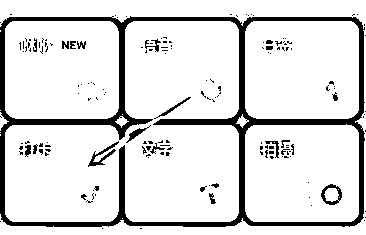

他人动态通道：

参考效果：

以前可以把动态图拼接出🛰️号，现在容易被告发，不建议再试。

2. 个人介绍里@马甲号
这样容易被平台盯上，马甲号一挂，你还要从头改介绍，所以不推荐。如果非要用，就让马甲号名字带谐音，或者在马甲号的图文里埋内容。

3. 背景指引
别在背景图放违禁词。如果平台ID和V信号一致，用箭头标到ID上并补充说明即可。如下图箭头可指向群聊或ID：

4. 顶部卡位
把带线索的图片卡在个人页顶部，可以配合分割图用。实测挂V信号也稳，跑了几千关注没出问题。顶部卡位需要至少5篇图文才解锁，不够就用仅本人可见的草稿补数。

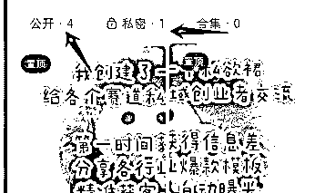

5. 头像提示
头像只能做诱导，别直接放V信号。平台会检测头像，用谐音还能撑一会，但不算稳定。

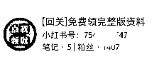

6. 名字曝光
例如“回关拿资料”“看我的保存夹”。然后配RPA脚本自动去点红心、加收藏、再关注一些人，让名字被更多人看到。名字记得谐音化处理，否则容易检测。同行怎么取，直接抄作业。

7. 图文内直接留平台ID
平台ID本身就是V信号，不封不屏蔽；不要求加热，能显示就行。

### （二）个人页里的暗招

1. 分割图
用修图App创建一张4:6画布，完成后按4:3切成两部分，分两条发出。参考：

2. 保存马甲号的图文，引导看保存夹
马甲号可以用0.1粉的，不求流量，只要发得出来就能被看到。图文内部可以大胆放线索，能过审就不亏。

3. 同号设置
把平台ID改成和V信号相同，在个人介绍里写“ID同\/”即可，也可配背景图。

4. 马甲号用特效图
可用 photofunia.com 生成生活化图片，据称能过头像检测，我自己试过有效。

5. 群入口
在个人页放上群，用顶部卡位或背景图指路。

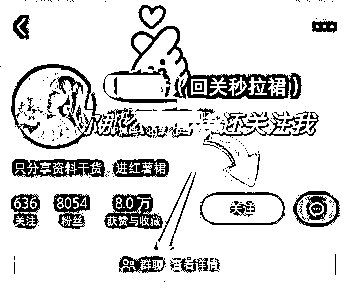

### （三）保存夹路线

先保存马甲号图文，然后引导访客点开保存夹。保存夹旁边能建多个合集，把V信号拆开放在合集名里。缺点是链路长：先进保存夹，再进合集。合集还能配合私聊曝光，也可以把线索图固定在顶部。

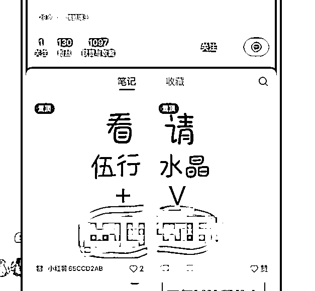

## 二、图文正文怎么放线索

### （一）正文玩法

1. 标记功能
发图时右划会出现“标记”，相当于图片里@人；被@的号可以叫“这里拿资料”，用炮灰马甲。

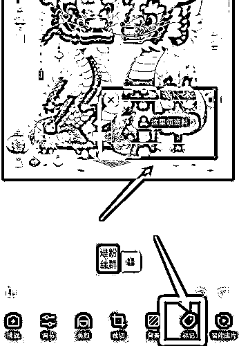

进阶：标记多个人，用多个马甲号分别设名字，防止检测。参考效果：摆放错开，别太整齐。

2. 票选
发图文时可以附带一个票选，设置3个选项，每个选项放不同线索。

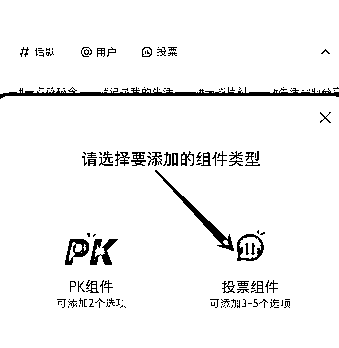

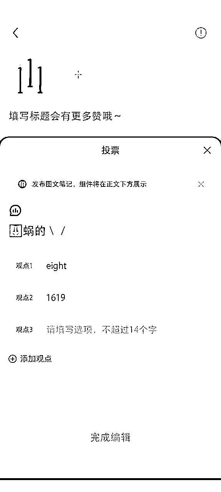

参考：

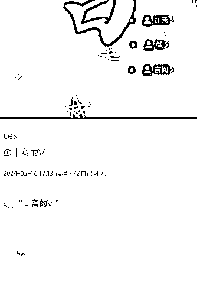

3. PK

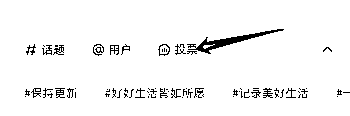

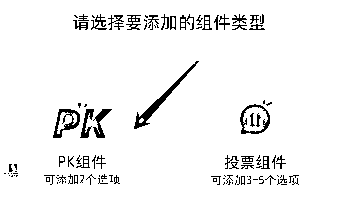

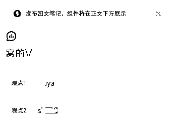

### （二）留言区玩起来

1. 马甲号提问，主号回群名
现在群名会直接展示，可以委婉；激进一些直接群名写 🌏xxxxxxx

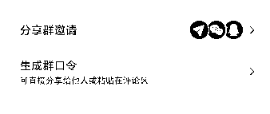

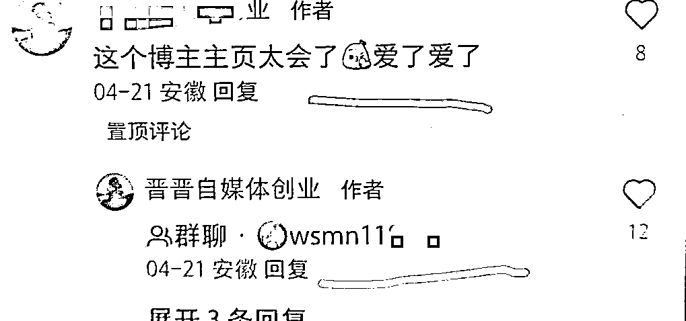

2. 留言区@马甲号
这个简单，马甲号能看见内容即可。

3. 二人转
A问B答，在留言区演双簧，把人导向B号。B号个人页要提前做精美。或者B@C，B装作普通账号推荐C。

## 三、私聊链路

先提一句：私聊发不出去，基本都是权重低。多刷内容、点红心、加收藏、再关注一些人，养几天就好了。

### （一）温和私聊法

1. 让对方先发V，你再加
内容够诱人就行，适合高客单价后端。

2. 发图
最好手写，且一张图不要用到地老天荒。不想写就用工具弄出手写效果的字体，字别太规整，背景复杂一点。这个网站很多字型，免费生成，背景可自定义，水印能打空格挤走：https://www.chh6991.xyz/pc.html

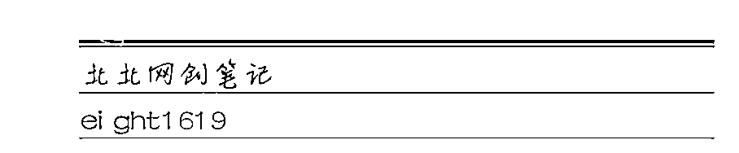

还可用纸牌、键盘、算盘等道具拍图。

3. 视频露V
随手拍一段桌面，最后拍到写有V信号的手写纸；发完补一句“看最后哦宝”。

4. 语音念V
不必真人念，用配音工具准备几条，男声女声方言都行；手机发语音时播放即可。下面的配音工具我一直用，好的配音要99永久，按需购买。

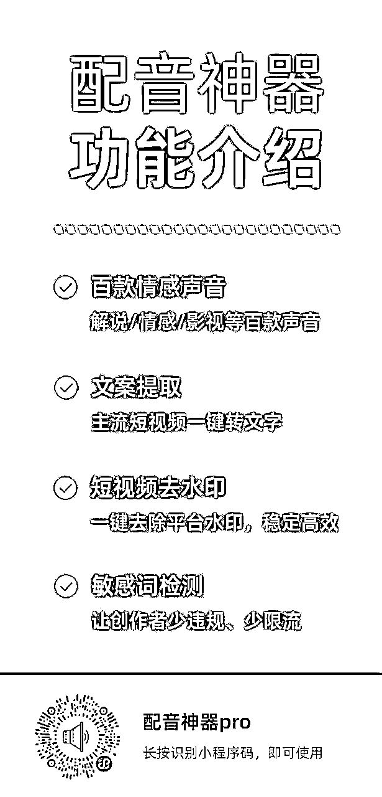

5. 合集共享
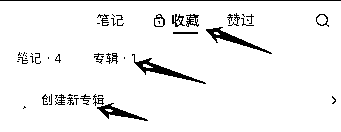

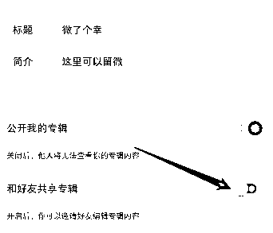

创建完毕后，选好友送过去。如果对方不在最近会话里，先发个表情问个好。

参考：

6. 跳转图
目前最常用：做一个分享页，点开直接跳到指定图片，分享页和跳转内容都能自定义，马甲号在群里发很顺。

### （二）强制私聊法

适用对象：权重低、被平台吞消息的号，例如0.1粉新号。

1. 合集共享
先给陌生人发个表情，让对方出现在你的最近会话；再建合集勾选后送过去。

2. 发后撤回
把ID名改成线索，比如“个人页保存夹拿资料”，用谐音字。再在合集里放V信号。发出消息后立马撤回，那边会显示“xxxx撤回了一条消息”。

3. 海量私聊法
原理：单个号可私10次；注销掉立刻重开一个，大概能循环8回，等于单个号一天80条。不要拿自己的号试，卖号的那里买号，成本才2-3元。不断销号再注册的号，做自然量后权重会掉。缺点：发几波之后得刷机，每10次换IP。优点：大胆发V信，封不住我。

## 四、群内玩法（稳得很）

### （一）明着放

1. 群名做线索
例如“免废拿xxxxx资源”。

2. 固定公告
例如“在这拿，V信xxxxxxx”。先自己建测试群摸底线，用马甲号发、主号固定。

3. 群管理名字
比如“先看固定公告，加V：xxxx”。开启“新成员自动欢迎”，这样新人一进来就能看到名字，不打扰老人。

4. 马甲号在群里发跳转图
一戳就跳到目标图，路径很顺。

5. 智能机器人
群聊里点“+”选智能机器人，名字、头像都能自定义。把V信号拆开填进去；先在自己群申请，审核过了之后，其他群也能添加。

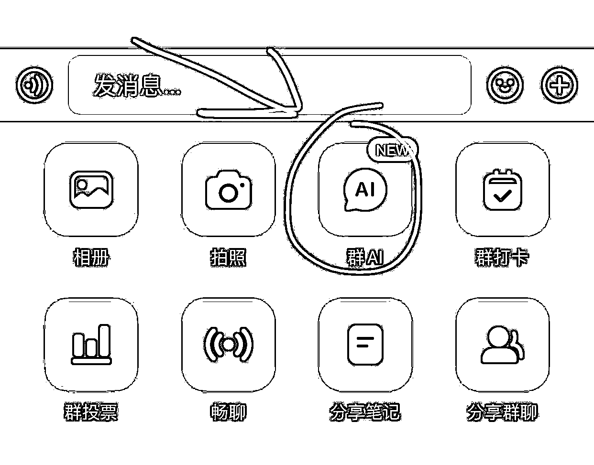

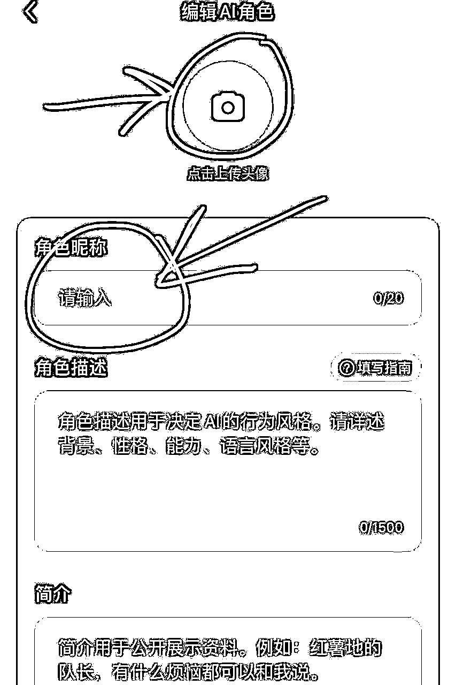

参考：

6. 签到
在“+”里和机器人同位置。测试过直接留也能过审；但签到内容人人都能填且无法撤回，别有用心的人可以来搅和，自己试。

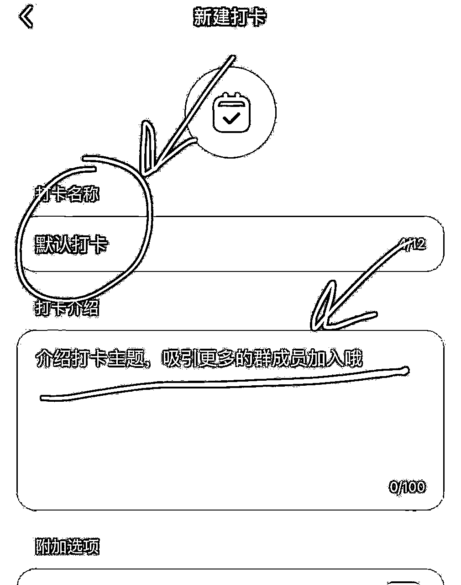

7. 群票选
和图文内票选同理，自己研究。

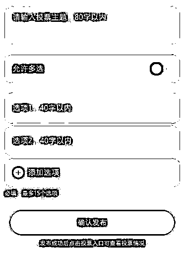

8. 禁言新用
去年群能禁言，后来“修复”了，但功能没取消，只是谁也不许发言——刚好防截流。群管理不能发消息，但能发群公告，相当于@全体。配合固定公告和群管理名字，够用。

### （二）暗着放

套用动态思路：群列表前5个位放我控制的号，用5个头像拼成V信号，再让群管理名字引导大家去看群友名单。

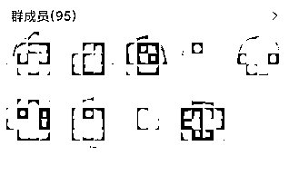

欢迎圈友来交流。