# 小红书上半年搜索热词全揭秘：10个流量密码，个个都能变现！

> 原文：[`www.yuque.com/for_lazy/zhoubao/rqr4nc9kb869gabh`](https://www.yuque.com/for_lazy/zhoubao/rqr4nc9kb869gabh)

赚钱的朋友们好，我是颜乐乐。今天带大家拆解一份刚出炉的干货——2024年上半年《小红书十大搜索趋势》。

如今的小红书搜索，俨然成了3亿人的生活搜索引擎。月活用户里有七成会用搜一搜，平均一天搜6次。有搜索就有需求，有需求就有生意，机会全藏在这些热词里了。

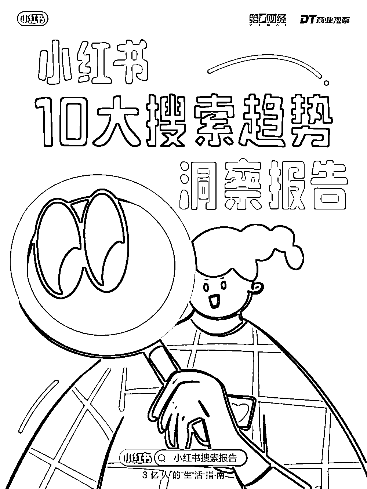

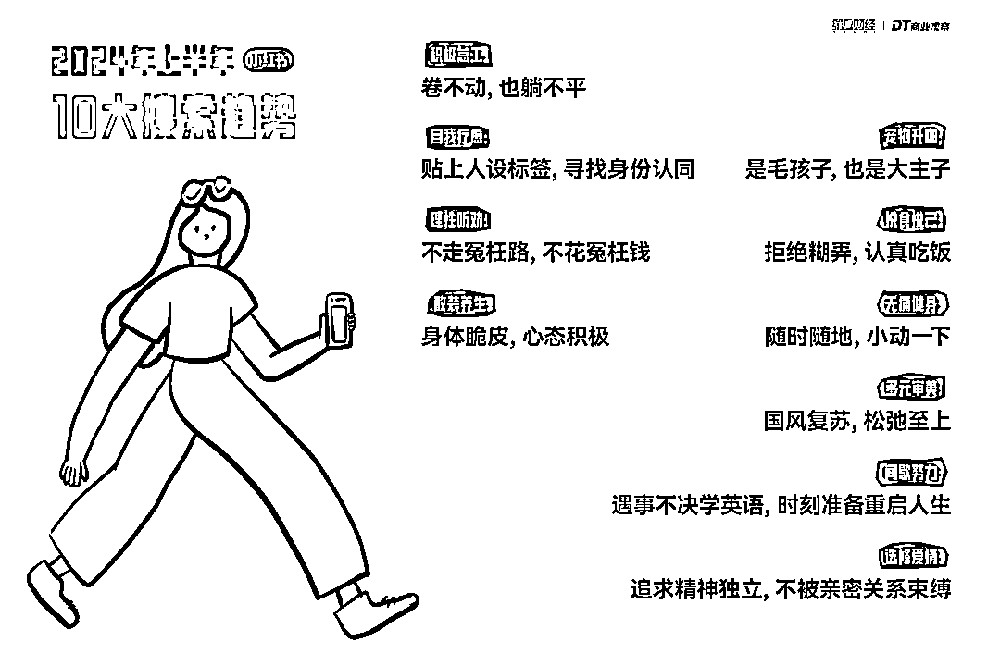

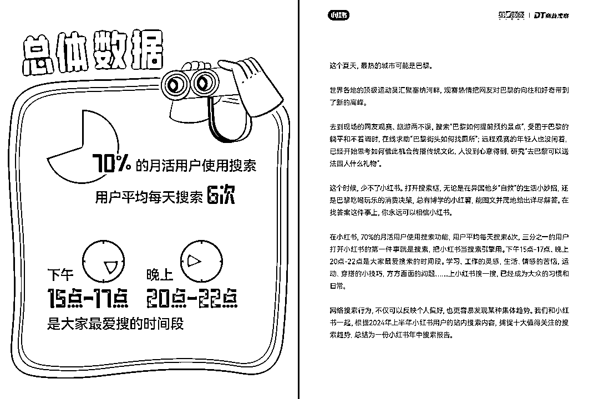

## 01 卷不动，也躺不平
**热搜词：兼职 / 简历 / 摆摊**

这届打工人开始祛魅了，很多人清醒地意识到自己可能只是个NPC。假期越快乐，回归后越难受。

“钱少心宽”的年轻人，身体困在工位，灵魂早在找Plan B。

小红书上到处都是在查副业怎么选、简历怎么写才能被捞、摆摊能不能搞起来、怎么和城管周旋的真实提问。

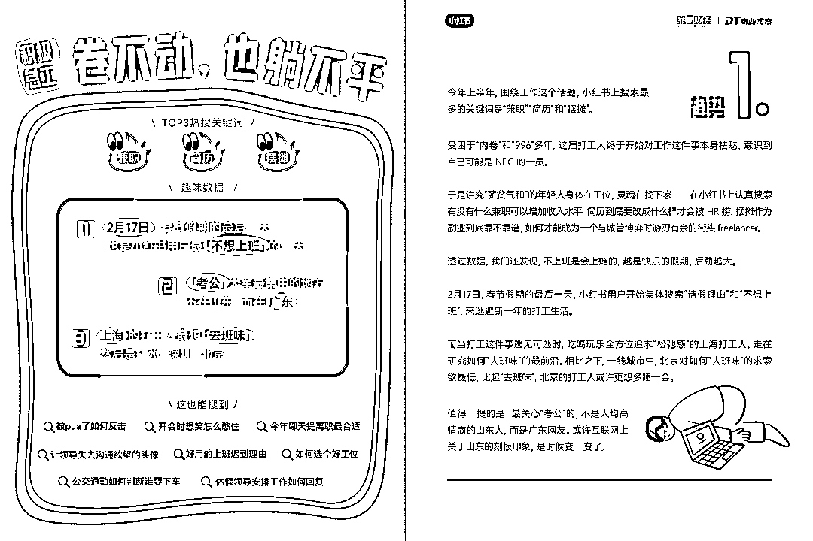

## 02 给自己贴标签，寻找归属感
**小红书最火MBTI：INFP INFJ ENFP**

你是I人还是E人？

上半年最受关注的三大人格是INFP调停者、INFJ提倡者、ENFP竞选者。按MBTI划分，N直觉+F情感的“小绿人”最爱在小红书上拆解自己。

从星座到人格测试，人们一边撕掉旧人设，一边给自己安新标签，于是“为I做E”“E言不发”“浓人”“淡人”这些说法开始流行。

但自我探索远不止MBTI。无数失眠的深夜里，用户借着搜索来疗愈自己，春天里集体想哭的人，都在找自救方法，喊着要把自己重新养回状态。

网友流行“发疯”，信奉“与其内耗自己，不如外耗别人”。

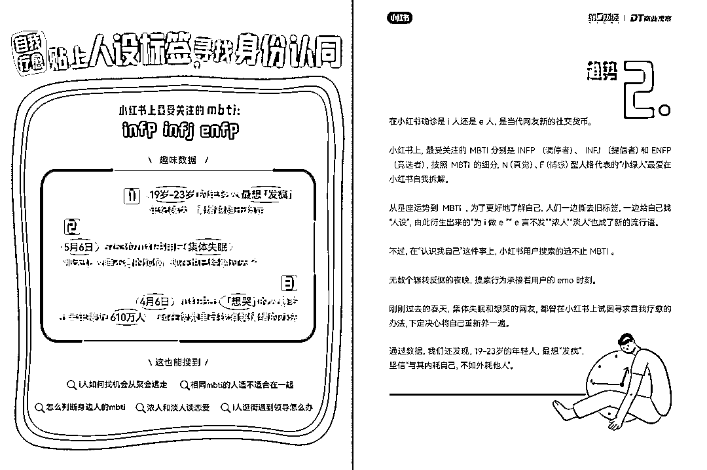

## 03 不踩坑，不花冤枉钱
**新晋热门目的地：小城**
**最受关注小城：运城、毕节、衢州**

去哪玩不刷小红书？几乎没有。

博物馆怎么抢票、高铁怎样快速进站、签证材料怎么准备、出国水土不服便秘怎么办、特种兵路线怎么走、度假酒店怎么选……出行全靠搜。小红书网友用提问换来极致效率和性价比。

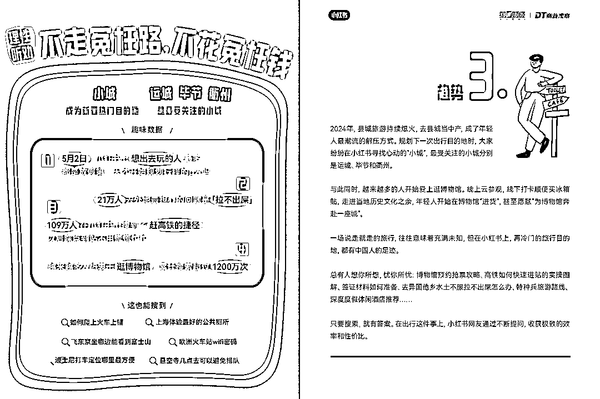

## 04 身体容易脆，心态依然乐观
**上半年最困扰的小毛病：便秘**

没想到吧，2024年上半年最让人头疼的竟然是便秘，“大便顺畅”都成了低调的炫耀。

136万用户夏天喜欢晒背养生。广东人最关心长寿之道，怎么活到100岁。养生品牌完全可以把这些搜索痛点做成内容。

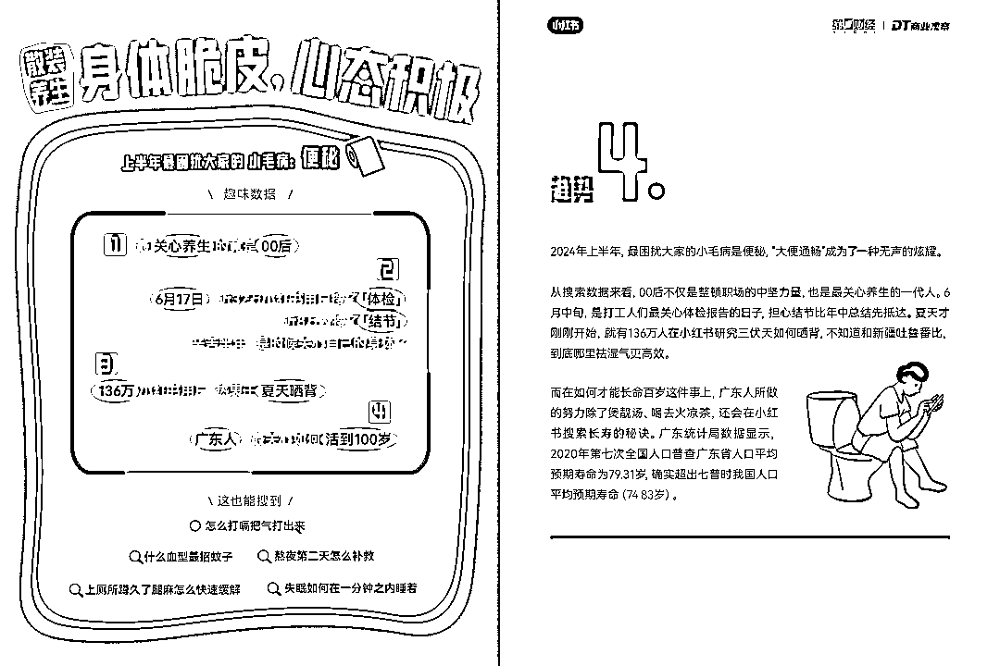

## 05 毛孩子也是家里的顶梁柱
**最热门狗狗：比熊**
**最热门猫咪：布偶**

猫党完胜狗党，猫党比狗党多出近2600万。

小红书还兼职《宠物取名大全》，上半年就有4758只猫的名字是网友帮忙起的。

养宠人像带娃一样认真提问：我家孩子能当童模吗？床单被猫抓坏了，主人要赔多久？

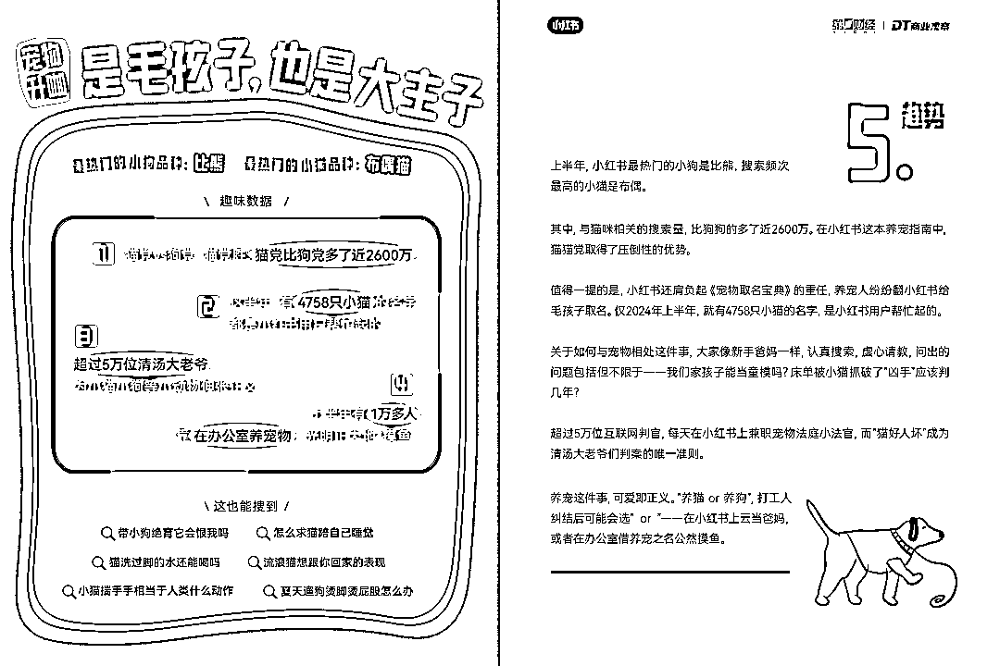

## 06 悦己也悦食，拒绝将就
**搜索量最高的一道菜：可乐鸡翅**

白人饭、酸奶碗、干巴lunch再火，也比不过一口家的味道。

成都人最爱搜“好吃又不长胖”，把成年人的既要又要写在了脸上。

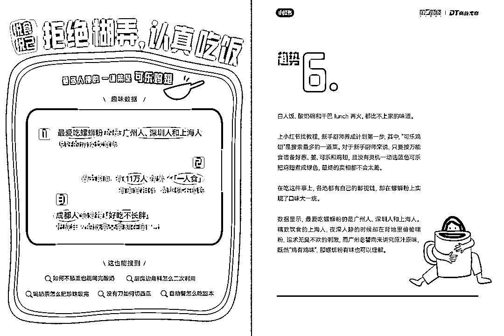

## 07 无痛健身，动起来就行
**最热门运动：散步**

近6万人最爱的健身房是“家里”。居家减脂需求巨大。

Citywalk火遍朋友圈后，散步成了小红书第一大运动。

有人搜散步路线，有人搜散步穿搭，还有人研究散步心率多少算稳、和相亲对象散步聊什么话题。

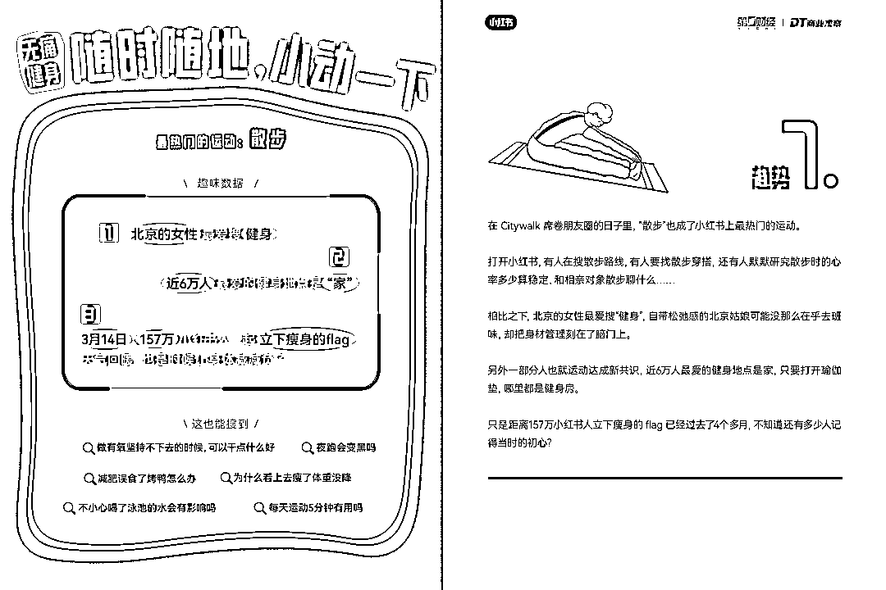

## 08 国潮回暖，松弛感当道
**最火品类：新中式 马面裙 旗袍**

穿搭赛道里，老钱风、辣妹风、侘寂风都败给了国风。新中式、马面裙、旗袍成为爆款，成为新一代中式审美的核心符号。

女生越来越不爱高跟鞋，更偏爱舒服的运动鞋。上半年，近2万男生在小红书上求改造，下一个小艾同学可能就在其中。

还有一个反常识数据：夏天大家却在搜“羽绒服”，为秋冬反季捡漏。

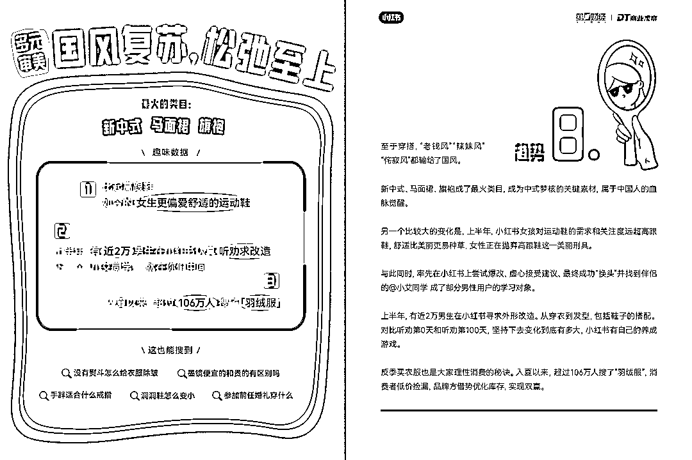

## 09 遇事不决先学英语，时刻准备重启
**小红书最爱学习的科目：英语**

成年人想改变自己，第一件事是健身+重拾英语。

重启人生的进阶版是考研，上半年有8万人研究大龄回炉深造。

不学习就焦虑，没进步就慌张，这届中国人为了逼自己学习，还会依赖自律APP。难怪多邻国这种天天催背单词的App在小红书上这么受欢迎。

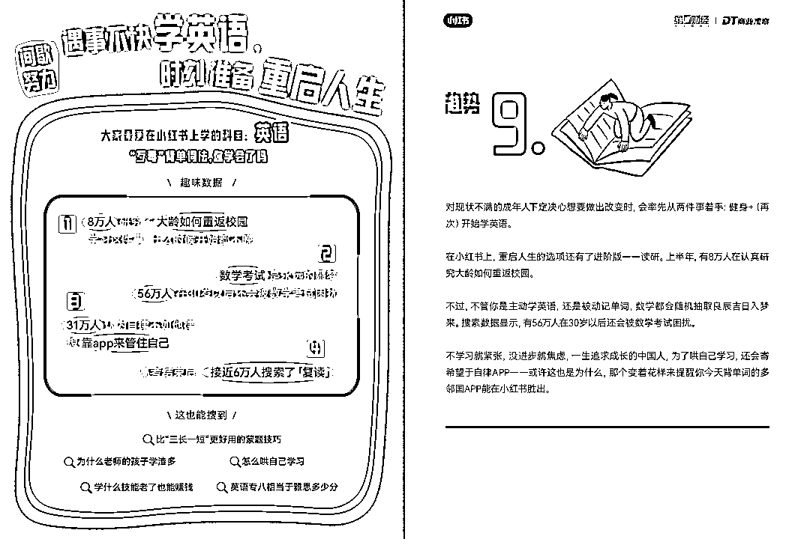

## 10 追求精神独立，不被关系绑架
**情感TOP搜索词：送男朋友礼物**

“送男友礼物”在情感赛道搜索量遥遥领先，不像电商上直男搜“女朋友感动哭了”那样粗暴，小红书女生更爱参考别人的成功案例。

有人开心有人难过，约95万人正在学“求复合”，情感咨询因此赚翻。520当天，超5000人搜分手和离婚。亲密关系是长期课题，爱情只是其中一环。

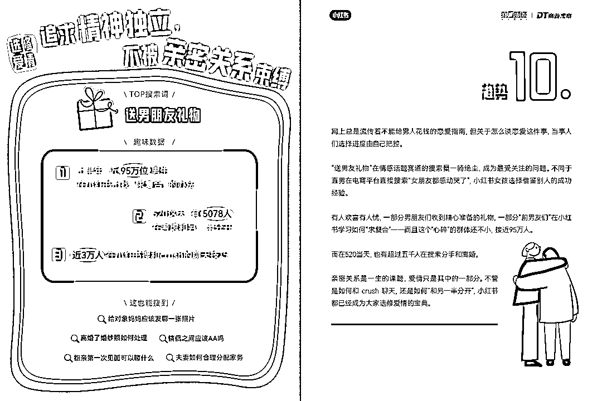

---

看完这10大趋势，能不能get到你的生意能怎么切入？你的项目能和哪个点结合？欢迎评论区聊聊~

* * *

评论区：

青城 : 遇事不决学英语[捂脸]太真实了

* * *