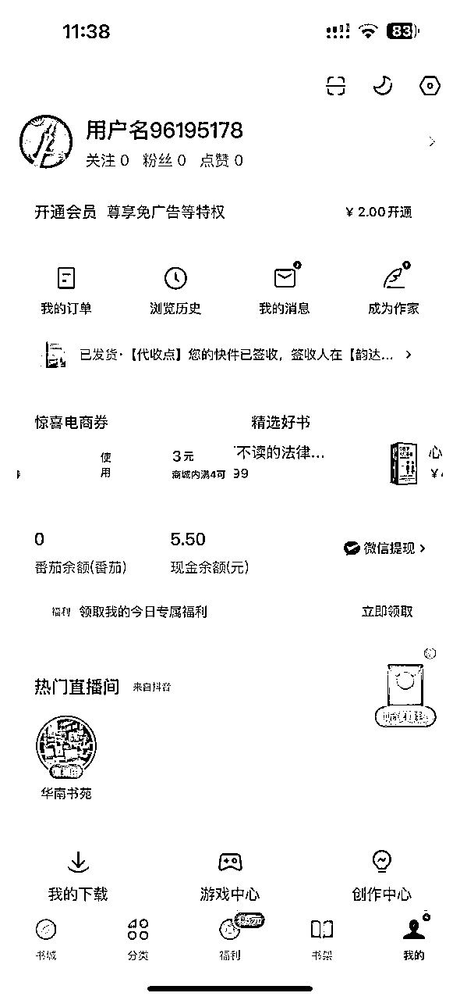
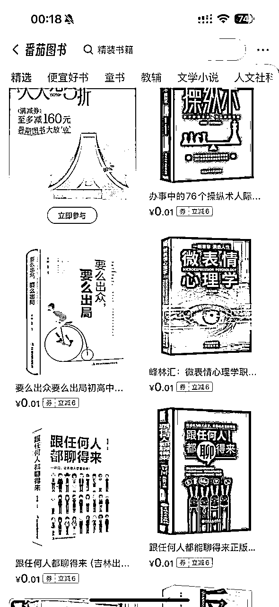
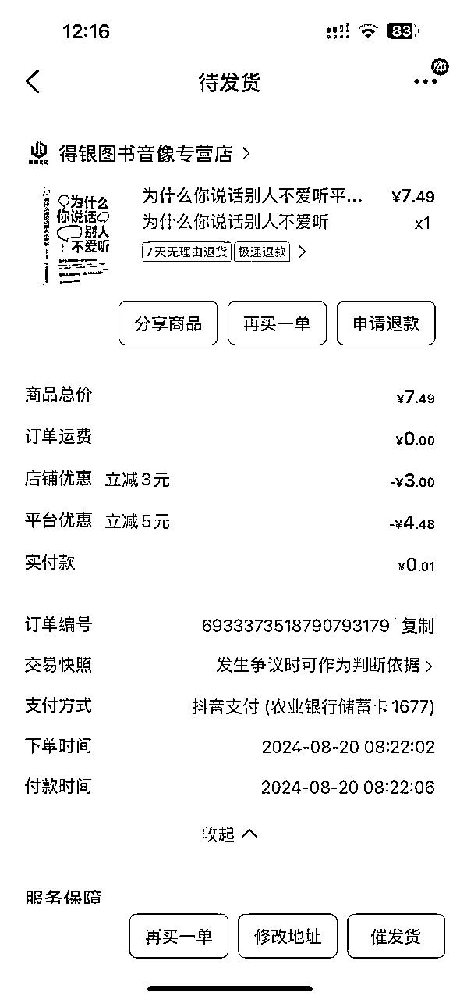
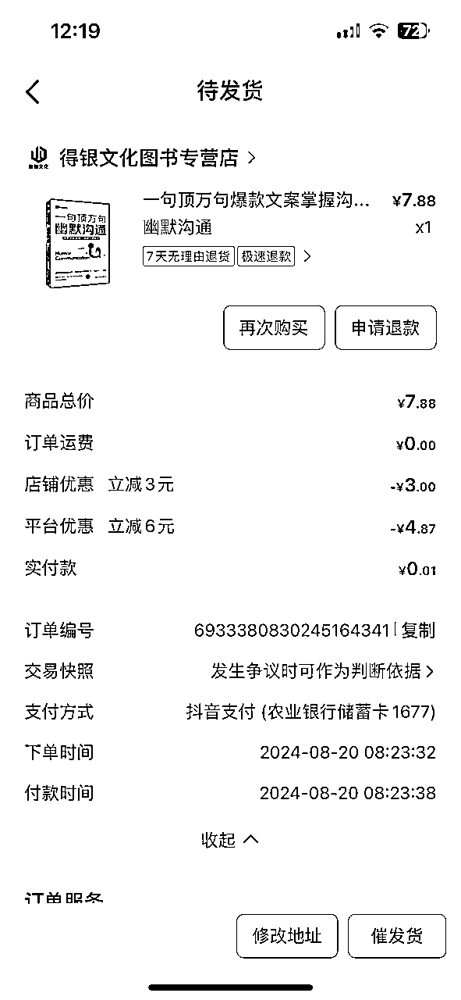

# 用0.01元包邮拿下正版实体书，我是怎么玩的

> 来源：[https://va802z4imkx.feishu.cn/docx/FVKpdz0eOoAe0FxJWwjcPvrMnUh](https://va802z4imkx.feishu.cn/docx/FVKpdz0eOoAe0FxJWwjcPvrMnUh)

大家好，我是少波，四月份才入驻龙哥盟。

来到这里就像打开了一扇门，认识了一批很合拍的人。信息密度确实大，有时候会跟不上节奏，但那种持续学习的快感，远比刷朋友圈强太多，也更愿意在这里吸收新方法、新思路来打磨自己。

我一直做线下实体，做过员工也自己开过店，骨子里比较保守，极度怕亏怕踩坑。可久了也发现，太谨慎会错失出手的时机。看了不少赚钱精华课和高手领航后，慢慢明白了关键：要在稳健和果断之间找到那个平衡点。

最近刷到闲鱼二手书的玩法，就去深挖了一下。门槛越高的事往往越有搞头，而且能把主动权牢牢握在自己手里。结果一查才知道，平台上架图书需要出版社授权，没授权就侵权违规，吓得我立刻刹车，又一次被自己的风险意识拽了回来。

于是我在赚钱的搜索框里挨个试关键词：图书、出版物许可、使用授权等等。恰好联系上了内蒙古的那位圈友 @乔久伴，从他那儿了解到了这个薅羊毛的渠道。下面就把整个流程整理出来，方便自己日后复盘，也分享给大家。

# 1 这套玩法值在哪

1.  只花0.01元包邮就能到手全新正版书
2.  拿到手后可以挂闲鱼回收变现
3.  也能直接送给亲友、送给本地社群换人情

# 2 启动前的准备步骤

1.  手机上装一个番茄小说 App
2.  用番茄小说去关联你的抖音账号
3.  抖音里提前绑定好银行卡用于支付

# 3 下单的具体路径

打开番茄小说 App后，点击底部我的，进入精选好书板块。这里面的图书全是0.01元起购，挑好想买的点进去，下单会直接跳转到抖音完成支付，填好收货地址就搞定。

# 4 操作中会遇到的情况

平台偶尔会做用户行为测试，来分辨你是真爱读书还是来薅羊毛的。对于部分账号，价格会临时变成1到3元左右。

我自己就有个号正好遇到这种状况。实测下来处理很简单，还是按上面第三步的方式去下单，只要3元以内我都直接成交。毕竟成本不高。

当然买不买完全看个人意愿，不想买就别买，别到时候来找我要差价就行😨

有趣的是，第二天重新打开 App，大多数书又会恢复成0.01元的状态。

另外一个小技巧，如果账号多但银行卡只有一张，完全可以把同一张卡绑定到多个抖音号上轮流支付。我特别羡慕那些手机多、账号多的朋友，我现在手里就两个手机🥹

# 5 一点总结

这次撸书最让我安心的是走的是正规官方渠道，基本等于稳赚不亏。

活动能持续多久我也不敢打包票，我两个号已经安稳薅了十几天的书了。

早上刚截的实测图，可撸的数量本质上取决于你有多少可用账号。

如果你身边有爱读书的长辈、朋友，或者家里有小孩需要绘本，可以把这个办法转给他们。一个人薅不够爽，分享给更多人一起薅才过瘾。后续如果再遇到类似的项目，我会第一时间在群里同步。

欢迎在下面留言交流，哪里没讲清楚或者可以优化的地方请多指点，我也好继续完善。谢谢大家！