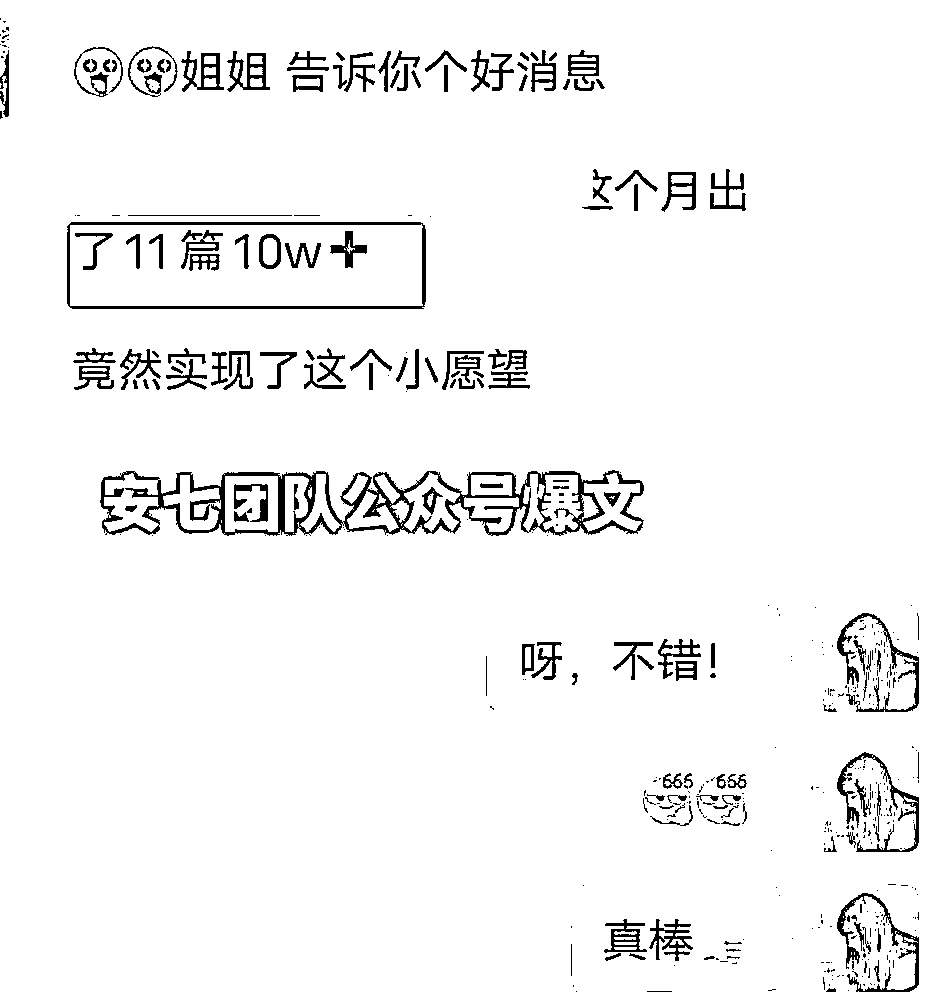
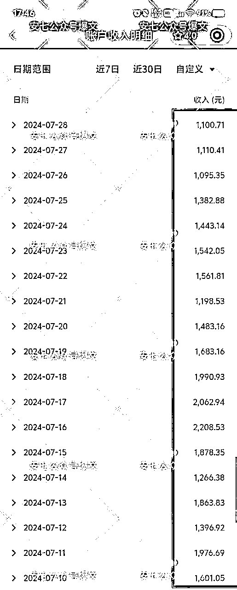
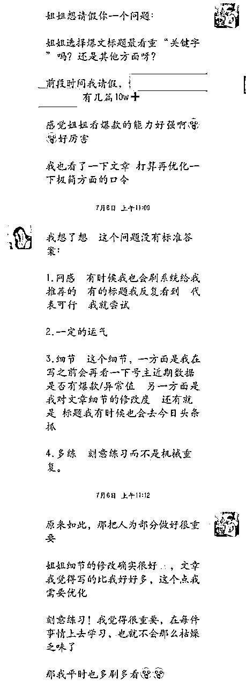
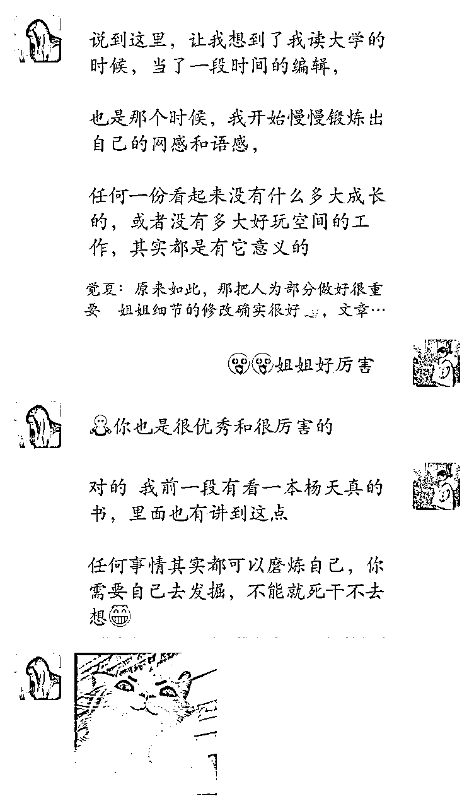
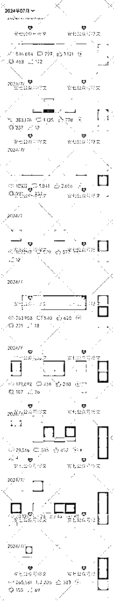

# 从00后大二女生到日更10万+：一年时间，她如何把公众号做成稳定现金流？

> 来源：[https://die28mmde0k.feishu.cn/docx/G63Ld7L5Bow3jvxAUw9cTcORnPc](https://die28mmde0k.feishu.cn/docx/G63Ld7L5Bow3jvxAUw9cTcORnPc)

嗨，伙伴们好，我是安七，应届毕业生，一年实现双百万营收。

这是AI公众号爆文系列的第三篇回顾，之前我们聊过：

系列1：我是怎么找到贵人、锁定AI公众号爆文这个方向的？

系列2：现在做公众号爆文，还来得及吗？

上期那篇坦白局被赚钱官方置顶成了精华。

精华文：https://t.zsxq.com/GjvBy

评论区挺热闹的，有人点赞认可，也有人质疑真实度，觉得现在做公众号爆文是不是已经晚了。

我不爱自夸。恰好，跟了我整整一年的大学生小助理，前两天刚交出成绩单：

1个月内产出11篇爆文，平均3天就能稳定出一篇10W+，运营的号开通流量主后，日入稳定在四位数。

看一个人靠不靠谱，别只听她讲。看看她带的人、她身边的学员，到底做出了什么结果，比任何口号都更有说服力。

所以我把她请出来了，让她用自己的口吻讲讲——

一个普通大学生视角下的公众号爆文真相。跟着我走了一年，她经历了怎样的蜕变？

一个零基础的大学生，在要上课、要兼职的情况下，是怎么做到稳定产出10W+的？

下面就是她的亲笔记录。

大家好，我是听听。

04年生的大三准毕业生，也是安七姐团队里第一位小助理。很幸运能加入进来，一年时间从完全的小白，成长到单月能出10篇以上10w+，号目前日入千元左右。

# 公众号到底还能不能赚钱？

很多人说红利没了，不值得碰。但事实是，现在依然有人靠公众号稳定变现。

核心就一点：只要微信公众号还能开通流量主，这条路就没断。

能赚多少，看能力加运气；能赚多久，看你怎么选。

有人专攻爆款，见效快，但生命周期相对短。有人做IP，前期慢，慢慢能沉淀私域还能接广告。

我们营里就有同学做读书IP，既做副业变现，又被清华大学出版社约稿。

赚不到钱的人，大部分卡在同一个地方：坚持不住。

总想马上看到回报，稍微没反馈就想撤。但自媒体这事，本质就是磨人性的事。懒和贪，是最难过的坎。

我从月更小白到平均三天一篇10w+，很大程度上也是学会了克制人性弱点。

不想写的时候，团队里有人已经爆了；想敷衍的时候，发现敷衍的结果就是更糟。事事都将就，人很难进步。

所以回到原点：公众号还值不值得做？我觉得值得。收益还在，就有空间。它不仅能带来收入，还能逼着你成长。

# 新手小白如何写出10w+？

我总结了三个关键点：

## 1. 跟着有结果的人学

我上过第一期爆文训练营，起步比同学慢，21天结营那会别人赚大几千，我顶多回本。那段时间很焦虑。

但结营后坚持方法，成绩慢慢上来了，破万的文章不少。

如果一开始自己摸索，绕弯路会更多。跟着安七姐，问题能被快速拆解，弯路大大减少。

就像她常说的：让人放心的幸运七。

## 2. 坚持做，并且用心做

工作学业很忙，中间也停更过，后来重新拾起来就没断过。

想写出爆款，网感是基础，能识别爆款会拆解，而不是自我感动。

要懂自己的账号，知道读者是谁、他们想看什么。

最关键是多练，但不是机械重复。

安七姐说过，看似没成长空间的事，其实都有意义。我定了一个小目标：一个月10篇10w+。最后真的做到了。

以前我只埋头写，后来发现我在用战术上的勤奋掩盖战略上的懒惰。

要想持续爆款，必须学会复盘。为什么这篇爆了，昨天那篇没爆？下一步怎么优化？

多问为什么，才能找到可复制的核心。机械进步很慢，有分析能力+网感+坚持，账号自然越来越稳。

不会怎么办？继续回到第一点：去问有结果的人。不要自己瞎琢磨，5分钟能解决的问题别花5天。

坚持是刚需。春种秋收，急不得。相信自己能做成，是熬过低谷的前提。

## 3. 用行动验证想法

有时候一个念头冒出来，第一反应是忽略还是验证？

我分析账号时发现：爆款是可复制的。越看越觉得对。

我拿大量标题去验证，事实证明确实如此。我的很多10w+都是复用爆款标题。账号权重起来后，爆的概率更高。

这就形成正循环：持续输出→有结果→权重提升→结果更好。

课程里其实提过，我没真正消化。这次亲身验证后才明白：学了不等于学会了。

要么花时间琢磨，要么多问多做。我靠后者，从小白做到了单月10篇+10W+，其中一篇阅读103W。

# 从抗拒到拥抱爆文的心路

我一开始是排斥爆文变现的，甚至对AI爆文有点抵触。写了四年文，有点“清高”，觉得爆款标题没技术含量。

但普通人很难空降实力。标题吸引人，读者才会看内容。平衡自我表达和读者需求，才是最佳解。

慢慢我接受了爆款逻辑，也学会了拆解标题。网感也跟着长出来了。

AI的到来让我别扭，但不得不承认它在效率上碾压人类。学会用它，等于省时间，坚持起来更轻松。

自媒体这条路，无意间推着我成长。有人来有人走，但目标始终没变，反而越来越高。

# 新手避坑清单

**1. 先想清楚你要什么。**
做IP就别盯着短期数据，要耐得住寂寞提升写作；做爆文就要研究标题封面、练网感，保证基础质量。目标不清晰，容易既要又要，最后放弃。

**2. 别感动自己式努力。**
机械重复不思考，就是低效。我以前就是这样。没有复盘就不优化，不优化就不进步。读者不傻，运气只能接住一次。

**3. 学会接住负反馈。**
新手期基本都是负反馈：推流了没赞、没关注、没大爆。这很正常，也是筛选器。能熬过去的人，方法对了结果自然来。

# 如何度过瓶颈期

数据卡住的时候，最怕的就是放弃。我没什么高招，就是硬做，熬一天是一天，靠团队陪着一起推进。

如果你一个人坚持太难，就找同频的人一起走。看到别人也走着，你就不敢掉队。

习惯养成后，要求会自然变高，进步也成常态。

目标要拆细。我要一个月10篇10w+，拆成平均3天1篇。再拆成：怎么复刻第一篇的成功要素？找到可复制的方法后不断重复，爆款就不再是偶然。

一个招式练一万次就是绝招。重复中找规律，重复中迭代优化。能被别人做成的方法，你照着做也一定能有所收获。

最后祝大家都能得到满意的结果，一起加油。

# 安七说

看完小助理的初稿，除了补数据图片，我一个字没改，写得太好了。

她是我身边唯一一个一路跟着、一直打磨的伙伴。这一年公众号爆文的成长，我全程见证。

当很多人觉得公众号没空间时，我们的团队还在深耕优化，用结果说话，其实挺难得。

大家的智商都差不多，甚至不需要太聪明。笨拙的坚守、正向的发心、走正道做笔记，钱不会差。

公众号爆文还能不能做？值不值得做？精华贴说过，现在也验证了。

一起加油，赚钱！

我是安七，下次见。