# 从关掉七家店到年入千万，二手手机这条路他是怎么走出来的？

> 来源：[https://vfqxua5lvd.feishu.cn/docx/JQ0odvpOLo4JQxxNiQ5cDBqSnWc](https://vfqxua5lvd.feishu.cn/docx/JQ0odvpOLo4JQxxNiQ5cDBqSnWc)

## 零：开场

赚钱的伙伴们好，我是郑州圈友凡灵逸尘。距离上一次和朋友随心深度聊完写帖子，已经过去整整两年。

两人私交甚笃，平时走动频繁，我对他的近况很清楚，才敢动笔写这篇。

这两年身边很多人都给他介绍了客户，因为我们公司的设备全是他供的。靠谱是关键，机器出任何状况他都会兜底，所以口碑自然发酵，转介绍源源不断。

口碑转介绍的本质就是信任背书。要是只是关系好、产品不行，大家谁也不敢推。

他也反复提过，上篇帖子为他带来几十万营收，而我手头项目太多一直拖着。答应过的事不好意思再鸽，某天郑州下暴雨的夜里，我专门去他那坐了三小时，才把这篇聊出来。

即便我见过不少创业大佬，这次交流依然收获很大。2024年，在我认识的所有创业者里，能做到业务还在持续增长的屈指可数，他就是其中一个。增长的背后，核心是他做对了一个关键取舍。

圈子里创业者居多，大家更清楚：设备成本再高，也不如时间成本贵。从我的角度看，他非常懂做工作机的互联网创业者到底在痛什么，原因在下文。

在当下这种市场环境里，他还能实现数倍增长，带着一堆好奇，我提前准备了大量问题，从大学开始的关键节点全部复盘，这次势必把他榨干，尽量多带出些干货。

上篇文章回顾：【如何用互联网思维，将二手手机业务放大100倍】https://t.zsxq.com/sD9s3

## 一、过往轨迹

### 1、大学起步

2012年他去厦门上大学，也正是和手机结缘的起点。高一就开始倒腾二手机卖给同学，还卖电话卡。

高中毕业做过卖手机送话费的兼职，干两个月赚几千。家里每月只给一千生活费，农村出来的孩子，周末就靠兼职补贴。

大一暑假在饭馆洗碗，一天八十，洗一周腰都直不起来，当时就想找个更轻松的赚钱方式。

大学里干过洗碗、服务员、发传单，后来做中介，给酒店谈合作输送兼职。最多一晚安排150人去饭店打工，自己提成10元，一晚上1500，比洗碗轻松太多。随后就常和厦门五星级酒店打交道，顺便寻找其他机会。

2014年大二，他关注懂懂，看到一群创业者。至今公众号已日更三年。那时他记住一句话：“只要你敢写，就有人敢看。”

同年加入付费社群，开始在淘宝卖电话卡和手机。现在的合伙人龙哥就是那时卖手机认识的。

当时随心月入五六千，在淘宝排第二，第一名更猛，想叫随心一起干，随心没同意，后来那人让随心代发，两人因此深度熟络。

### 2、毕业后的摸索

淘宝实名制后卖不了电话卡，就和厦门的老同行一起开实体店。认识四个月就合伙，至今十多年。

2015年开实体，获客靠淘宝、论坛、小鱼网、中关村，一年两人到手一万多。

16年做手机分期，利润高，做了一阵后觉得让别人付高利息不厚道，就停了。也觉得开店没意思，去福州做摄影运营助理干了半年，16年底离职，不开心也赚不到钱。

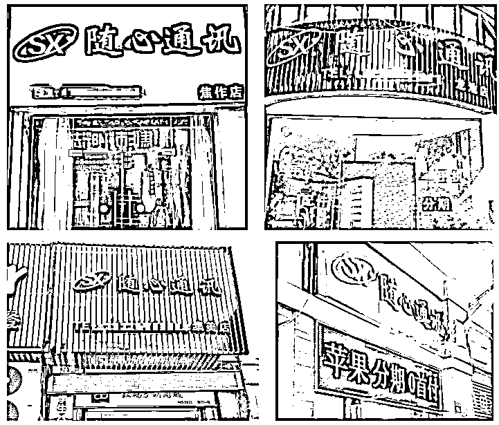

2017年回老家开店，是因为做梦梦到开了很多店。厦门店还有股份，每月分红几千，加其他收入月入两万左右。出于冲动投五六万拉朋友一起，想当然觉得一家月赚一万，开十家月入十万。结果陆续带朋友开，多家都倒闭了。

那时他缺流量、运营、货源、市场、品牌思维，根本没流量能力。几十万投下去就负债了。店都半死不活，合伙人撑着，不赚不亏。

2018年休息出去玩一圈，看人喝茶，就花十几万开茶室。

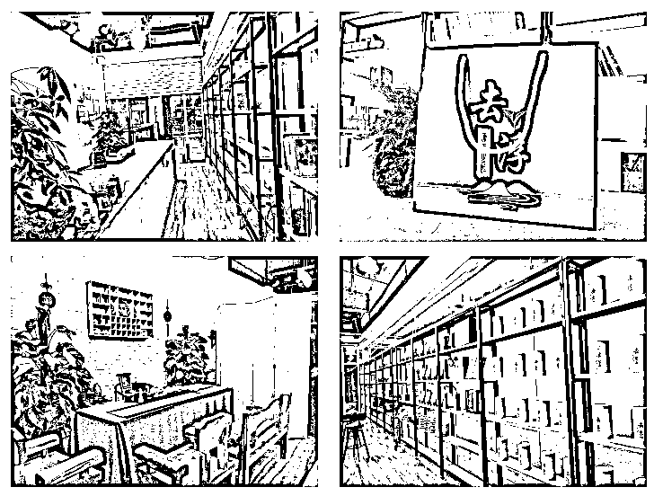

### 3、重新入局

2019年下半年，合伙人龙哥去江西出差喊他玩。那时他比较闲，不想赚钱，一天赚500就下班，有负债也能周转。

三天大酒后，龙哥问他最近在干嘛。那年龙哥赚了几十万，问他有没有项目要不要一起。随心说在卖手机，手上小业务不少。

随心做小钱的能力很强，靓号、手机卡、手机样样来。龙哥直接转给他十万，重启手机业务，并让他回郑州发展。

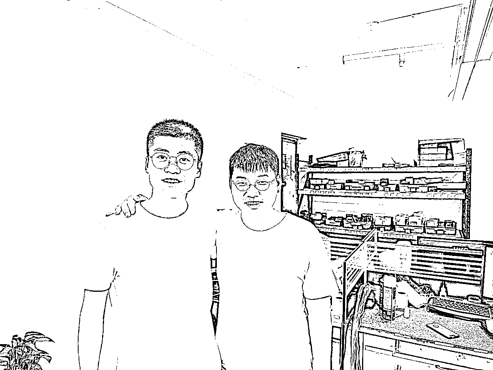

## 二、创业的关键抉择与思考

提问思路：
1. 初期挑战与转型
2. 挫败经历
3. 竞争优势来源
4. 多倍增长的核心
5. 坚持与放弃心态

### 1、回郑州初期最大的挑战是什么，怎么克服？

对二手机他有自己的坚持，不想只赚信息差，更想帮客户解决问题，用合理价格买到合适的机器。理想是好的，但流量不行，货卖不掉。三个员工月薪一万，房租工资都扛不住，一直在亏。

后来开始转型。记得有天赚了一千块特别开心，朋友劝他做工作机，现在大家做抖音，很需要专业靠谱的供货。

他当时在写公众号、发朋友圈，还在互联网社群混，正好听了朋友的话转型，立刻止亏。

随后不断迭代、不断研究增长。问他现在规模是怎么来的，他说自己扪心自问再走一遍也不一定能成。成功需要时间节点，别人的路径不可复制。时机重要，也取决于当时的状态和认知。

### 2、为何能坚定专注工作机？

一开始抱着理想入行，中途离开过，又回来，像连锁梦一样一直对行业抱有期待。他本质是理想主义，想干出一番事业。

随着时间推移，认识到行业没那么简单，于是把想法压在心里，在业务里一点点兑现对行业的执着。

现在做终身售后、不断抠细节、产品描述极致清晰，本质就是认真对待行业。初心是童叟无欺，让价格回归价值。

他自己曾买过垃圾机器，深知用户怕什么，所以想把用户问题解决掉。虽然很多平台也在做，但问题仍在。他要把服务做到位，覆盖更多用户，在行业里实现价值。

不止想在这个行业赚钱，更希望行业走向正向。外界对行业印象是素质低、坑蒙拐骗、忽悠用户。他希望改变偏见。正如老罗说：“我要干干净净赚钱，证明干干净净赚钱是可能的。”

他也可以不赚信息差钱，直接公开手机利润、问题点、用户能否接受、能提供什么服务，收相应的利润，这就是他想要的商业模式。

现在很多同行跟着他学，说明行业里有人开始重视服务。靠这股力量推动行业进步。利润可能有限，但他想做品牌、影响更多人，为行业做贡献。

### 3、业务发展中最挫败的时刻？

每次做门店都失败，至今开了七家，没一家成功。两年前提出的百城百店要缓一缓，目前擅长的是互联网引流。

未来若做连锁，也会用互联网基因去和别人合作。对门店的理解目前还很浅，不擅长实体运营。

### 4、如何建立独特竞争优势？

2023年前，行业很多人闷声发财，信息差巨大。他以前只会找同行拿货赚差价，而老玩家掌握了巨大的渠道信息差，所以能赚很多。

去年之前行业几乎没交流会，大家闷头赚钱。去年开始频繁交流，是因为抖音打破了信息差。

信息差被打破，很多人赚不到钱，于是各种交流会冒出来。真正赚钱时大家没空交流，行业难赚钱是从2023年开始的。

比如回收价，以前差价就是利润，现在华强北报价满天飞，用户人手一份报价单，对比后信息差消失，利润也消失。

这两年实体店从业者很艰难，行业要重新洗牌。对创业者来说是机会。洗牌前大哥永远是大哥，洗牌后小弟可能翻身。

靠新流量渠道、新经营方式起来的玩家，只有行业变化时才有机会。新的流量方式变化，对后来者是天然优势。

他们相对同行有互联网优势，以及持续挖掘流量的能力。最早开店月入一两万，现在公司月营收约五百万，月毛利五六十万。

### 5、多倍增长路上最关键的点？

竞争力=与同行的差异化。

产品差异化：别人做组装机，他们做原装机；
用户差异化：别人和同行抢用户，他们在创业者圈子找用户；
人设差异化：他不只是卖手机的，还是创业者博主。

差异化贯穿产品、人设、公司方向，找到生态位特别重要。

### 6、哪些成长对增长起决定性作用？

对流量的理解。以前觉得把产品做好就行，流量不重要。虽然现在仍认同口碑是最好的营销，但生意要做大，核心是流量。以前没概念不会做流量，现在觉得流量本质是人性。

过去是等客户上门、等转介绍，现在是主动去做流量找客户。流量决定生意能否传播，但产品必须先做好，流量来了要能留住，留存是核心。

### 7、创业这么久，有没有想过放弃？最后为什么坚持？

从来没想过放弃，但有无数次崩溃。崩溃可能只持续一秒，他自我调节能力很强。朋友评价他，心里总是有答案。

他是个有答案的人。做项目不是跟别人学的，是自己做的。问人也是带着答案去问，不是去问问题。所以几乎没想过放弃。

调节心情的方式是泡茶或走路，两者都能快速把他从糟糕状态拉回来。

凡灵逸尘：找到自己的调节方式太重要了。没什么坎过不去。我问这个问题，也是想给屏幕前的奋斗者一些能量，能看到这里，我们都是同行者。

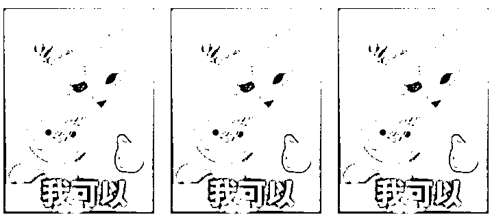

### 8、现在最大的问题和踩过的坑？

人才问题。公司发展需要大量人才，每个业务都需要合适的人，目前还没找到能在业务上给到强力帮助的人。

目标随阶段变化。2019年目标一年赚100万，做10人小团队。现在团队20多人，目标是一年几千万。

人是贪婪的，每个阶段都有新目标。做到1000万后，可能还想更多，比如100个城市开100家店，哪怕之前门店都没成功过。

以前团队管理没话语权，员工听话能干但业务能力弱。现在要调整策略，找各板块合适的人，目前看重靠谱特质，不同板块需求不同。

现在想通过互联网吸引创业者加入，注重前端业务体系打造，目前还没踩过特别大的坑。

## 三、抖音带来的增长归因

提问思路：
1. 流量获取挑战与解决
2. 转化衡量指标
3. 为何现在能成

### 1、行业整体在降，你通过抖音获取流量过程中最大困难是什么，怎么解决的？

通过抖音获取流量，3-5月实现增长，从月销80台到2000台，6月又回落到几十台。

一开始认为是内容问题、抖加投放问题，各种尝试都没解决。

7月才发现是平台问题，有不可抗因素。解决办法是做确定性事对抗不确定性未来。目前主要在抖音和闲鱼获客，视频号也在分发，效果一般。

### 2、如何衡量抖音流量转化为实际增长？关键指标？

客户转化周期在两三个月。关键指标是当月销量，用投放金额对比当月销量来判断。公司各板块财务独立，盈亏一目了然。

### 3、之前做抖音没什么效果，如今内卷期反而拿到结果，为什么？

抖音天花板高，他擅长在变化慢的平台长期投入，适合抖音这种需要积累的平台。

最开始拍了几百条视频没变现，春节后突然开始爆，一天加100人进私域，才觉得是机会。现在他和合伙人全力all in。

他的每一步动作都有积累，不会频繁变动。所以当很多人觉得抖音不是机会时，他反而能拿到结果。

因为他all in了，而且他的动作符合性格：可以很慢，可以大量投入时间，可以拉长战线。这是很多团队做不到的。

### 4、未来业务拓展计划与优化方向？

如果要做行业外业务，一定是在这个行业拿到巨大结果后再迁移。什么叫最大结果？就是在这行已看不到增长，已触到个人能力天花板，才会换赛道。

今年3-4月的爆发和往年不同。往年四月生意就差，今年特别好，之前月入20万，今年直接到50万。2023年10月他还在想公司月入50万，现在已实现。

模式本质没变，就是找到流量洼地。流量搞定，后端售后服务体系会被逼着优化，这些迭代都是增长后才考虑的事。

没有增长就没钱优化，所有优化都围绕利润，每一步都要真金白银。

比如之前发货用极兔，每单3.5元，现在换京东，月成本多5000，一年多6万，相当于一年少赚6万利润。

为什么换？因为极兔经常丢件，客户体验极差，转介绍受影响。把服务细节拉满后，转介绍不断增多。

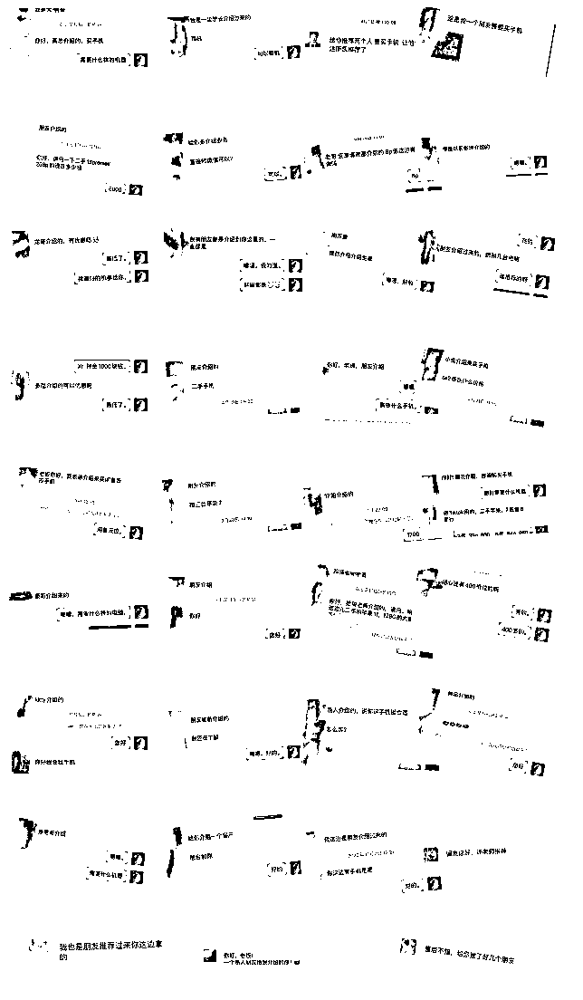

## 四、业务流程与运营

### 1、采购方式

* 平台采购：拍机堂等平台，月约150万
* 实时竞拍回收：月约30万
* 同行调货：市场收货，月数十万，不好统计
* 终端用户置换：积累大量用户，他们用完手机会卖回

### 2、质检入库

机器采购回来先质检，分给质检员。没问题入库，有问题送维修。维修完再次质检，再入库。

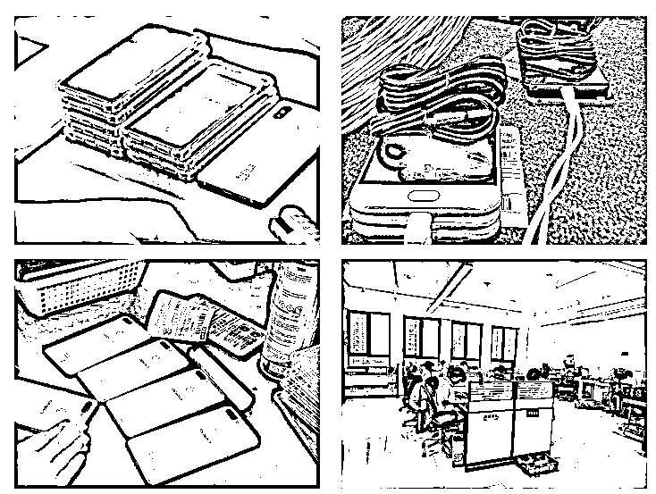

### 3、销售客服

目前主阵地是闲鱼+微信。闲鱼有客服把在售商品上传微商相册，学员在闲鱼发布售卖。

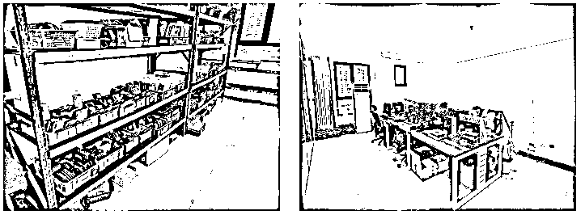

单独建学员下单群，客户下单后学员在群里沟通，问题由客服协助解决。

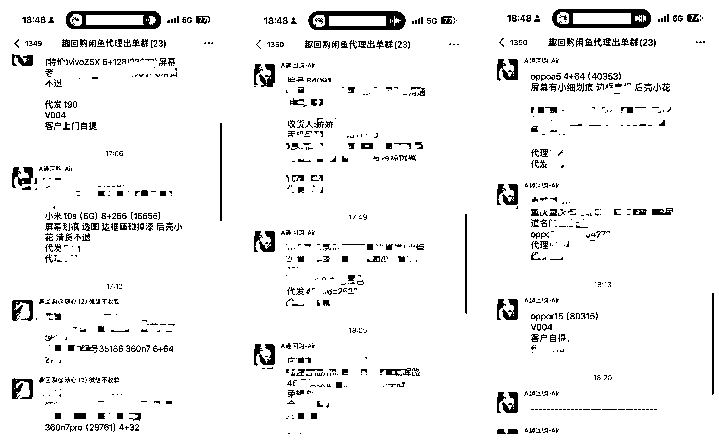

其他平台的流量全部导到微信。微信销售接单后丢到发货群，发货客服负责发货，发货前再次质检清理充电、打包，回传单号给销售客服。

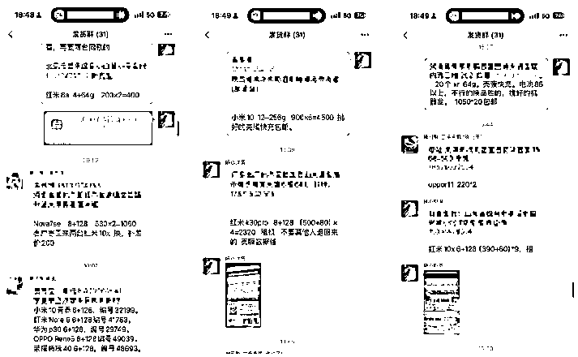

### 4、维修仓储

除终身售后外，还为批量采购二手机的创业者提供免费更换服务。机器有问题，直接发同型号新机过去，客户把问题机寄回维修，不耽误使用。对创业者而言，时间精力比一切都重要。

做了这么多年的二手手机生意，我越来越觉得，这个行业真正的门槛不是货源，而是有没有把最基础的细节做到位。

所有流入仓库的手机，只要有一点小毛病，都会先经过维修团队处理——电池不耐用就换电池，屏幕碎了就换屏幕，接口接触不良就修接口，数据残留就彻底清理——修好之后才会重新入库上架。这个过程听起来很笨，但保证了每台发出去的产品都是合格的。

库存是这行最大的风险。机器压在手里，每一天都在损耗资金。我们的应对方式是不断动态调价：比如在闲鱼上，一台机器如果一周还没卖掉，就立刻降价，让资金快速流转。很多人不愿意做这件事，觉得降价等于亏钱，但算上资金成本，慢卖其实更亏。

回顾这几年的发展，有几个关键节点挺重要。2019年，我从传统二手手机卖家转型为互联网创业者服务，靠差异化竞争找到了变现路径；2020年，知识付费社群爆发，我抓住批量采购工作机的流量，实现了第一波明显增长；2021年，通过蓝海选品发现闲鱼的流量洼地，招募大量学员在闲鱼卖货；2023年，开始做抖音矩阵，拍日常、发货、客户故事，业务又上了一个台阶。

目前几块业务的状况是这样的：私域社群相对稳定，体量和之前持平还略有增长，服务模式不断迭代，从终身售后变成只换不修，效率更高，也带来了不少复购和转介绍；抖音业务占整体体量大约三成，2023年10月开始做，复购率很高，其实就是把私域的玩法搬到了公域，用海量内容对抗概率，今年会继续加大投放、扩大矩阵，目标做到5000台的出货量；闲鱼业务确实在萎缩，从最高峰每月600台掉到300到400台，原因包括砍掉培训、精力转移、人员流失，但业务形态也有转移，回收板块从原来的10多台涨到了400到500台，整体量下滑了10%-20%。今年我准备重新投入精力，重新选品、增加账号和品类，再用抖音流量反哺闲鱼培训，同时搭建闲鱼团队，把能力复制给团队伙伴，让自己从具体事务里抽出来。

回收业务是今年新拆出来的独立小团队，模式是以销代采，现在两个人一个月能做出2万左右的毛利，纯利大约1万。今年会继续推进，很可能借用闲鱼培训的模式招募回收合伙人，目标是月毛利从2万做到10万。

价格策略也做了调整：以前客户还能还价，今年我们所有价格都锚定，实行一图一价，所有人都是同一个价，不接受砍价，但服务上一定会加倍给到客户。培训产品改成了199元的训练营，打卡就退还费用，从中筛出真正想干项目的人继续陪跑；同时线上培训转为线下，招募全职人员，学不会包退，最终目标是训练营补上人，反哺闲鱼后端的货盘。售后从终身售后改成一年内只换不修，增加服务追踪，发货前充满电、清理好，责任核定到个人；薪酬体系也会根据后端人员下班时间发薪，另外拿出公司盈利的5%-10%作为奖金发放。回访也加强了：货发走后实时查快递，客户签收时或刚签收就做第一次回访，一个月、三个月后再各回访一次，保证客户有问题能找到人解决，这其实是在践行终身售后的承诺，口碑和转介绍率自然就上来了。

直播环节重新做了分工：我的合伙人龙哥专门围绕目标用户痛点输出内容，比如我们主要服务工作室，就拍工作室会遇到的各种问题，吸引精准客户，他更偏卖货IP，而且视频全部来自日常积累，不需要脚本和准备，由龙哥管理。我则会减少卖货的投入，从“讲手机”转向“讲如何做项目、如何带学员”，因为我们有真实的数据、案例和场地，这些本身就很有说服力。

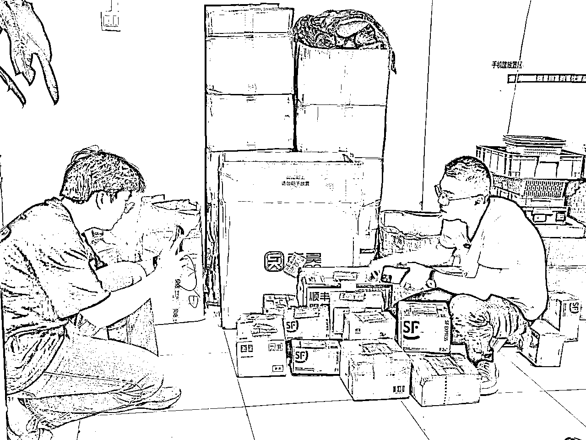
虽然最终能成交多少、客户能积累多少、能赚到多少钱，这些都不确定，但大量重复那些确定性的动作，就能争取到更好的不确定结果。

之前提出的百城百店计划，后来被我叫停了。原因是原来的模式想做自营加联营，希望控制每一家店，让合作方所有的货都从我们这边出，这样一来供应链的钱都被我们赚走，合作方手里拿到的钱就少了。这种模式是反人性的，违背利益的驱动，硬走下去不会长远。你把渠道和技术都教给了对方，人家又拿不到大头，离开是必然的。

今年我把这个计划调整成用培训的方式输出团队，合作方要不要继续合作、自己找货源还是用联营，全由他们自己决定。我们只负责把所有方法教给对方，给足选择空间，然后从中筛选出真正认同我们、愿意主动跟着干的人，而不是靠合同和约束去捆绑。

因为所有生意的核心是流量，我们也会教合作方怎么做流量。以前二手手机行业是“有货的就是大爷”，现在反过来了，能卖货的人才厉害——能卖货才能以好价格收货，否则手里压再多货也没用。以前我们四处找货，现在货主反过来找我们帮他卖货，所以流量才是破局点。

抖音跑通之后，我们会尽最大能力放大抖音的结果，因为天花板实在太高了，能把团队从一年四五万毛利带到1000万以上毛利。接下来先按一个月50万到100万的路径走，再看看要不要去小红书等其他流量渠道。

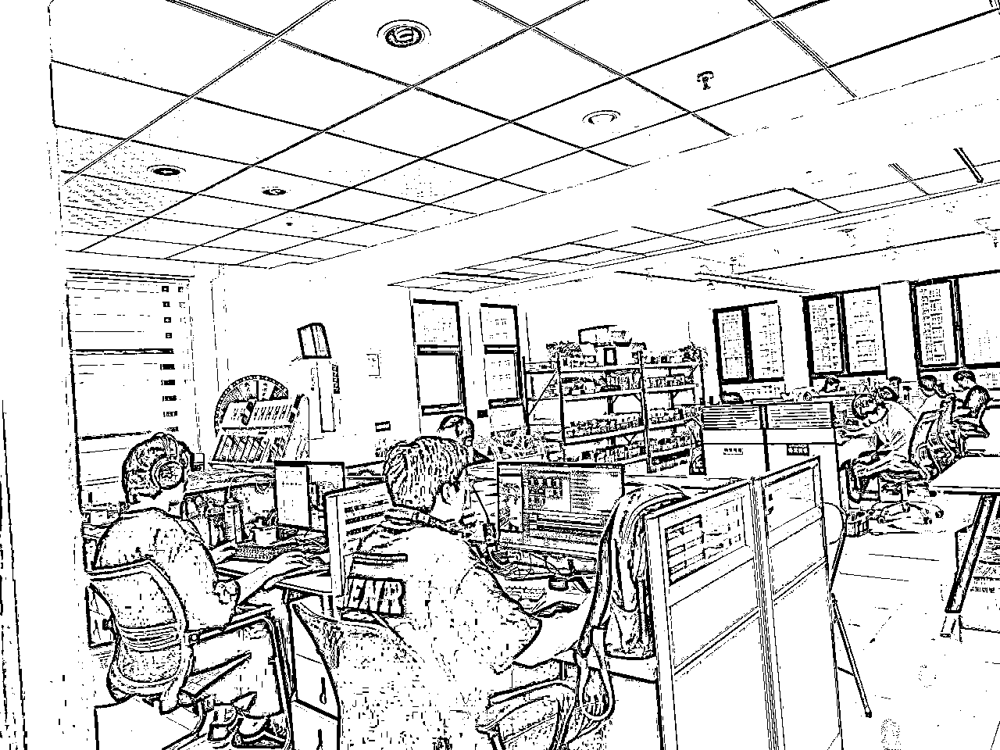
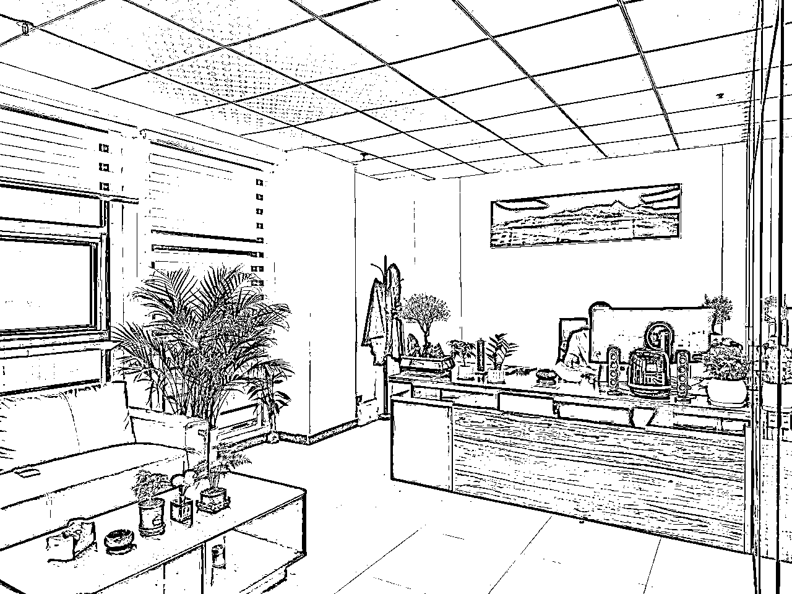
我其实做过三次抖音，前两次都失败了，第三次才算真正做起来。很多人问秘诀是什么，复盘下来，区别还挺明显的。

19年那会儿，看到别人用抖加带货卖手机赚钱，觉得很简单，就跟合伙人凑了十几万，把整个团队拉过来现学现卖，剪视频、投抖加。结果碰上疫情，人被困在家里，而且当时的心态是“能干成最好，干不成拉倒”，再加上公众号等其他渠道还能轻松赚钱，精力被分走了大半，最后亏了五六万，项目不了了之。

21年又试过一次，这次拍闲鱼相关的内容，靠SEO引流量，结果只做出一两千的流量，转化很差，也没赚到什么钱。原因其实差不多：心态没摆正，而且当时社群和公众号来钱太容易，一篇公众号就能收钱，谁还愿意去死磕抖音。

23年这次真的不一样。一开始也试过各种脚本，比如拍“00后不上班、创业干二手机”之类的，但转化很差；后来让学员去拍，依然没什么起色。直到我开始实拍收手机、卖手机的日常，一周后终于卖出第一台——那是个云南的唱歌客户，买了一台苹果X，还把旧手机卖给我。有了这笔变现，我觉得这条路可行，就开始拼命拍。一开始播放量也就500左右，但每次发这类内容，流量都会明显上来，而且能收到几十条评论、十几个咨询，这种爆发感是以前做社群和闲鱼时没有的。于是我认定这事能成，一直拍到现在，已经拍了几千条视频。

为什么这次能成？一是因为看到了真金白银的变现；二是见识到了抖音的流量潜力；三是我进了“工作机”这个细分品类，两个人做了100个账号，发了几千条视频，用绝对数量把所有对手淹没，用户一搜基本都能搜到我们，慢慢做到了品类第一。四是选对了对手：以前做工作机的人要么做得不行，要么收同行货转卖，而我第一个针对真正的工作室用户去建账号，等于没有对手。当然还有执行力——我们两个人一个月拍了1500条视频，一天最多80条，一般人真的做不到。

说到公司的竞争力和差异化，我想说，做生意有时候能赚钱，不一定是自己多厉害，而是看对手在干什么。存量时代，只要比同行跑得快就行。我们要做老虎，从别人嘴里抢食，把对方饿死，抢回他的用户，我们就赢了。一定会有人倒闭，别人倒闭了就是你的机会。所以让自己更强，才是活下来的逻辑。

我们能够持续发展，有个很重要的原因是创造了一个细分品类。在我之前没人提这个概念，我说工作机应该用原装、用精品，那这个标准就被我立起来了。当你在行业里有话语权，你说的话就是标准——因为讲之前没人讲，你讲了，它就是对的。

核心竞争力其实很简单：我们一直在往前走，不断完善团队、寻找新的流量洼地、找新的机会。具体来说，第一是持续做流量。现在公司已有5万私域，年底计划翻到10万，每天都在精准进流量，就算当下不赚钱也不能停。第二是不断创新和转型。售后方面我们从19年就开始领先：别人做一周时我们做一个月，别人做一个月时我们做一年，别人跟进时我们已经终身售后，现在直接换手机。我们还在行业里首创“工作机要用原装精品”的概念，提前预判了平台对工作机的要求会越来越高，垃圾机根本拿不到流量。第三是多元化布局。我其实不太看好只服务互联网创业者这个客群的长期前景，所以一边做工作机流量，一边布局C端和零售端，未来会开门店，做多品类，积累大量小C端用户，避免被大客户绑架。同时从贸易商转向服务商，靠持续追踪和免费维修赚客户一辈子的钱。

关于业务布局，抖音是因为它流量最大，我看到太多人在抖音上赚到了几百万、上千万，既然别人行，我们也有机会；闲鱼是因为看到同行一年能在闲鱼上做出千万利润，我觉得自己至少能做个一两百万，所以带着目标回归。两边一起做，既有增长经验又有新机会，而且把事情干成的成就感，有时比多赚几十万还让人满足。

现在最大的挑战其实是闲鱼。抖音的增长路径很清晰，只要持续做流量，粉丝转化是可预期的，而且单粉产值比较高，粉丝量上去了收益也会跟着涨；加上我们走的赛道足够独特，还能继续复制拓展。但闲鱼的结果不确定性很强，同行能成功是因为入局早、手上有很牛的账号，这些条件我们不具备，只能用自己的老办法慢慢扩量。另外，创业类IP的内容创作也需要仔细打磨：一是要在讲手机的账号里融入经营理念，吸引对商业感兴趣的人；二是要围绕变现讲清楚“我是谁、在干嘛、怎么做、做成什么样、为什么这么做”，还要把用户带入进来，比如做百城百店项目时，要告诉对方跟着能赚到钱以及怎么参与；三是要结合热点讲认知、讲故事，用案例和结果建立信任。

转型过程中有没有借鉴别人的经验？说实话，更多是靠实战摸索。我看过不少课，但真正操作时发现理论用处不大，只有拿真金白银去测试，才知道什么适合自己。身边朋友的经验局限性也很大，不一定能迁移到我的业务上。

目前新的业务模式还有很多可以优化的地方。比如线下课培训，缺的是陪伴和追踪。很多学员参加完培训就没了下文，遇到问题没人解决，信心就垮了。所以我打算招聘或培养专门的人持续跟进学员项目，建立学员追踪系统，记录进度和反馈，及时调整教学方式。有希望比什么都重要——当学员看到这件事能挣到钱，又有人帮他们解决卡点，再看到公司已经拿到结果，他们就会很有信心去干成。不能只为了收几千块钱培训费，而是要透过培训找到真正能干事的人，为百城百店做准备。业务模式上也要不断探索新机会，鼓励团队创新，小范围试点；加强团队协作，建立沟通机制；还要加强人才培养和引进，给员工培训和晋升机会。

团队方面，我很庆幸和龙哥配合得不错。我是主要决策者，在业务方向上基本可以做百分之百的决定，他不会阻拦。哪怕有些项目赔了钱，比如电脑项目亏了十几万，开店做零售也没达到预期，我们也不会互相抱怨，觉得不可行就一起砍掉。分工也很明确：我负责不断寻找新机会，他负责把后端打理好，并且把我的想法落地。从100万做到1000万，本质上就是团队不断优化的过程，只有拥有一个靠谱的团队，才能支撑公司走得更远。

做项目从来不是一条坦途。前期要反复掂量可行性，中期又常碰到无从下手的难题。但既然认定了方向，就别轻言放弃。只要心里那团火不灭，再难的坎也有跨过去的可能。创业本身就是一场高风险的博弈，可每一步走过的弯路、踩过的坑，都会成为下一程起跳的踏板。

业务要往前跑，就不能死守老路。试新玩法、开新渠道，都是常态。毕竟活下来才是硬道理，手里必须多备几张牌。别让自己活得像温水里的青蛙，危机感要常在。敢闯敢试，跳出熟悉的圈子，才能给增长注入新的变量。

扎进行业深处，才能看清风向和拐点。市场变化快得吓人，应对挑战、抓时机，都要靠对行业的理解。在波动中持续打磨自己的护城河，想明白靠什么赚钱，这才是长久之计。

流量固然重要，但用户来了能不能留下才是真本事。产品和服务过关，信任和口碑才会跟着来。让用户走进来是本事，让人舍不得走是功夫。

人也要跟着成长。边干边学，在实践中攒经验，才扛得住变化。合伙人之间各管一摊又彼此协同，劲儿往一处使。一个好团队，就是把困难拆碎、把目标搓成绳，一起拉到终点。

这次写法和从前不一样。一边站在已知结果的角度，慢慢还原事情是怎么走到这一步的；一边用提问牵引着往前走，再拿对话做总结。希望这些内容能让人对照自己想一想，也勾起一点好奇，去寻自己的答案。

