# 2024年，小红书哪些赛道该撤了，哪些赛道还能捞金？留学转行2个月卖出1亿的实战复盘

> 来源：[https://ht16ej1tui.feishu.cn/docx/JUtKd8BmSoSV6KxotikcGqbZndf](https://ht16ej1tui.feishu.cn/docx/JUtKd8BmSoSV6KxotikcGqbZndf)

小红书留学板块到底还能不能玩？2024年哪些赛道在掉头向下，哪些在悄悄往上走？什么时候是提桶跑路的黄金窗口？截至24年8月20日，40多个高客单赛道的卷度到底有多凶？蓝海赛道怎么找？

先自我介绍一下。

我珍妮子，22-23年和合伙人陈铭Ivy在小红书教育赛道做到2700万营收，1500块起家。

当一批留学同行还在抱怨引流越来越贵、转化越来越差时，我们已经悄悄换了跑道，杀进一个高客单上升赛道，两个月内成交11套房，合计一个小目标。

很多人问我们：你们是怎么提前嗅到风险，及时止损换道的？

今天把我的判断逻辑拆开讲清楚：

1）小红书留学相关赛道，哪些赛道最好别碰
2）什么样的人才真能扛住留学赛道
3）2024年留学同行真实处境如何
4）2024年哪些赛道的人该考虑转行
① 什么时候该离开现有的赛道
② 哪些行业在下行，哪些在上行
③ 40+赛道的卷王程度盘点
5）蓝海赛道寻找方法论
6）补充1：各赛道卷王程度打分表
7）补充2：男剪女布赛道释义

以前有老板私下问我怎么找蓝海，我没敢公开发。因为有些信息一旦扩散，聪明勤奋的中国人一拥而上，瞬间又变成红海。

这篇是我在24年3月写的，原计划拖一年再放出来，保护先行者利益。受「理白」邀请，这次增加了最新信息和更新。

看懂的，自己默默挪窝就好。别到处喊，不然又是下一个红海。

往期相关笔记可看：
1⃣https://t.zsxq.com/DT1SJ
2⃣https://t.zsxq.com/aPL7f
3⃣https://t.zsxq.com/XXl6X
4⃣https://t.zsxq.com/Fvvr8
5⃣https://t.zsxq.com/LhyXR
6⃣https://t.zsxq.com/2Wg9U
7⃣https://t.zsxq.com/49u9r
8⃣https://t.zsxq.com/r7CMz
9️⃣https://t.zsxq.com/k8Nsa

# 小红书留学相关赛道，哪些是最雷的？

抛开英澳硕士申请这个大坑，能避就避。除了它之外，这几个留学关联赛道在小红书基本别碰：

## 1）留学保录取，死号率TOP1

我们亲身踩过，含泪退出来。

保录取客单极高，30万到500万不等，985保到牛津剑桥。但客户信任门槛也高得吓人。

线上销售能力一般、没有个人IP、没有强背书，靠自媒体去拿下客户，难度堪比登天。

笔记看着好写，利润看着漂亮，实则死号极高。素人发保录取，基本一发违规。

开蓝V后，开价80-100一条广告，天天被同行点进去刷量，投放费白烧。

更致命的是，烧钱也很难过审。聚光投了，内容稍微有花样就违规。这说不得，那说不得。

还有个坑：商家之前把市场教育坏了，很多家长以为30万就能进澳洲八大，价格和服务预期严重不匹配。

综合来看，留学保录取是小红书当之无愧的TOP1死亡赛道。

## 2）小红书别做香港保险，去视频号更合适

小红书上香港保险的资质门槛比内地高太多。留学行业50块买个海南个体户就能认证蓝V，港险要花大钱才能拿到合规资质。

不做资质认证，一发就删。疯狂死号。

把主体身份认证成咨询公司，比如50块的个体咨询中心，也是能被举报掉的。

我4月看到一个博主做矩阵，有的号认证保险公司，有的认证咨询公司。7月中旬回看，保险公司资质的还在更，咨询公司的全都断更几个月了，被罚惨了。

要认证成保险中介公司，营业执照本身就要钱，5000起步，看渠道。

【不过听说小红书8月后开始慢慢放保险白名单，具体资质价格现在还在变。】

去视频号做香港保险就轻松很多，认证一个从业者就行，甚至可不认证。

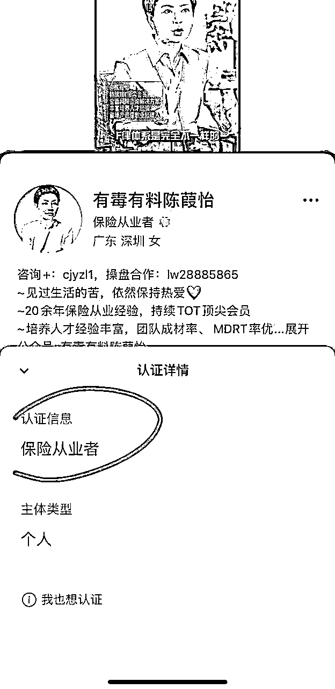

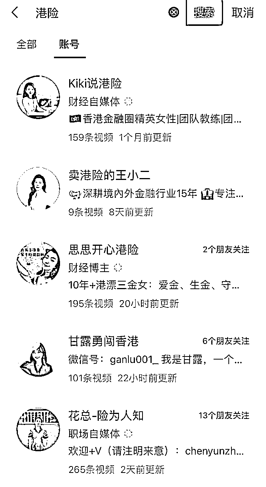

# 什么样的人，适合继续做留学？

我把留学赛道拆成14个常见品类：

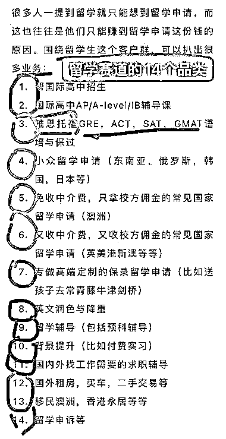

新人也能进的赛道：中外合办。

最蓝海的：国外租房、买车、二手交易。

需要一点专业知识就能矩阵引流的：移民、香港永居、小众留学申请。

除此之外，其他品类，没有在这个行业深耕4-5年甚至10年，熟悉每个环节的操作流程，真的别进去。

因为此时行业里已经有卷王天花板在铺矩阵，从20年卷到24年，知道哪些选题死了，哪些模板不能用，哪些爆款标题过时了。

一个行业小白此时冲进去，不知道过去发生了什么变化，多半是拿钱去交学费。

# 2024年，留学同行到底怎么了？

今年留学圈卷到极致，除了前面说的几个相对安静的赛道，其他基本卷出花。

我认识的大厂，一个月预算10万聚光，半个月烧完，下个月直接没预算。

有第三方线索商，因为引流越来越难，直接裁了整个运营团队重招。

还有老板来问我：雅思怎么卷，课程辅导引流下滑怎么办？

现实是：

雅思赛道从22年起就是卷王天花板。连卷王都卷不出花了，其他人更没戏。

课程辅导赛道被海马课堂等大厂矩阵+投放打压，小厂自然流越来越差。现在能引流的，大多是个人名义接单，不是机构名义。

有人会说：我看到留学申请笔记爆款还挺多的啊？

珍妮说：爆款不等于利润。情绪价值、干货笔记点赞收藏高，评论区热闹，但没人问价，你赚什么？

很多大厂自我安慰，把22年的图文打法换成视频就以为能起量。实际上图文能火，视频不一定火。人物演技、价值观传递不到位，视频就是干念图文。

创始人出来拍视频，绝大多数是在念旧稿。没有观点、有温度的表达，就是自我麻痹：我很努力我在救公司。

观众对一个会念干货的机器人没兴趣。图文能看懂的干货，非要看视频干嘛？颜值型博主除外。

今年还有一个现象：菜鸡互啄。因为不知道怎么引流了，A公司亏本还在抄，B公司照抄A公司，然后B也跟着亏。每个人都以为自己能赚，最后一起降薪裁员或倒闭。

还有公司到处报自媒体课。问题是，教课的人不懂留学行业。他们只能教运营技巧。而留学行业的困境早已不是技巧问题，是20-23年赚快钱的人带来了资本，矩阵号+投放把新手卷到连小虾米都吃不到。

当初没赚到钱、没深耕的人，现在都在洗牌。

无论账号铺多少、爆款有多少，我们从引流笔记类型和起号时间就能判断这家公司的运营是不是在亏本。

# 2024年，哪些赛道的人该转行？

先回答两个关键问题：

1）什么时候该离开现有的赛道？
2）哪些行业在下行，哪些在上行？

## 什么时候该撤？

在红海里卷没有意义。同样努力，蓝海给你500万，红海给你10万，还送你一份体检异常单。

### 判断红蓝海方法1：

红海赛道：23年6月起小红书要求商家持证上蓝V，23年7-9月推聚光，不投放就发不出联系方式。硬广笔记和同质化干货的自然流量被大量压缩。

一个红海产品，如果在23年9月后还能靠硬广拿到50+人评论区咨询，靠干货拿到上百赞藏，是不错的数据。

大部分红海产品，23年9月后只能拿到3-20个咨询，干货千篇一律，小眼睛不到500。甚至除了水军，一条咨询都没有。

蓝海赛道，无论是否过23年9月，只要硬广下面持续有上百人礼貌问价，就是健康信号。

一个人晒的业绩如果全是23年6月前的数据，23年9月后没有持续表现，那他赚的是时代红利，不是运营能力。

### 判断红蓝海方法2：

参考「金枪大叔」在《借势》里说的观点：

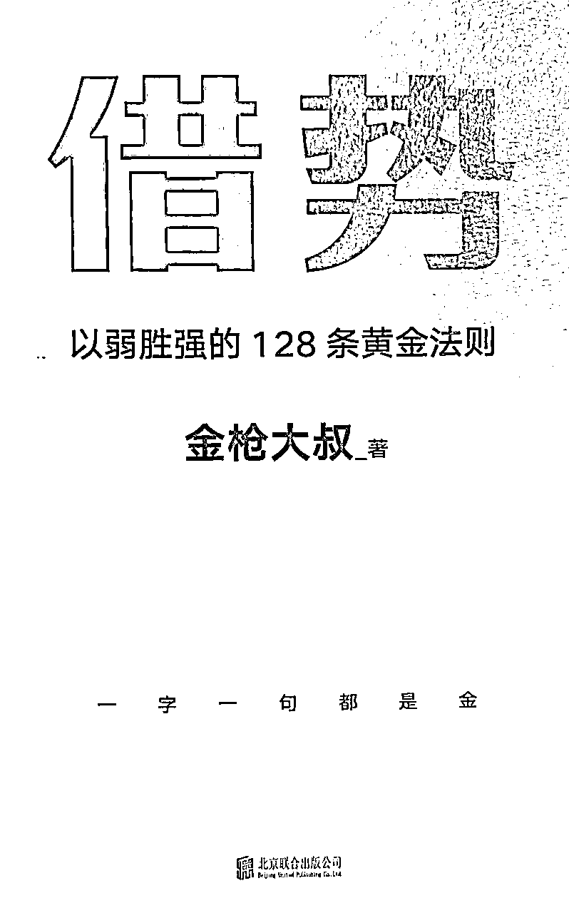

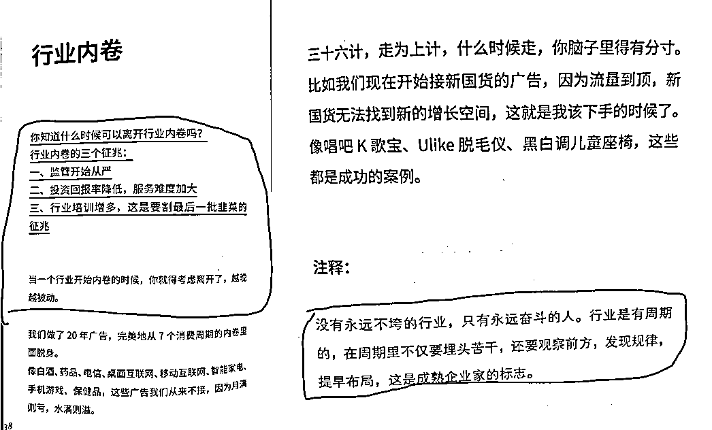

赛道一旦开始内卷，就该及时撤离。

很多人是因为我23年7月那篇《小红书教育赛道GMV1600万/年，小团队创业心法》才认识我。

那时刚开始要求聚光，不充值就是站外引流、限流。

我当时休年假，还在琢磨花式发微信号的骚操作，结果流失了不少客户。因为再花式也不如直接发联系方式。

如果我不花钱，同行就会花钱抢走客户。

我在23年3-4月就开始观察赛道走向了。我报过一位穿越周期20年、在欧洲和周边国家都有影响力、早已财务自由的贵人姐姐的IP课。

她当时点醒我：留学行业要下行。出国读博读研的人会越来越少。能送孩子出国的，要么是超级富豪从小就在英美名校规划，要么是长期在海外的华人。

【注意】如果继续做留学生意，未来可能要做反向留学，帮外国人来中国读EMBA之类。我就遇到俄罗斯能源高管想来中国刷人脉读水硕，2000多块报名费到现在没交。

中产能移民的会移民，因为接下来在中国生活会越来越难。**这里暗示移民类生意还有最后一波客户。**

底层和小康小资，之前咬牙卖房送孩子出去，现在可能选择不出国，或者去马来西亚、爱尔兰这类性价比国家。客单价下探，免押金拿返佣的中介会更多。

国家会慢慢M型化，中产没落。

那时贵人姐姐推AI。我立刻学GPT、Midjourney。用GPT清洗矩阵号文案，避开20多个号同文案被判定抄袭封号的悲剧。用Midjourney生成美女图做素人号。

从她点醒我留学下行开始，我就和Ivy聊过了。那时正是聚光前留学赛道最后一波红利，买单如潮。

但趋势不长久。我写完23年7月那篇后，英澳留学中介的笔记最后一次火在23年9-10月。之后，很少再看到笔记下面一堆礼貌问价的场景。

学AI对我来说是工具，让我快速挖信息差。

同时我们23年试遍了所有留学相关赛道，最终发现行业整体下行。不是不赚钱了，而是以前20分努力赚120，现在100分努力赚120，未来110分努力赚120。为这10块拼，划不来。

有100分的能力，不如去蓝海赛道降维打击。

所以我写了这些文章，只放在知识星球。

原文如下：

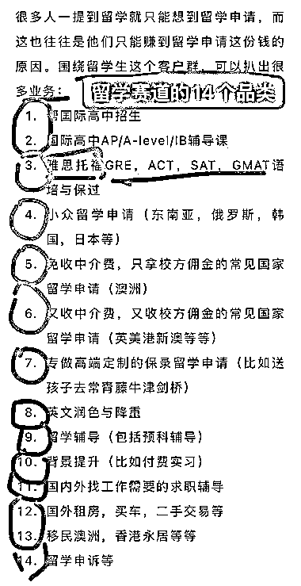

上图是留学行业的14个细分品类，下面我逐个拆解趋势和利润空间。

👉1-2 国际高中。从疫情开始招生就越来越少，家长觉得国外不靠谱。国际高中生减少，AP、A Level、IB课程需求也跟着跌。

👉7 高端定制。永远的需求，服务中国最有钱的富人。不会没落，前提是你有能力，且稿子不因“保录取”这类词触法被教育赛道总监拉黑。

👉12 国外租房、买车、二手交易。永远的需求。移居过去的华人有后代，国内的运营者做国外小红书的网感很差。如果我们能拿国内打法去做，市场份额能被抢光。我们没做只是因为团队都在国内，没法落地拍素材。

👉13 移民澳洲、香港永居。移民项目还能做一波，男剪女布的中产群体在国内日子不好过，更向往海外生活，有积蓄就会想移民。

香港永居地方小，发展不如深圳，目标客户更窄。主要是大富豪和中产，中产没钱了。

如果要做留学从业者，可以做拿身份，方便子女上学，同时过去卖保险、卖房、做资产配置。

👉3.5.6 雅思托福、免收中介费申请、英澳申请，已卷成狗。天天免费送资料、不收中介费只为拿校方佣金。

学生拿到资料只愿意上大班或几百块网课，利润被压到极低。学生没去读，中介一分钱拿不到。

👉3中的GRE、ACT、SAT、GMAT门槛高，没那么卷，独立老师还能做。代考已经卷成狗，且源头搞错会毁学生一生，请慎重。

👉绿圈4 小众国家申请，勉强还能做。吸引体制内、事业单位想刷学历，或付不起英澳学费的人。

这类客户预算10万/年，有的甚至10万读两年。20万预算的珍惜，基本也难签约。三年前说要留学，现在雅思还没考出来，耗精力。

中介费收1-1.5万就被拉黑。他们多方比价。预算不足又想要代考的“既要又要还要”客户基数大，能者多劳，无能为力的人别碰。

👉紫圈8.9.10.11

8 英文润色降重，GPT出来后基本不行了。

9 留学辅导，涉及代写代考，慎重。做不好学生可能退学跳楼。纯辅导赛道也卷到极致。

10 背景提升，比如付费实习，是中产和富豪刚需。中产没钱了，可有可无的消费在砍，市场下行。

11 国内外求职辅导，还能做。小课599能卖。几万的产品不好卖，原因同上，中产客户群在缩小。

👉14 留学申诉，还能做。水份大，一次收1万，哪怕没成功退一半也能赚，抓焦虑心理。

但不是所有人都挂科，有淡旺季。期中期末后是旺季。

我不做这类业务，也不收这么高价，良心过不去。

之前我一直没发这些，只在小圈子偷偷说，怕行业波动。

现在半年过去了，遇到越来越多的留学老板急得找流量、到处报课。

他们不懂，他们的困境不是代运营或报课能解决的。

做留学这行的人，大多心里有数：这可能是全网自媒体里最不缺“卷王”的赛道。如果连一个能打的卷王都活不下去，问题通常不在个人，而在赛道本身。想靠找一位其他行业的大佬花钱买经验、买一段续命时间，也大概率行不通。

续不下来，无非三条路：第一，换战场；第二，继续砸流量；第三，拿出真东西证明自己——服务性价比、安全系数、客户口碑都经得起查。我说的不是几张聊天截图，而是有证据链的硬核实据。花活再多，都不如甩证据。

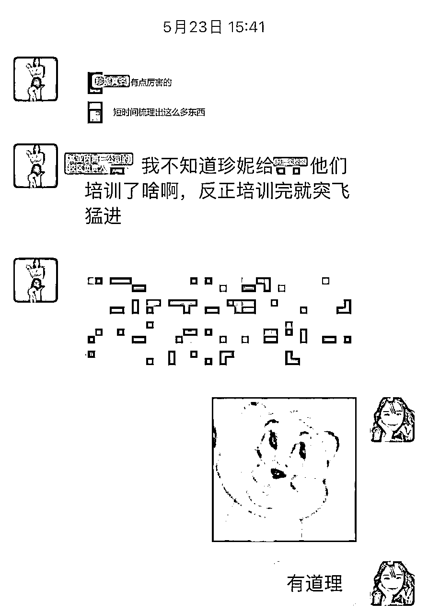

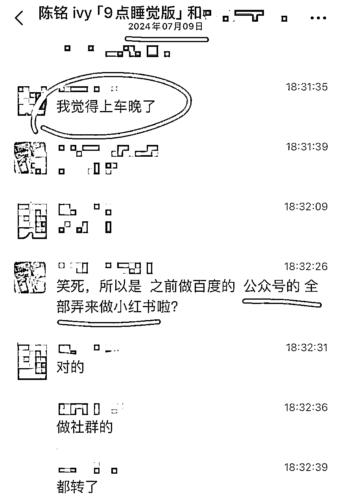

今年我们接到一个咨询单，对方是留学行业某细分排名第一的公司。四月份进场做培训，到了七月份，这家公司把原来负责百度流量、公众号流量的团队全部调到小红书上来。为什么？因为市场给了他们短促有力的正反馈。

这种调整，靠几节自媒体课是补不上的。要在留学圈里长期泡过、干过，踩过交付的坑，才知道内容怎么做。市面上的自媒体课，对留学从业者来说更像情绪按摩：听了舒服，但解决不了获客问题。新手想靠这样的课在留学赛道里拿到结果，几乎不可能。

留学圈现存的那些矩阵号，已经变成了我们的候补池。2024年初，我们做了一个决定：自营业务全部砍掉，只留某条细分方向的代运营；全员压到新的蓝海方向。金枪大叔说过，一个赛道出现内卷迹象的时候，就该准备离场了。

外界只看到22-23年留学人赚钱，眼红着冲进来，却没看到：真正赚到钱的那批人，但凡有更好出路的，早就走了；没有退路的，才留下来死磕，或者替越来越贵的流量买单。

先说说行业大趋势。

曾经主要靠中产吃饭、由西方舶来而非中国本土长出来的生意，接下来都在下行通道里：健身房、咖啡、金融、留学、英语培训、宠物、高档面包店、轻食、卖轻奢的店、高尔夫、电影院、KTV、酒吧、做染烫造型的美发馆（护发、白转黑这类不算）、动刀子的医美（不动刀的另说）……这条名单很长，共同点是它们服务的是正在缩水的钱包。

而往上走的行业只有两类。第一类，是国家真金白银补贴的方向，看下图。

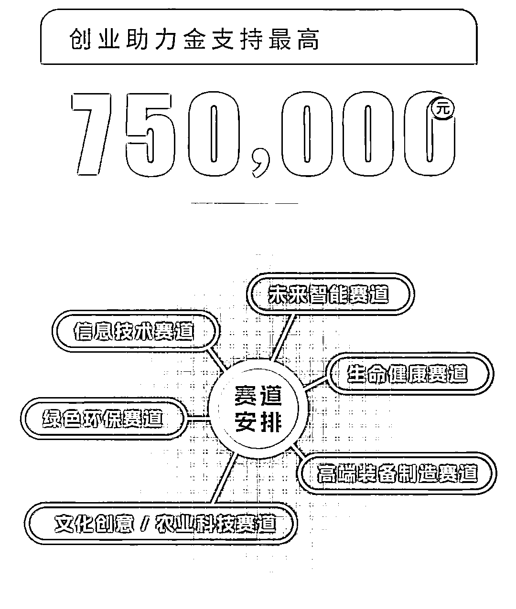

第二类，是咱们老祖宗几千年传下来的东西：中医、艾灸、推拿、食疗、教育、书法。有人说情感博主、婚恋中介能不能做？当然能。中国自古以来就有媒婆。

这里贴一段我在知识星球分享过的观察，从Ivy老公分析股票说起，讲的是宠物经济为什么接下来会走下坡：

Ivy的老公以前是基金经理，做股票分析。他看过一只票：市值18亿，账上躺着8亿现金，业务是全球宠物卫生纸代工，估值才12倍，便宜得离谱，结果股价还是跌到不敢加仓。为什么？其实娃姐早在23年1月就点过题：凡是因外国人进入中国才兴起的行业，接下来运势都会走差。宠物就是这个词的典型。上一辈中国家庭没有“宠物”这个概念，养猫是为了捉鼠，养狗是为了看家。“宠物”二字，本来就是外国人带来的。和宠物绑定的产业链，都是舶来品产业，运势往下。

所以，不管谁跟你说英语培训又赚到钱了、宠物经济又火了、金融咖啡KTV酒吧怎么风光，都别跟着往里头挤。人家赚钱，是因为在这个行业积累了多年；如果不转行，能赚到的钱也会一年比一年少。不要在1949年还进宫当太监——即使宫里看起来香火鼎盛。

舶来品相关的行业会集体没落；中国本土渊源深厚的行业，会慢慢长回来。

再说小红书吧。从2024年3月1日到8月18日，我每周工作六天，都在拆解各赛道玩法，一来保持运营团队对一线的嗅觉，二来想看看哪个赛道最不卷，好把卷王界的打法降维带过去。左边红圈里，就是我当时扫过的赛道列表。

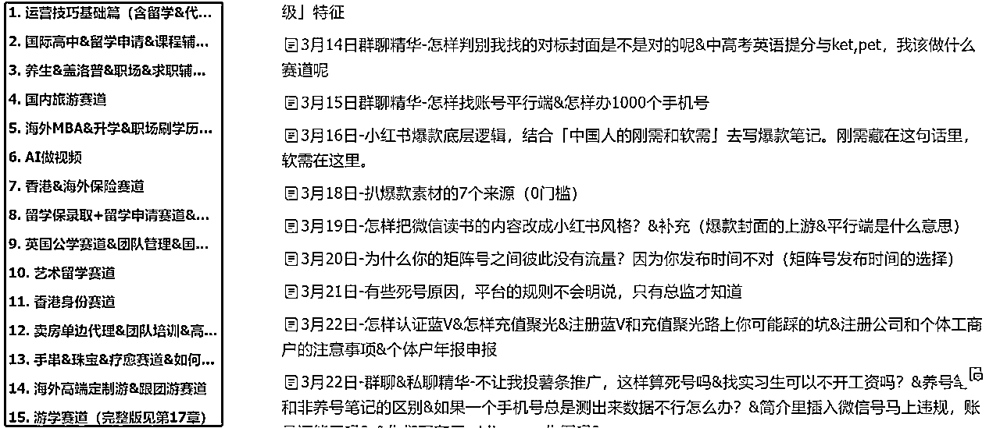

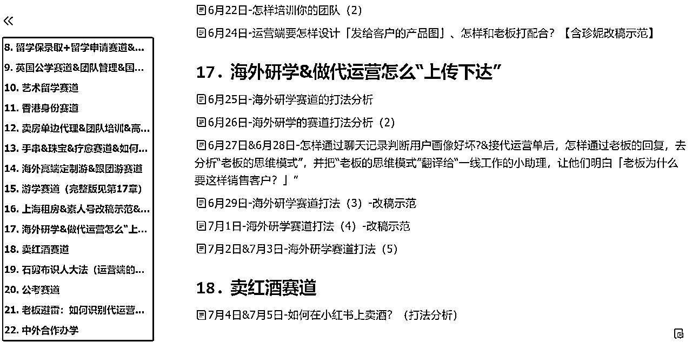

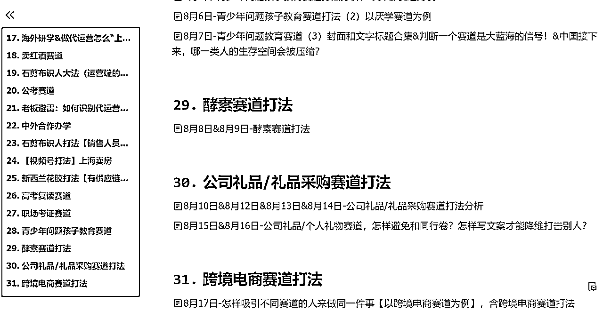

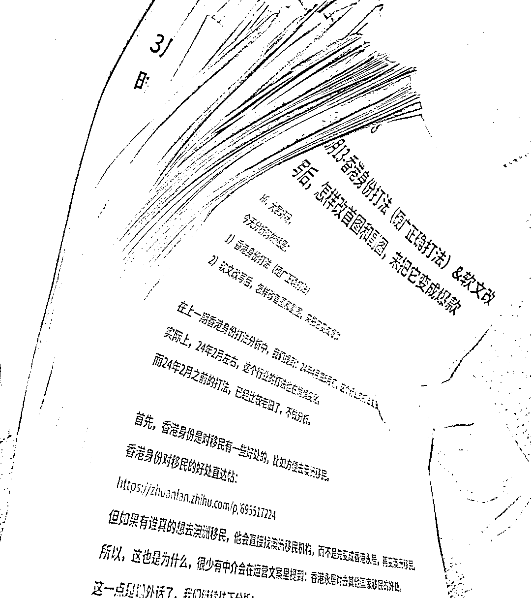

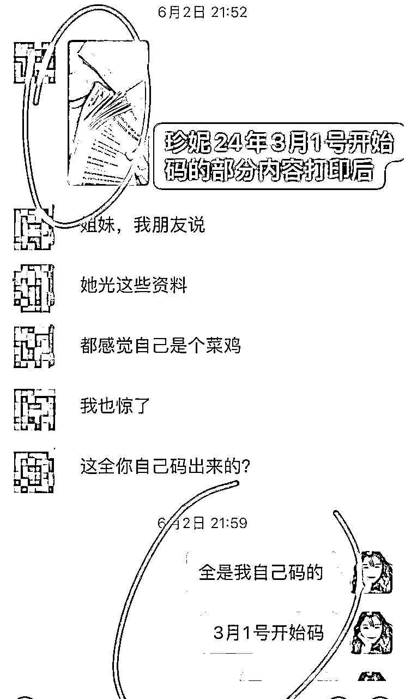

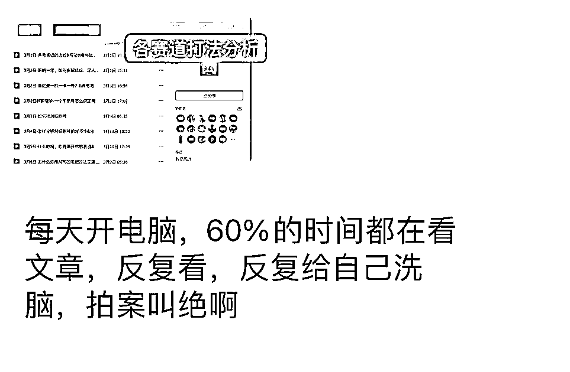

我给这些赛道打了一个“卷王指数”，10分制，分数越高越卷，衡量的是在小红书平台上引流的难度。现在上结果：

10分档，也就是地狱难度：留学申请、课程辅导、雅思；海外高端定制游、跟团游同样是10分，堪比留学赛道，已经开始大洗牌。

8分档：K12、英语、国内旅游、留学保录取。留学保录取看着写起来最轻松，实际上是封号率最高的赛道，能排到死号榜第一。

5分档：求职辅导、艺术留学、海外游学、高端租房。这个分数还能做，但已经有小浪了。

4分档：职场、国际高中择校、海外MBA（比如马来西亚MBA）、国内保险。

3分档：专升硕、香港身份、手串珠宝疗愈（容易违规）、公考、职场考证（这3分是“小学生互啄”式内卷，不代表他们引流能力强）、喊别人做跨境电商但自己并不做的。

2分档：KET/PET具体考试、养生、中外合作办学、新西兰花胶。

1分档：代理记账、香港/海外保险（容易死号，劝退；资质很难办，5000块基本买不到蓝V）、高考复读、青少年抑郁、酵素、公司礼品/采购。

0.5分档：盖洛普、红酒。

0.1分档：青少年厌学。

结论是：5分以下还能进；5分可以试，但别指望轻松；超过5分的赛道属于死亡区，新手这时候开小红书，别谈赚钱。

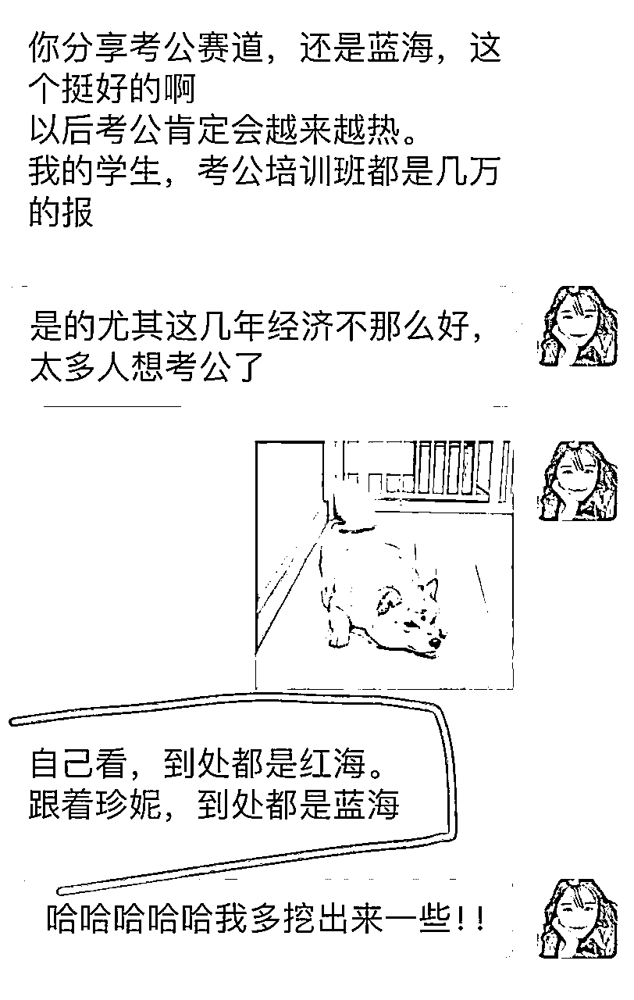

那蓝海到底怎么找？

《新闻女王》里全公司抢两百万广告费那种画面，在我和我合伙人看来非常可笑。如果哪个赛道需要我们在红海里拼命去抢两百块钱的订单，我们根本不碰。我们两年做到2700万营收，靠的主要就是蓝海。留学下滑时，我们又找到一条新的蓝海，提前铺了B端品牌，今年顺势完成了C端+B端的切换。

方法一：同样的服务，换一个人群来写。

留学笔记写到留学生都腻了，但买单的决策者其实是他们的父母。那就写给父母看。这些父母未必在小红书，可能分散在百家号、头条号、抖音，甚至朋友圈。想搞清楚他们用什么平台、关心什么，很简单：去回访几个来找过我们、付费过的留学生爸妈，再看看他们的账号主页在发什么、收藏什么，朋友圈晒什么。

同理，做大学生赛道的，如果大学生把笔记看腻了，就去找为大学生买单的人。也可以观察一下，哪些赛道的评论区里，家长群体的声音最密集；还可以看看高客单价的产品是谁在买，就围绕这个画像去创作。

方法二：同一群人，把服务的上下游、平行端全部挖一遍。

什么叫平行端？就是目标客群当下所处的阶段、正在做的事。上游，是他们未来大概率要做的事。下游，是他们以前经历过但可能还有需求的事。

拿大学生举例：上游是考研、考博、考公、考事业编；平行端是各类考证、专四专八、CATTI、雅思托福、创业竞赛、期末复习、各种在读期间的比赛；下游是高考志愿填报、高中各科补习、国际高中和国际竞赛。

盖洛普也一样。它的平行端是霍兰德、MBTI、PDP职场测试、DISC、各种考证。小红书上做盖洛普内容，别动不动就cue“盖洛普”三个字，因为绝大多数用户根本不知道这是个啥。这是珍妮今年3月在小圈子里说的，那时候小红书上几乎没有盖洛普爆款。

每个行业都可以这样拆，上游、下游、平行端，靠联想和搜索就能扩出一张网。比如原来只做大学生赛道的某个业务，现在把考研、考公、求职、内推这些上游都拉出来；把各专业的考证列一遍（记得避开舶来品类的证书，像咖啡师证、专四专八证、潜水员证）；再把高考志愿这种下游也放进来，说不定有些角落就是蓝海。

这一步最容易淘到金。判断标准也很直接：在小红书输入关键词，如果近三个月持续冒出爆款，而且评论区全是礼貌问价，不是要资料白嫖，那这个赛道有八成概率还是蓝海。反过来，如果爆款笔记都在免费送资料，或者靠煽动情绪获得流量（比如把留学生日常包装成爽文主角的帖子），那就算了吧。

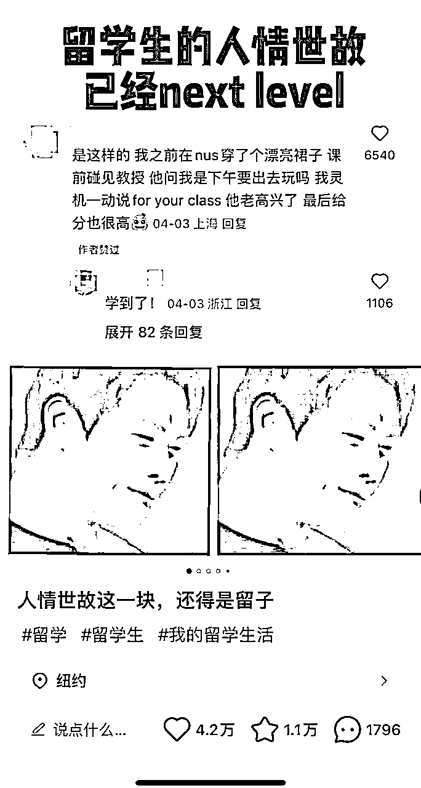

更典型的坑是：爆款笔记全在喊“免费提供xx服务”，比如“免费做留学申请辅导”。要知道，任何东西一旦免费，自然就有流量，所以这并不能说明赛道有戏。如果往下滑三四个屏幕就能看到2022年的爆款，排除运营太菜的情况，说明这个赛道出过大事，可能2023年大面积死号，或者根本不适合再进场。

方法三：不换人群，换产品权益和价格。

比如有家店，服务其实很抓人：针对疫情后家庭资产缩水的留学生做“半DIY”申请，每一项都可以拆开单卖，价格灵活。可惜运营不够聪明，没有反复放大这个优势，数据一直很平庸。

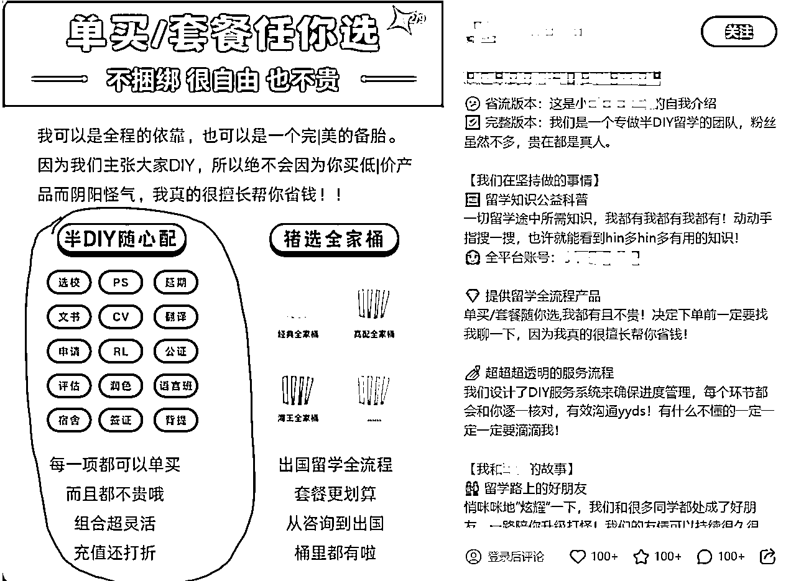

如果不换人群也不换产品，那就把产品重新打包，拆成性价比高的小单元。半DIY的逻辑就是这个：拆开卖，客户按需选。

为什么这么做？还是因为中产在没落。接下来市场只有两个极端可赚：大富豪的钱，或者刚需层的钱。想继续吃中产，中产就会拿放大镜看性价比。除了“送礼属性”极强的品类，任何试图靠包装和营销卖高溢价的生意，都会被中产用脚投票投死。

方法四：不换人群，换一个地理坐标。

这招天然适合做矩阵号的老板——去跟线下传统行业的老板谈合作，把他们的业务搬到小红书，等于把一个小众蓝海做成大市场。

“少儿体能上门”“女子私教上门”火起来，背后的逻辑就是这样。这类业务本质上是健身房、瑜伽馆的变体；三年疫情把实体店租金和关门的问题放大，2022年有人开始尝试上门模式，当时真的蓝得发指，有人发一张PPT质感的丑图就能收咨询。到了23年，尝到甜头的人变多，一些个体教练自己开小红书、不认证蓝V也出来接单，等于抢了原来机构老板的客户。

孕妇瑜伽又是另一个好品类。价格高，客户怕去门店被传染，上门还方便；对孕妇来说，练瑜伽有助于顺产、缓解孕晚期耻骨痛。有钱的孕妇买单干脆，要么自己有钱，要么老公有钱；女子体能私教就差一截，因为客群往往只是自己有钱的年轻女性；少儿体能又更好，因为背后一定是家长的钱包。所以这类上门生意会越来越多，替代昂贵的门店式经营。

看到这里你会发现，这些思路无非是商科里的4P：Product产品、Price价格、Place渠道、Promotion促销。赛道不好，就改产品、改价格、改渠道、改促销。不熟4P的，可以微信搜“营销4P”，或者在刘润公众号、得到App里找。

以上，就是我这轮关于蓝海赛道的全部折腾和心得，覆盖了留学赛道哪些不能碰、什么人适合做、24年留学同行现状、哪些行业该转场，以及找蓝海的具体打法。

补充一句，关于打分表的理解：

那张“卷王指数”只针对小红书。有些赛道在小红书好引，但竞争在别的平台也很凶，比如代理记账，客户还会去淘宝、拼多多搜索比价。有的赛道在小红书难做，但换个平台立刻不一样，比如香港保险更适合视频号。还有的赛道在小红书已经卷成麻花，引流成本很高、客户还爱比价，比如英澳留学常规申请和海外旅游。更有意思的是，有些业务国内做很痛苦，到国外做反而轻松，比如留学生课程辅导，国内引流贵得离谱，到国外本地获客却顺畅得多。另外，K12在回暖；凡是带辅导、报班属性的赛道，用“督学”“陪练”的姿态切入，比装成大机构卖课更容易赚钱，雅思虽然不是K12，也适用。

再补充一个概念：男剪女布。

这是人群属性，不是赛道本身。一个人是男剪女布，不等于他做的就是男剪女布赛道。举个例子：正骨医生如果是女性，那她多半是女布，因为没力气就做不了正骨推拿。但正骨医生的客户，主要是喜欢推拿正骨的男布女石家庭，所以正骨这门生意属于石头赛道，不是男剪女布赛道。

男剪女布赛道，指我们服务的核心客群是男剪女布。这个群体收入在缩水，继续服务他们自然难赚钱。比如海外旅游，客群几乎全是男剪女布，因为只有这个属性最爱旅游；男布女石和男石女剪都不怎么爱出门。当男剪女布收入下降，海外旅游从业者只能被动承受砍价和比价。留学也一样，客户主要是男剪女布和男布女石家庭的孩子；随着前者收入缩水，客群只剩后者，行业就会陷入无休止的价格战。健身房同理，办卡主力也是男剪女布。

最后是致谢。

感谢我的合伙人陈铭Ivy，感谢给我们派单代运营的幕后大老板，感谢一起卖房业务的合伙人海里。这篇稿子如果没有理白，就只是一堆散乱观点，根本不成型。特别感谢【理白和Coco的小宇宙】，帮我把很多从前没发现过的细节捡了回来。还有梁靠谱梁医生、芷蓝姐、拱卒，我一直泡在他们的圈子里悄悄获取信息差。

更要感谢赚钱。22年我和Ivy刚进赚钱时，其实正创业不到两个月，马上要倒在小红书引流危机里。后来靠精华帖找到误区，才活到2024。也因为赚钱这个圈子带来的影响力，我们遇到了派单大老板、遇到了合拍的合伙人，最后顺利转行。赚钱是Ivy和我的再生父母，两次在倒闭边缘救了我们。