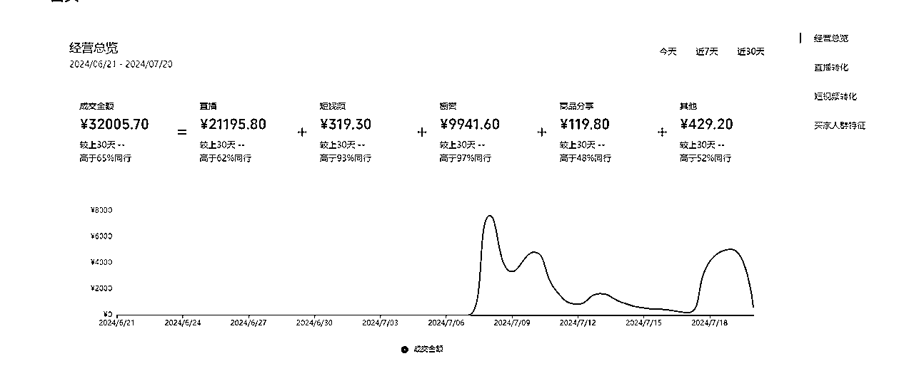
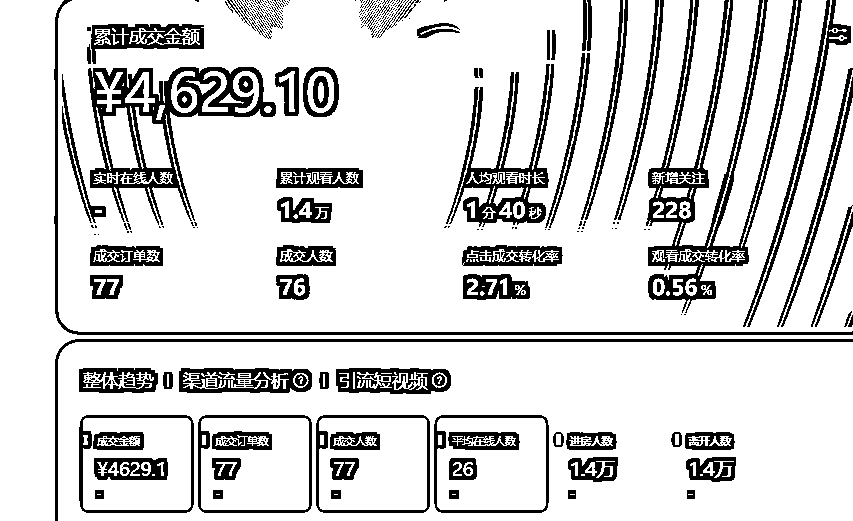
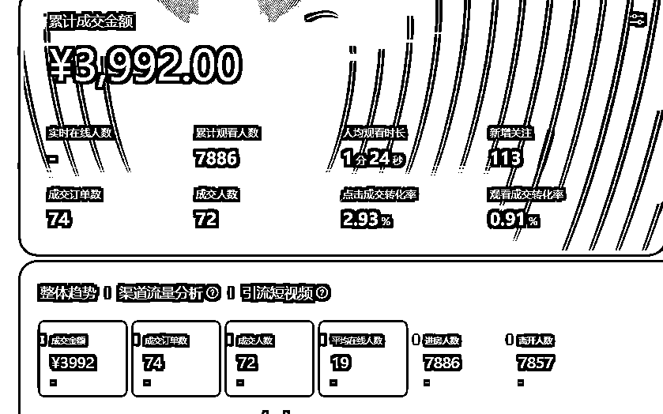
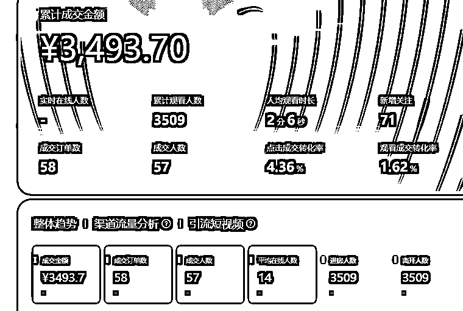
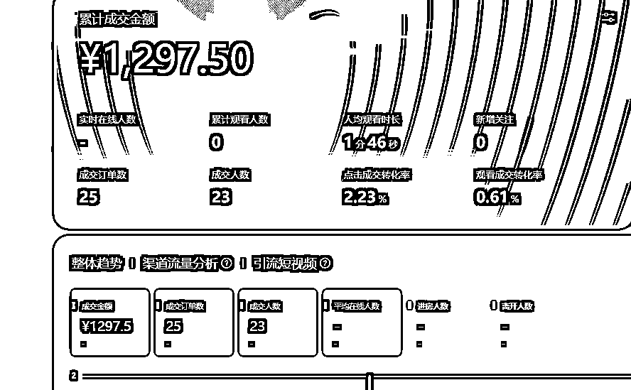
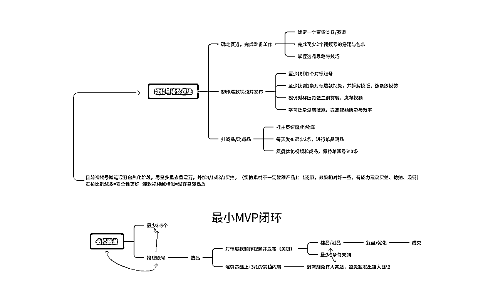
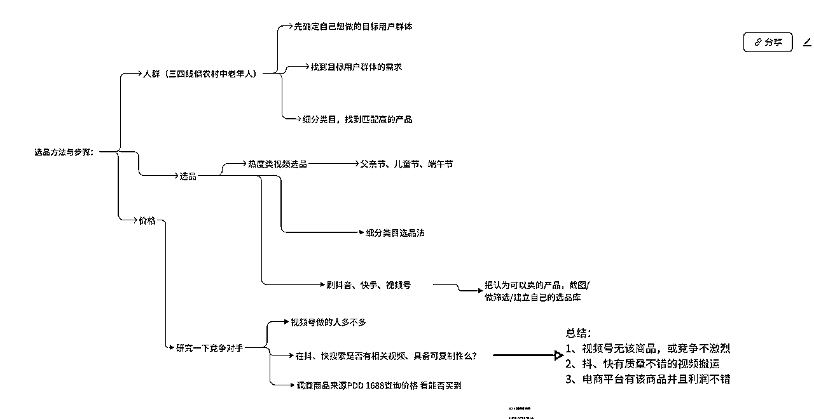
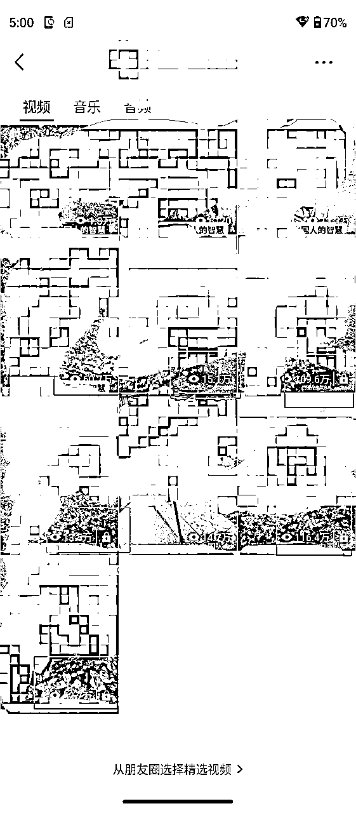
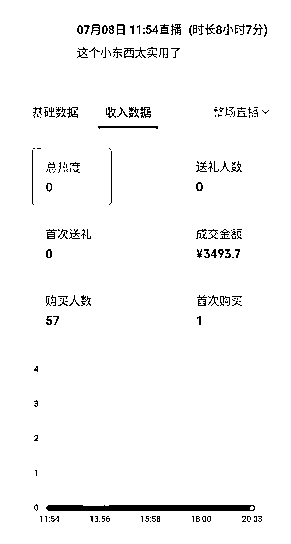

# 体育老师跨界视频号：7天从0到百万播放，单品GMV冲破5万+的实战复盘

> 来源：[https://c3kvccg2ub.feishu.cn/docx/JxYudaG7goUXIsxEdKKc0mtbnEg](https://c3kvccg2ub.feishu.cn/docx/JxYudaG7goUXIsxEdKKc0mtbnEg)

大家好，我是春哥。现居长沙，视频号带货做了1年多，累计变现超20万。经常被问爆款怎么来的，今天就用我这次参加【视频号带货】航海的真实经历，给你拆解一下关键做法，希望能帮到你。

## 一、专一一个赛道，把基本功练到极致

我本职是一名中学体育老师。我追求的是非对称的杠杆效应，先有份稳定的收入做底，再用空闲时间去试水风险更高、回报更大的副业。

在赚钱有术里摸索时，我也曾被琳琅满目的项目看花眼。但体育人有句话：千招会不如一招精。马步扎三年才算入门，横踢我也练了十多年。

因此我从众多方向里锁定了视频号，过去一年左右我没有换赛道，所有学习都围绕它展开。对结果预期我放得很低，先把地基打牢。探索期本就很难赚钱，甚至好几个月零收入，这就是学徒阶段。所以副业的前提是有一份可靠的主业收入，能降低焦虑、让人更专注。

这次航海期间，我新建了2个账号做实拍和混剪，同时操盘了之前3个老号。累计发了200+作品，出了4条百万播放，账号粉丝累计破万。3个授权矩阵号也同步出单，GMV累计突破5W+。限于篇幅只放部分截图。

视频火了之后我大概连播十几场，附上部分战绩截图。

## 二、跟随航海练内功，打开变现通道

下面我结合这次航海，分享6个打磨基本功、打通赚钱任督二脉的要点。

### 1、用思维导图串联操作流程，卡住就查，不会就问

航海手册本质就是项目赚钱秘籍。我这种重基本功的人，必须吃透它，最少过三遍。学过的知识不用就会忘。

航海前我会提前预习过往的视频号内容。看手册时我习惯把核心知识点整理成思维导图，加深印象。虽然慢，但效果好。执行时卡住了就先看导图，导图没有的，自己琢磨出来或问教练解决后就即时补充进去，不断优化。

我的观点是：航海手册的关键内容要短时间内高频复现，必须边学边做。遇到问题先搜索，实在不懂就举手。手册已经把完整路径整理好了，自己提炼的思维导图才是适配你的执行方案。

就像练体育动作，刚开始身体僵硬、枯燥难受。先把动作路线吃透，再练发力技巧，然后在短时间内大量重复，就能打出标准有力的动作。所以要多花时间研读手册，边读边做，用思维导图不断迭代流程。

### 2、靠“刷”找到蓝海，选品要极致重复

视频号现阶段不是大IP大V，买家买的不是你，是产品吸引力。需求匹配+价格合理，就容易成交。所以选品必须下功夫，我的办法很笨但有效，就是“刷”。千招会不如一招精，每天就是刷。

我每天划屏不下1000次，不用考古加、蝉妈妈之类工具。就是靠大量重复刷，我刷到了这次航海的爆品，夏季防晒类目。

判断它有潜力的三点：
第一，应季且刚需。防晒人人需要。
第二，视频号搜关键词，发现几乎没人做。我当时很兴奋，觉得可以去测。
第三，找素材验证。我把抖音相关素材全下了，再找同类防晒的爆款看别人的做法。

我先拷贝同类爆款音频，用相似模板混剪第一条。结果40多分钟播放就破5000。我当时没样品，赶紧隐藏了视频，当天就联系供应链，多多下单样品，准备实拍和直播。等样品期间我按第一个模板又混剪了10条。

第二天忍不住发了3条，全部炸了。没样品我就先打印个模型上播，当天直播GMV就3000+，橱窗也出几十单。

验证成功后我又加了2个号继续混剪，也都出了百万播放。一个人播不过来就请了代播。样品到手后我判断这个品能打一个月，开始每天外出实拍、剪辑、直播。

确实很猛，播放高、单量稳，一直持续到第8天，一个出单猛的号被限流了，原因是脚本重复度过高。当时想死的心都有了。好在还有另外2个号顶上，换号继续播，虽然收益下滑，后来跟品的人也多了起来。

我的选品心法：
第一，多刷广场，每天45分钟。看到好品立刻转发到自建小群并收藏到选品库。爆过一次的品，下次可能还会爆。视频号内容少时可以跟品。
第二，多刷抖音、快手、多多视频。这次爆品就是从抖音刷到的。先把账号刷垂直，一打开就是带货视频。好品点赞收藏，空闲时间整理到选品库再分析。把抖音快手找到的品去视频号搜，判断蓝海还是红海。内容少就可以马上混剪测。异常信号是：点赞300-500、评论区有明确需求、视频号还没大量出现。符合就测。
第三，举一反三。爆品打一段时间后要迁移联想同类目。比如刷到空调清洗剂，就能延伸到空调挡风板、万能遥控器等。

### 3、测品核心是快测起来

找到心仪品后，先找对标账号，看点赞、转发、评论数据好的内容，拆解视频和账号，然后模仿拍摄或混剪。

具体怎么测：
第一，搬运测品。抖音刷到的品，我会先用工具自动搬运测试。虽然平台不支持搬运，但很多小众号没同步到视频号，可以先测。6月我搬运的一个品，从搬运到实拍卖了4万多GMV，方法可行。需要备多几个账号，容易违规。
搬运会遇两种情况：一是有播放说明没人同步，发5天观察，播放超3000就买样品深耕；二是提示高度重复限制推荐，可以放弃或扒素材混剪。我一般混剪测3-5天，每天发3条，播放稳定在2000-5000或已出单就深耕，不然换品。
第二，交叉测品。准备2-3个号，选定2个类目，每个品混剪2条交叉发。比如A、B两号，各发防晒2条、家居2条，连发3-5天，看哪个播放高就做哪个，不行的删掉。耗时但能练基本功。
第三，遇到爆品就复制。广场或短视频里看到爆款，判断后买样跟品。跟品要快，我一般用美团等次日达抢蓝海窗口期。测品最有效的是复制爆款脚本文案。这次爆品音频就是同类品的，我稍作修改。测品期套用同类脚本，播放远高于自己实拍的脚本。后面为避免违规，我是混剪过渡到实拍，实拍框架要贴近爆款模板。

注意避坑：避免重复度过高，多准备几个模板，降低营销感，加入生活元素或场景。之前主号就是因脚本重复被限流，调整后违规明显减少。

测品密码：
第一，不断刷品。百货类目要持续刷，刷多了有感觉，一看就知道能不能爆。
第二，多备号。视频号易违规，不废几个号不够格。规则快变，多号才有试错成本。
第三，快速验证。对感兴趣的品别犹豫，快速做出第一条丢市场验证。账号是消耗品，违规了删了申诉也行，晾着不测就是浪费。
第四，运气加持。辛苦选的品不一定爆，不在意的可能爆。视频号有运气成分，坚持久了概率会提升。正反馈出现时特别亢奋，我最高一次播了十几个小时，GMV不断涨。但不坚持，概率就不会到来。

### 4、直播是边做边优化的迭代过程

我会提前把产品参数整理成文档，直播时直接复制粘贴，和用户互动。百货直播要求不高，2个灯光+成交音效铃铛基本够用。

视频爆了但直播间没人，进场3步排查：
第一，大概率掉直播入口。看最近30分钟短视频进场人数，若只有几人，用小号看自己的短视频，头像是否显示直播中，安卓苹果交叉看。
解决办法：重开直播拉人。
第二，入口正常但账号被限流。去解限，多用自拍特效、风景、读古诗等素材解号，我备了大量备用素材。
第三，都正常但还是没人。大概率流量不精准，尝试拉长直播时长洗人群，或用小号在直播间引导下单刷信任、推热卖。熬不住就请代播或暂停，核心是把时长拉长，观察人群画像，几场后会慢慢精准并出单。

### 5、不爆是常态，关键在把每一步做好

航海能出结果，有运气也有复盘。辛苦选的品不一定爆，不在意的可能爆。所以要放大测品频率，不断试错提升概率。这个品就是我在不断刷中第一个发现并混剪测试的，后面6-8个跟品号出现，出单依然不错。

百万播放除了运气，和我航海期间死磕几个关键动作有关：我把大部分时间放在核心步骤的短时足量重复上。

刷品-测品-直播-复盘。品测出来后就专注打透，增加账号放大收益。不断优化话术、直播、短视频、文案封面。把品赚到钱后再换品或横向测同类目。

别羡慕别人一场几十万，刚入门能稳定每天几百GMV已不错。视频号不爆是常态，把刷品、日更、混剪、拍摄、测品、建素材库当成日常功课，不管情况如何严格执行，最后的收获一定属于坚持的人。

## 三、知行合一，集齐碎片的瞬间就是变现时刻

❤️心态上，该干嘛就干嘛，不受情绪干扰。
赚钱这件事很复杂，小白短时间内要掌握大量技能，必须有耐心不断自学、搜索、练习，不然动作变形不达标。我航海期间很少看消息也不看别人战绩，只做当天的事，大部分时间解决难题和搜索知识。“每天该干嘛就干嘛，不受心态影响”听起来简单做起来难。学技能像教学生体育动作，刚开始僵硬不协调还总失误，心态容易崩，我既是学生也是老师。

💃行动上，要有超长耐心，不断重复关键步骤，把步骤拆更细再重复优化。
这个过程不能省、不能走捷径，就是在打地基。磨的时候没收入、想短期拿大结果，很容易放弃。但磨出来后哪怕微小进步也会成为坚持的动力。

总之，聚焦项目最关键的动作，具备超强耐心，短时间内足量重复，把最小MVP跑通，基本功才会真正扎牢。把时间放在最关键动作上不断重复，缺什么技能就学什么技能。当你把所有赚钱的技能碎片集齐，任督二脉自然会打开。

最后分享三句话：
⛽️天下之至拙可胜天下之至巧！花足够时间做大量练习，重剑无锋也能发挥巨大威力。
⛽️⛽️勤奋和努力是创业者的基本素养，不该被夸奖。同时，好好赚钱真的挺省钱。航海那段时间每天测品+直播，一天很快就过去了。
⛽️⛽️⛽️做项目不要感性，踏踏实实做好自己的事。每天该干嘛就干嘛。别人赚再多，跟我半毛钱关系都没有。

祝大家在搞钱路上不断精进，天天爆单。感谢赚钱有术这个平台，有启发的欢迎评论区交流～