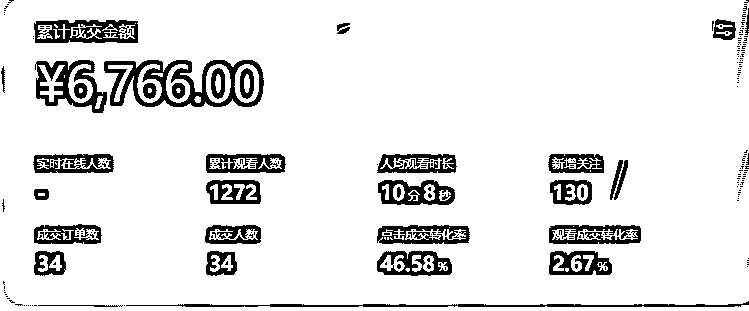
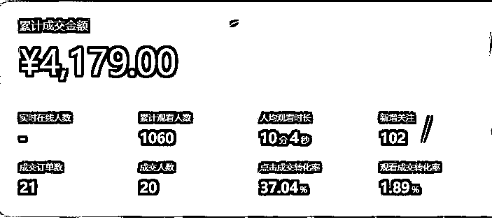
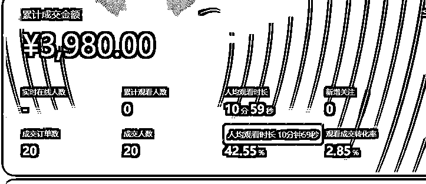
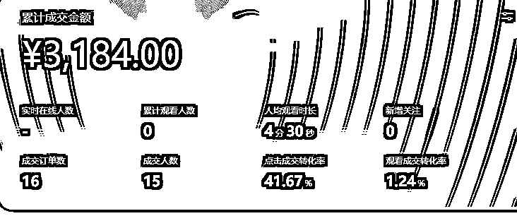
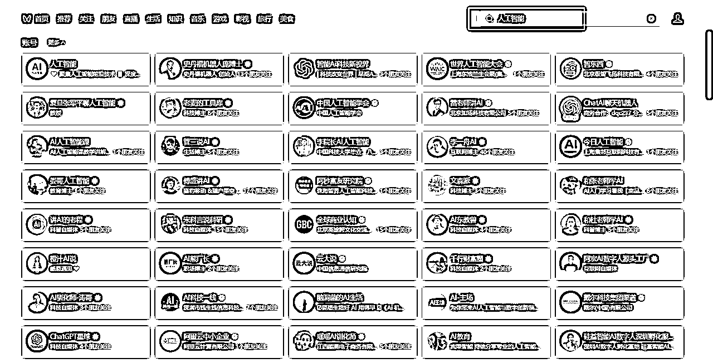
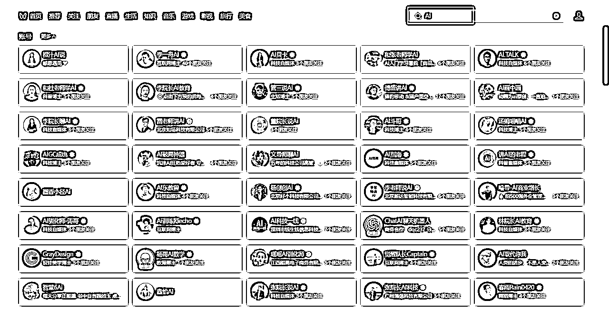

# 98年辞职小伙押注视频号航海，2个月做知识付费实现6万+变现

> 来源：[https://fu92l5vu3n.feishu.cn/docx/N6cidKPTFoaknix5WRxcdg4VnSg](https://fu92l5vu3n.feishu.cn/docx/N6cidKPTFoaknix5WRxcdg4VnSg)

赚钱圈的朋友们大家好。今天我就把自己从零开始做视频号知识付费的全套经历，完整拆解给大家。如果你也在考虑入局真人口播，那这篇一定能帮到你。

先简单自我介绍，我叫耿一凡，在赚钱已经待了两年。刚进来的时候我还在公司给老板打工，帮他操盘项目，那会儿主要就是找能直接落地的打法。

真正自己单干创业是今年年初的事，大概半年左右。这半年我连着参加了三次视频号航海，在航海里认识了一批志同道合的伙伴，也学到不少干货，最后才有了现在的成绩：用两个月时间在视频号做到10万+粉丝，累计变现6万+。

下面我分两部分来聊：

1、整个项目的玩法逻辑和落地细节
2、我实操过程中的真实经历和一些心得

### 第一部分：项目全流程拆解

变现赛道：面向都市银发人群的人工智能知识付费。用真人出镜拍短视频引流，引导用户预约直播，直播间完成成交。

数据复盘：我一共做了6个账号，每个号每天稳定发5条，航海期间发了200条原创。内容授权给6个号发，相当于在平台上投放了1200条视频。6个号粉丝加起来10万+。直播频率是每周每号一场，平均下来每天一场，累计变现6万+。

下面几场直播的数据都不错，之前有过视频爆量，预约人数拉满，进直播间的转化率也相当可观。部分直播截图如下：

起初我在赚钱精华帖里看到视频号正处红利期，就直接冲了。顺手报了视频号航海来做知识付费。这次航海持续47天，比之前的21天更长。对新人来说，长周期陪跑真的太值了，有啥问题随时问，0到1的坑几乎都能覆盖，甚至对后面做1到10的放大也很有帮助。

实操中我把流程拆成了五步：

第一步，死磕航海手册
手册基本能解决80%的入门问题。0到1阶段几乎所有困惑，手册里都有答案。我前后翻了五遍以上，边看边做，每次翻都有新发现。有些之前没注意的点，后面再看才发现原来早就写清楚了。

第二步，找品+找对标
方向比努力重要。
我的产品就是自己录制的在线课程。找对标我主要靠两招：一是直接在视频号搜关键词，二是开一台手机专门刷同行内容。每隔2-3天就集中刷一个小时，很快就能锁定一批活跃账号和近期爆款。

第三步，学会混剪和仿拍
我走的是真人口播路线，所以就是拿到别人的口播口播稿，自己重新演绎一遍。混剪和仿拍的具体操作方法，手册里讲得很细，这里就不展开了。

第四步，搭建内容工厂，保证日更批量
想长期做，稳定的内容供给是底座。“不爆是常态，爆了才变态”，这句话太到位了。我也经历过很久不爆的低谷，直到看到这句话才开窍。
每个赛道话题都有生命周期，之前一个话题在视频号很火，现在可能就难爆了，这很正常。所以优秀的打法应该是即使不爆也能变现。先建立起每天稳定批量产出视频的能力，爆款只是锦上添花，不能依赖。

第五步，直播成交
视频负责把人拉到预约，直播负责转化。我基本是把同行的直播脚本拿来，改成自己的语言习惯，保证开口就顺。直播需要大量练习，前5场就是熟悉脚本，把自己的录屏和同行、大IP对比学习，长处全吸收。

没上100场直播前，都别说自己会直播。直播是练出来的，找到松弛感，别像个播报机器人。

### 第二部分：实战经历与感悟

感悟一：关键节点遇到贵人，成长速度能翻倍
项目启动时我很迷茫，赛道该怎么选。最早想做抖音个人IP做AI知识付费，折腾了两个月没啥数据。虽然技能方面有所提升，比如剪辑、直播、店铺搭建，但没效果。
转机是我在赚钱看到一篇精华帖，讲视频号做AI知识付费的，作者是圈里的陈锦亿。我马上加了他请教，后面这套方法论基本都是跟他学的，他是我第一个贵人。
后来又认识了汪淼教练和家瑞教练。我在群里提问，汪淼教练一看我直播间截图就感觉眼熟，加我后才发现我一直把他们当对标，太惊讶了。他们的体量比我大很多，我的很多文案都是抄来的。
后来他们几乎毫无保留地分享了业务细节，甚至把团队的优质视频、剪辑、课程、售后、直播资源全部授权给我用，这对我业务放大帮助巨大。赚钱真的是个宝藏圈子，一次深聊就能帮你避开无数弯路。

感悟二：快执行快迭代，0到1再到1到10
方向确定后就开始起号。视频号新号有流量扶持，我起的前两个号里，有一个在口播还不熟练的情况下，直接爆出一条100万播放。趁热打铁赶紧开播，完善脚本、上架课程、补售后，整个闭环跑通了。
后面开始做矩阵放大。航海里学到不少降本增效技巧，比如一条视频授权给6个号发，用矩阵工具批量发布。我还把剪辑外包出去，自己专注在更核心的事上。现在也在和更多主播合作测试口播效果，不断起新号放大。目前团队有2个主播、1个剪辑、1个运营，我还在往1到10的路上冲。

感悟三：直播里的坑要避开
现在直播已经常态化，每周稳定6场，每场40分钟固定脚本。
刚开始踩过一些坑。比如直播设备怎么选、绿幕抠像怎么搞，这些都是我在小红书、淘宝到处问才搞明白的。要是当时就有航海手册，能省不少事。
还有一个巨坑：直播预约功能。我第三场直播前想试播一下，没想到视频号私密试播也会消耗预约通知。我提前把8000人的预约全放了，结果正式开播时所有人都进不来。按我正常转化，8000预约大概能有2万销售额，当场直接打水漂。提醒大家，预约直播一定不要提前试播。

最后和大家共勉
非常感谢赚钱这个圈子，方法能直接落地，教练和圈友都很热心，航海群里有问必答。群里也有很多刚起步的小伙伴，大家一起加油。
创业的路就是不断循环：有一阵增长、有一阵平稳、遇到瓶颈、再突破。我在做视频号的感受就是，每隔一段时间就会迎来一个新增长点，可能是销售额，可能是个人能力，可能是心态。
所以核心就一个字：坚持。多做多练多思考。

加油，我们一起龙哥盟！