# 从一条风向标到全国性风口：30+位同行跟着跑出500万级GMV的青年夜校实战复盘

> 来源：[https://vub1ul9ufi.feishu.cn/docx/QfpadWIPMoqdYxxyVEAcGjI6nqh](https://vub1ul9ufi.feishu.cn/docx/QfpadWIPMoqdYxxyVEAcGjI6nqh)

3月杭州航海家年会，门口偶遇龙哥。他主动打趣说：“不言，你们的夜校玩得不错，我听说跟你学的不少圈友都已经做到几十万了。”

当时心里挺意外，这个赛道竟然被他持续关注。起盘靠龙哥盟的一条风向标，后来被精华帖推着放大。客观讲，若没有赚钱这个场域，夜校很难从上海局部扩散成全国性话题，也很难让一批人拿到第一笔可观收入。我本人同样是受益者。半年多过去，整理一下这段路，供大家参考。

# 一、青年夜校到底是什么，钱从哪来，我是怎么切入的

## 1.1 定义

青年夜校最早源自上海，属于政府引导、半公益性质的兴趣技能类课消项目，品类涵盖瑜伽、乐器、绘画、舞蹈、水上运动等，标配是500元12节课，强调价格友好，用来丰富年轻人下班后的去处，同时提供轻技能获取渠道。

## 1.2 变现逻辑

民间版夜校的核心是资源整合与撮合，本质是中介。把有付费意愿的学习人群和供给端培训机构、老师连起来，赚取课程差价和机构返点。举例来说，一单500元的课，通常能拿40%-50%的佣金；当学员后续报名千元以上的进阶课程，还能继续拿到10%-20%的后端分成。

当私域流量和信任沉淀下来后，会自建课程，比如新媒体运营、Photoshop/PR剪辑、塔罗、养生调理等。更进一步还能嫁接同城相亲、同城医美等本地化项目。最终的商业天花板，取决于操盘方的认知模型。有资源或想入场的小伙伴，可直接对接。

## 1.3 切入节点

2023年10月30日中午，我在风向标里刷到几位圈友分享上海、北京的夜校做法，第一眼就觉得模型成立。
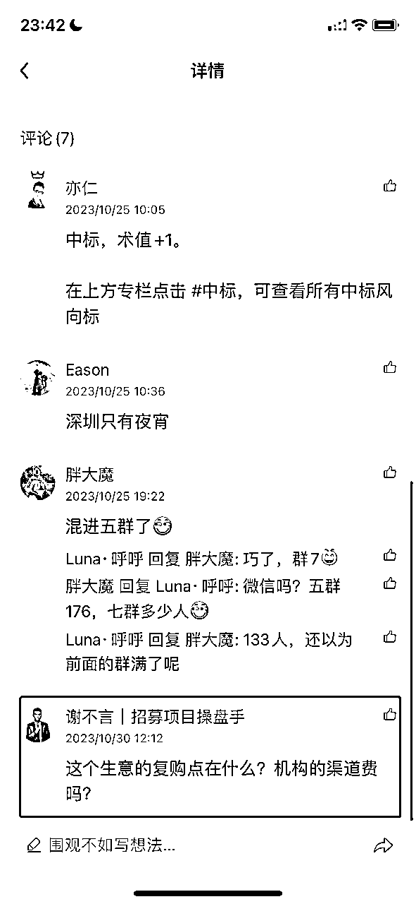

第二天上班就让内容运营同事启动试水，一周内就看到初步反馈。

# 二、过去半年，我们和同行跑出了什么体量

直接辅导、间接带动的赚钱同行超30人，累计GMV保守看已突破500万。
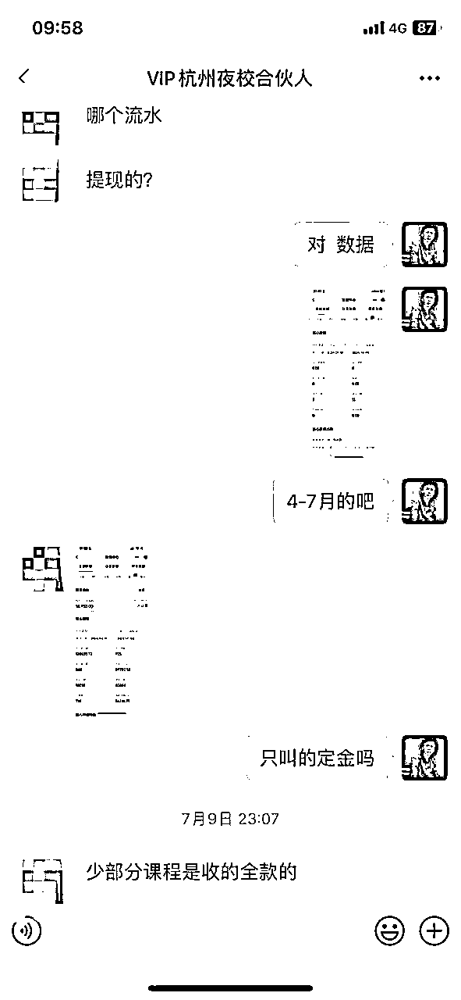
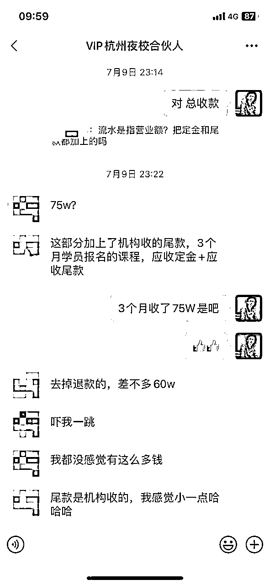
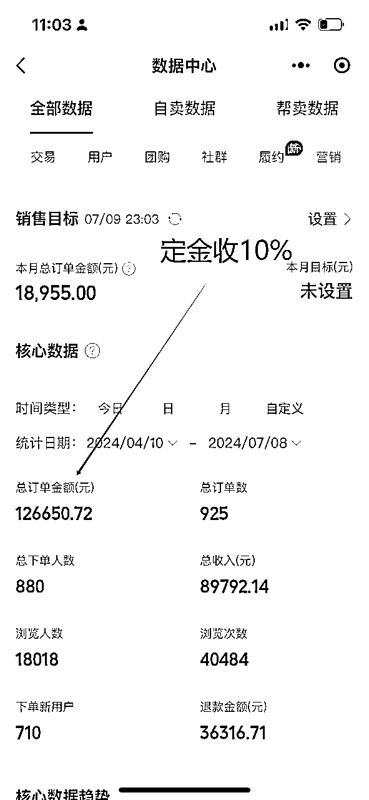

其中，杭州的城市合伙人，3个月到账75万，净利润30万，数据与聊天截图经本人同意公开披露。

补充说明：广州、苏州、上海、郑州、深圳等地的同行，营收各自保守超过50万；徐州、临沂、昆明、大连等十余座城市的同行，营收各自超过10万。以上均为保守测算，少报不多，欢迎交流。

媒体层面也获得关注。
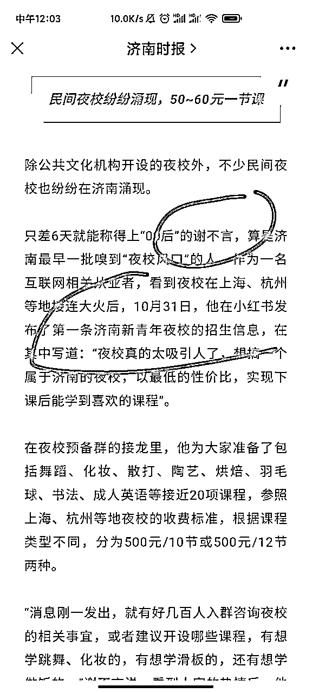
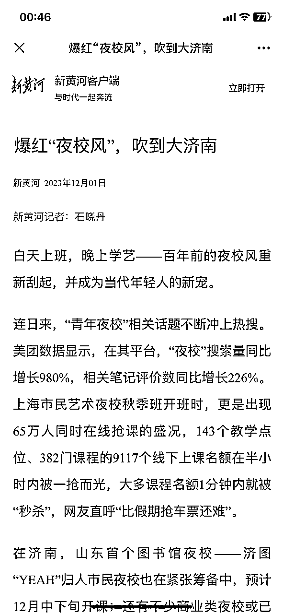
首次上官方媒体，直接带来一笔六位数的济南企业代运营合作。
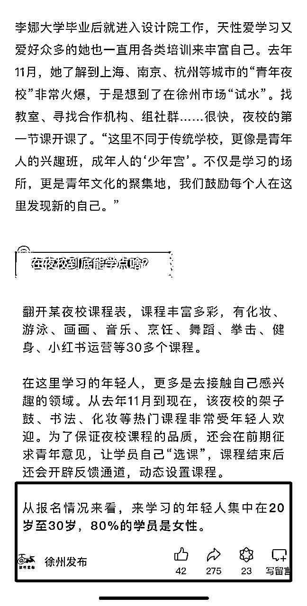
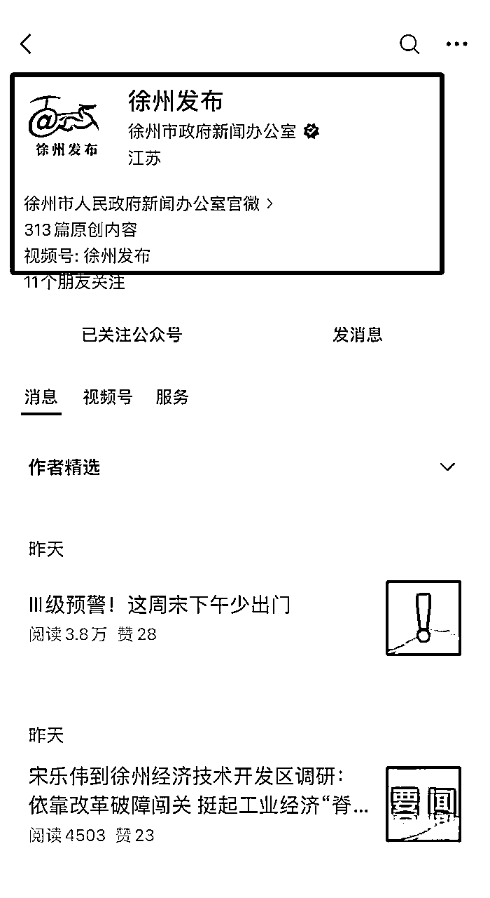
徐州的城市合伙人被市团委领导现场考察，并登上地方官媒。

# 三、复盘：关键窗口期我踩对了哪些点

## 3.1 红利期要同时看执行力和资源位

2023年山东圈年会嘉宾刘家齐说过一句话：面对红利，既要尊重执行，也要尊重资源。极度认同。

刷到风向标后，当晚就做了判断，第二天就开干。第一天就把一个微信群拉满，一周内拿下济南本地的声量。
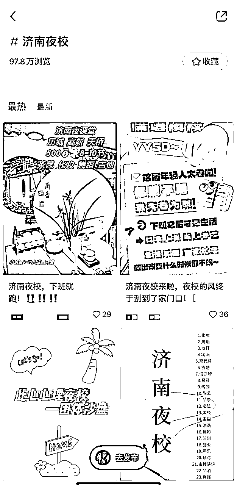
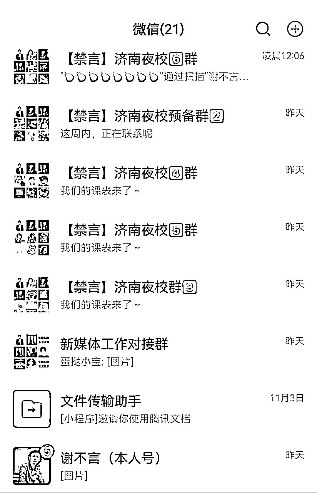
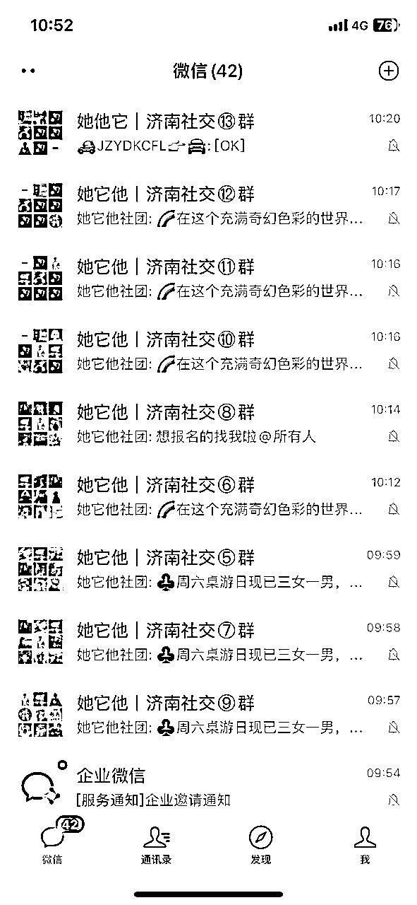

《飞驰人生2》里那句“机会只在几次出手里”，对创业者很有感。牌桌上机会很多，但真正匹配自己的屈指可数。窗口期一定要敢下注。

## 3.2 先模仿再改良，最后形成差异

起初对标的是京沪两家团队，直接复制变现效率偏低。于是倒逼自己做微创新，后来把快团团作为课程上架载体，转化效率提升数倍。

做项目必须持续打磨链路，效率决定结果。

## 3.3 开放心态，大方分享

一周验证有效后，我第一时间在山东圈群内同步信息，还做了腾讯会议公益讲解并答疑，凌晨两点整理成文发到星球。
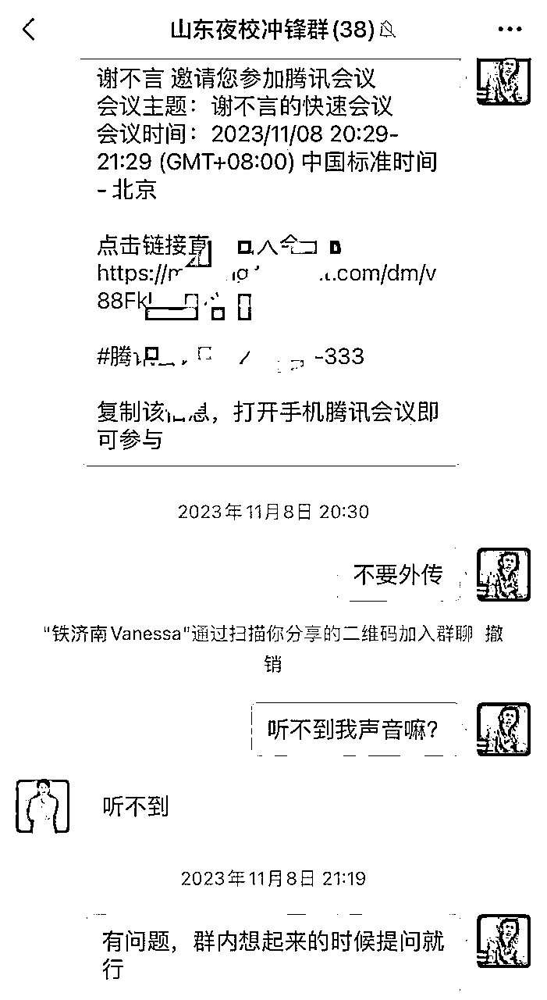
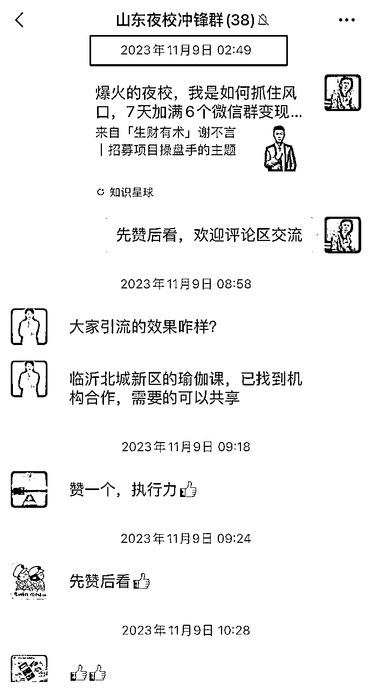

市场对先行者的奖励很明显。
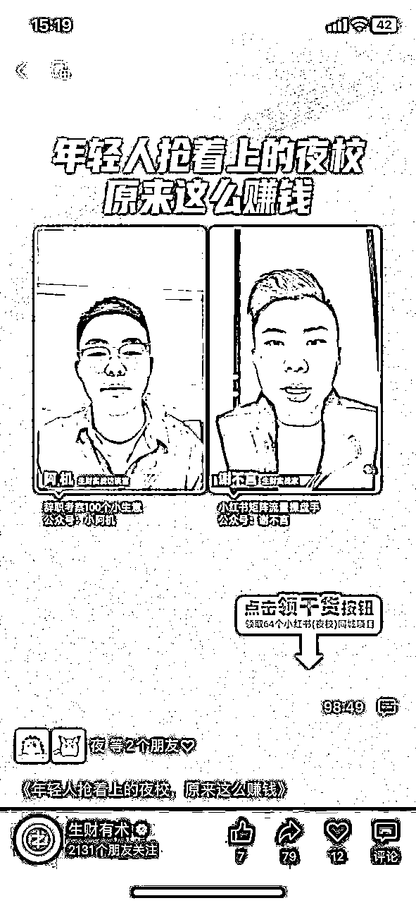
后续受邀参加赚钱实战家直播连麦，继续分享。

## 3.4 从单点生意转向人群经营

夜校不是一次性买卖，而是人群运营的入口。这批年轻人还有社交、娱乐、技能升级、认知升级、副业变现等多元需求。

可以围绕需求做线下轰趴、狼人杀、桌游等活动，也能做线上自营的剪辑课、运营课，甚至引流到靠谱的副业项目。
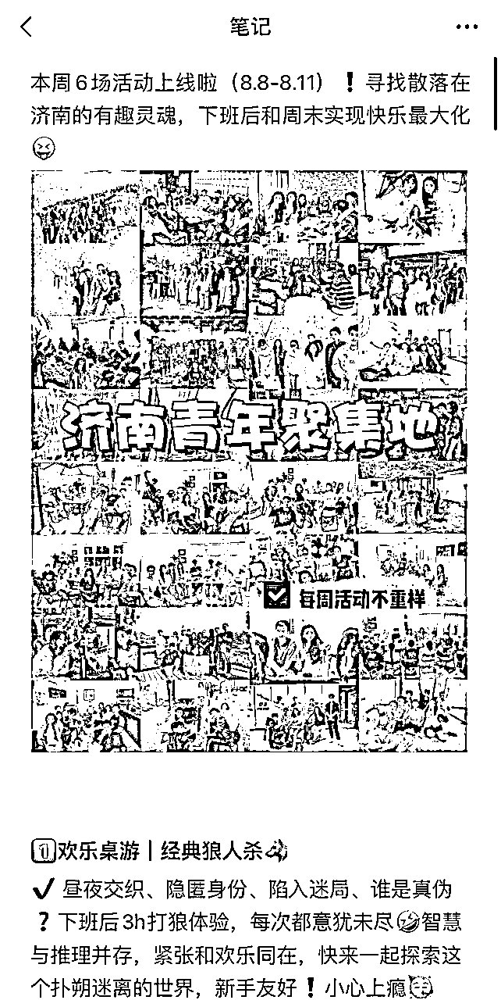
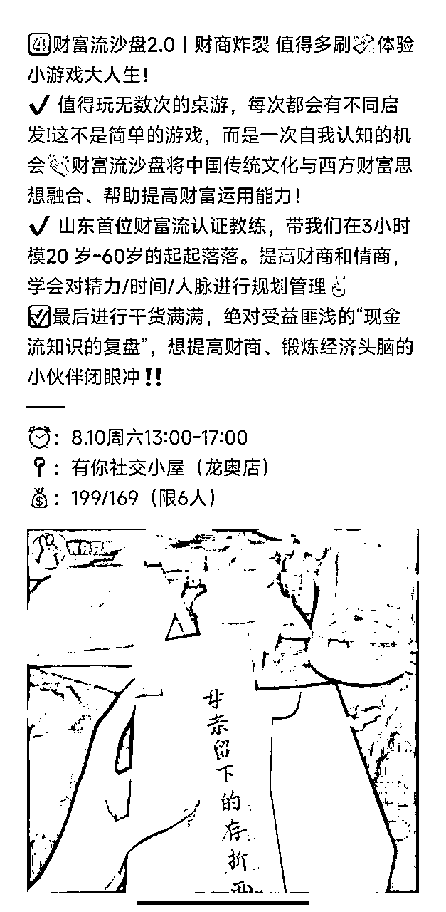

## 3.5 从C端向上赋能

当城市里有了稳定流量，商家会主动找上门。帮商家拿到结果后信任自然建立，再谈小红书代运营、陪跑服务就顺理成章。随着影响力提升，可从C端用户逐步过渡到小B门店，再过渡到中型企业。

# 四、给正在做或准备做青年夜校的10条观察

1. 百万人口的城市，已足以支撑个人创业的梦想。
2. 夜校是流量入口，别只做单次交易，要做人群与人心的长期经营。
3. 本地生意能线下见面，容易把客户变成朋友，实现持续复购。
4. 相同赛道，十万和百万的差距在创始人视野与认知。
5. 未来三年，本地生意依然是蓝海，灯下黑效应明显。
6. 用流量撬动商家，让价值回流给用户。
7. 中介生意最终会走向流量的集中采买与分发。
8. 机会面前，胆子放大，速度加快，耐心拉长。
9. 单兵作战不如抱团，人多力量大。
10. 种树最好的时间是十年前，其次是今天。

我是谢不言，连续创业者，有幸在夜校赛道成为较早吃螃蟹的一批人，取得了阶段性成绩。感谢龙哥盟提供的舞台，让一线实战者被看见。欢迎交流，微信 okk296，有问必答。