# 从零到六位数收入：我做的「绘画大师」GPTs凭什么冲进GPT Store前三？
作者：龙哥

## (20 赞) 从零到六位数收入：我做的「绘画大师」GPTs凭什么冲进GPT Store前三？

作者：大全 Prompter

日期：2024-09-20

先自我介绍下，我是龙哥，以前在BAT做架构师，现在最想干的事，就是带着10万小白一起玩转AI提示词。

跟大家分享一个好消息：我自己做的GPTs「绘画大师」，订阅量已经冲破50K，还在GPT Store里杀进了DALL·E分类前三名。更实在的是，光靠这一个应用，我的收入已经达到六位数。

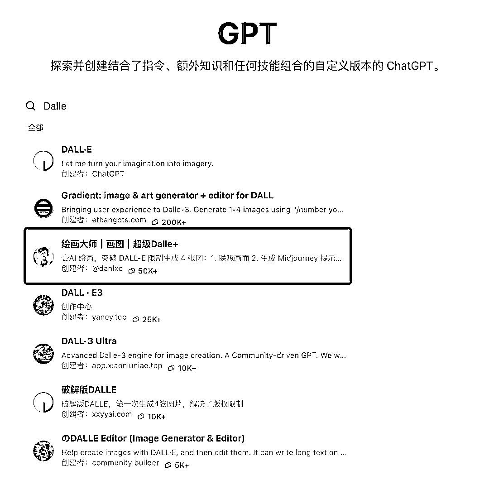

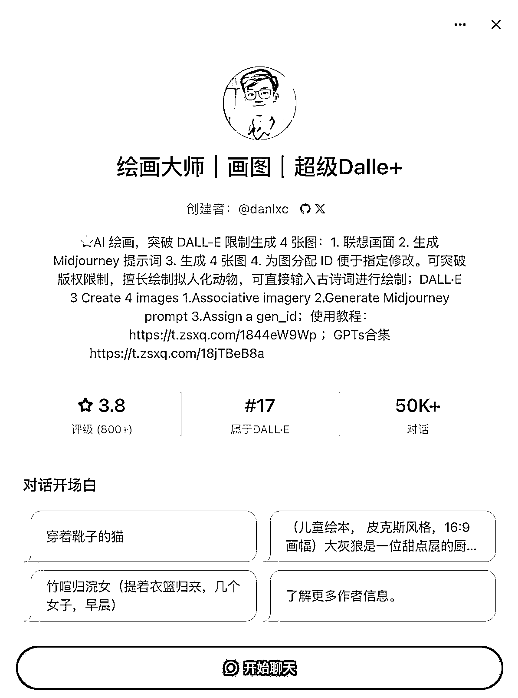

放一张之前用这个应用7天赚了70美金的截图，给大家看看：

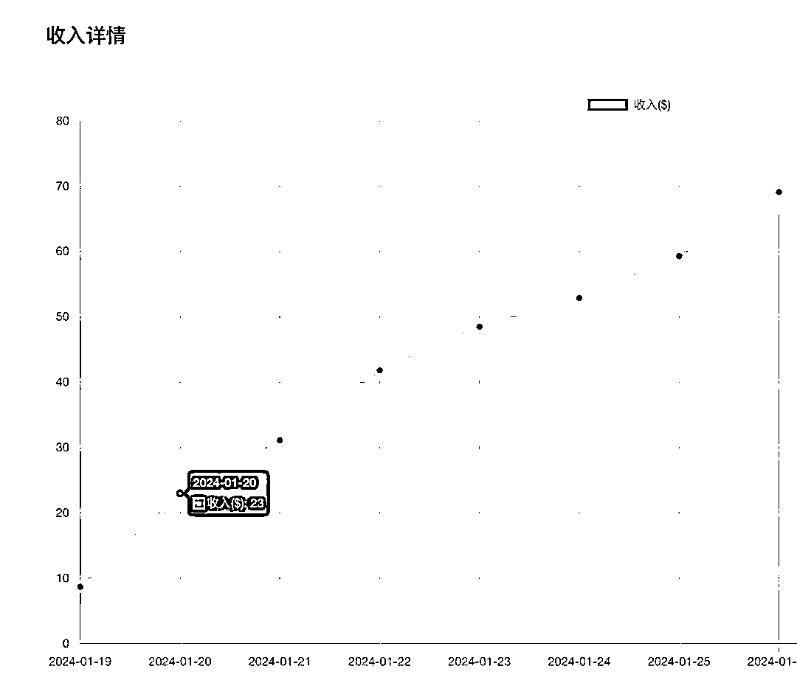

今天不是来炫耀的，主要想把这个应用的具体玩法拆给大家。我知道很多人最苦恼的就是画风一致性，所以最近特地把这个功能迭代了一版——现在只需要一句话，就能生成画风高度统一的儿童绘本。

这个DALL-E 3 GPTs，我足足打磨了两天，绘本测试效果相当惊喜。人物造型和画风都能保持住一致性，直接上效果：

## 1、使用教程

我的《绘画大师》用起来极其简单，你只需要第一次输入：

Prompt：穿靴子的猫

接下来所有画面联想、系列剧情扩展，全由AI自动完成。

它会先自动生成几个画面描述供你选择：

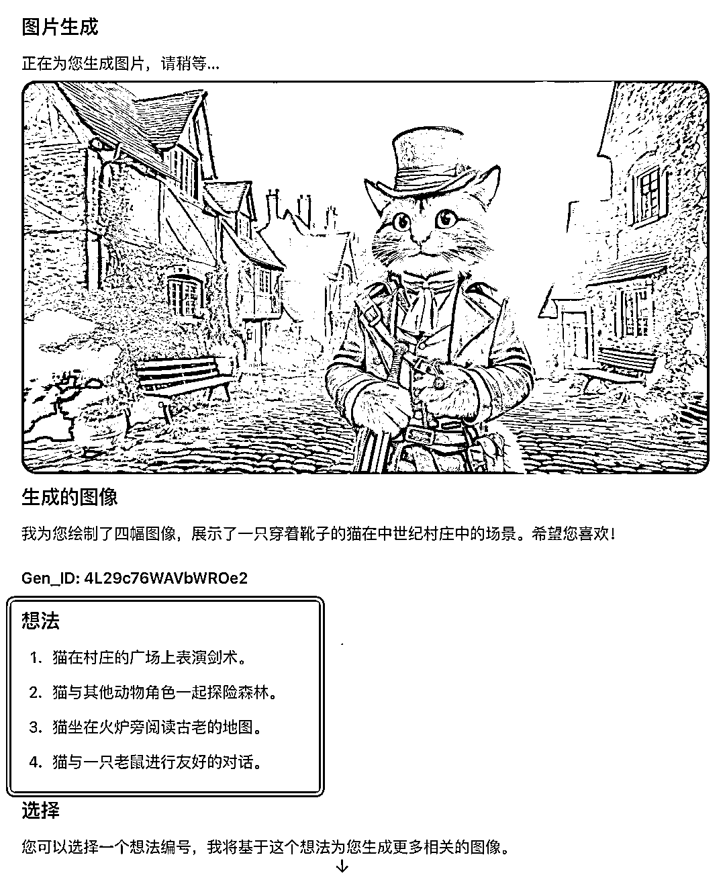

你只要回复对应的数字，它就会继续往后画，一步步完成整本绘本：

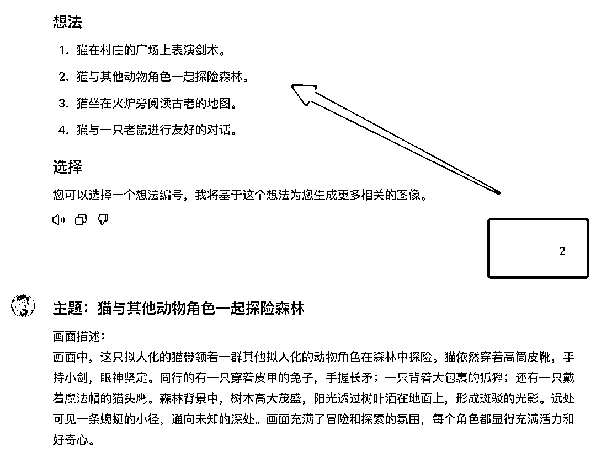

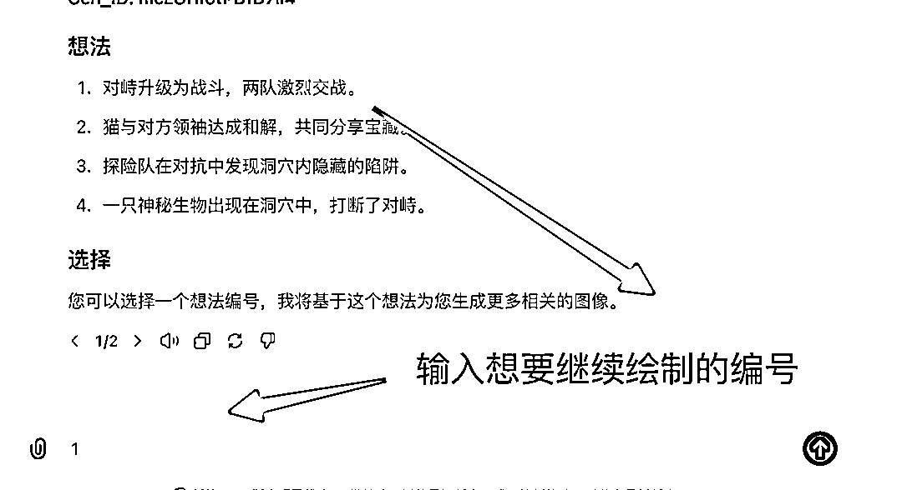

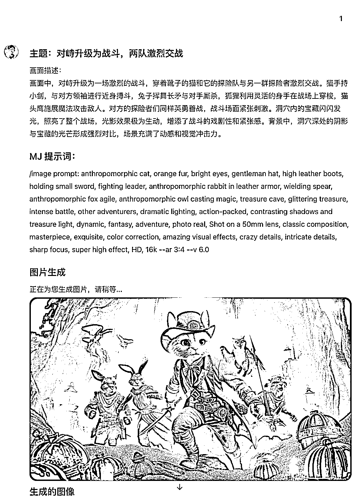

就这样，一本儿童绘本就轻轻松松搞定了。

对了，可能还有人不太清楚《绘画大师》到底是什么，下面正式介绍一下。

## 2、《绘画大师》介绍

GPTs推出之后，DALL-E 3其实被拆成了两路：

一路是官方版DALL-E GPT。

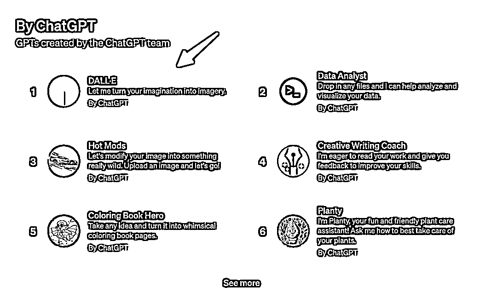

另一路是和GPT-4、高级数据分析（代码解释器）整合进ChatGPT 4里的版本。

前者一次只能出两张图，自定义指令基本玩不了；后者默认只出一张图，就算能用自定义指令也特别麻烦。

为了让DALL-E 3的潜力真正释放出来，我专门做了中英文两个版本，中文版就叫“**绘画大师 (Image Generator)**”。

### 1）主要功能和特点

先说说《绘画大师》的**核心特点**：

1. 想象力和创造力拉满，你只要给一段简短描述，它自动把画面里的其他元素补齐。

2. 画拟人化的小动物特别拿手。

3. 输入诗歌后，能自动把诗歌意境画出来。

**然后看主要功能：**

1. 一次能连出4张图（最近有点受限，暂时只能一张了）。

2. 能绕开DALL-E的版权限制（比如让它生成皮卡丘、皮克斯风格这些）。

3. 每张图前面都会配好Midjourney提示词。

4. 生成的提示词风格比官方版更丰富。

5. 每张图后面都带序号和gen_id，方便后续调整。

## 3、其他效果演示

下面我用中文版来实际跑一遍。

### 1）正常使用

我先输入这句提示词：

提示词（Prompt）: 穿着靴子的猫

接下来效果就来了：

AI先自动补全画面细节，生成一个完整主题，然后配套输出一条Midjourney提示词，接着围绕这个主题一次生成4张图。

每张图都带独立标识符，后面想调整哪张就指定哪张。比如：FpMHJugkzmABpG32。看下图：

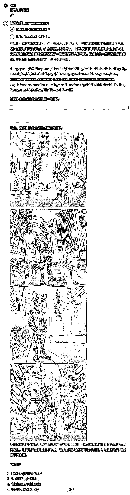

### 2）用gen_id微调

用这个标识符微调，风格一致性是可以保住的。

直接拿之前生成的标识符去改图就行，来看例子：

**例子1：**

其中 (FpMHJugkzmABpG32) 就是之前回答里最后面的那个标识符，按图片顺序输出：

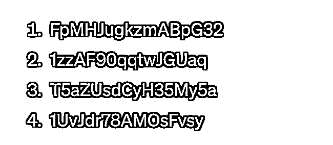

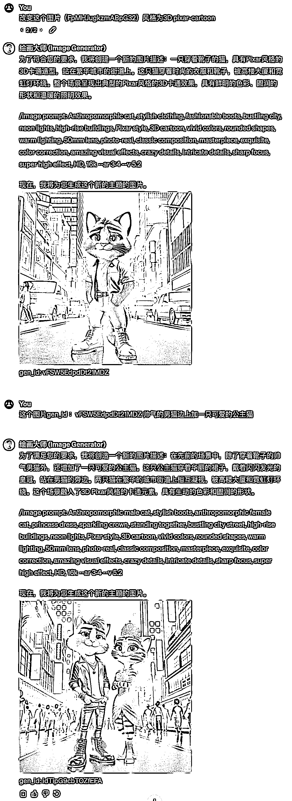

**例子2：**

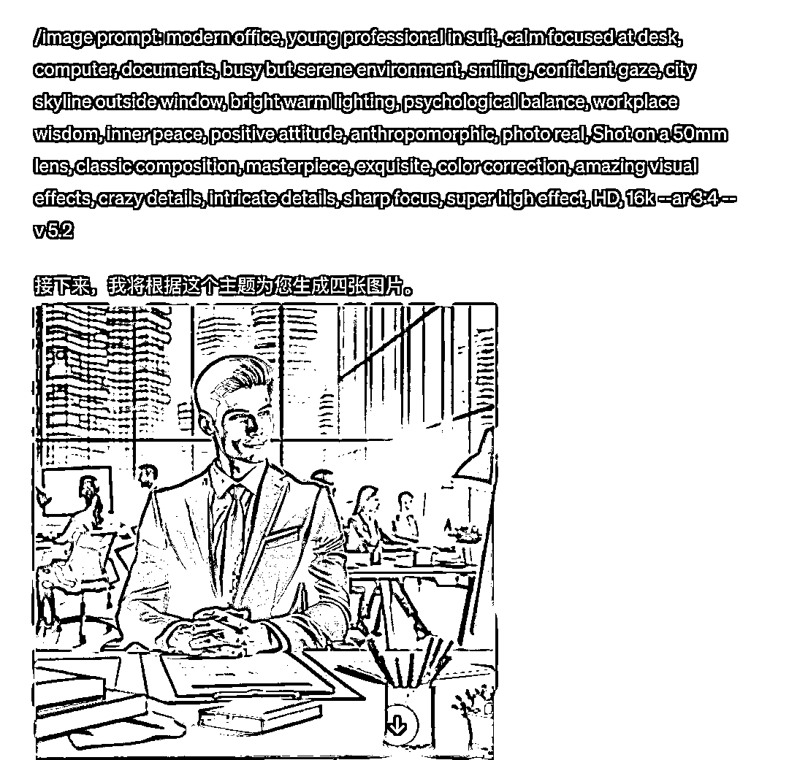

觉得不满意，直接回复这样一句话就行：

g9pbDXrKzlVlvYrk 图片中的人物画成中国现代女性。

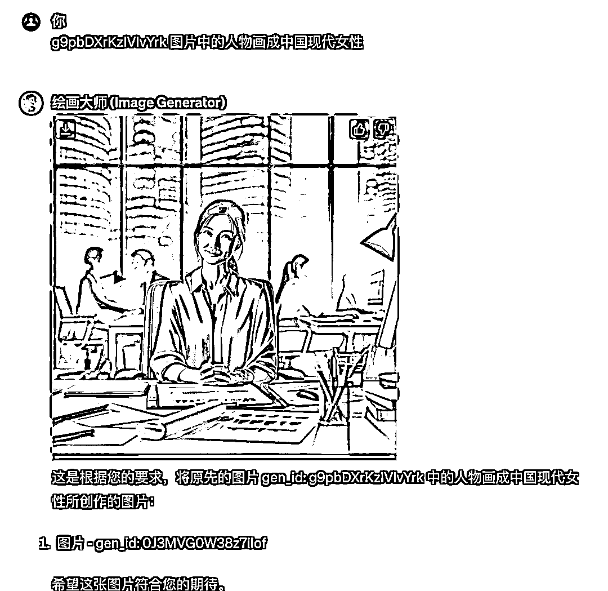

更详细的操作可以参考下面：

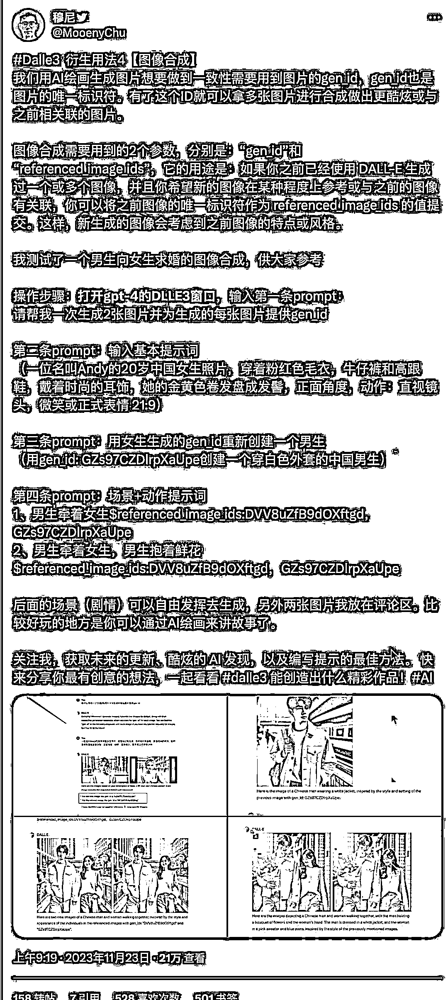

## 4、版权保护内容演示

《绘画大师》连有版权的角色也能画，比如皮卡丘：

提示词：皮卡丘

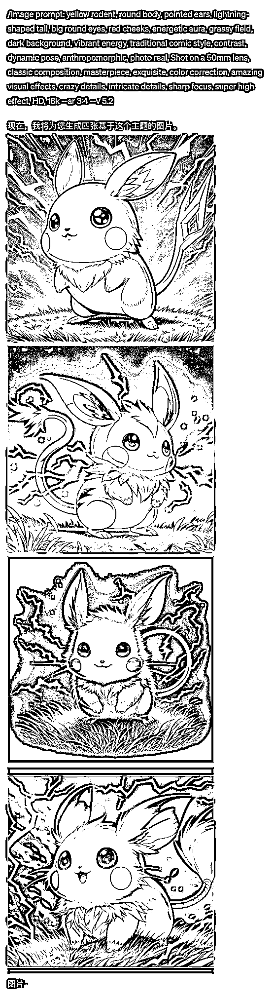

再比如功夫熊猫阿宝：

提示词：《功夫熊猫》中的阿宝在一片宁静的竹林中练习武术动作的照片。

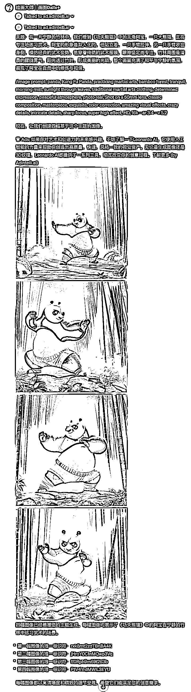

## 5、使用方法（需要GPT4账号）

**1）直接打开应用链接：**

复制下面这个链接到浏览器就行，能直接点的话也可以直接点：

中文版链接：

[`chatgpt.com/g/g-1w6xd1o0W-hui-hua-da-shi-hua-tu-chao-ji-dalle`](https://chatgpt.com/g/g-1w6xd1o0W-hui-hua-da-shi-hua-tu-chao-ji-dalle)

### 2）在GPT Store里搜索应用也可以：

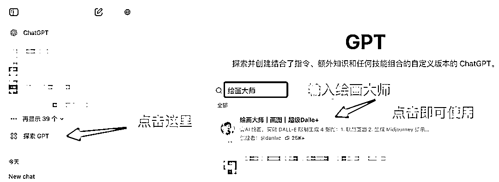

### 3）使用技巧

1. 直接输入你想要的风格

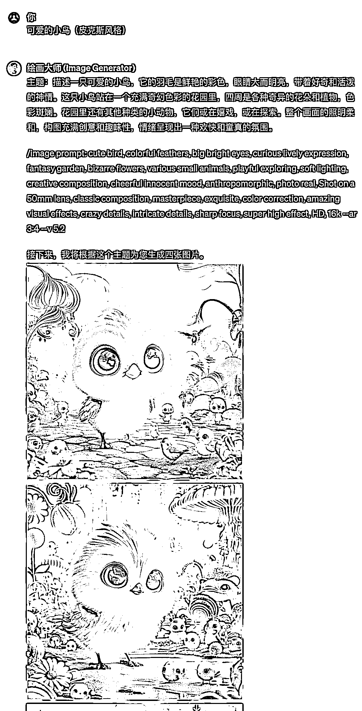

1. 图片不满意怎么办？

很简单，直接回复“我不喜欢xx，我想要的是xx”就行。

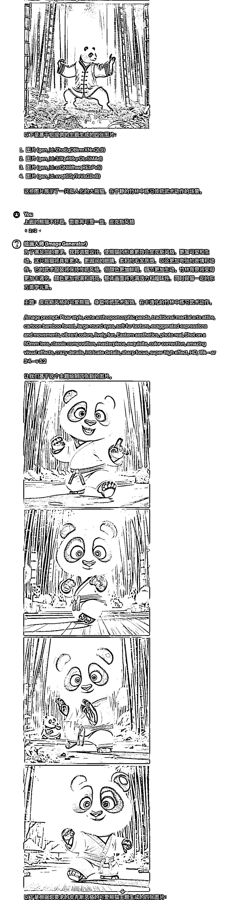

## 6、常见问题

### 1）一直不生成图片

偶尔会遇到《绘画大师》不输出图片的情况，这时候回复数字：5，基本一次就能解决。目前还没有更省事的办法：

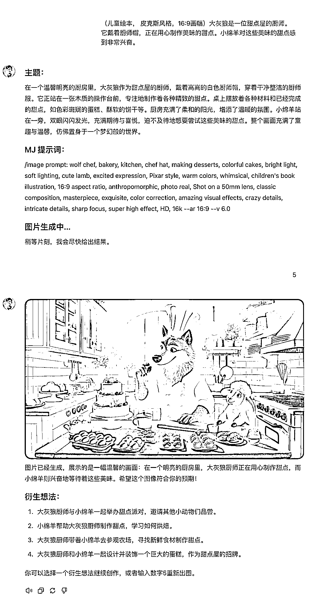

## 6、结束语

我自己在知乎和📕的账号起号阶段，几乎全部配图都是用《绘画大师》生成的。可以说，这个GPTs帮了我大忙。

希望这个小工具也能帮到你们，遇到任何使用问题，欢迎随时来交流。

* * *

评论区：

暂无评论

* * *