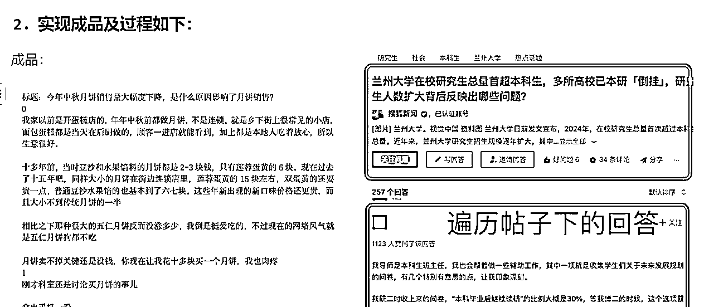

# 如何爬取知乎的帖子回答，来辅助文章的人工&AI 创作（附效果&实操&源码）

写文章最怕的不是没灵感，而是有灵感却没料。我一直觉得，素材的成色直接决定了文章的底色。为了给写东西的人（不管是真人还是AI）铺路，我鼓捣了一个专门抓取知乎内容的RPA小工具。

这个工具干的事很简单：你把某个话题丢给它，它就把这个话题下面所有的帖子连带着各路回答，统统扒下来，汇总进一个Word文档里。这样一来，一个话题的高质量讨论就被打包成了现成的素材块。以后想写点什么，无论是自己手动整理，还是直接喂给AI当参考，都省了东翻西找的力气。

详细的制作思路和实操演示，我放在了飞书文档里，想照着自己做一个的，可以点开看：

[https://vge3py7ug6.feishu.cn/docx/T19HdqfcsoxgQ5xlqlyckLFkncd?from=from_copylink](https://vge3py7ug6.feishu.cn/docx/T19HdqfcsoxgQ5xlqlyckLFkncd?from=from_copylink)

另外，如果你好奇我为什么这么较真地折腾素材——这里有一篇踩坑总结，讲得很清楚：素材质量是怎么一步步决定AI最终成文质量的。想避坑的朋友一定得看看：

[踩了很多坑才知道--素材质量决定文章生成质量（附实操）](https://articles.zsxq.com/id_hzremn8qrg0r.html)

#公众号 #RPA #AI写作 #人工写作 #思路整理

评论区已经有人问上了：“用的扣子（Coze）吗？”

