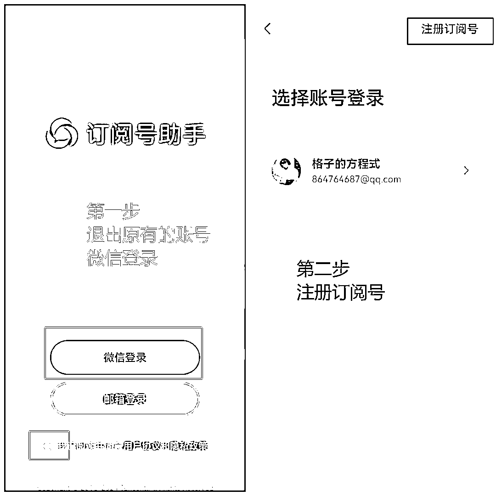
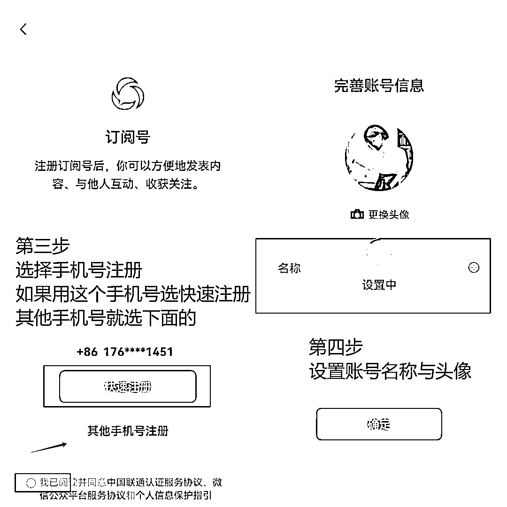
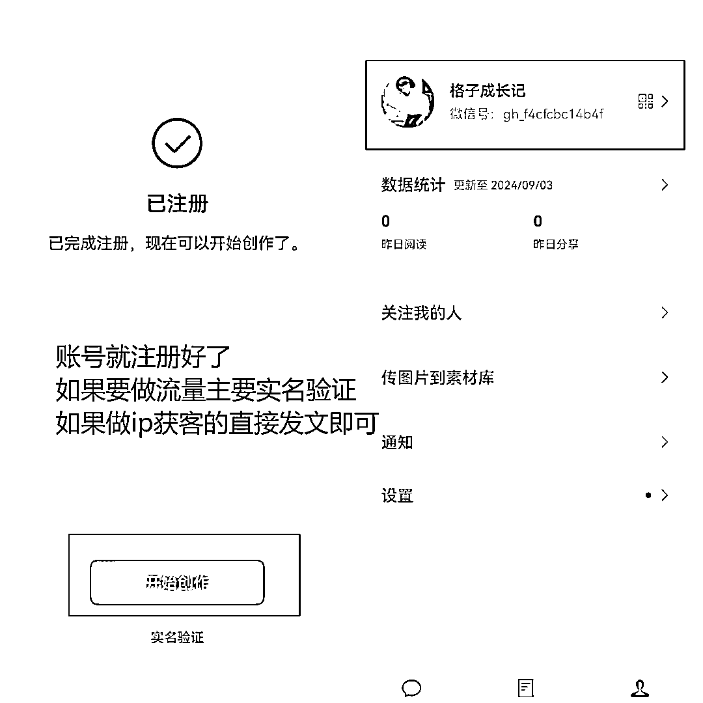
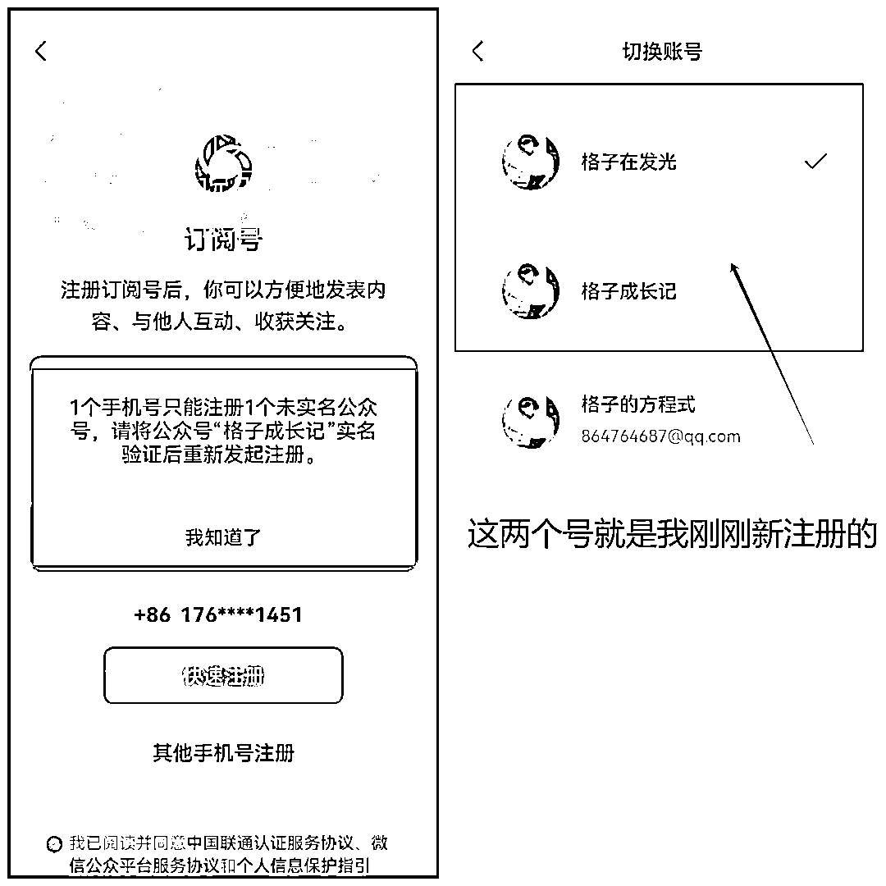
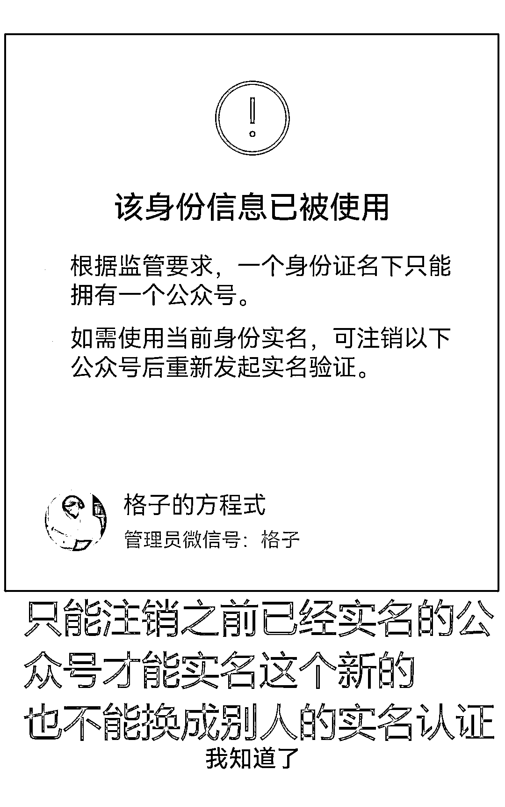

# 👸号隐藏新功能：怎么无限注册👸号？
作者：龙哥

最近圈子里都在聊一个让人兴奋的新变化：👸号竟然悄悄解锁了一种“不限量开号”的玩法！搁以前，一张身份证只能绑定一个号，想搞矩阵？门儿都没有。可现在不一样了——只要你有手机号，就能陆续注册出全新的👸号。

我实测了一下，目前一个手机号大约只能开出“未实名”状态的号，但不同的朋友反馈不太一样，有人说能连续注册出1到12个号。到底最多能囤多少，试过的圈友不妨在评论区报个数字。

不过，这种新号也有天花板：实名规则没变，依旧是一张身份证对应一个实名号。多出来那些号统统属于“未实名”，像赞赏、流量主这类赚钱工具就没法开通。也就是说，靠阅读分成变现的路子，基本被堵死了。

但好处也很明显——发布文章完全没影响，用来做IP矩阵、把粉丝导流到私域进行转化，绰绰有余。目前我能想到的最大价值就在这里，谁有更妙的用法，也欢迎抛出来切磋。

我的想法是：趁现在能注册，先囤一批放着。这功能刚刚冒出水面，腾讯后续很可能会调整玩法，甚至放开部分权限。万一哪天实名限制松动了，这些号也许就能摇身一变，成为流量主变现的生力军。

还有一点要提醒：一个🛰️号最多承接5个👸号的位置，手头满了就换一个🛰️号继续操作。

接下来直接把保姆级操作流程安排上。

先去手机应用商店下载“订阅号助手”，注意登录的🛰️必须是已实名的账号。拿我的手机举例，之前已经有一个👸号在运营中，我先把那个号退出，再选🛰️登录，页面右上角就会冒出“注册订阅号”的入口：

如果就想用当前这个手机号，直接选“快速注册”；想借用其他号码，就选别的选项，然后填写相应资料：

流程走完后会自动进入创作后台，一个全新的号就算是开起来了：

想多开几个的话，重复上面的退出、登录、注册循环就行。系统会提示每个手机号只能绑定一个未实名号，这时候换个手机号继续操作即可。我自己就这么轻轻松松多开了两个：

这里有个硬性规定：如果手机上登录的是未实名🛰️，系统会提醒你先把🛰️实名，否则无法注册新号。所以操作时千万记得用已实名的🛰️来登录。

另外，还有一个容易踩的坑——通过实名🛰️注册的新号，无法再绑定别人的身份证。如果你要给这个号做实名认证，必须先将之前那个已实名的👸号注销，腾出名额才行。

不过我刚试出一个变通招数：把新号的管理员权限交给家人，例如父母🛰️名下没注册过👸号，就登录👸号网页版，把管理员换成他们，再走他们的实名认证链路，问题直接解决。

眼下能注册就抓紧多注册，先扔那儿放着，观察平台接下来有什么变化。尤其是做IP的朋友，本来也不指望流量主吃饭，用这些号做矩阵获客，非常划算。

最近👸号的动静可真不小：去年上线了小绿书，今年IP内容有机会进流量池，前几天又放开了短剧推广的权限。这些信号都在告诉咱们——腾讯依然把👸号当成“嫡系产品”。找一个值得长期投入的项目，👸号绝对排得上号。它背靠着🛰️生态，🛰️不倒，👸号就不会轻易被裁。反观其他平台，随时都可能凉凉。所以对内容创作者来说，每一次规则变动，本质上都是新的机会。干就完了！

