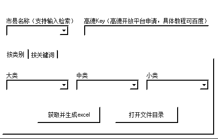
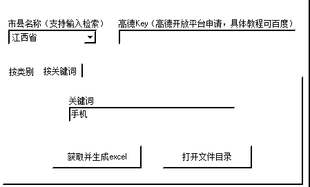
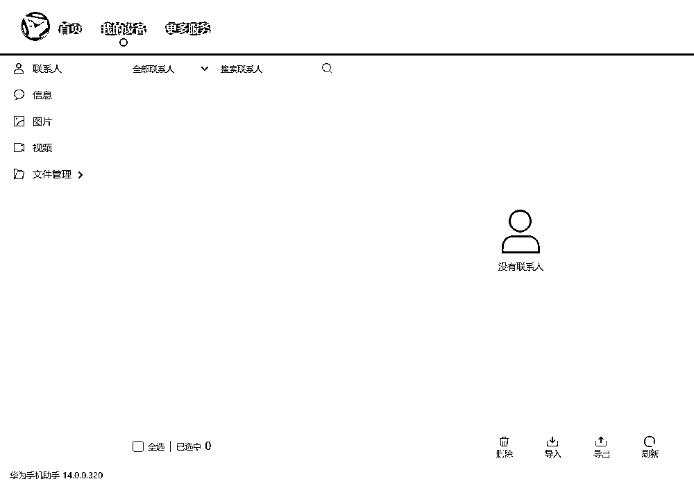

# 通过地图搜索添加商家微信实现简单高效的赚钱方法

别嫌“笨”：地图搜一搜，商家的微信就是你的钱

大家好，我是子赫。

之前聊过不少实操项目，比如闲鱼粉引流一天变现3000+、线下跑客户月入过万。有人跟着做了，有人半途而废。今天换个口味，讲一个“笨到极致”却真能赚钱的打法。

为什么说它笨？因为你只需要重复一件事：加微信，加商家微信，主动去加。一天下来，能加几百个人。

微信号从哪来？高德地图、百度地图啊。那些实体店的联系方式，上面基本都挂着呢。

听到这儿，你可能觉得“是个人就能做”。没错，门槛确实不高，但别急着冲——真要是傻乎乎地一个个搜地图、一个个输手机号去加，速度慢不说，通过率还很拉胯，加多了还容易被限制。

那到底该咋操作？

我拿自己举例。我是做流量卡的，赚钱逻辑很简单：用户充值使用，我就有赚。所以当务之急就是把卡铺出去。怎么铺？把利润大头让给合作伙伴，自己一单只留1-3块钱。

注意，流量这东西没有人不需要，所以全天下都是目标客户。而那些有稳定客源的实体店，比如手机店、电脑打印店、超市、菜鸟驿站、百货超市，就是最好的合作点。你只要找到老板，谈合作就行——谁不想多赚点钱呢？

问题来了：怎么快速触达这些老板？

方法一：在地图上找到一个，就加上一个。慢，而且加多了容易触发限制。

方法二：把地图上的联系方式先记到电脑表格里，再导入手机，从“添加新朋友”里逐个加。收集信息那一步会很烦。

方法三：直接上电脑采集工具批量抓取， 然后把号码导进手机， 用“添加新朋友”去操作，既能躲开频繁限制，效率也拉满——一天加大几百人不是问题。加完之后，再人工搜一搜捡漏。

这套操作我做了整整一年，陆陆续续加过来的代理超过5000个。有的代理卖得多，有的卖得少，就不慢慢细说了。反正现在月均收入10万以上，而且每个月都在涨。

为什么这么“笨”的方法能成？核心就两个字：量。量上来了，只要你是在持续添加，成功就是水到渠成的事。还有个小秘密——你加的都是店铺老板和商家，人家通过你的概率特别高。

当然，这只是我的变现路子。你要复制的话，唯一要准备的，就是多备几个微信号。

欢迎留言说说你的看法，觉得有门路的点个赞再去试。