# 玄学手串三个月做到十万营收？我从选品、引流到成交给你完整拆解

> 原文：[`www.yuque.com/for_lazy/zhoubao/yt2fuwu5bzv38s56`](https://www.yuque.com/for_lazy/zhoubao/yt2fuwu5bzv38s56)

作者：匠叔
日期：2024-09-03

一直有人问我，玄学怎么变现？我过去也在反复摸索这条商业化路径。今年六月开始尝试"玄学+手串"的组合：珠子款型由我自主设计，核心卖点是"根据客户生辰八字定制或推荐对应的手串"。客流从哪里来？一类是老客户的转介绍，另一类就是社媒平台自然流量。身边几个学员也跟着一起实践，三个月下来合计营收接近 10W。客单价最高的一单是 4077 元，买家正是通过小红书找过来的。

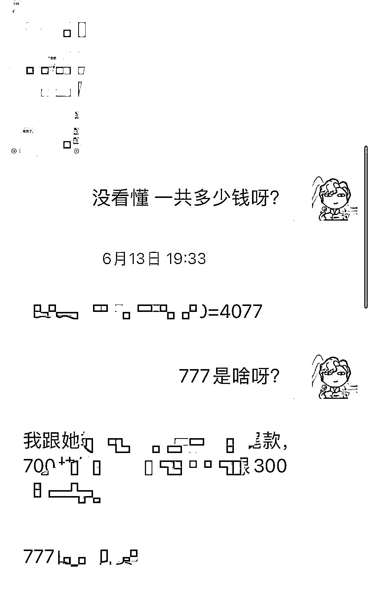

常规款定价基本从 498 起步，标价 888 卖得最多。

为什么我会认定这门生意值得做？因为它天然满足了三个条件：

**第一，市场不用我再教育，入场成本极低**

"好运手串""水晶手串""疗愈手串"这波概念早就被市场炒热了，用户看到这类产品天然就有信任感，我不需要花力气解释原理。任何生意，只要还处在需要反复说服用户的阶段，没有雄厚的资金支持基本做不起来。

线上卖水晶更是典型的零库存模式：有订单了再补货，完全没有压货压力。前期我建议别急着囤货，囤货是为了提高毛利，但初始阶段利润低一点没关系，关键是没投入、没风险。

**第二，公开平台引流非常顺畅**

玄学类内容最大的痛点就是限流，动不动被举报、被封锁。可只要聊的是水晶手串，平台基本不会太干涉。水晶+玄学解读+搭配电商内容，在流量获取上效果非常猛。这点后面我会展开细讲。

**第三，成交之后复购链路完整**

水晶手串本身有一个特点——用户不会频繁购买，一般戴上一整年才会想再买。但我们加上了玄学服务，用户就算不需要新手串，后续还可以找我们做其他玄学咨询，复购的频次就被拉起来了。两者叠加起来，整个生意逻辑非常顺。

接下来我从三个维度做展开：**产品怎么设计、流量怎么获取、成交怎么做。**

# 一、产品设计：先想清楚卖什么，再谈流量和转化

商业上最重要的是产品，你得清楚自己靠什么赚钱，后面的动作才有意义。

产品设计分成三部分来讲：**品类划分、价格体系、设计方法。**

## 1. 按用户需求分品类，而不是按水晶种类分

水晶确实有一些大众熟知的功效，比如粉晶招人缘、黄水晶招财。网上一查全是这类信息。

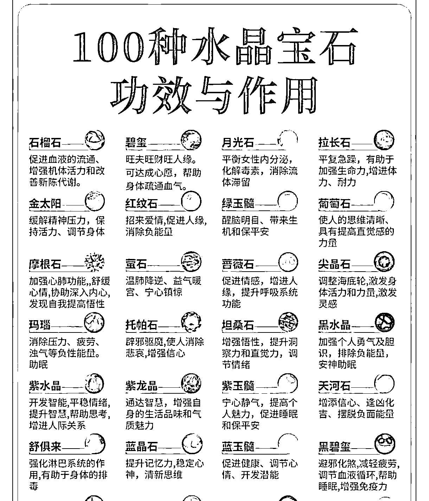

传统做法是照着水晶品种一个一个列，比如白水晶、紫水晶、发晶、钛晶……品类多到数不清。可对于没有稳定供应链的新手来说，这种玩法很难落地：用户看到的选择越多，双方的压力越大，万一他看中的款式你没货源，反而更尴尬。

所以我建议按用户的需求来做分类，只围绕 5 个维度：

**1、招财**

**2、助考运**

**3、旺事业**

**4、桃花姻缘**

**5、健康平安**

产品线就砍成五个大类，先问清楚用户最想要什么，再有针对性地推荐。这样做的好处很明显：其一，用户不会拿着你的产品去货比三家，因为你卖的是针对他个人心愿的方案，每个需求都很独特；其二，你根本不用准备大量的产品话术，全程只需要跟对方聊玄学层面的事，最后把话题落到手串上就好。

## 2. 按用户愿付价值定价，而不是按材料成本定价

水晶本身是有价格梯度的。不少人的习惯是拿进货价来倒推售价：白水晶便宜就卖便宜点，黄发晶进货贵就标高一些。成本当然要纳入考量，可做玄学手串，定价真正的锚点是需求本身——用户愿意为自己的愿望花多少钱。

我这边设计了三个档位，让用户一眼看出差别：

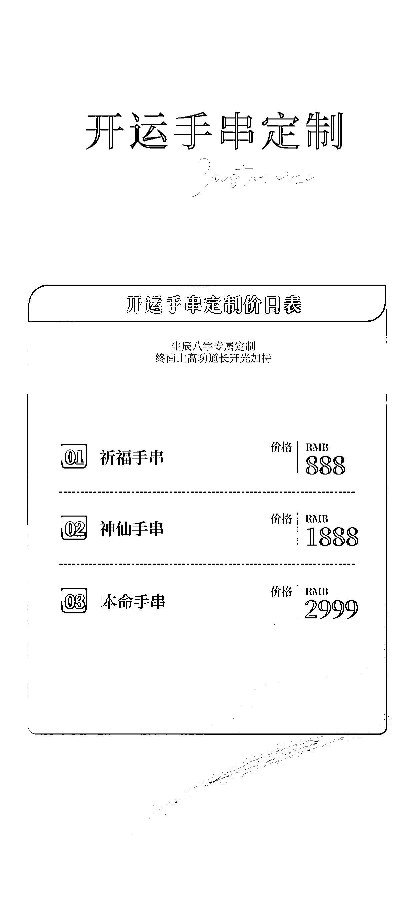

第一档，基础旺运款，主要走传统五行调衡的路子。

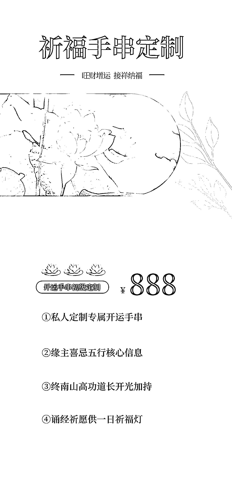

第二档，神仙款，依托道家神仙体系，配合开光请神来做能量加持。

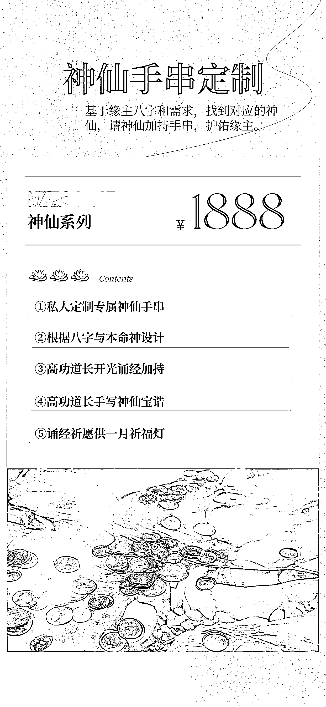

第三档，本命款。

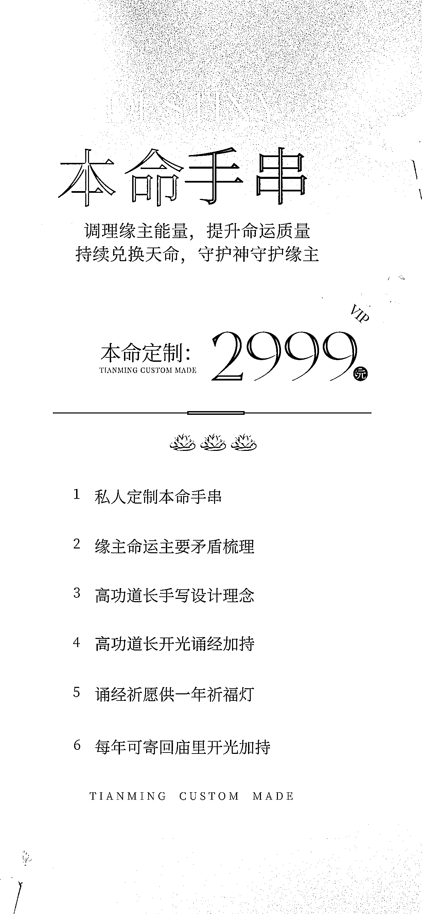

三档之间差异很明显。如果你也想做这类产品，建议同样从用户需求出发搭建价格阶梯。这样没人会追着你问成本，也不会有人拿去横向比价，因为每家立足点都不同，市面上没有一模一样的参照物。

## 3. 五步法，快速设计出一条玄学手串

下面这段是给有一点玄学底子的朋友看的实操流程。

### 第一步：推用户的喜用神

先看八字，判断这个人的五行喜用是什么。现在市面上有不少排盘软件可以辅助，新手也能直接上手。比如推出来对方五行喜"水"。

### 第二步：按喜用神选主珠

喜水就对应黑色系，可以搭蓝、黑调的珠子。蓝色系常用海蓝宝、青金石；黑色系这会儿常用黑曜石。具体看搭配出来的质感，有些年轻女生戴黑曜石偏硬，那就换海蓝宝。

### 第三步：按愿望配吊坠

求财可以挂元宝、貔貅，求姻缘加一只小狐狸，这些都是经典且接受度高的搭配。

### 第四步：给用户讲透这条串的价值

既然喜水，那水在这个人的命局里代表什么？可能是财，可能是事业。你必须把这些讲明白，让对方一看到这条手串就知道为什么戴它，这种发心上的认同才会真正起效。

**到这一步，手串和这个人之间就产生了深度联结，彻底变成了他的专属物件。**

### 第五步：开光赋能，附加赠品

最后一步就是结合你手头的资源二次加持。我身边刚好有庙宇资源，所以能提供开光仪式。大家根据自身条件来安排，目的是提升手串的独特感和用户的获得感。

这套五步流程有很强的交付闭环，就算你只懂一点皮毛也完全能落地。更复杂的定制设计一两篇文章讲不完，但照着这五步来，交付品质足以让你的用户感到靠谱。

# 二、引流获客：两个百试百灵的方法

拿小红书来举例，抖音的逻辑也是通的。分享两套可复制的获客模板：

**1、干货科普+免费测盘**

**2、低价商品导流**

## 1. 干货科普 + 免费测盘

先来盘点小红书上关于水晶的主流内容形态：

1、互动帖

2、晒货帖

3、知识帖

### 互动帖

抛一个开放性问题，吸引大家在评论区接龙聊起来。

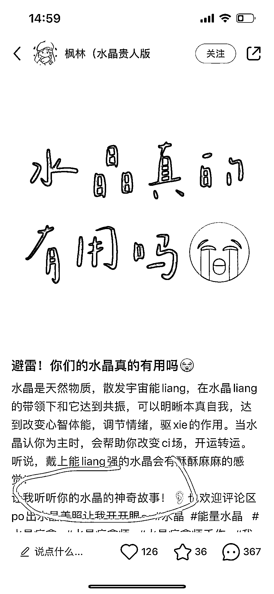

比如《姐妹们，敢不敢晒一下你的手串》《求叠戴好看的搭配图》这类话题，评论量通常非常可观，而互动数据恰巧是平台推流的关键指标。

但这类帖子有一个问题：能拉权重，却撑不起人设，对最终的卖出环节帮助有限。所以前期可以发几条热热身，但不值得当成主线来做。

### 晒货帖

纯粹靠精美图片吸引眼球，评论区很容易出现"太美了，哪里买？"之类的询问。

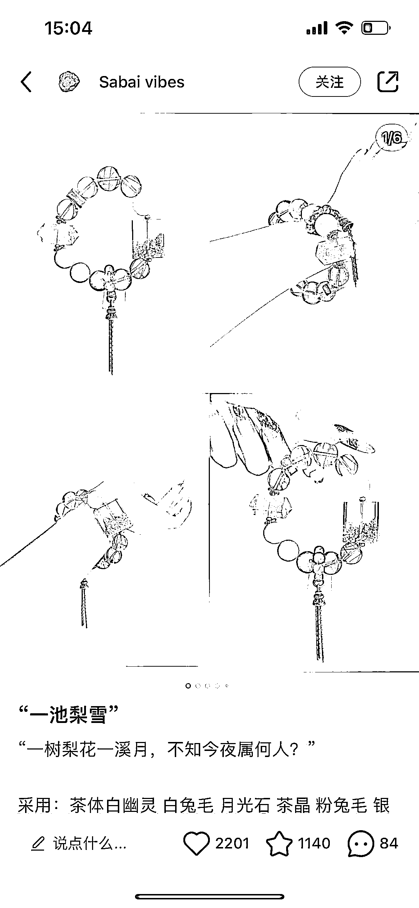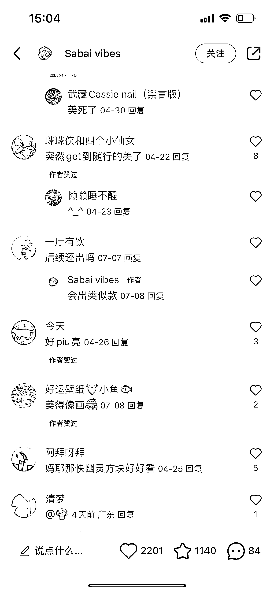

这种形式当然也有用，但它有两个硬伤：第一，对供应链和审美设计能力的要求极高，新手没有足够的货品储备，很难拍出高质感大片；第二，这类串很难卖出溢价，我见到的多数成交价在 100-300 之间，而且盗图低价跟卖的现象非常严重，你会很快失去价格优势。

### 知识帖

围绕水晶的各个知识点做科普，目前平台扫一眼几乎全在做这个方向。

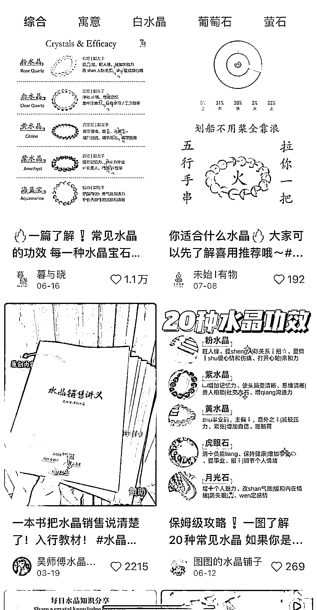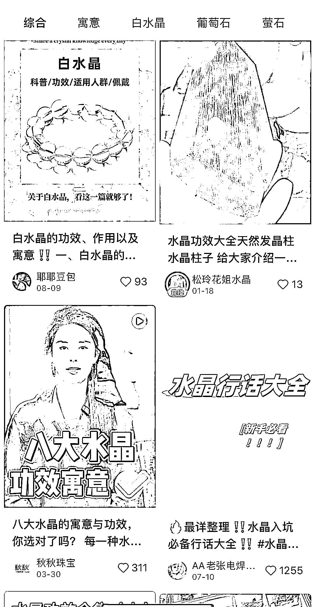

这种内容天然自带信任感，对人设积累很有帮助。如果你刚刚起步，我会强烈建议主力做知识帖。

那"免费测盘"又是什么？简单说：用户主动加过来，提供出生信息，我免费帮他判断适合什么样的手串。说白了就是先给点甜头，把用户吸引到私域再慢慢经营。

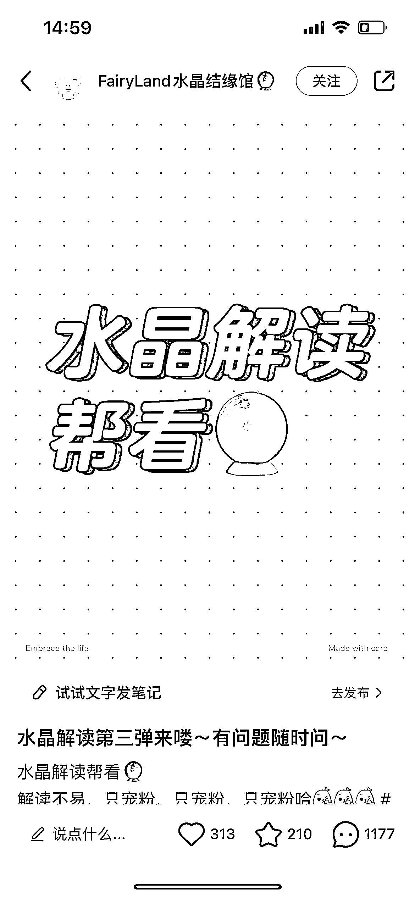

具体执行时，帖子下方可以先回复几组，再引导对方加微信做完整版解读。这套钩子筛选来的客户都认可八字且对手串有明确意向，引流十分精准，聊到合适的时候还会直接下单。

前期先攒够二十几位意向用户，认真给他们做一轮深度解读，出单并不难。

**以上就是干货科普+免费测盘的完整闭环。**至于在小红书上具体怎么把用户导入微信，星球里有现成教程，直接搜"小红书引流"就行。

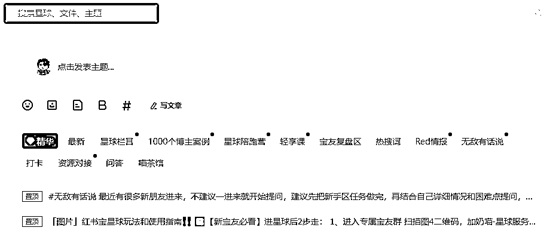

## 2. 低价商品导流

这套玩法更直接：上架几款低客单的水晶类小物，售出后在包裹里附上卡片，引导对方添加微信免费测手串。哪怕产品本身不赚钱，引来的都是精准粉。

像某款低价爆品一次走量几千单，卡片埋好，加到几百人是常事。

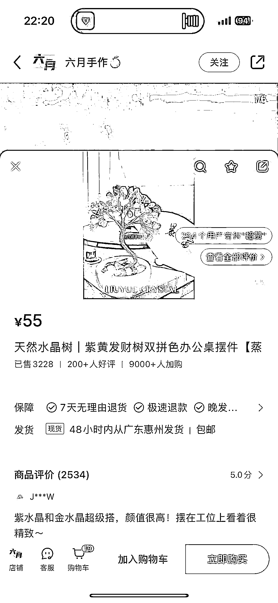

核心就两点：第一，产品必须和晶石相关；第二，价格要压到极致，最好控制在 10 块钱、20 块钱这个区间。

这需要开一个个人店铺，预交 1000 元保证金。具体开店环节星球里同样有 SOP，我就不重复了。

## 3. 还有两条路子，我没亲自验证但见别人跑出过成绩

### 直播卖货

星球里有学员靠直播把这个生意做到月入 10W，我自己没有直播经验所以没上手。如果你有供应链优势，或者表达能力够强，可以去那些卖得好的直播间里取取经。

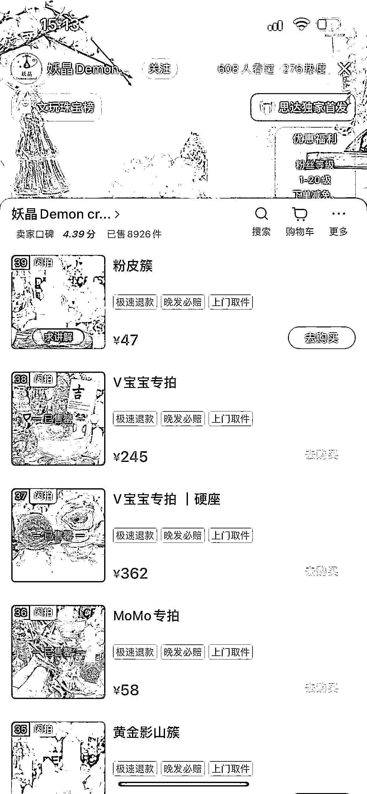

### 定制展示

在小红书公开自己的定制流程，视频的感染力比图文更强。这个我也没有系统测过，但有一个做得很好的博主可以参考，点进去就能看到：

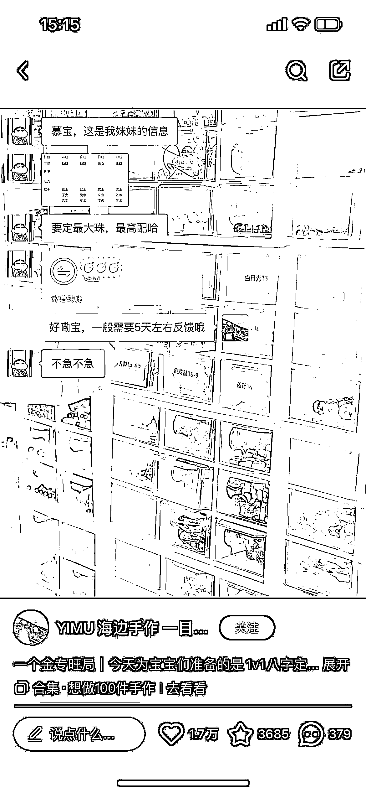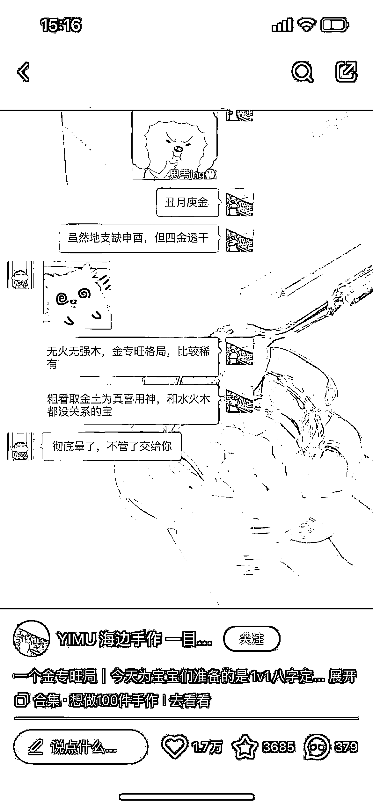

数据相当能打，属于定制领域里的顶流水准。

# 三、成交变现：私域经营的全套动作

用户加过来了，基础沟通也做完了，下一步怎么促单？我从三个方面说：

**1、朋友圈发什么**

**2、下单时要收集什么信息**

**3、收货后还要交付什么**

## 1. 朋友圈就发两种内容

### 第一类：设计思路

配图放成品照片，文字写的是我做这条串的构思过程。

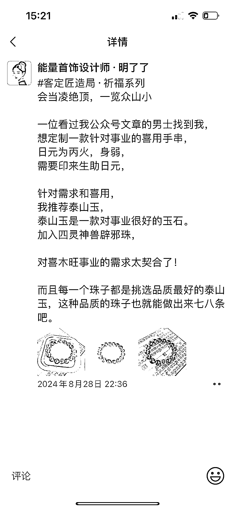

这条内容线是在持续加固你的专业形象。哪怕现在底子还不厚也没关系，找几个同行多看多学，仿写他们的表达发出去，一样能建立印象。

### 第二类：买家反馈

配图用客户收到的晒单或好评截图，文字讲对方佩戴后的感受。

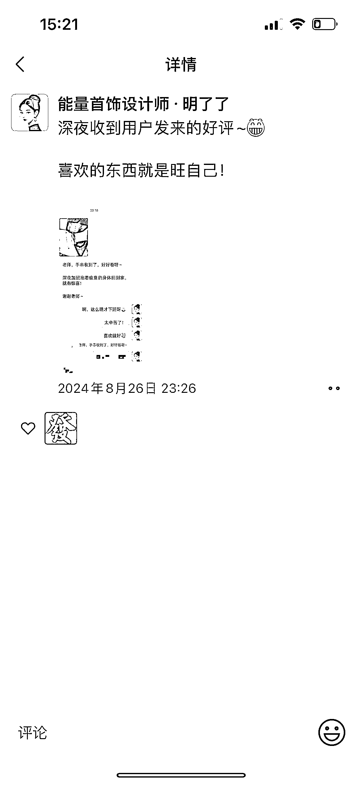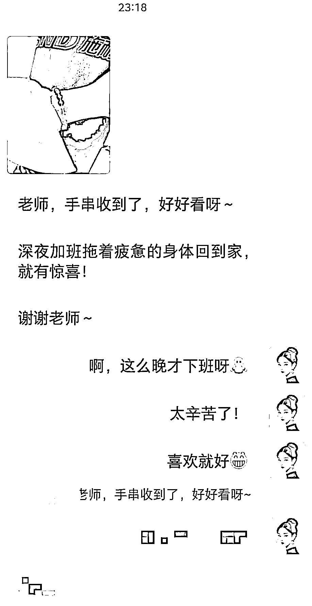

反馈内容不断去向市场证明你的手串真有实效。朋友圈里的每句话、每张图都应该是人设和专业的放大器，做到这一点就不会跑偏。

## 2. 下单之前需要用户提供什么信息

在正式收款时，必须标准化收集以下信息，这能让用户感受到你的专业度：

**【祈福手串】**

**需要你的：**

**性别：**

**出生年月日：阴历**

**出生时间：**

**出生城市：**

**祈福内容：**

**手围：**

**特殊需求：**

套用这个模板，用户会反复确认自己求的是什么，你在做设计和后续沟通时也能牢牢抓住他的需求主线。

## 3. 快递发出之后生意就结束了吗？并没有

手串寄出去了，交易看似完成的，但玄学服务才刚刚开始。

**第一步，主动回访对方佩戴的感觉，强化积极的体验反馈。**

**第二步，顺便再做一次自我介绍，让对方记住你，以后遇到其他命理层面的需求，第一时间会想到你。**

**第三步，明确给出售后承诺，有任何问题随时回来咨询。**

把最后的收尾体验做足，部分客户很可能就此成为你的终身客户、长期朋友。

---

先写到这里，下次有机会再慢慢延展。文章里如果哪里有没讲透的地方，评论区直接留言，我会一一回复。

* * *

评论区：

忧愁小松鼠：看完很有启发，如果是从零开始的纯新手，要到哪里找玄学相关的学习资料呢？

夜息：这个赛道个人小规模玩一玩，一个月赚万把块是有空间的。但如果碰到的都是只看寓意不懂门道的纯小白，入坑之后拼的就是价格，否则复购率上不去。水晶本身就是中低端彩宝，早就卷成红海了。玄学的盘子做大之后，最后还是会走到拼价格那一步。

匠叔：拼多多上淘一淘就有。

匠叔：一周多赚两千也挺好，多赚两百也香。

嘻嘻又嘻嘻了：我也一直在留意这个方向，会塔罗占卜，但就是缺货源。

匠叔：生财圈子里肯定有人有货源，发个帖子问问就好。

范 xiaoxia：想再深入了解一下这个赛道，怎么联系你？

匠叔：jjjiang826

* * *