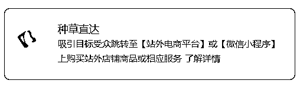
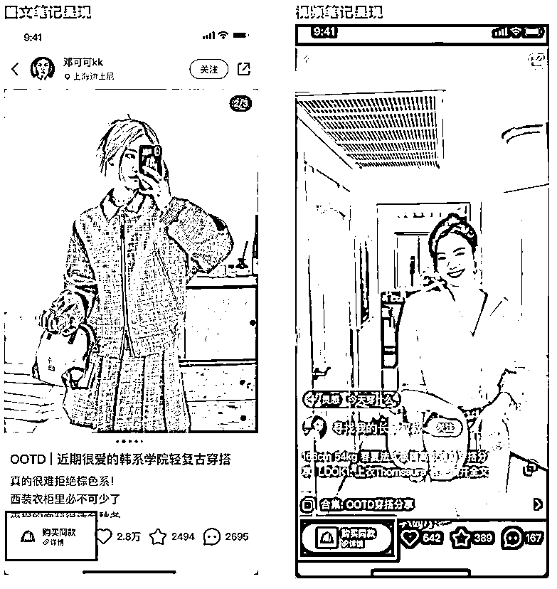
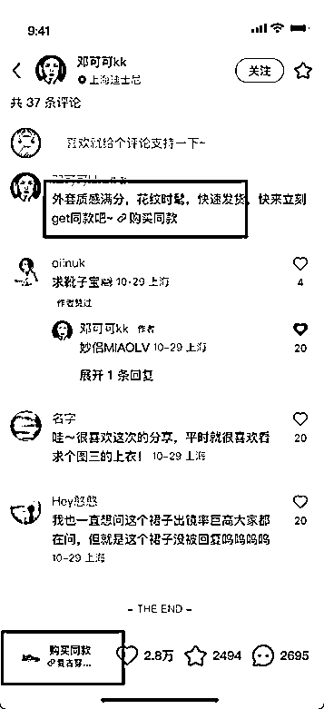
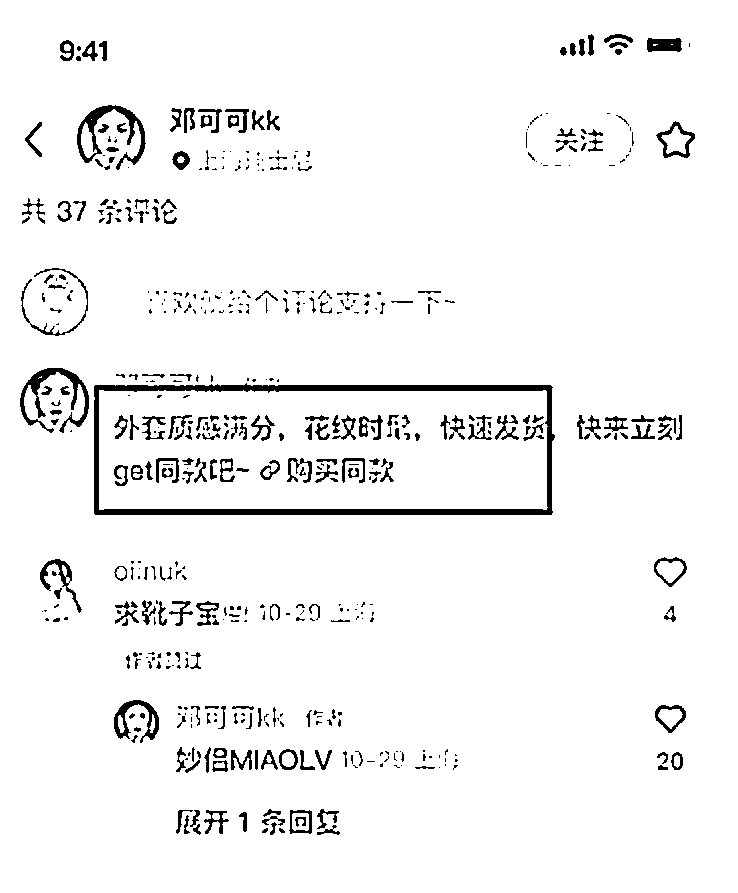
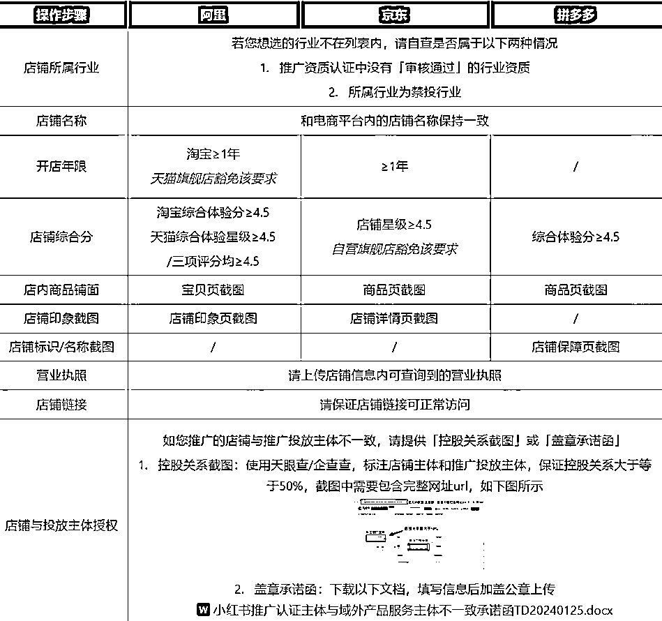
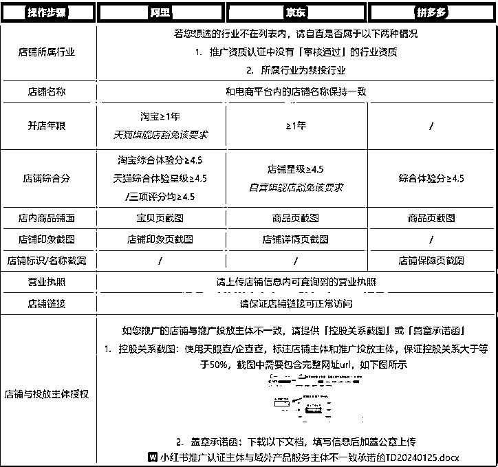
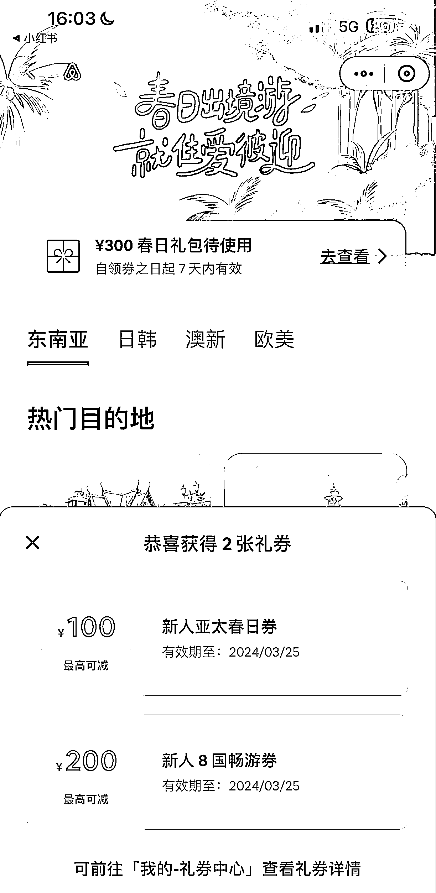
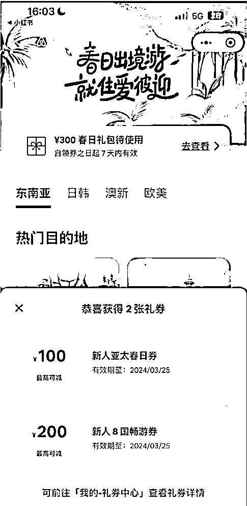

# 📕 cid：跨平台种草收割神器

📕CID：跨平台种草收割的新机会

抖音的打法是分阶段集中打硬仗，📕却走了一条全面开花的路线——种草社区、站内交易、直播带货、付费推广，每一条战线都在同时推进。在这种全维度布局中，一个容易被忽略的信号正在浮出水面：📕CID。

先给不太了解的朋友补个背景。CID英文全称是Click ID，翻译过来就是“点击数据”。当你在信息流平台投放跨平台引流广告时，最头疼的就是平台之间的数据回传。CID工具可以把点击、转化这些关键动作串起来，帮助你持续优化投放效果、提升ROI。所以行业里很多人干脆把跳转广告统称为“CID”。

跑CID跳转广告，吸引力集中在三个层面。

第一，跨平台的链路被彻底打通。从用户刷到内容，到最终完成购买，中间的所有行为都能串联起来，流失率大幅下降。过去传统的跨平台种草，从📕引流到淘宝，依赖的是用户主动去App里搜索，可很多人怕麻烦就不搜了，或者搜出来被别家店铺截了胡。CID的跨平台直跳直接把这段摩擦消掉了。

第二，品牌方在成交平台的沉淀资产能继续派上用场。举个例子，一个牌子在淘宝做了多年，粉丝、评价都很有基础。如果非让它另开一个📕店铺，那等于从零开始开辟战场，运营团队，尤其是内容能力不算强的团队，会非常吃力。而跑CID只需要在📕维护好官方账号、做好基本公关，展示品牌可信度即可，成交仍然交给更有积淀的淘宝店。团队运营压力小，广告投产比只要过得去，就能长期放量，实际成本并没有增加多少，无非是换个渠道买流量。

第三，种草效果终于有了度量衡。📕CID广告本质上属于搜索广告。商家在📕投放种草内容，官号直投、达人笔记、A种B收都行，内容触达用户后，曝光、点击、互动这些数据能看到，但转化一直是盲区。当用户被种草，去搜索框输入关键词，看到广告贴后点击组件跳转到成交平台，这一步就能靠CID精准统计，并以此评估本批种草的真实战绩。

一句话总结：CID广告做到数据可控，内容平台的便宜流量和成交平台的高转化，两边同时吃到。门槛当然比直接在📕开店要高一些，但是整体收益也更划算。

其实📕很早就试水过官方跳转工具，比如与淘宝合作的小红星，核心就是达人种草加跳转成交。只是小红星经历了几轮改版，门槛始终不低——商家找不到自助入口，投放首先要充5万块，对品牌也有要求。这些限制对成熟品牌不算什么，可真正急需跳转成交的，恰恰是白牌商家和打品团队，而平台的内容生态又恰恰靠广大的中小商家在撑。

转机出现在今年618前后，聚光后台上线了一条新的投放链路：“种草直达”。

具体展示形态如下：

评论区呈现方式是这样的：

用户点击胶囊按钮或评论区链接，就能直接跳到对应的电商平台，淘宝、京东、小程序都可以。说白了，种草直达就是📕版的CID跳转。过去需要5万充值加白名单才能享受的待遇，现在开个户就能上手。官方显然已经看明白了。

当然，门槛放宽并不代表零门槛。平台店铺有一些基础要求：

另外，跳转电商平台需要官方认可的技术服务商来配合。这一步稍显繁琐，不过在行内人眼里，渠道都已经铺好了。

除了电商平台，📕CID还能直接唤起🛰️小程序。

跳小程序不需要技术服务商介入，只要团队自己具备开发能力，配合聚光后台做数据回传即可。举个例子，如果你的业务本就在私域成交，把产品上架到小程序，再找服务商开通聚光账户，简单调整一下数据回传参数，马上就能实现无缝跳转的私域闭环。就算当时没成交，也可以利用小程序顺势引导用户添加上个人🛰️或企业🛰️，整个过程非常顺滑。没有小程序开发能力也没关系，找SaaS服务商套个壳，或者找懂技术的开发团队帮你搞定。

分享者团队前两年在抖音跑CID的客户相当多，主要集中在大健康品类，美妆护肤也不少。后来抖音流量涨得凶、竞争也卷，部分客户开始转战📕CID——毕竟门槛已经降下来了。

那么现阶段，📕CID更适合哪些品类和玩家？

1、单价高于200元、卖点足够清晰的商品；
2、类目略微擦边、可以利用平台规则差的商品；
3、在传统电商平台已经有一定积累的商家/品牌；
4、想把小程序作为私域电商承接工具的团队。

第二条尤其值得展开。所谓“平台规则差”，是指有些商品或内容因为资质、功效等原因在📕上架受限，但在拼多多等其他平台却可以正常售卖。比如某款带功效的保健品，📕不让上，拼多多随便上，这时就能用CID把用户引到拼多多成交。你在拼多多该交的费用照交，📕的广告推广费也照付，整个动作合法合规，完全不同于过去那种在评论区拉客、容易被封号的老路子。同时数据可追踪、可优化，跑量非常顺手。如果再配合达人种草、A种B收这些打法，还会产生意外的叠加效应。想象一幅画面：用户刷📕时看到某位博主推荐你家产品，记住笔记里悄悄埋下的搜索词，去搜索框一搜，正好看到你在投放的CID广告，点一下小胶囊直接落到淘宝店，又发现评价厚、价格好，下单也就顺其自然了。

第四条同样值得多聊两句。抖音、📕归根到底是内容平台、兴趣电商，短期内很难沉淀出复购型粉丝。流量成本逐年走高，想把毛利做上去，复购率必须提上来。可在信息流推荐主导的内容生态里，用户回头率天然偏低，忠诚度更是奢侈品。传统电商平台，特别是🛰️私域，恰好能够弥补这一环。用户通过CID跳转到小程序成交之后，再用企业🛰️把人接住，二次触达的成本几乎降到零。

这几年，围绕小程序做私域的团队肉眼可见地变多了：品牌侧有远方好物，工具侧有快团团。早些时候大家还没完全适应社交媒体，对微商也算客气，可后来朋友圈生态被各种广告和折叠内容搅得乌烟瘴气，正常内容的空间越来越小。到了2024年，还指望靠加好友、发朋友圈广告来促成交，成本已经高到离谱。所以很多反应快的团队开始改用小程序做承接和成交，一方面不打扰用户，还能留住人方便复购；另一方面也把收款问题一并解决，这里懂的都懂。

如果你正打算跑私域高客单产品，📕CID跳小程序的链路值得认真试一试。分享者最近也在物色合适的品类，手里有好产品的话，欢迎随时交流。

最后，祝各位老板，天天爆量。

以上。

评论区：
加麻: 感谢分享🙏🏻

