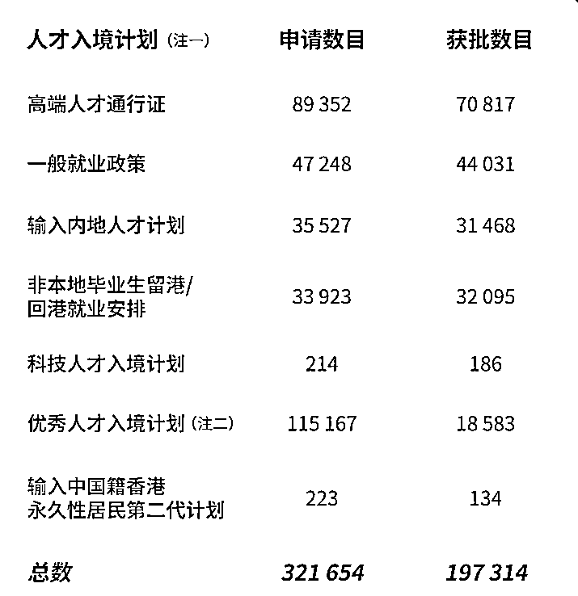
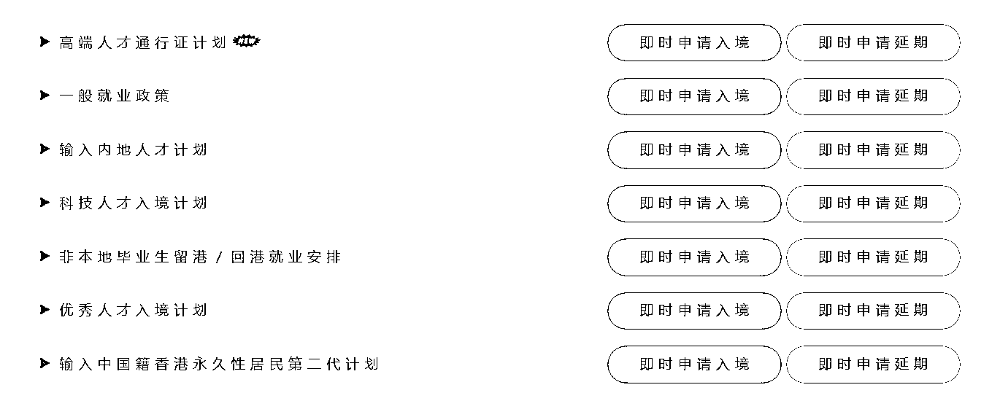
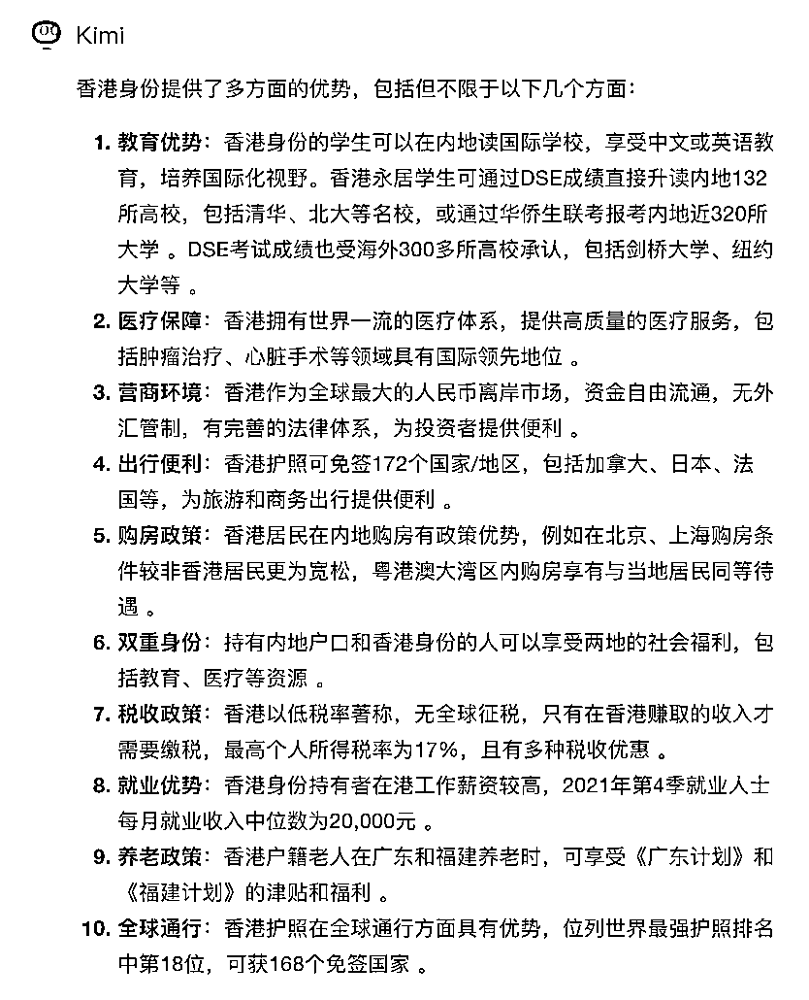
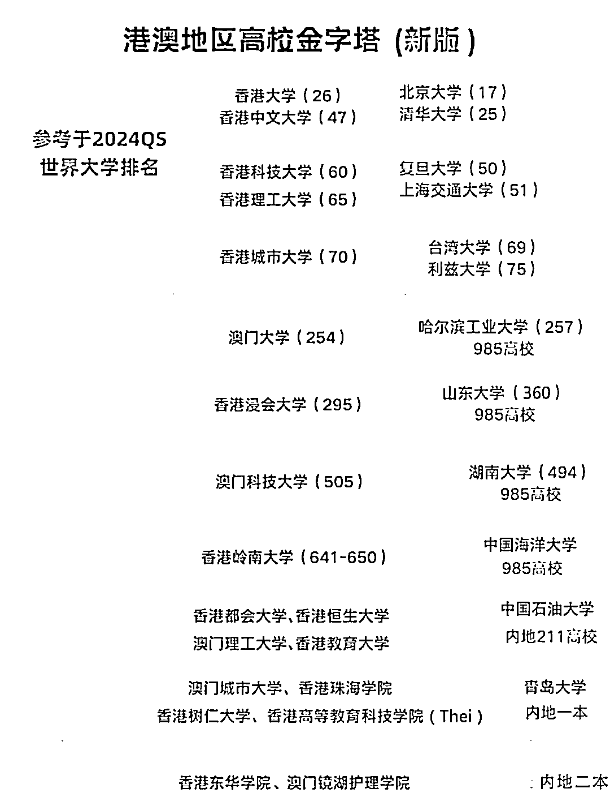
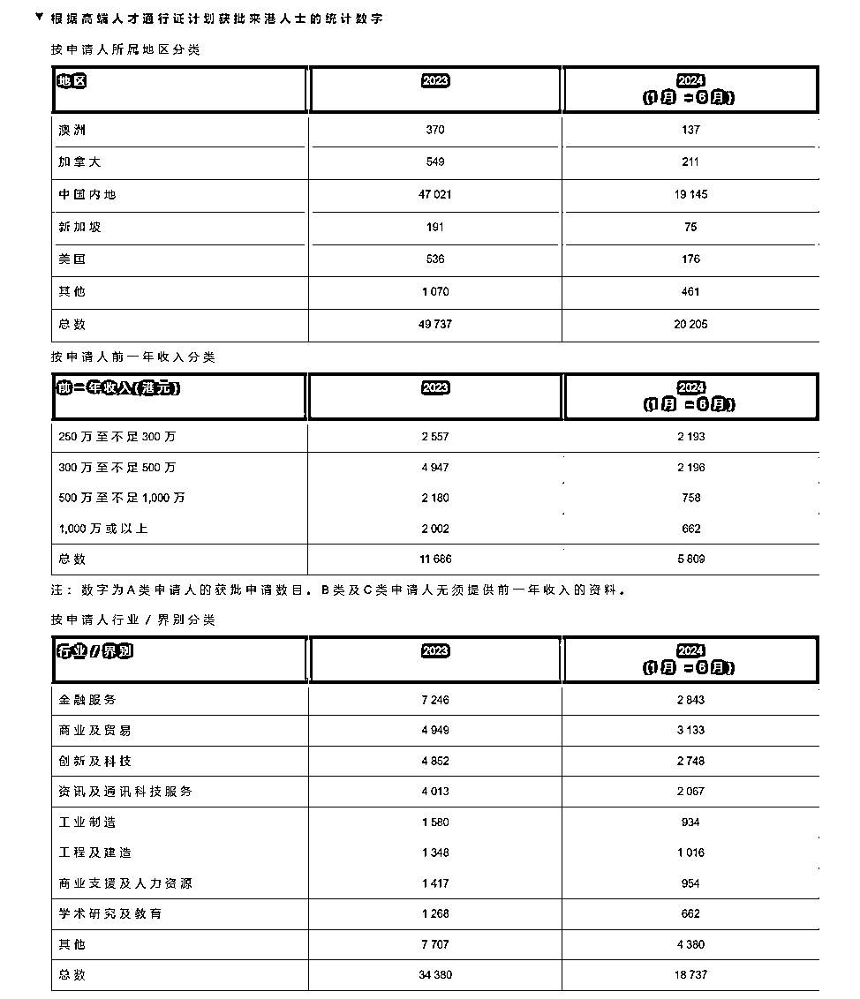
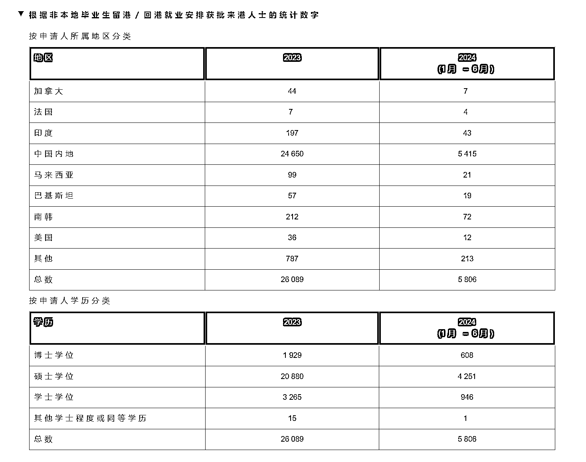
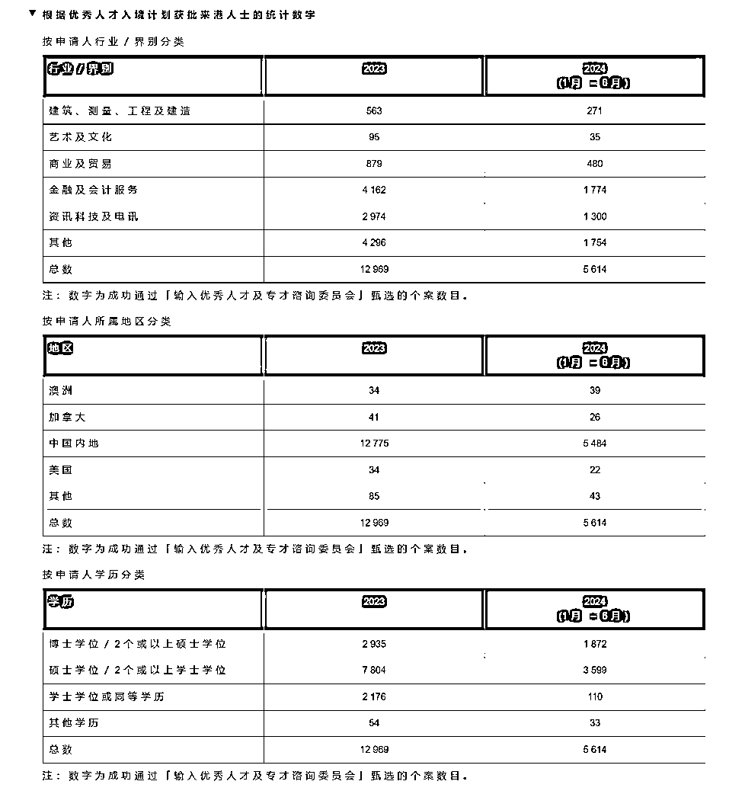

# 香港身份到底要熬多久才能拿下？为啥隔三差五就有人说“要关门”？

直接说重点：眼下咱们内地人想拿香港身份，最靠谱的路径就是“读研留港”和“高才通”；优才计划可以冲一把，但别当成保底。

先看一组时间线数据——从2023年初到2024年年中的获批情况，大致是这样的：

如果倒推时间：读研通道今年11月才开闸，所以10月就该把材料备齐、把面试练熟。官方政策已经明牌：高才和优才的“不限名额”红利今年底结束。这么一算，高才理论上是9月底截止，优才差不多是10月截止。

很多赚钱圈的朋友会问：办了到底有什么好处？值不值得？怎么拿？这事儿真得看个人情况。我手上有一手经验，已经帮52个家庭拿到了香港身份，至少能帮你避开一些坑。

有一句先撂这儿：如果你年收入不到50万，或者不能保证每年在香港累计住够一个月，真不建议硬挤。规则就摆在那儿，除非你有“钞能力”硬砸，不然性价比实在不高。

## 香港身份能带来什么？

说白了，就三块：教育、经商、医疗。

**教育**：想让孩子轻轻松松上名校，可以参考谷爱凌的路线——不走千军万马挤独木桥的老路，选一个赛道更窄、分母更小的方向，反而更容易出成绩。很多家长办身份，就是给孩子多开一条路。从幼儿园开始，公立学校就不用花学费，而且“租售同权”，压根不用买学区房。香港八大里五所都进QS前100，内地也就清北复交浙这5所。再看看深圳每年多少人拼高考，香港又有多少人考DSE？差距一眼就看明白了。

**经商**：香港现在冒出了不少跟深圳完全不一样的新机会。特首亲自给Web3.0站台，菲佣性价比极高，还有19万新港漂带来的全新需求。你看，袁记云吞、农耕记、杨国福麻辣烫、探鱼、呷哺呷哺、太二酸菜鱼、木屋烧烤，全都开过去了。去年蜜雪冰城香港首店开张，门口排队排到爆。5港币一个甜筒，9港币一杯柠檬水，16港币一杯珍珠奶茶，这价格直接给香港奶茶圈上了一课。

**医疗**：香港医院设备全球顶级，诊断更精准，治疗副作用更小。比如癌症早期筛查，能发现更小的癌细胞。医疗费用呢？大概只有美国的三分之一。乳腺癌五年生存率89.8%，全球第二；胃癌、肺癌治疗也都是世界级的。香港的医疗监管非常严，医生要过高标准培训和定期考核，而且信息都能在医管局官网查到，透明得让人放心。新药新技术引进快，患者能第一时间用上。看病收费差别也很大：普通门诊本地人$180，非本地人$1230；要是住院，本地人$100，非本地人$5100。街头还经常能看到行动不便的老人自己出门，无障碍设施和绿色通道都很完善。

## 内地家长最容易走的三条路

主要是“非本地毕业生留港”的读研通道、“高端人才通行证计划”的高才，以及“优秀人才入境计划”的优才。官方公布的数据显示：读研通过率95%，高才80%，优才只有16%。

当然，数据可能有审批滞后的因素，但从已获批的学历、行业和地区分布看，大家心里基本都有数。实际上读研是百分之百能拿到临时身份的；高才要看个人条件，还得准备完整材料；优才嘛，我就不多评价了。官网数据在这儿：https://www.immd.gov.hk/hks/facts/visa-control.html

## 写在最后

好福利背后总得有人买单。澳门每月养老金给3740块，但澳门身份的门槛高得离谱，维护成本也说不清楚（刚出政策）。香港身份要花七年时间和精力去磨，真不是每个家庭都扛得住，量力而行吧。

局里的人往往看不清，出了局才恍然大悟。这也是我一直没写文章的原因——不想太市侩。但凡认真研究过香港身份，或者刷过抖音📕，都能看出这篇的含金量。

关于香港身份有任何疑问，欢迎评论区留言，看到就会回复。（续签问题不解答，也不做续签落地方案。）

