# 做个人品牌、IP、私域，都不能学大冰

做个人品牌、IP、搞私域，千万别学大冰那套。

最近在社群里又刷到不少“大冰式”人设：一开口就是多重身份加持，这个主理人、那个合伙人，仿佛一个人能同时运营十个赛道。看到这些，我真的很想吐槽。

但光吐槽没意思，正好借着这个话题复盘一下：为什么这种玩法走不通？

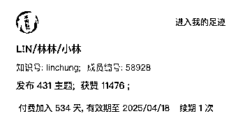

说起大冰，很多朋友都不陌生。早年出书时，他的自我介绍能列出一长串头衔：主持人、歌手、背包客、酒吧老板……跨度之大让网友直呼离谱。这种“全能人设”放在IP打造上，真的不是优势，而是硬伤。

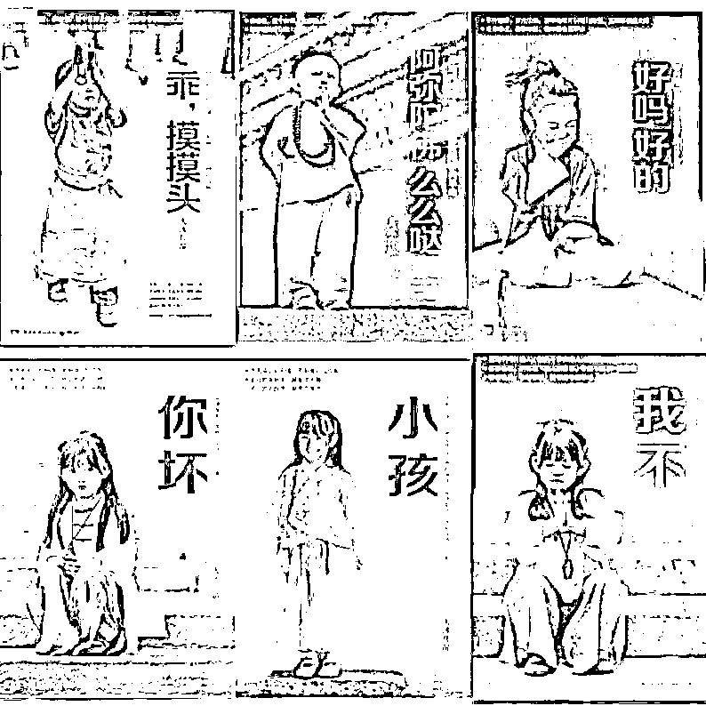

我进赚钱社群一年多，加过不少圈友微信。点开对方签名或朋友圈，经常看到类似画风：手握好几个社群、同时投资多个项目、横跨N个互不相关的领域。乍一看很努力，细一想却让人心里发毛。

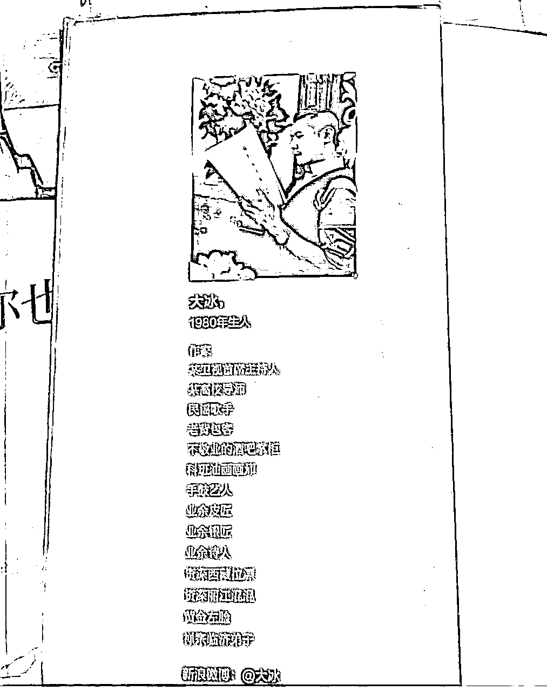

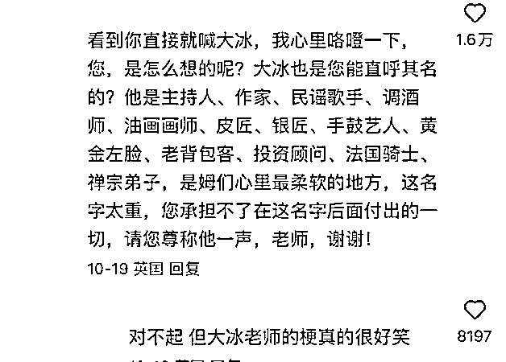

为什么不行？先说第一层：身份太多，反而无法为任何项目背书。你卖手机我也卖手机，但你比我钻研得更透、服务得更细，用户凭什么选我？业务铺得越广，看似显得越全能，实则越说明没有一样真正能打。

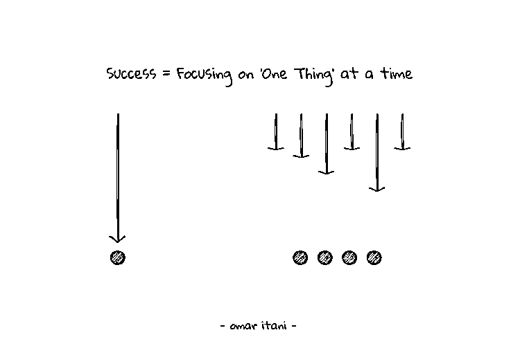

第二层，是给人的感官极差。一上来就发广告式问候、朋友圈刷屏，这种“爆粉式”操作和上门推销有什么区别？人家正专心工作，你突然敲门，只会招人反感。《县委大院》里的郑三，想跟新县长套近乎，都知道先寒暄、站在对方角度说话，隔着屏幕更该讲究分寸。

第三层，是增长逻辑走反了。共读《10x is easier than 2x》时有个关键点：与其到处找新机会做2倍增长，不如把已有优势打磨到10倍。可“大冰式”人设恰恰相反，看起来忙忙碌碌，实则一直在低效扩张，很难让人对他在任何一个领域的成绩产生信心。

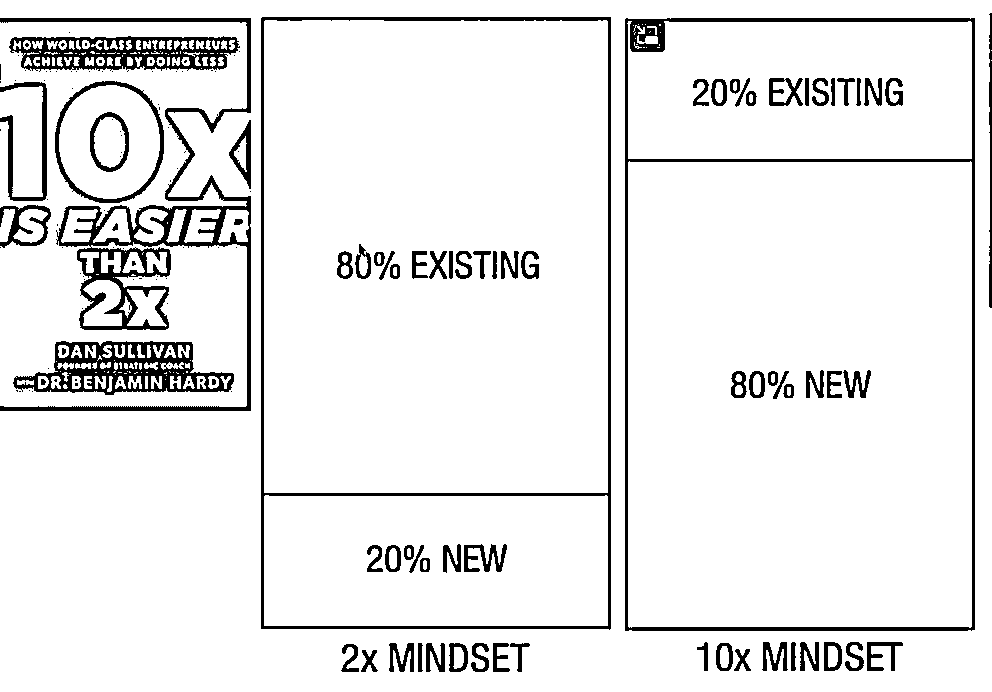

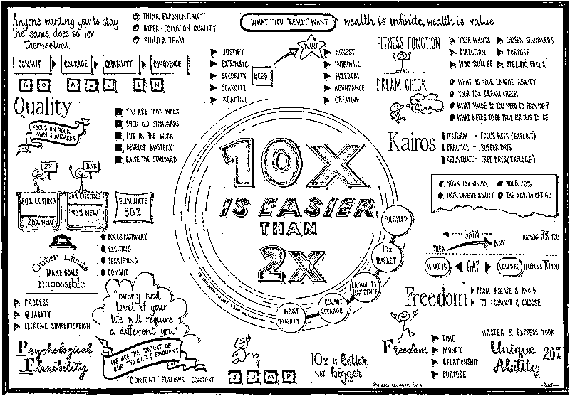

有人问：这跟赚钱有什么关系？社群的氛围是大家共同维护的，6万多会员里难免有“枯枝”。我不是想否定谁，但确实看到有人因为不愉快的事被劝退。劝退从来不是目的，而是提醒——想清楚自己为什么留在这里，如何正确使用资源。如果本来就不适合，到期不续、关掉手机去感受真实世界，也没什么不好。

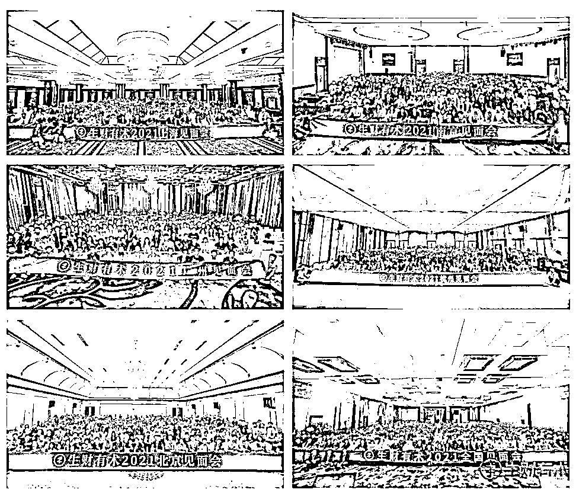

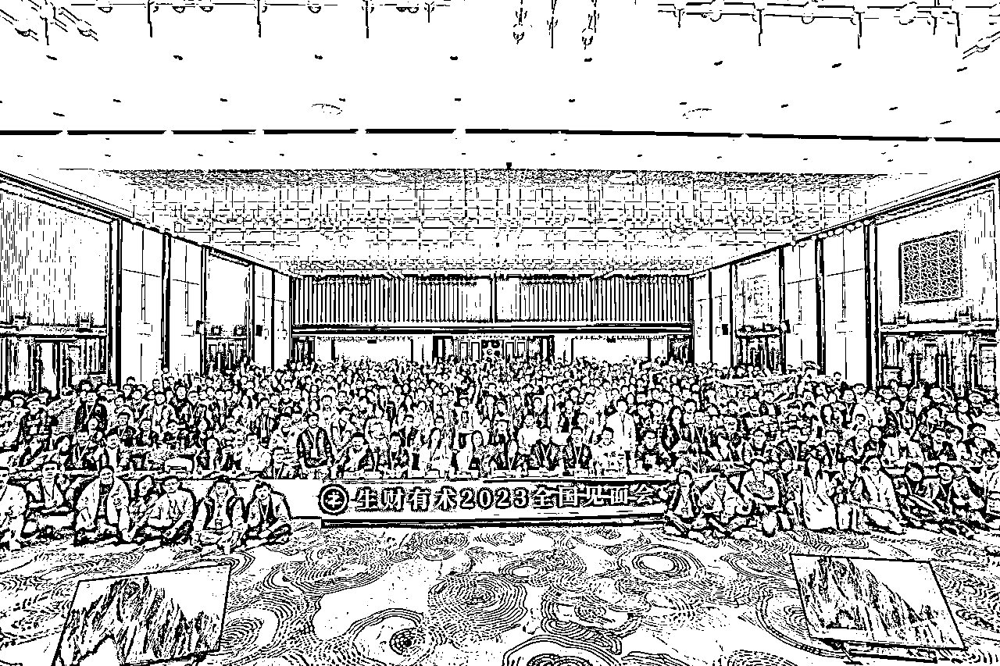

那到底该怎么办？我的办法未必最优，但值得一试：如果你有条件，可以开一个个人👸号，专门写一篇自己的故事，降低新朋友的了解成本；或者用飞书文档、个人网站做一份“个人说明书”，把自己的经历、特长、做成过的事坦诚列出来。

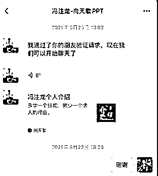

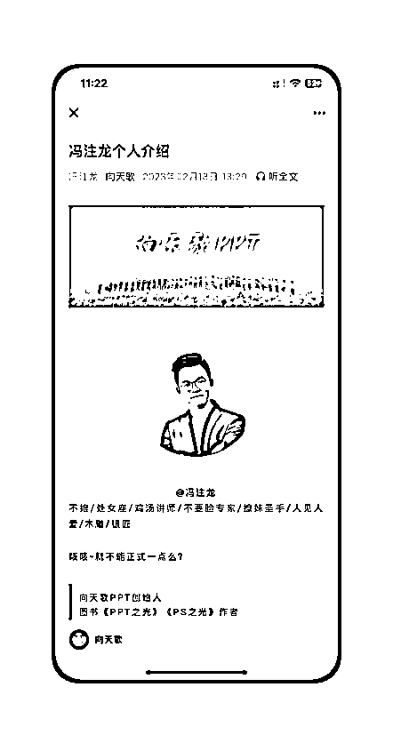

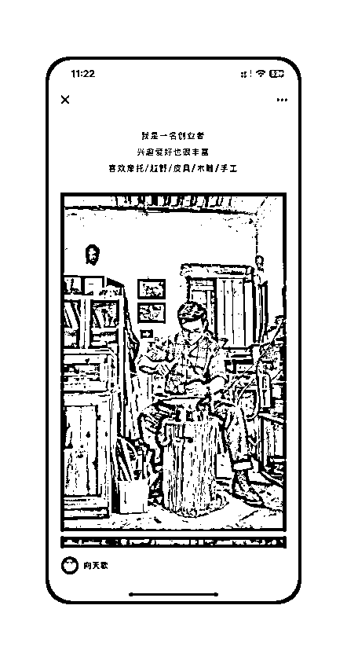

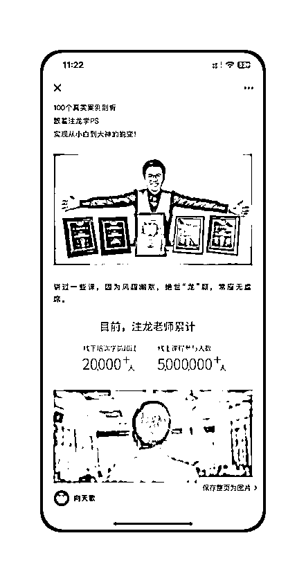

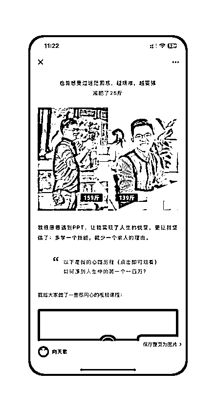

比起把十个头衔一股脑甩到对方脸上，这种“说明书”更有技术含量，也更容易赢得信任。方案可以慢慢迭代，但方向至少是对的。

以前这么包装自己的人还少，能图个新鲜。现在满大街都是“大冰”，只会让人审美疲劳甚至反感。如果你也意识到这一点，就会明白这篇帖子不是在针对谁。真想攻击谁，我直接甩截图发私信就行了。

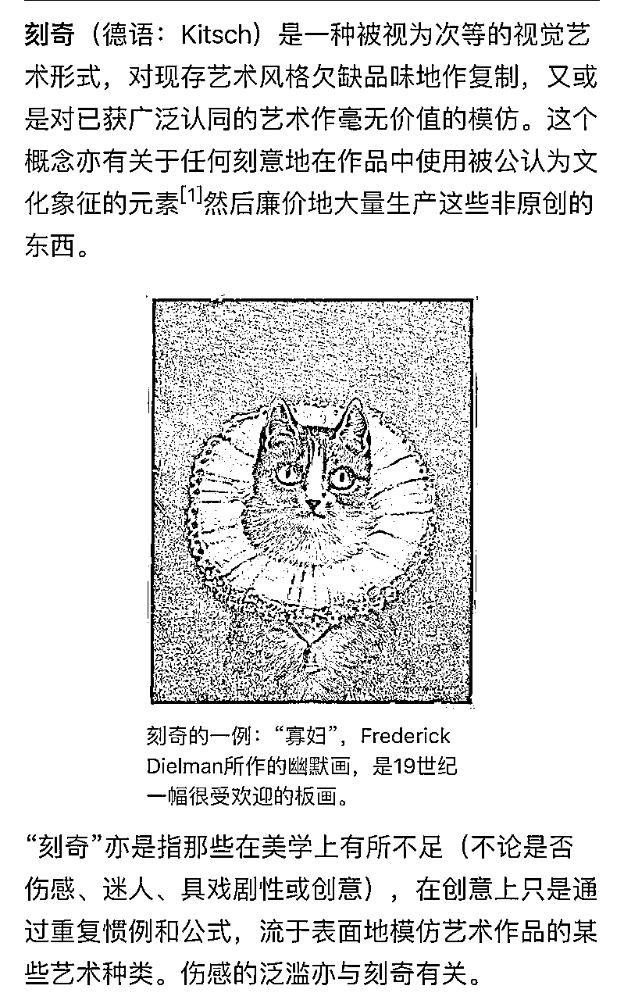

成年人的世界，不讲对错，讲利弊。与其纠结这么做好不好，不如认真想想：怎么做，利才能大于弊。