# 第一次当视频号带货长航海志愿者，我把自己坑惨了：47天翻车全复盘
作者：龙哥

大家好，我是龙哥，2024年6月视频号带货长航海47天志愿者。

9月航海马上要来了，我终于战胜拖延症，把这段翻车史写成复盘帖，希望大家别踩同样的坑。

## 翻车战果

一开始我抱着“边学边帮船友”的满腔热血冲在最前面。前几天小组竟然冲到了第一名，我甚至开始幻想自己也能像那些优秀志愿者一样写一篇经验帖。结果，现实狠狠打了我的脸。

1. 小组排名从里程数第一，一路跌到第五；
2. 47天满勤的免押金船友只有2个，28个免押金的人里只有11个成功上岸，一半都不到；
3. 唯一一个交了押金的船友，最终也没能上岸，999元直接打了水漂。我们小组上岸率是0%，没错，0%……

## 为什么会当志愿者？

很简单，我想把上一次思维导图志愿者柏芝传递给我的精神接过来。

是她，把我这个i人从“从不主动求助”变成“愿意主动分享”；是她，给我的每一条打卡日志点赞留言，让我觉得被看见；是她，带着队伍7天冲上榜一，我愿意跟着她一起拼；也是她，鼓励我分享，还送了我一本郭拽拽的《前途无量》。

所以我想把这份善意延续下去，去帮30个船友成功上岸。结果，一切兵荒马乱，全乱套了。

我认真读了赫连雨彤领队转发的志愿者手册，也参考了优秀志愿者的复盘，还把所有相关帖子翻了好几遍，发现内容大致分两派：一派说做好本分、别太卑微；一派讲服务技巧、提效方法。作为i人，我自然选了后者。

可后来，我变成了“卑微的小怨妇”，情绪从兴奋到惆怅，再到卑微、抱怨、抓狂，最后彻底摆烂。

下面说说我掉进去的六个坑。

## 第1个坑：跟踪船友进度，表格做得太复杂

为了做一个“相对完美”的志愿者，航海还没开始，我就在飞书建了一堆表格：

1. 志愿者每天待办事项
2. 船友打卡情况
3. 是否打卡统计

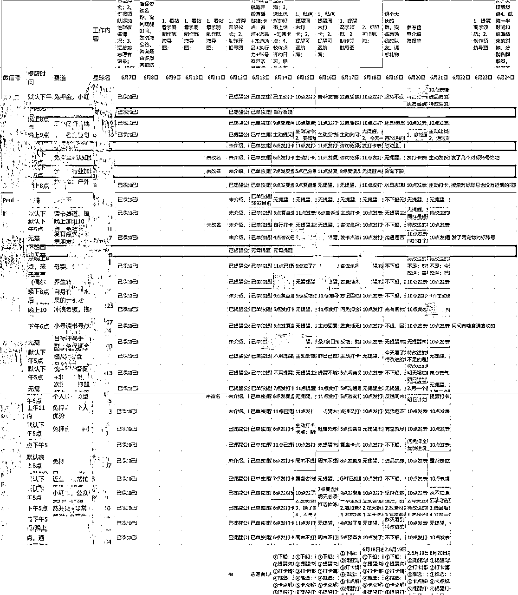

尤其是船友基本情况表，细致到令人发指。我记性不好，只能靠日常聊天、朋友圈、星球动态去捕捉信息。但大多数新人都是“干净”的朋友圈和星球，想“投其所好”真的很难。更别提很多人已读不回，我根本不知道他们喜欢什么。好不容易从蛛丝马迹里发现点东西，也不敢打扰，只能默默记下。

我记录的点包括：有没有自我介绍、有没有改航海昵称、参加了几次、需要几点提醒、打卡内容是什么、提醒后有什么反应、谁主动打卡、谁上了好事墙、谁想放弃、和我聊了什么、我给了什么建议、明天该怎么帮、要不要点赞评论……甚至还有夸夸文案分享。

结果，航海进行到三分之一时，我就停止更新了，表格全部作废。因为太想完美，每一步都压得自己喘不过气，后面彻底坚持不下去，催打卡也催不动了。

志愿者群里那些“搞笑催打卡表情包”“假装是故事实则是打卡链接”的招数，全都不管用了。我试过各种话术：

「你今天发了9条视频真棒！」
「今天直播~」
「好事上墙啦~」
「我来分享私藏干货啦~」
「看着你变现感觉我也变现了~」
「今天被教练点评啦~」
「咱组开始掉出第三名~」
「你感情好细腻哦~」
「你能坚持已经打败80%的圈友了！」
「又被你鼓励到了~」
「感谢你的能量回流~」

无论是夸夸、利他、被Cue、给压力，全都石沉大海。该主动打卡的还是主动打卡，我最后只能把心态放平。

**改进：**
- 表格越简单越好，不然没动力更新。
- 多整理一些除表情包之外的催打卡技巧。
- 如果你有更好的方法，欢迎评论区支招。

## 第2个坑：没认真对待船友复盘中的真实需求

47天很长，我想着中间做个复盘问卷，既能帮船友理清方向和进度，又能直接复制问卷内容当打卡，还能了解那些不爱说话的i人真实想法。简直一举多得，我还夸自己聪明。

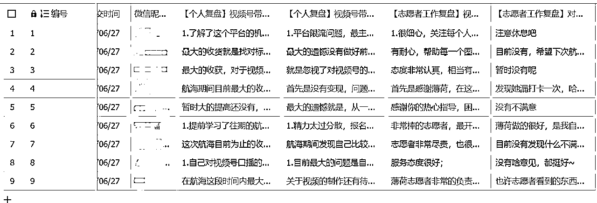

但问题来了——我并没有第一时间重视他们写的东西。

1. 看到没多少人填问卷，心情先低落了。
2. 看到填了的船友都在夸我细致耐心尽责，我就沾沾自喜。
3. 粗看复盘，感觉都是船友在自责，我也没当回事。
4. 人家已经自责了，我再戳痛点，岂不是“哪壶不开提哪壶”？

结果，他们真正提到的隐形问题，全被我忽略了。

**改进：**

**前期：迷茫**
船友说“时间紧迫”，但47天明明很长，其实是因为限流、违规、二次创作、对标等问题占用了大量时间，导致正反馈来得太慢。光有工具不够，还要会“为己所用”。但很多人只是知道有往期手册，根本不会主动打开学。

志愿者需要多做一些：
- 搜集精华帖、中标风向标、竖版思维导图、实操视频，帮船友快速进入状态。
- 拉群时问清楚：想做哪个赛道？有没有对标账号？粉丝多少？够不够开直播条件？
- 问风险预案：有没有备用账号、备用橱窗？别等限流了才干等解封。

这样能减少挫败感。A号不行就切B号，心态稳了，打卡也就跟上了。

**中期：精力不足、执行力差**
有人同时报了两个航海，新手要关注的东西太多——账号、选品、选材、实拍、口播、剪辑、直播……最后一样都没做好。还有人就是执行力差，静不下心梳理项目。

我一开始只觉得是时间问题或家庭原因，没有多想。其实这个问题是可以挽救的。

3月份我本人一口气报了7个航海，目标很简单：熟悉项目并上岸。我不鼓励大家都这样，但每个航海你要达到什么成果，得自己定目标。

所以，面对迷茫的新人，志愿者要帮他建立目标：
- 问“你打算什么时候学习？”陪他做时间规划，而不是被一句“我今天很忙”挡回去。
- 看看他另外那只船是什么，能不能帮忙，顺便减轻压力。虽然有点像干了对面志愿者的活，但真的很暖心。
- 自制成果认可海报。有志愿者靠这招冲到前二，我当时没在意。及时给船友做海报，他们会被看见、被认可，动力更足。给他们贴标签：“日更8篇—执行爆棚者”“解除限流—拆弹小能手”“混剪2条视频—混剪装甲师”，还有作业完成率100%、1个月涨粉200变现2000、连续好事上墙……哪怕是粗糙的自制海报，被惦记的感觉谁都爱。我因为时间原因放弃了，下次一定执行。
- 当然，也可以在前期劝退那些精力明显不够的船友。我劝过，但效果一般，谁有好招欢迎分享。

**后期：没有成绩、没有变现**
船友说没变现可能是视频量不够，其实不止。黄金3秒不到位、视频质量不够好、评论区没有引导……都是原因。有船友每天剪8~10条视频，坚持很久，如果始终看不到正反馈，特别容易放弃。我当时只关心他发了几条视频、打了卡，没有往变现方向去鼓励优化。

改进：
- 鼓励船友阶段性暴露问题或账号，主动找教练点评，而不是默默“假装努力”。
- 好事墙我基本没逛。看到别人变现我会焦虑，但后来明白，真正该看的是：他变现那天做了什么？修正了什么行为？输出了什么？而不是只看金额。而且应该从前期就开始分享好事，按赛道、经历、限流、剪辑等模块多维度整理，才更有针对性。
- 定制催卡表情包：爱猫的做猫咪包，爱绿植的做发财树，爱演唱会的发明星包。
- 有船友变现了，可以组织分享复盘，邀请有潜力的船友进群，让变现的人带动氛围，形成良性链接。

这三类问题是船友掉队的主因，也是志愿者普遍面临的挑战。

## 第3个坑：替船友冲锋陷阵，反而害了他们

很多船友是第一次参加，平时已读不回，难得开口，我就恨不得抓住机会猛聊，硬是把i人逼成e人。我打开话匣子的方式，是帮他们在群里或私聊问教练。

当然，一两次还好。但教练更希望船友自己表达问题、解决问题。后来我发现，有了志愿者在前面冲锋，船友会暂时觉得安全，可一旦志愿者没有继续主动带头，他们就更不愿意暴露问题了。问题越积越多，卡点越积越多，最后直接放弃。

而且，船友自己描述的会更清晰，得到教练回复会更有底气；志愿者转述则有时间差和理解误差。

**改进：**
- 整理群里类似问题的答疑，分享给船友。
- 学会鼓励船友主动暴露问题，这也是要练的。同时避免“为啥你帮他问不帮我问”的尴尬。

## 第4个坑：过度纠结“会不会打扰”，错失提醒时机

前期我按船友要求的时间提醒，有人要早晚两次，有人要晚上9~10点，有人要下午5~6点，还有人“无需提醒”。为了不打扰，我严格照做。

但我发现不对劲：晚上提醒太晚，打卡时间不够，干脆不打了。后来才知道，很多人是我提醒了才开始学，提醒太晚连实操都来不及，更等不到播放数据，于是放弃。

再后来我把时间提前到下午6、7点，但已经晚了。前期欠的打卡太多，船友们不愿半路捡起来。更气的是，那些标注“无需提醒”的船友，我真的就不提醒了，结果他们连续7天、半个月、一个月不打卡，彻底救不回来。

**改进：**
- 连续2天不打卡就预警，跟踪情况。
- 提前摸底：他是在围观、放弃、迷茫、还是没时间？心里有底，别任其恶化。
- 免押金可能也是无压力的原因之一，但有免押金船友照样满勤变现，关键是愿不愿意突破舒适区。
- 真诚永远是最好的招数。你真诚待人，就能看清对方是在消耗你、还是珍惜你。真心换真心，就好好珍惜；不值得的，也不必留恋。志愿者只能做到陪伴和引导，别像我一样卑微。

## 第5个坑：盯着里程数，忘了上岸率

航海第8天小组冲上第一，我就飘了。之后陆续跌到第二、第三、第四、第五，越跌越焦虑，越想赢回来。为了排名，我开始变形——只要有人打卡、有人上好事墙就行。

但志愿者该盯的是上岸率，不是里程数。我原本想让更多人拿到成绩，结果跑偏成“用大家的打卡换我的第一名”。于是有了前面那些花式催打卡的折腾。最后，只有7个人还在打卡，免押金的上岸了11个，唯一交押金的船友却没能拉回来。

**改进：**
- 优先盯押金船友，确保他们完成打卡。
- 航行中随时修正自己的动作，不忘初心。

## 第6个坑：高估自己帮助别人的能力

第一次当志愿者，我一心想拉人坚持航行，硬是把32个人留住了28个，但其中只有一半真正想航行。我还跟船友说“试试我志愿者的帮扶魅力”，现在想想真尬。

结果，大部分人在徘徊、忙自己项目、忙另一只船、纠结要不要做、处理家事、加班、做了实操却不打卡、卡在限流、卡在没变现……最后坚持打卡的只有个位数。

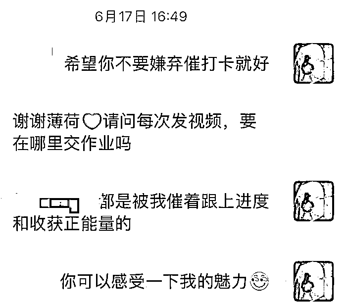

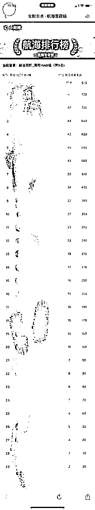

对这些情况我完全无力，不知道怎么帮，也没向外求助领队、教练或赚钱团队，只是每天机械地完成“催打卡”动作，安慰自己说“已经尽责了”。最后只能用“放下助人情节，尊重他人命运”来安慰自己，心灰意冷地服务少数坚持打卡的人。

**改进：**
- 早期识别船友状态和目标，对犹豫不坚决的船友直接劝退。
- 正视自己的能力，及时调整心态，主动寻求团队帮助。

## 附上高手领航的思维导图

来自李诚老师：

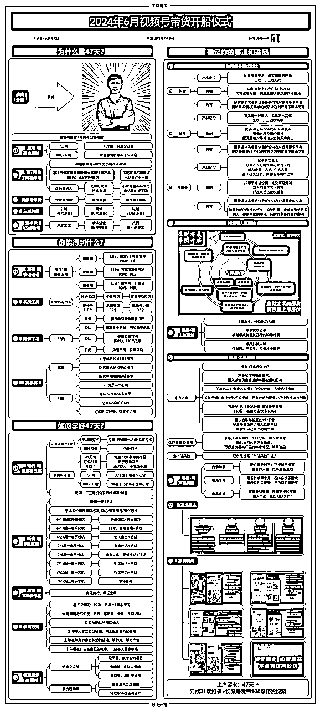

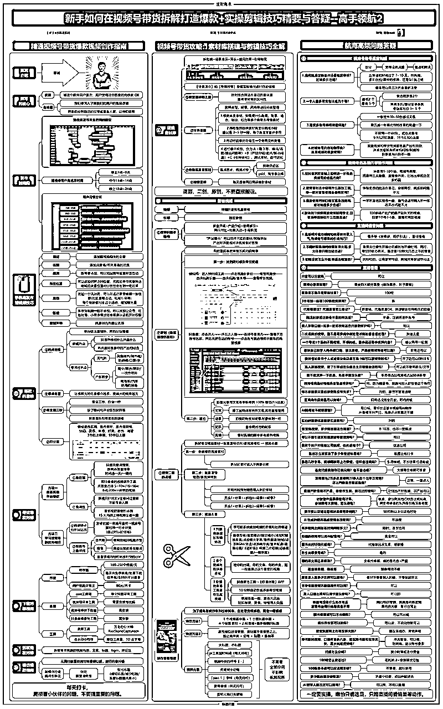

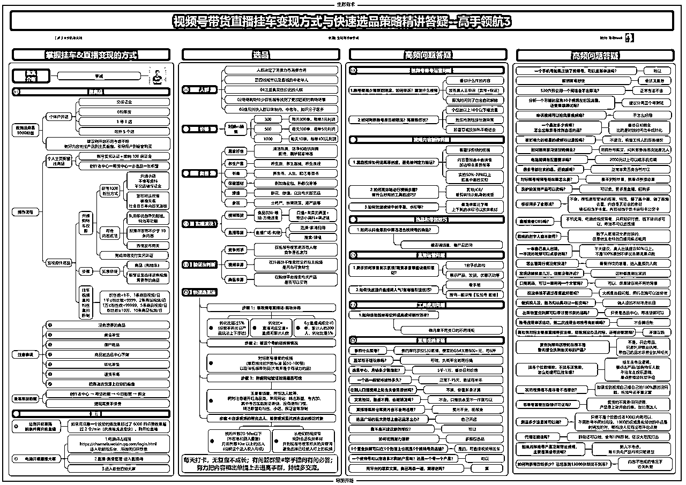

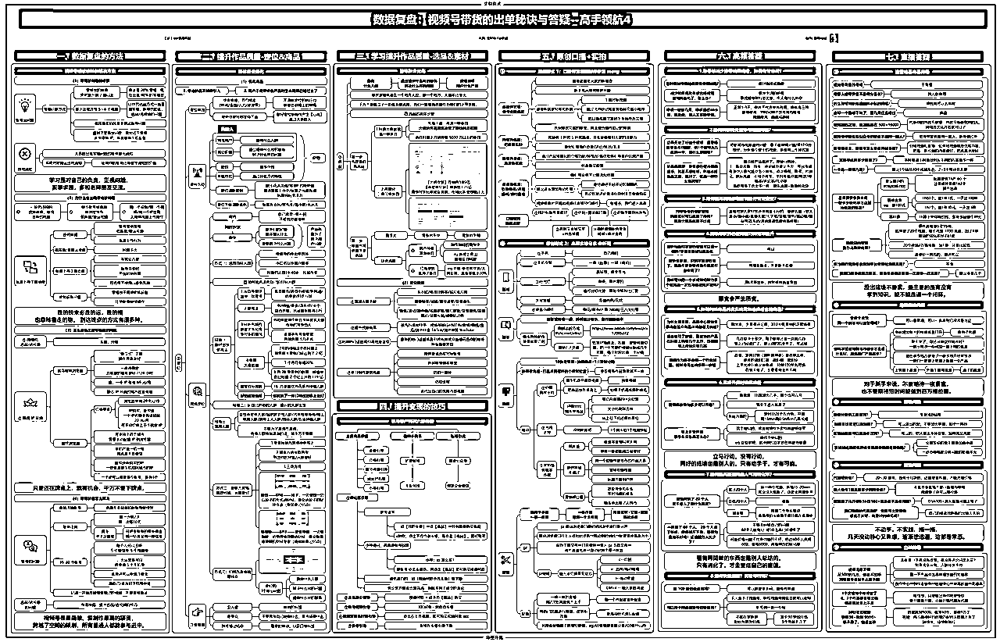

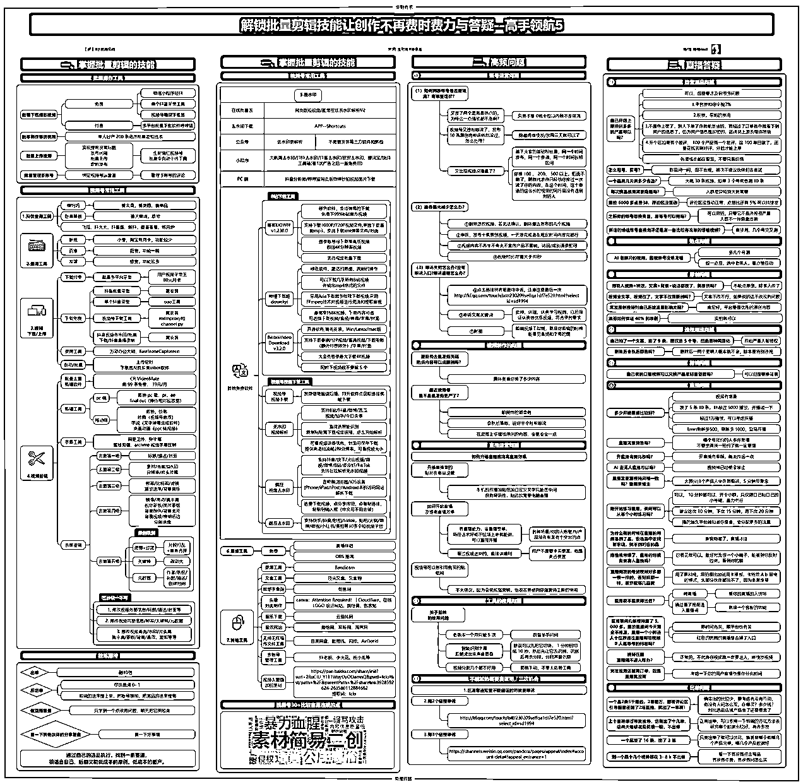

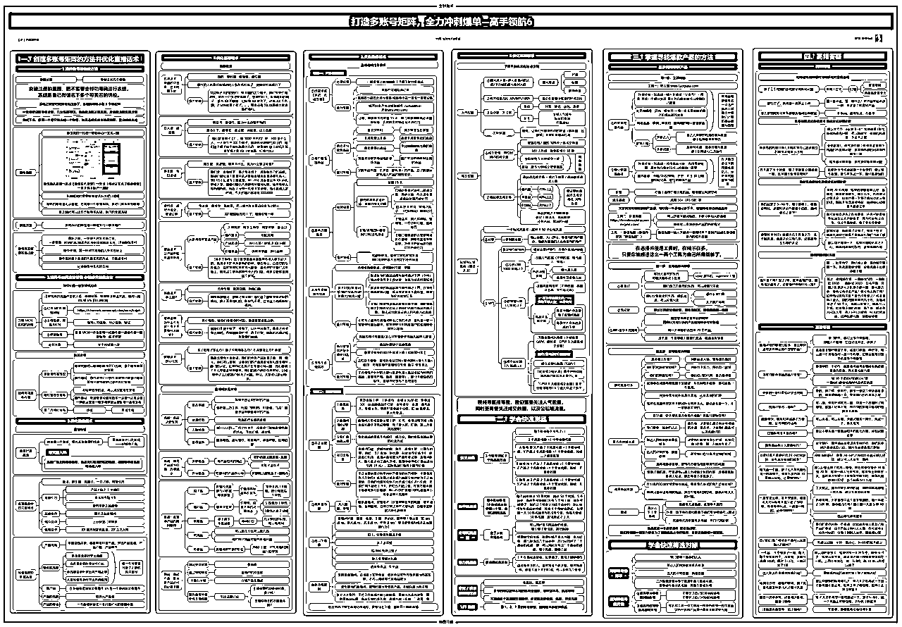

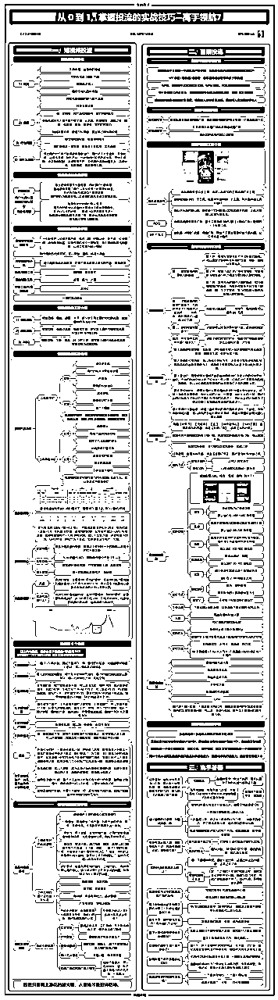

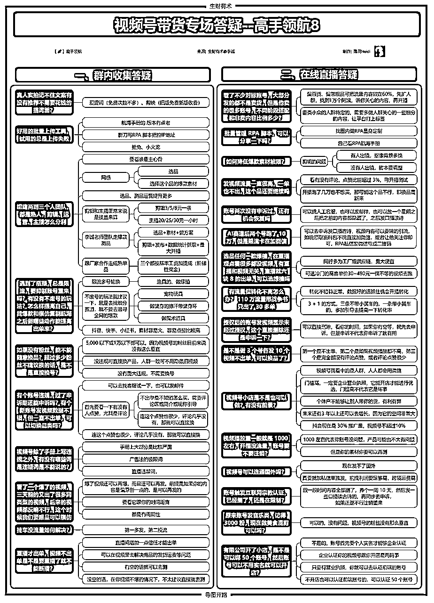

## 以后怎么当志愿者

1. 重新学习优秀志愿者精华帖，提炼前中后期细节，制定适合自己的SOP，不忘初心，服务利他。
2. 及时给自己充电，不把负能量带到监督过程里。
3. 发现船友闪光点，当面公开表扬，放大他们的名字，用平等的视角欣赏，给他们坚持的勇气。
4. 学优秀志愿者的真诚运营，获得信任，赋能船友。
5. 分阶段体现价值：破冰期知己知彼，启航期激发热情，困厄期请外援加热，后期一对一私教式分析修正。
6. 用文档记录船友全程成绩与感恩，毕业那天做成竖版导图呈现给他们，不是卑微讨好，而是让他们被看见。
7. 用好志愿者和领队的经验，背后有赚钱这么强的后援团，遇到问题，宁可问错，也不要沉默。

感谢赚钱，让我获得了这次志愿者的机会；也要谢谢一路陪伴的32位船友、领队、教练，以及所有参与视频号带货的志愿者伙伴。虽然这是一次并不成功的复盘，但对我来说，它是非常难得的经验，值得细细收藏。

如果真的要说有什么期待，我想说：希望你们都能达到合格志愿者的标准，身上带着“真诚、利他、主动、开放、空杯、日拱一卒”的样子。你们可以成为自己的榜样，也能成为船友心中的榜样，更能成为其他志愿者眼里的标杆。请继续精进，向高阶领队的方向迈进，最终剑指赚钱孵化器。

至于嘲笑或批评，大家尽管放马过来，我全盘接受。期待未来还有机会，让我做一名更优秀的志愿者，继续和你们一起成长。