# 分享一个巨大红利：付费流量，同城获客，三个月埋头苦干，从0-1，一个月过50万营收

大家好，我是丛政。在赚钱这个圈子里，我已经泡了整整四年。最早是靠地产自媒体起家，后来一头扎进跨境电商，说起来折腾了不少方向，但内核一直没换——我做的事全是围着流量打转。不管是写👸号还是做抖音，本质上都是给后端的业务输送弹药，只是后端项目一直在跟着风向换。

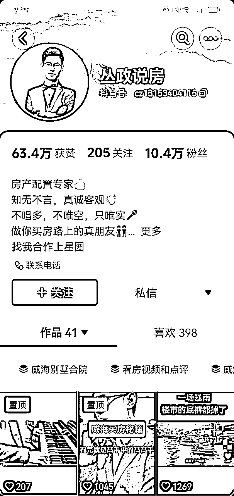

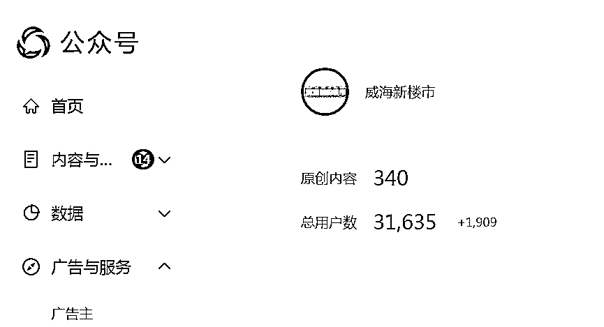

今天想认真跟大家分享一个我不仅看好、而且已经实实在在啃下肉来的机会。靠着它，我现在本地业务单月营收十万以上，全国业务做到四十万以上，而且下个月我有信心至少再翻一倍。

先简单交代一下来路。更早的帖子我在赚钱发过，有兴趣的朋友可以往前翻，这里只挑最近的经历说。

2021年，手上的韩国平台酷胖越来越卷，疫情一冲，公司亏了不少钱，只能把项目停掉。之后是一段漫长的空窗期，我一直在试新方向、做0到1的测试，但始终没打出像样的结果。一方面市场环境确实冷，另一方面我也得承认，那阵子更多是指挥团队干活，自己没真正下场。总爱在开会时说等项目成了请大家喝庆功酒，结果半年过去，连杯酒也没喝成。

后来身边一位老哥点我，说现在得多接触政商，资源都在政府手里。再一看，这几年能稳定赚钱的朋友，清一色是做供应链的。正好这时候有个机会砸过来：威海经区政府准备投15亿建一个国际生鲜产业基地，有位领导认可我的能力，让我当整体操盘手，线上线下的运营都归我统筹。

项目建设的周期拉得很长，我手头的自媒体和招商团队也没闲着。在孵化新项目的过程中，我撞上了两个特别扎眼的问题，相信很多做短视频的公司都有同感。

第一个问题，陪跑和代运营的生意特别难谈。说白了，我们不是大IP，头部的资源根本不会往我们这边靠。跟客户面对面聊单的时候，没有够分量的背书，高客单价根本收不上来，信任也建立不起来。更要命的是，靠自然流量让客户真正看到效果，越来越像玄学。这几乎是所有短视频运营团队的共同噩梦，前面闹得沸沸扬扬的参哥50万事件，就是一个再典型不过的样本。

第二个问题，是在两个合作分润的项目里发现的。我们帮威海一个女性私密项目做流量，矩阵和IP一起打。结果一个多月下来，矩阵号是起来了，播放量和粉丝数都极为亮眼，可客资数量却少得可怜。再看IP这边，三轮拍摄拍完，播放量硬是只有一千多。当时我真怀疑自己是不是不会做内容了。可后来我四处跑了一圈才搞明白，真相是平台的自然流量确实在萎缩。哪怕你内容做得天花乱坠，该不火还是不火。这样一来，问题就逼到眼前了：怎么才能让销售团队永远有稳定的进线和客资？怎么才能让一个新项目快速跑完0到1，得到验证？我当时心里很清楚，这两个问题不解决，后面的路根本走不宽。

带着这些问号，我频繁出差找解法，也顺带把整个市场重新审了一遍。

现在的市场是什么局面？不管你是卖矩阵系统、传统互联网广告、建站、小程序，还是做AI系统、数字人，又或者是代运营陪跑、电话外包、客服外包，所有业务几乎都卡在同一个死穴上——都是先让客户交钱，却不能保证客户拿到一个确定的效果，也没有像样的客户体验。商家们被割过太多次韭菜，心里早就怕了，他们最担心的就是钱花了、结果没了，所以你签单的压力自然越堆越高。再加上市面上的产品五花八门，很多根本拿不出真实有效的结果。可实体生意的环境又一天比一天难，所有人都在为获客发愁。这中间，恰恰藏着一个巨大的信息差：巨量AD的用户习惯已经悄悄变了。过去靠表单收线索，现在变成了私信动作，成本大幅下降，标签也足够成熟，用户精准得惊人。

我一开始也想不通，像山顶会的波波，凭什么能收到那么多学员？等我自己把这套打法完整走了一遍，才恍然大悟——原来很多人早就在用付费流量闷声发财了。大家现在刷抖音，应该都刷到过不少广告：全屋定制、兴趣培训、美业、餐饮招学员……很多项目都已经变成了“先体验后合作”。他们玩的就是这波机会。比如苏州的星哥，专攻全屋定制赛道，5个投手配上30多个销售，单月业绩能干到300万。他的路子就是做垂类，先让客户看到效果，客户拿到结果后再决定要不要让他代运营，或者跟着他学。这种打法的销转成功率不是一般高，因为客户是亲眼见到结果才掏的钱。

过去商家找达人、找代运营，说穿了是把做流量的本事交给外人。但现在靠本地推，流量这杆枪自己就能握住。

顺着这个思路，我还发现了一个市场机会，我朋友也正在吃这块。我菏泽的大哥，自己搞卤味招商加盟，单月光学员就能收200到300个。这还不算，他另外又起了一个盘，专门教餐饮老板怎么招学员——就是大家刷广告经常刷到的那些内容，这条线单月能做到50万。他的团队配置也不过3个投手、10来个销售，利润相当可观。我合肥那个朋友，则在做家居建材类目的教学和代运营。这个行业客单价高，老板们以前找代运营公司，大多没尝到什么甜头，那我们就先让客户体验，看到效果再付费。说白了，垂直类目用这套玩法，是真的香。

第二个机会在同城。同城这条路有两条岔口。

一条是盯头部。你去问问那些头部连锁企业，现在哪个不为流量发愁？我朋友在合肥碰到的案例就很典型：一家拥有1200家成人体验馆的连锁企业，加盟门店业绩上不来，流量也跟不上，老板急得要命。我朋友只花了100块投流，就打出了20个精准线索，顺利成交3单，客单价300，毛利70%。这是一个单店引流的投产比，各位可以拿计算器算算。现在他跟这家连锁谈的合作是59800，外加分阶段毛利分成，大概是30%、20%、10%。只要把这么一家头部拿下，整个团队的基本盘就稳了。所以去切这种头部，确实又稳又香。

另一条，是切进好项目里。就像我刚才说的餐饮招商加盟、招学员这类，或者别的好项目。以前你测一个项目从0到1，可能得熬很长时间。现在呢？花个一千两千块，就能快速打出100个客资来测销转率，一个项目能不能形成闭环，几天就暴露无遗。我们大多数人并不是大IP，好项目的信息不会主动聚集到我们身边。但用这种方式，你在同城就能筛出优质项目：只要利润够厚、客单价够高，符合好项目的那几条判断标准，你就直接去跟他谈分润。你负责流量，他负责成交，赚到钱一起分。这笔钱赚的是项目的钱，比赚服务费要轻松、持久得多，利润空间也更大。当然这里头玩法很多，有的甚至在打灰黑，但我真心劝大家，顺着平台的政策去干。

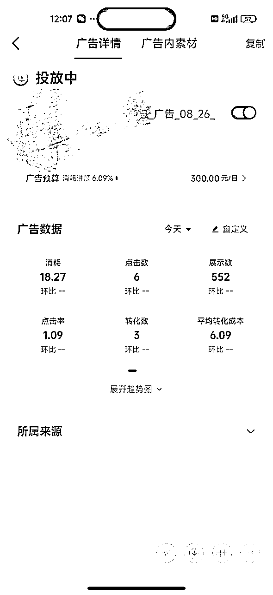
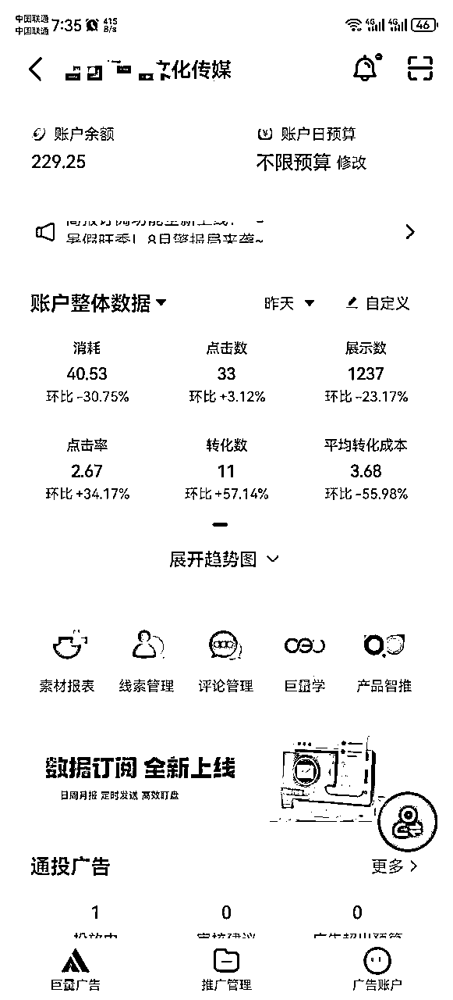
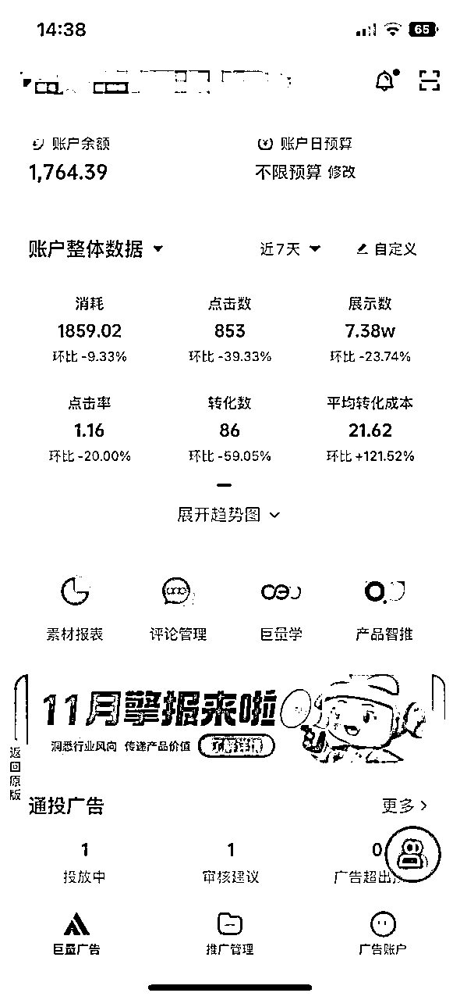

这个红利期能有多少？我跟身边做大健康、美业、国学的朋友都聊过，大家共同的遭遇就是被平台严厉打击，封号封得厉害。那些本质上是对着平台干的玩法，往往都活不长久，无人直播也一样，周期短，做不到持续的稳定。所以我现在对创业的理解变了：不是你有多了不起，而是当平台在某条业务线上发力的时候，你跟上去了，红利就是你的。眼下抖音官方正大力推本地推，本地生活就是抖音的一个重要方向。巨量AD加上本地推，基本覆盖了抖音体系里绝大多数行业。AD适合打线索，本地推适合打同城。当然里面还有一些更细的划分，大家有兴趣的话，回头我把资料整理出来发给你们。

这是官方行业统计。目前像全屋定制这类低成本行业，每条线索的价格大概在二三十块。但半年之后，这个成本可能飙升到五六十。现在两百块能帮客户打出10组咨询，半年后可能只有5组，而两年之后呢，两百块可能只出1组客户。这就像当年的千川一样，是必然会经历的过程，最后拼的就只剩下真正有实力、有品牌的头部玩家。无论是对本地商家，还是对我们来说，只要抓住这一波机会，还是能大有作为。至于赚多赚少，全看各自对方向的判断、能力，还有投入力度的把握。

走完这一圈，我发现要解决之前的那些问题，唯一的路就是付费流量。

那为什么我到这个阶段才来碰付费流量呢？因为在2019到2020年，地产下行的时候，为了找流量和客源，我去过海南的美房网，也去过北京的安居乐业网，他们全是做付费流量团队的，我跟他们合作过，也花了大几万请他们打客资。结果线索又粗又糙，根本不精准。我自己也投过朋友圈广告、头条系广告，还是找代理投的，效果差到让我觉得钱就是打了水漂。从那时候起，我脑子里就长死了一个念头：付费流量全是骗人的，根本拿不到结果。也就因为这个固执的偏见，我后来那么多年都没再碰过付费流量。

聊到圈子，20年我在合肥做TikTok时，交了个朋友叫老谢。后来在一个群里又碰上了，他跟我说，他发现了一个很好的机会。他有个朋友，名字四个字，业内无人不知，在江苏那边。表面上公司是做直播带货体系，可人家单独开了一条项目线：带一个助理，每天投600块左右，就能加100多个百业客户。到了晚上开一场直播，讲讲后台怎么搭建、投放计划怎么设置，收几个陪跑或者线下学习的学员，一天一万轻轻松松到手，然后就去喝酒了。老谢正打算去跟人家学。

我一听到这个事，就觉得挺靠谱，当即飞合肥跟他见面。当我亲眼看到他们后台的数据，又看了抖音进线和🛰️进线的情况，我心里立刻有了底：这就是我要找的东西。我当时直接跟老谢谈合作，因为他也是花钱学来的嘛，我就跟他说，我给你1万块，后面项目要是能赚钱，我再给你分润。那时候老谢其实还没正式跑通，但我已经提前锁定了这个机会。因为我清楚，等老谢真正做出成绩、打出名声，那就是不是三五万能学到的了，甚至可能给再多钱人家都不带教的，这太人之常情了。

回到威海后，我开始死磕付费投流。中间踩了无数的坑，每天盯计划盯到凌晨两点，早上七点一睁眼就要看账户有没有跑飞、烧钱。我首先拿几个行业做测试。

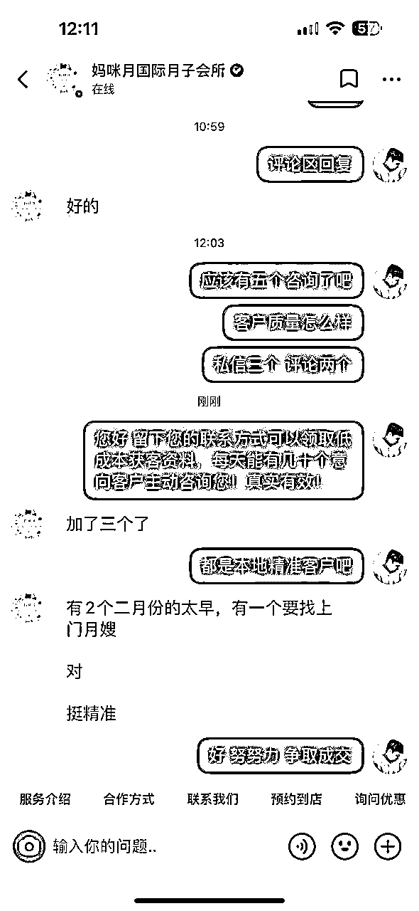

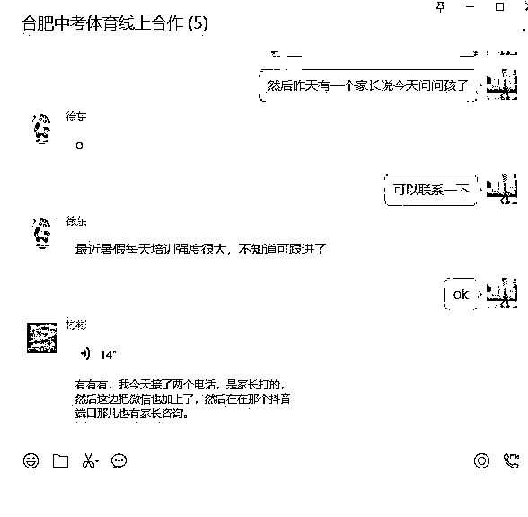

月子中心用100块打出了15组有效咨询，全屋定制也很快打出了5组。当这些案例一个个往外冒的时候，我心里就有底气了。因为这些客户是花一两百块就看到效果的，后面他们会主动来问你：这个怎么学？怎么合作？到这个时候，你可以挣教学的钱，也可以挣带人的钱。

但是，如果只盯着威海这一个市场，哪怕我天天签单，一个月撑死也就十几万二十几万。于是我开始研究全国模型。投流特别烧钱，前后搭进去近20万，把各个行业、各个城市都测了个遍。最终，这个全国模型被我硬生生跑通了。现在我能做到任何一个城市，每天都能加二三十组企业客户，什么行业都有，可能是个体实体店，也可能是大型工厂。

我当时的第一个念头，是做自营体系。于是把销售组拉起来，我打线索，他们打电话谈单。结果落地测试了才3天，就发现个大问题。当时烟台一个客户眼看就要签了，合同发过去，人家说：你们销售能不能来一趟？我说大家都在总部办公，没法外出。对方直接回了一句：连面都不见，来都不愿意来一趟，那算了，别谈了。再一个，我原本想得挺美，一个人负责一个城市，主管负责一个省。可现在回头想想，这体系得有多重？而项目变化那么快，我为什么不能把团队做轻、做小，做成一个人效极高的团队？要是我当时真那么干了，哪怕最后能跑出来，大概率也会死得很惨，管理太重、人工成本太高，随便一点变化都能把我压垮。幸好我及时踩了刹车，放弃自营，转而把这个模型往各个城市复制。我给这套复制体系起了个名字，叫“城市合伙人”。他们到威海来，把这套0到1的整套技术方法学走，然后回各自的城市开展业务。我提供的，是从获客端到交付产品的完整闭环，而不是简简单单一个技能培训或者知识培训。

合作形式呢，我选择把门槛压到最低。因为这不是一个系统或工具，我没法完全掌控。我也不能一分钱不收地掏心掏肺教给大家，毕竟我打这个项目也有成本，团队体系也在烧钱。所以最终，前置费用我定在了1万块，后端则是纯利润的10%分润。关于这个设计，我说说我的思考。

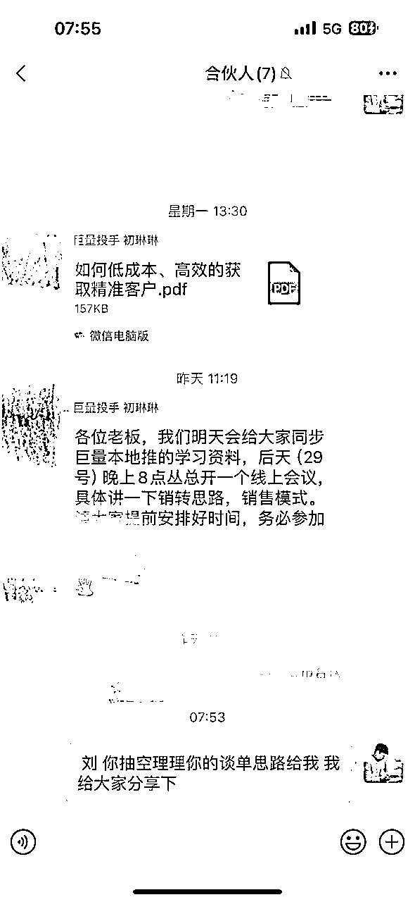
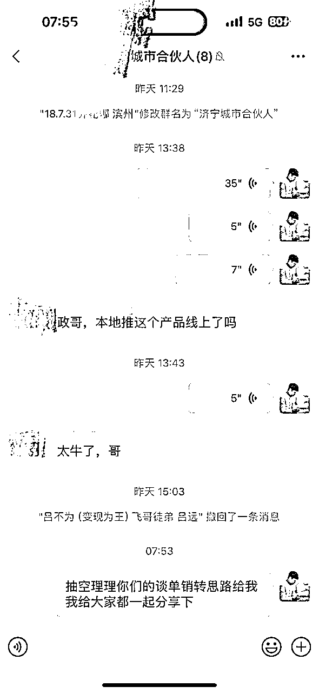
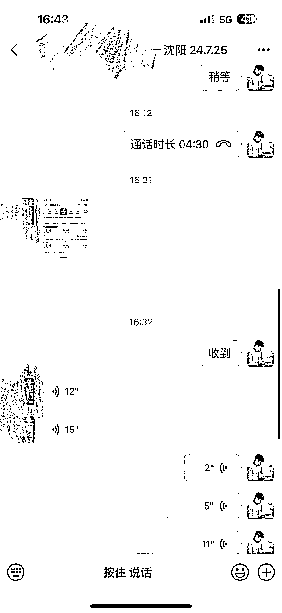

第一，合作做项目，指望人性根本不成立。大家素不相识，你哪怕是合资成立公司、派个财务过去，对方如果铁了心不想分这个钱，照样不会分给你。

第二，我是踏踏实实泡在这个项目里两个多月，玩命干出来的。他不可能在极短时间里复制我所有的能力，包括我打出来的那些行业案例，这些都是我们真金白银攒下来的资产。所以他需要一个比较长的学习周期，也需要我们持续跟进的陪伴式服务，短期内他是脱离不了我们的。这可以算是我们的一个控点。当然，如果他本身没有分润意识、没有分钱意识，那我们就不会有长期赋能的动作了。

第三，正像我前面说的，我经历过项目断档，所以我很想搭出一个体系，让大家都抓住这波红利，一起赚钱。但项目是有周期的，每个人却都有发掘项目的能力。未来只要有新项目出来，我搭建的这套体系和渠道，就可能成为大家的渠道网络。比如你今天跑通了一个项目，以前你得从0到1做动作，现在不一样，一套能覆盖全国的渠道就在你面前，只要你的项目能落地、工具能被市场认可，大家就能立刻把它推向全国各地。这就是我想搭这个平台的原因。而我做的，是持续给大家赋能巨量AD、本地推、📕聚光这一系列打法。

其实，这件事我原本没打算发在赚钱里，这种机会自己悄悄握在手里不是更好？但做了一段时间以后，我真的觉得这个市场太大了，里面有机会从纵深不断往下挖。光靠我个人和团队，短期内根本做不到多深的程度。比如说我们的合作伙伴湛江老吴，他手里有个矩阵产品。我当时尝试帮赚钱的圈友投流，自己掏腰包买流量帮大家去销，但这个产品线做不到像我们这边的产品那样“先体验后付费”，那种炸弹一样的威力，所以圈友落地的时候阻力很大。虽然这个项目还在做，但照我估计，最终效果未必会好。

所以，对赚钱的圈友，我的态度是这样的：第一，大家如果在投放上有什么问题，随时可以来找我交流。第二，如果愿意来威海跟着我们一起做，我的承诺是现场保证拿到结果，拿不到结果，直接退款。第三，圈友可以先体验后合作，无论你是做垂直行业，还是短视频自媒体团队，都可以先让你体验，证明我说的这些都是真的。我们能做到用投流的方式，让精准的意向客户主动找你，而且投流成本非常低，你不需要拍视频做直播，也不需要费心做内容。

最后，简单讲几点心窝里的话。第一，这个项目是我自己从0到1完完整整跑通的。我亲手做了前端投放获客、销售、交付整个闭环，才敢把它放大。我希望大家不管你是小白还是很强的牛人，做任何项目都要有这种0到1的底气。这样的话，无论什么情况发生，你都能扛住，你对团队的每一步进展也了然于胸。第二，我想把平台搭出来，持续给大家赋能投放知识，不只是巨量产品、📕聚光，

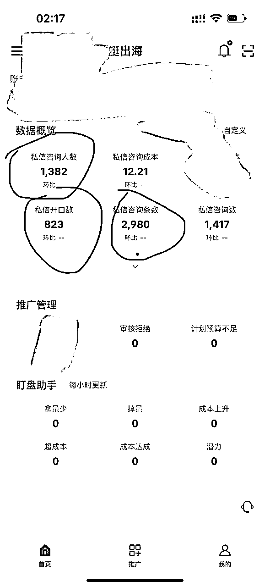
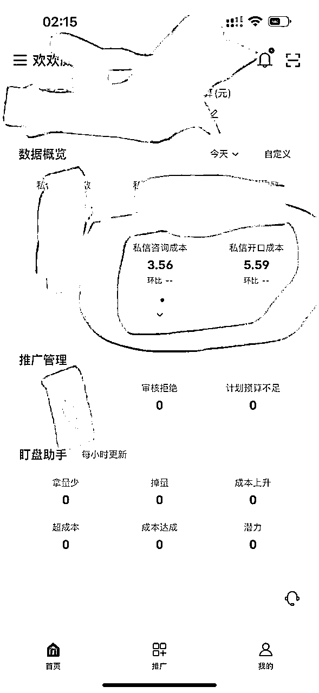
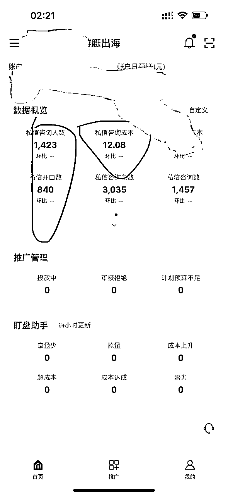

包括未来的视频号和TikTok，我们都会陆续为合作伙伴去分享。而且这都是我们自己实战实操出来的。换句话说，我的计划怎么搭，你就怎么搭，你搭出来的计划跟我一模一样，而我这边已经有结果了。第三，如果大家手里有优质的、已经跑通0到1的项目，可以来跟我对接。我会带着我的整个平台体系，一起帮你推向全国。我手下的这些人，都是经过验证、有分润意识的。只要你的项目能落地、能赚钱、够靠谱，大家就会在全国各地一起使劲，你根本不用苦哈哈地自己去做招商。第四，如果你有自营项目，需要流量、需要放大，也欢迎来跟我讨论。就像前面说的，不管是付费流量还是自然流，我们团队都擅长。做流量的几个板块，自然流、节流、工具、投放，内容端和付费端，我们都能给你做增量。大家觉得有合作机会，就可以一起来聊。第五，目前我们这个项目的0到1闭环模型已经完全打通。如果你有流量方面的能力，还在找好的项目机会，欢迎你来山东威海，咱们一起把事干起来。