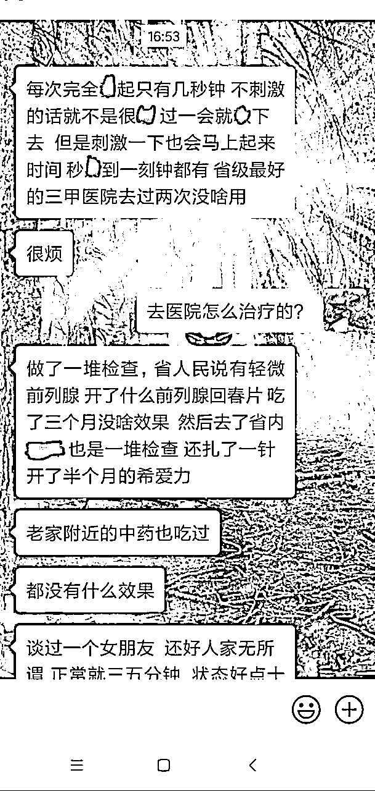
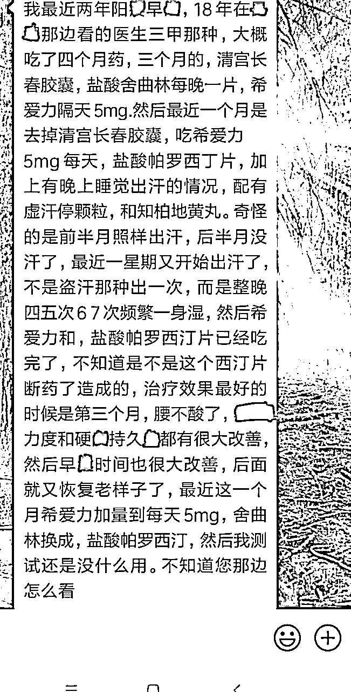
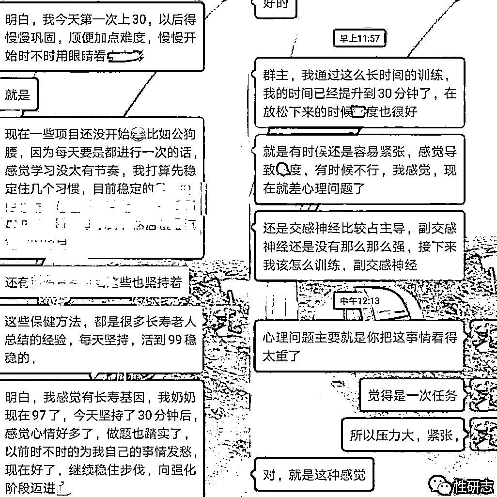

# 从“翻车”到日入六千：一个两性咨询项目背后的真实生意经

赚钱圈的朋友们，大家好。

我是今年年初加入圈子的，潜水看了很多前辈的分享，确实大开眼界。早就想动笔写写自己做的事，但一直觉得项目太小众，拿不出手。今天鼓起勇气聊聊，希望能给圈友一些启发。

这个项目跟两性有关，准确说，是男性功能与两性健康方面的咨询指导。

## 一、项目是怎么来的？

我算是90后里比较早“做生意”的那拨人，小学暑假就去车站卖过豆浆馒头，大学干过床上用品、快递站、二手倒卖、新媒体。但真正让我扎进这个领域的，是一次尴尬经历。

大三那年，我第一次约喜欢的女生出去玩，结果晚上表现失常，两个月后分手，自尊心受挫。从那时起我开始研究“房中术”。家里是医学世家，中西医的书都有，我从小耳濡目染，有一定底子，很快琢磨出些门道。除了自己实践，也在网上发文章分享，想让更多人交流。

起初真没想赚钱，纯粹是兴趣。结果咨询的人越来越多，每天回消息要两三个小时，我才意识到这事能做成付费服务。

最早的定价低得离谱：一年咨询费298元。每天大半天时间趴在线上答疑，现在想想简直是在做公益——那时医院心理咨询师一小时的收费都两三百了。

好在流量很给力。当年靠知乎写文章，每天主动加我的人有五六十，当天转化率30%多，综合下来接近50%。靠着298元一年的付费咨询，最高日入6000元，巅峰月份赚了13万。

做了一年左右，我停了。一是交付太重，出门吃饭要带三个手机，像客服一样随时回消息；二是家里安排我接药材生意，实在顾不过来。

药材生意理顺之后，空闲时间多了，我又想起这个项目。为了减负，从去年开始找合伙人。折腾大半年，终于找到两位男科医生。忙不过来时，我把学员推给他们指导，他们搞不定的再转给我，学员收益和他们分成。

很多人会问：科班男科医生，还需向你请教？

我以前也困惑：为什么医院医生治不了这个？后来相处久了才明白几个真相。

一、泌尿外科医生就是大家说的男科医生（公立医院多叫泌尿外科，私立叫男科）。他们主要处理生殖系统的器质性病变，比如尿结石、肾结石、膀胱肿瘤、前列腺增生、睾丸附睾炎症等——这些属于器质性问题，得靠药或手术。而单纯的功能性问题（比如不举、早谢），如果不是由前面这些疾病引起，医生也没有好办法。所以我在招学员时，有明显器质性病变的，都会先让他去医院治好，再回来解决功能问题。

在国外有些发达国家，单纯男性功能问题有专门机构，通过心理调节和行为训练纠正。但我们这边，这类问题基本被扔给了泌尿外科，原因也很直白：纠正成本太高，至少要三到六个月甚至一年以上，效益太低，医院和医生没有动力去做。

二、单一功能问题只影响面子，不影响命，体检指标可能完全正常。在医生眼里这就是“小问题”，不会花大量时间做心理辅导或知识传授。很多医生自己也没系统学过怎么处理，最多安慰几句“放松心情、多锻炼、注意休息”，严重的开点临时药，副作用还不小。

我的学员里，至少四成去过三甲检查过，身体一点毛病没有，但就是不行。吃药一时猛，副作用也明显。

所以我找的医生，上线前要先接受我的方法培训，再结合自己专业灵活运用。有了帮手后，我连续提了几次价格，同时加大引流。从去年下半年起，扣除各项成本，这个项目月均利润稳定在五万左右。

## 二、流量怎么来？

早期就是知乎和公众号发文章，内容是问题成因、解决思路、避坑指南。因为有理有据，老学员也经常反馈效果，还有人转介绍，等于帮我打广告，所以引流一直不错。但近一年，引流和转化可以用“惨不忍睹”来形容。

平台越来越严，动不动被删文，有些平台干脆发不了，目前相对宽松的只有公众号、知乎、B站。

另外粉丝的购买欲望也在下降。经济不好，大家先解决温饱，享受的事往后放。

还有个临时想到的点：我引流只针对男性，男性购买力不如女性。如果扩展到女性呢？毕竟“他好我也好”嘛。

好在今年上半年找了几个专门做引流的小伙伴。我花了两天时间，把近几年聊天记录整理成一套完整的成交话术，覆盖了绝大部分问题，还定期更新，遇到答不上的随时找我。为了让他们放心，成交环节直接放在他们手上，成交后留下谈好的30%分成，剩下转给我。学员交付还是我和团队成员做。

对引流小伙伴来说，转化粉丝拿分成，远比低价卖粉赚得多，双赢。

## 三、交付怎么做？

我亲手写了五万多字的训练课程，作为学员教材，内容涵盖日常锻炼、行为训练、饮食调整、身体保健、两性技巧、心理疏导等。除了教程，还针对每个学员的特殊情况给个性化建议，并提供不限次数的指导咨询，保证每个训练周期里的问题都能被解决。

只要学员坚持训练、定期反馈，效果都挺不错。

这里放两张学员反馈图，里面虎狼之词太多，只放打码后的截图，还望星主大人高抬贵手。

## 四、项目的五个硬伤

1. 引流难。话题敏感，平台管制多，渠道有限。

2. 复购低。这是知识服务，指导内容短时间内变化小，基本没有复购需求。统计下来复购不到5%，大多是之前没坚持练、时间过期的学员。

3. 转介绍少。项目特殊，几乎没人主动介绍。到现在转介绍只有3人，还是亲兄弟。我只能在沟通中记录训练效果、截图做宣传。

4. 单价低。现在一年指导费是2000到4000元（看难度），两年和终身价高些。看着不算便宜，但对比投入的时间和精力，真是白菜价——心理咨询师一小时都要200到800元。

5. 交付重。训练不是几天能搞定的，普遍几个月甚至一年以上，我们得提供全程陪伴。一个学员几个月的聊天记录就能上百页，我现在每天至少13小时在线答疑，压力很大。除了涨价我没找到更好的办法，但涨价又影响下单率。

以上就是项目全貌。欢迎各位前辈指点，祝大家生意兴隆，财源广进！