# Claude绘制SVG图形，新手入门实操教程与结果展示

这些年依靠文字创作谋生，最让我头疼的，就是碰上图表制作、数据可视化和海报排版这类商单——十有八九得临时找人救场。回想没有Claude的日子，我只能窝在WPS里一格一格地拼流程图，或者打开Excel，对着表格笨拙地敲数据、生成统计图、扇形图，效率低到让人抓狂。

第一次体验Claude时，我彻底被它的绘图能力震撼了。原以为要用专业软件才能实现的图形设计，它只要读懂你一句话，就能把图形“变”出来。不管是简单的点线几何，还是看起来颇为专业的商业图表，它都照单全收。

为了彻底摸透它的脾气，我花了一周时间反复钻研，攒下了这套实操心得。希望这篇文章，能让更多和我一样零基础的朋友们，快速掌握Claude的基本绘图玩法，拓宽自己的创作边界。无论你是给日常工作做图表，还是为创意项目打造视觉素材，Claude都称得上一位得力的助手。

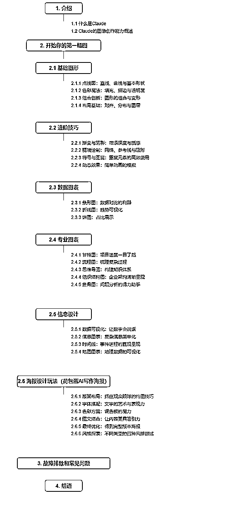

### 一、Claude是什么

Claude是Anthropic公司推出的先进人工智能语言模型，属于自然语言处理领域的前沿产品。作为大语言模型中的实力派，它有着非常出色的文本理解和生成水平，复杂任务也能稳稳接住。

它的核心优势可以概括为六点：

*   **视觉理解**：能读图、分析图表和各类视觉素材。
*   **工具调用**：能与外部API和函数衔接，处理复杂流程。
*   **企业级安全**：拥有SOC II Type 2认证，还可选HIPAA合规项。
*   **低幻觉率**：可靠性好，长文档处理尤其准确。
*   **灵活可选**：Opus、Sonnet、Haiku多个版本，兼顾智能、速度与成本。
*   **语言能力**：多语种精通，文本生成、代码编写和深度分析都拿手。

### 二、Claude的图像创作能力

简单来说，你只需把脑海中的画面用提示词清晰地写出来，Claude就会生成一段SVG（可缩放矢量图形）代码；这段代码丢进浏览器或其他支持SVG的软件里，图形就会跃然屏上。只要提示词足够准确，反复打磨细节，它就能陪你一起把创意一点点画出来。

Claude的图像创作能力主要包括：

*   **图像分析**：能描述上传图中的内容，识别物体、场景、颜色和文字。
*   **视觉数据解读**：分析图表背后的信息，从画面中提炼有价值的数据。
*   **SVG生成**：绘制可缩放矢量图形代码，交由浏览器渲染成图。
*   **创作指导**：给出详细的绘画建议，覆盖构图、技巧与思路。
*   **视觉问答**：回答图片相关问题，还能对比多张图找异同。
*   **辅助设计**：提供配色方案，讲解设计原则与最佳实践。

### 三、第一幅画：从基础开始

#### 1. 点线面：直线、曲线与基本形状

输入一句“画直线、曲线与基本形状”，Claude会返回对应的SVG代码，比如一串贝塞尔曲线路径。渲染之后，图形立刻就呈现在眼前。

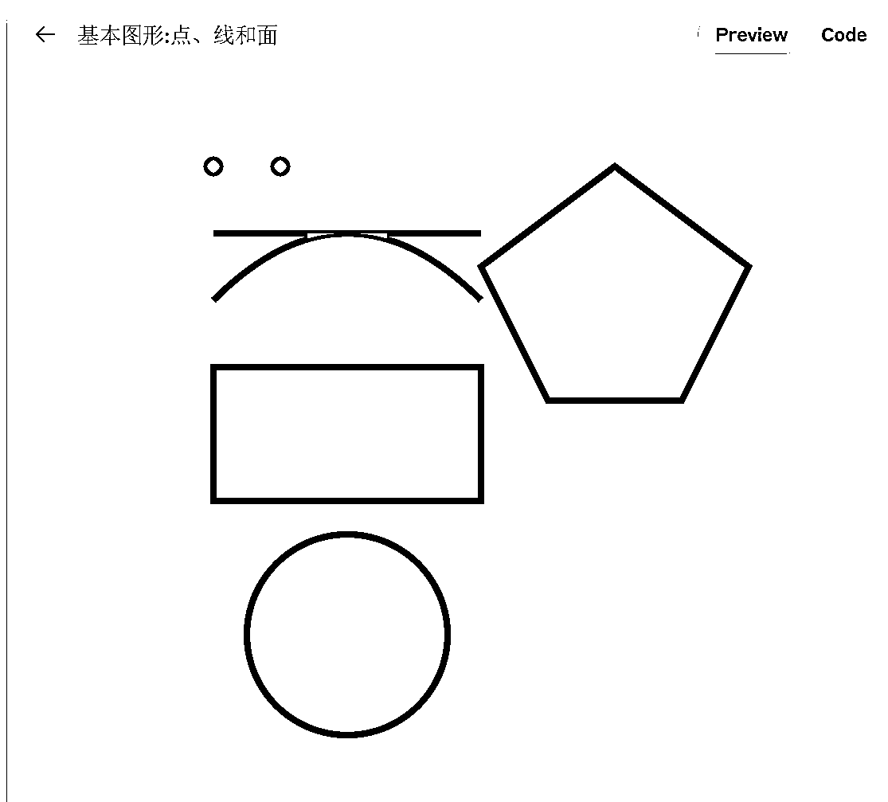

#### 2. 色彩魔法：填充、描边与透明度

你可以把需求说得更细：“画一个黄色的圆形，旁边放一个黑色边框的三角形，再画一个透明度是0.3的长方形。”它会完全照做。

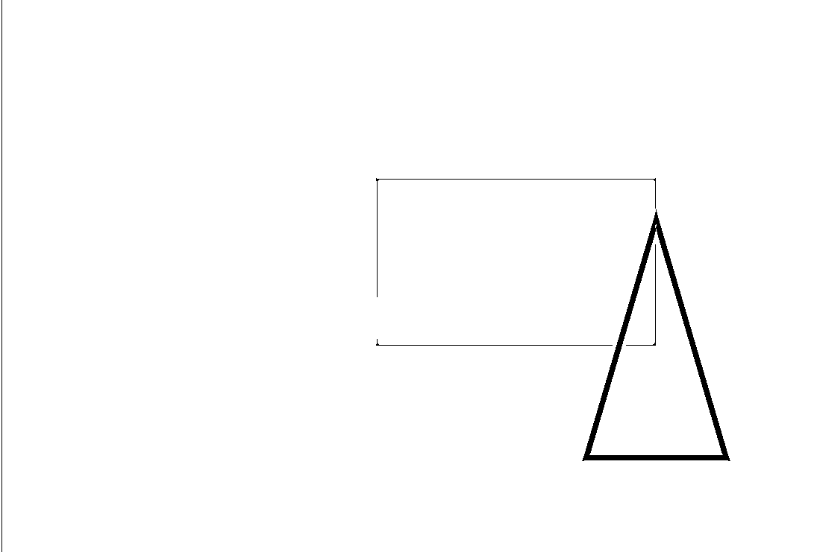

如果想继续调整，就把长方形的透明度由0.3改成0.7。对比可以发现，颜色明显变深，透明度也更具质感了。

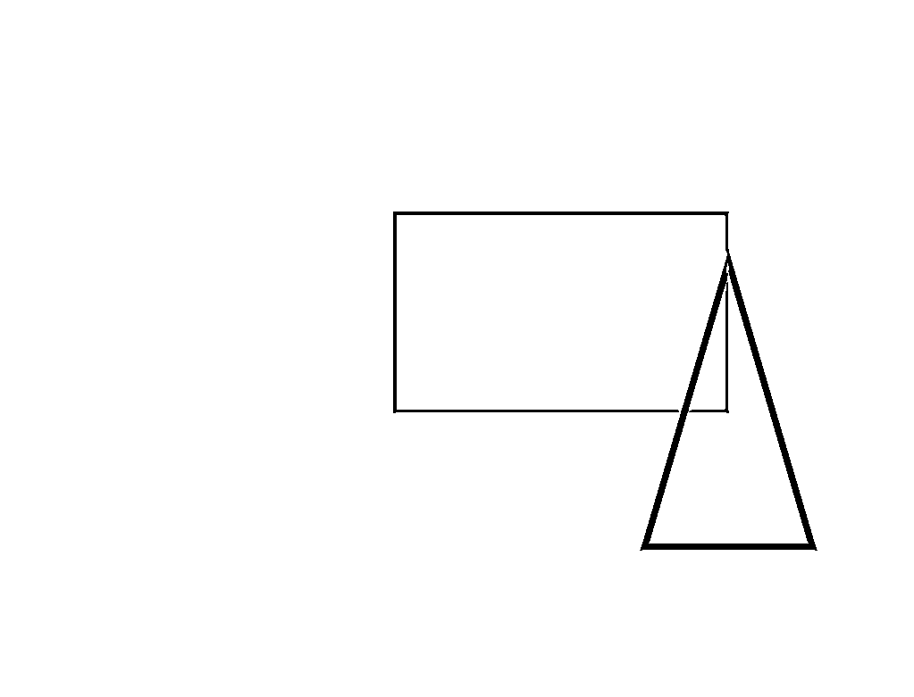

#### 3. 组合创新：图形的组合与变形

图形之间还能组合出新花样。比如让Claude设计一朵花和一只蝴蝶：

*   花朵部分：花瓣用四个重叠的粉色圆形，花心用黄色圆形，茎用细长的绿色矩形，叶子借助path路径做出来。
*   蝴蝶部分：翅膀用两个浅蓝色圆形，身体用紫色三角形路径。
*   颜色上，花瓣选柔和的粉（#FF9999），花心用亮黄（#FFFF66），茎叶用清新绿（#66CC66），翅膀用淡蓝（#99CCFF），身体用淡紫（#9966CC）。

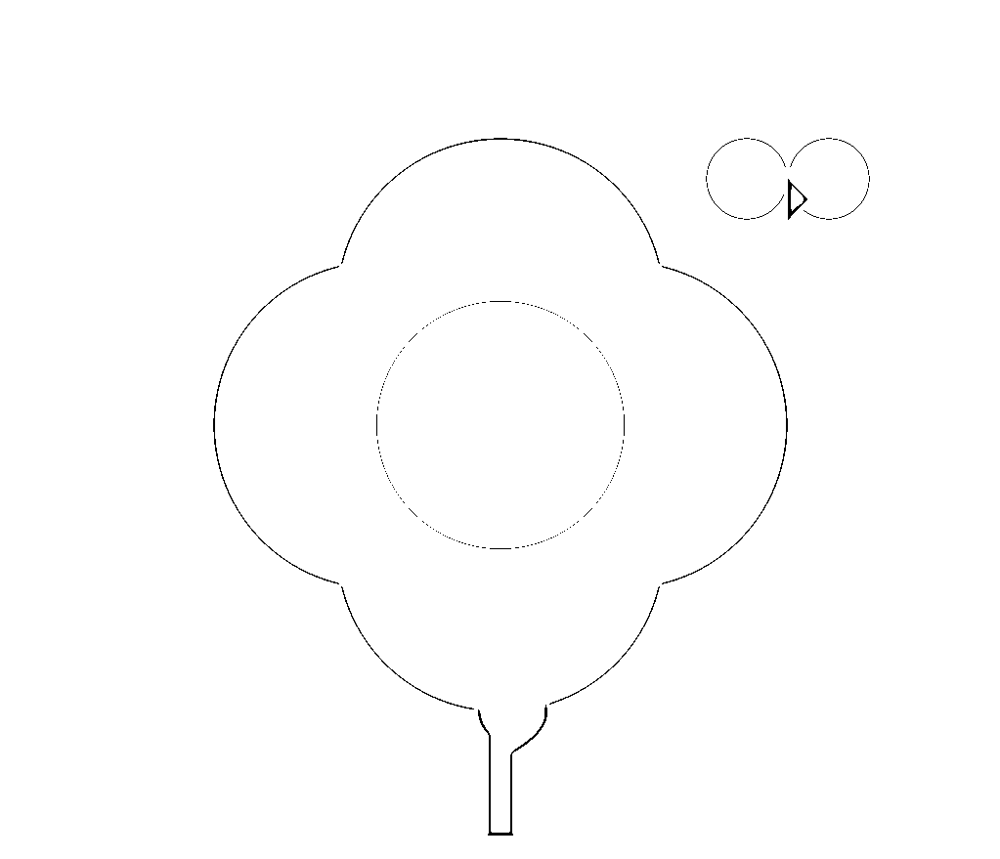

想要变形，只需调整代码中的路径坐标，图形就会随之改变，新的造型即刻出炉。

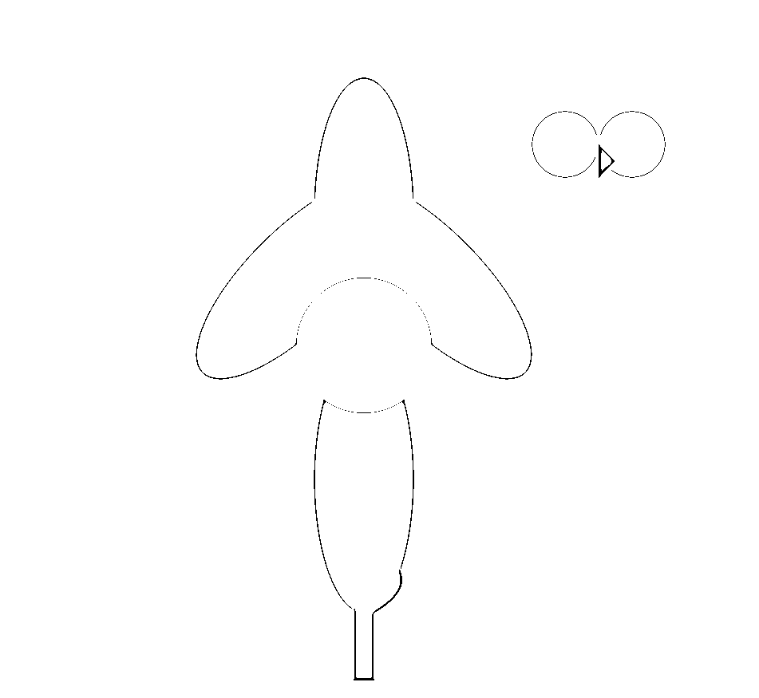

#### 4. 布局基础：对齐、分布与图层

更进一步，你可以玩转布局。把画布左右分成两半，右侧作为左侧的镜像，通过SVG的变换属性就能实现。具体来说，用transform="translate(400,0) scale(-1,1)"做水平翻转，形成完美的轴对称效果。

每个复杂图形包含两条弯曲的贝塞尔波浪线、一个半透明大圆、两条交叉直线和中心的小圆点。左右两边的色彩体系也有讲究：左侧用粉红到红的渐变，右侧用浅蓝到深蓝的渐变，渐变通过<lineargradient>元素定义。曲线、直线、透明度和渐变都结合在了一起，整体感非常丰富。

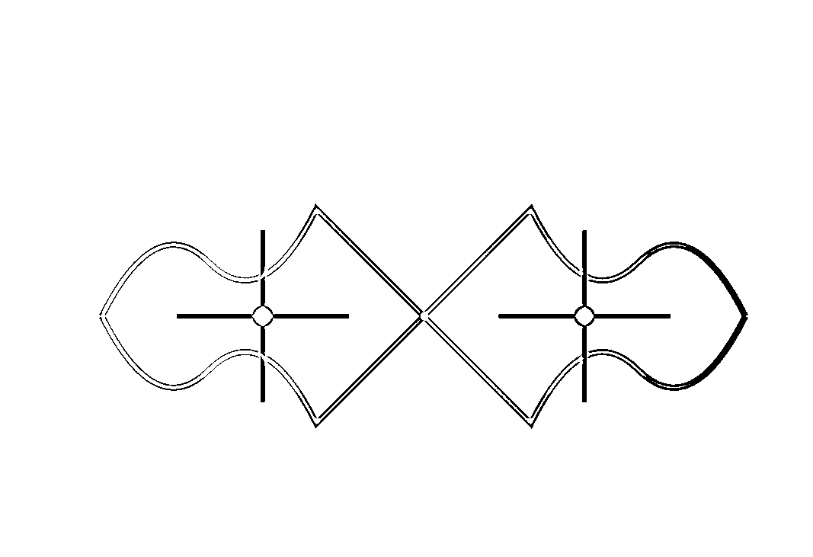

### 四、进阶技巧：让画面更有深度

#### 1. 渐变与阴影：增添层次感和质感

先看一个眼镜案例。最初版本是一副典型全框眼镜：深灰色粗线条勾勒圆形镜框，配镜腿、鼻托和蓝色渐变镜片，镜片上方还有白色弧线模拟光线反射，整体已经相当规整。

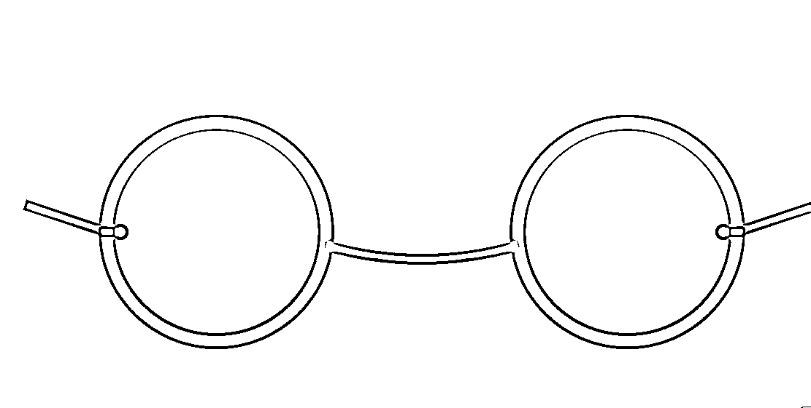

接下来做质感升级：

*   给镜框加入线性渐变，从顶部浅灰过渡到底部深灰，营造金属光泽。
*   用SVG滤镜给整个眼镜添上柔和阴影，增强立体感。
*   把直线镜腿改成带弧度的曲线，同样赋予渐变效果。
*   在镜框与镜腿连接处加上圆形小细节，模拟螺丝或装饰，顺便补上铰链设计。
*   保留原有的蓝色渐变镜片和高光弧线，与新增阴影形成鲜明对比，视觉效果更突出。

修改后的眼镜，精致度和档次感一下就上来了。

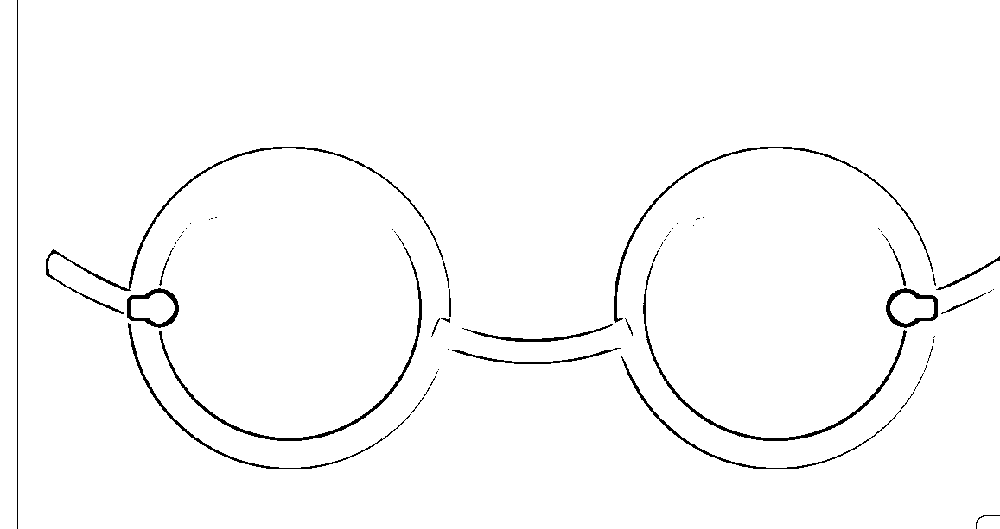

#### 2. 精确绘制：网格、参考线与吸附

设计软件里的辅助线功能，Claude也能模拟。画布上覆盖一层浅灰色网格，网格间距20像素；两条红色虚线贯穿画布中心，一条水平、一条垂直，充当自定义参考线。

蓝色矩形和绿色圆形以半透明形式呈现，方便展示它们与网格、参考线的关系。矩形角落和圆心处标出红色吸附点，表示自动对齐的位置。再配合文字标注，“网格”“参考线”“吸附点”的含义一目了然。

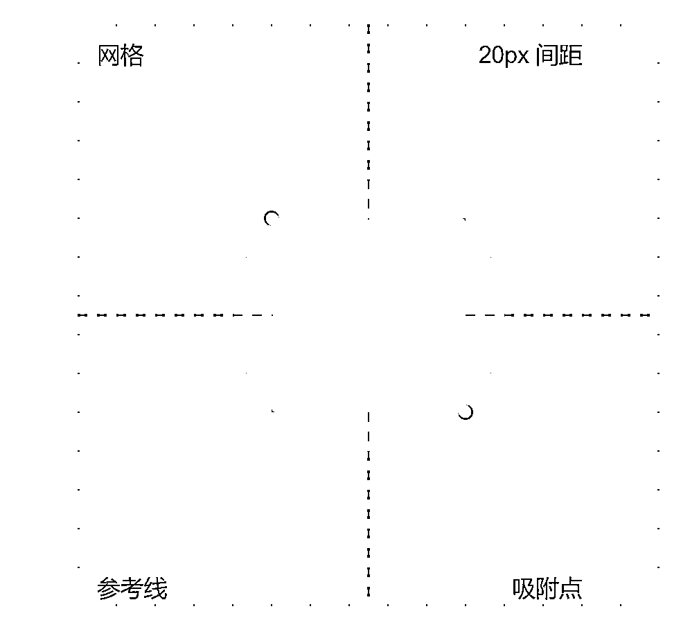

#### 3. 符号与图案：重复元素的巧妙运用

高阶玩法的代表，是让Claude画一枚逼真的荷包蛋。

*   蛋白用不规则的路径塑造自然流动感，叠加径向渐变（中心纯白、边缘微灰）和轻微模糊，让边缘柔和真实。
*   蛋黄用圆形，内部采用亮黄到橙色的径向渐变，还原真实色彩过渡。
*   蛋黄上添加椭圆高光，增加光泽感；蛋白上绘制几条曲线模拟自然褶皱和纹理。
*   点缀一些小圆点，代表煎制时产生的小气泡或焦褐斑点。
*   最后给蛋白和蛋黄加上细微微的描边，增强轮廓定义。

就这么简单，一张细节丰富、质感生动的荷包蛋图就大功告成了。

### 写在最后

Claude绘图，最大的惊喜在于：门槛远比想象中低。你不需要记住复杂的代码指令，也不用掌握深奥的设计理论，只要学会把需求说清楚、把细节补到位，然后根据结果不断迭代优化，就能收获理想的图形。

从基础的点线面，到色彩搭配、图形组合、布局对仗，再到渐变阴影、网格辅助、精细纹理，每一步都充满可玩性。无论你是职场人士做汇报图表，还是创作者做视觉设计，都值得给Claude一个机会，让它成为你随叫随到的绘图搭档。

做设计时，最怕重复劳动。一个同样的元素，如果能在不同位置自动“分身”，还能做出动态效果，效率瞬间就上来了。今天分享一个有趣的小案例——用可复用元素打造“荷包蛋”创意图形，再加上一点动画模拟，最后再用智能工具快速搞定商务图表。

先来说说如何让一个荷包蛋“变出”一大堆。核心思路是先定义，再复用。在SVG的`<defs>`区域，我们把整个荷包蛋封装好，给它一个名叫`friedEgg`的ID。这就像是做了一个模具，之后想用几次就引用几次。接着，通过`<use>`标签反复调用这个元素，每次调用时都可以添加不同的变换来制造差异：缩放（scale）能改变大小，旋转（rotate）能改变朝向，倾斜（skew）能微调形状，透明度（opacity）则能让部分蛋看起来更淡、更透气。把这些姿态各异的荷包蛋分散摆在画布不同位置，构图看起来随意却又保持了平衡。最后再丢几个小圆点当装饰，瞬间让画面多了几分趣味。

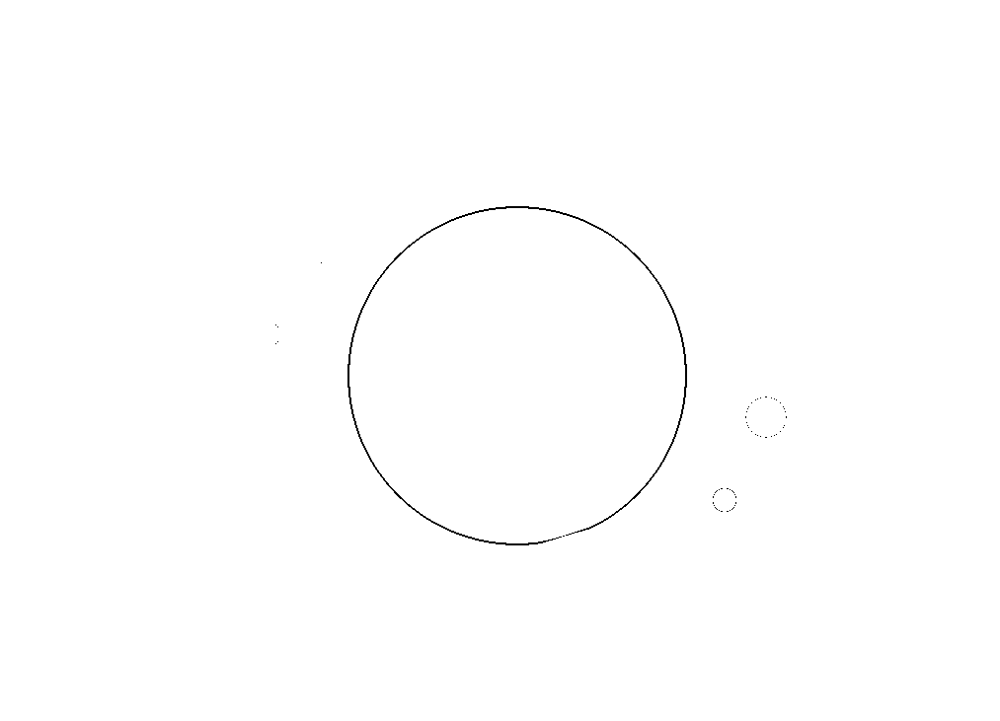
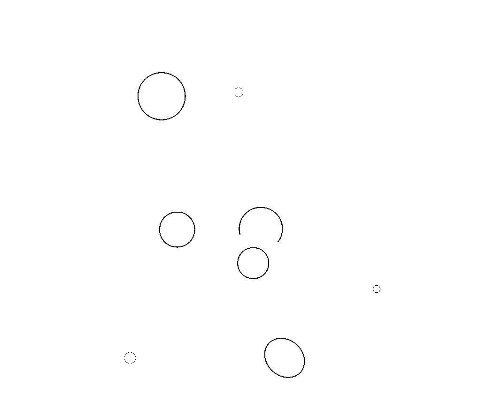

如果光是静态还不够，那就干脆让这些荷包蛋“活”起来，模拟它们在煎锅里翻滚的样子。动画的设计同样巧妙：蛋白的形状会轻微变形，仿佛在油温下慢慢起泡；蛋黄通过位置属性的动画，上下小幅度跳动；那一点高光也学会了“呼吸”，透明度由强到弱再回来，模拟光线的变幻；整个荷包蛋组还会时不时整体晃动，像锅底传来的微小震动。另外，再添加几个大小不一的圆点，随着时间忽大忽小，这就是煎炸时溅起的油花。为了让场景更逼真，背景用深色来处理，恰如一口黑铁煎锅。经过这些组合，一个活灵活现的煎蛋场面就出来了。

这些手法不只用于图形创意。当我们手上有数据需要做可视化时，同样可以走捷径。比如拿到“泽鑫电力科技公司2020-2022年主要经营指标表”，数据单位是万元。与其在Excel里一条条录入再生成图表，不如直接把数据交给Claude，让它快速绘制条形图或柱状图。做法很简单：让每个年份生成三个条形，分别对应资产总额、负债总额和营业收入。从图里能清晰看出趋势：资产总额（蓝色）这三年保持稳定，只是小幅上涨；负债总额（橙色）则一路走低；营业收入（红色）增长非常显著，尤其到了2022年，实现了大幅跃升。用AI辅助做图表，省下的时间足够再优化一版报告了。

从可复用的图形元素，到会动的煎蛋特效，再到一键生成的商务图表，掌握这些小技巧，创作也能变得轻松又好玩。