# ('关于黑神话悟空的热点预判详解', (2, 16))

谁能想到，《黑神话：悟空》能成为今年游戏圈最出圈的大事件？更少有人知道，我早在其发售前一年就嗅到了这股风，顺势在B站埋了一堆内容，一路把账号养到了10万粉，还拿到了B站“知名出行up主”的认证。

当热度真正席卷而来时，我又追了一把热点。如今我账号里的每两个粉丝，差不多就有一个是因为黑神话认识我的。

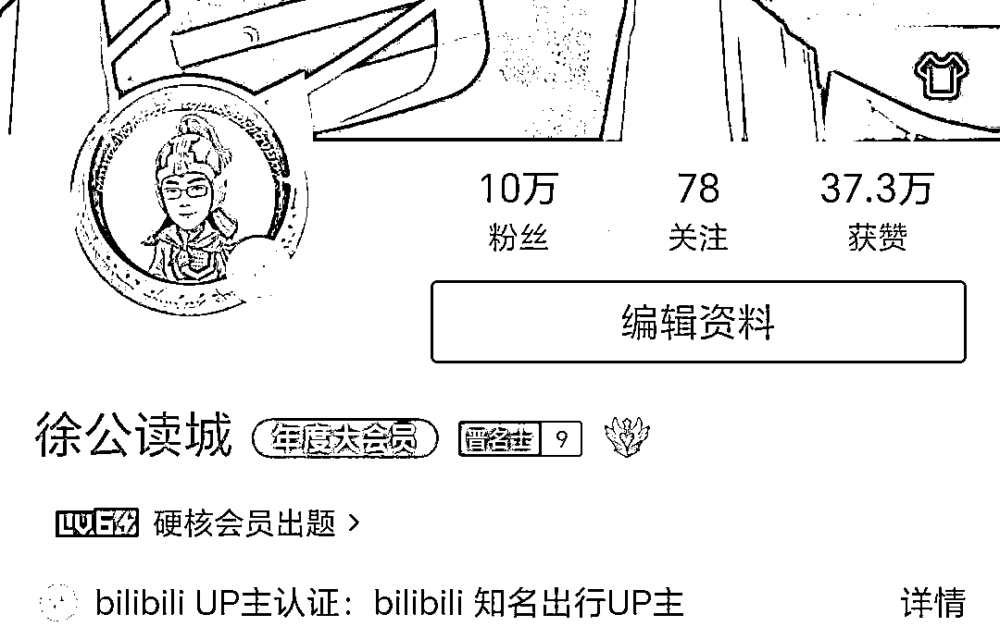

当然，B站这个平台的变现能力，说实话一般般。像我这样的体量，日常每个月收入就小几千块；只有碰到大的商业合作，才有机会冲到大几千甚至上万，而且这种合作几个月不见得等到一次。但做到十万粉之后，就能参加不少官方扶持激励活动，多少能给口袋里添一点稳定外快，也算值得期待。

接下来，按时间线复盘一下，我是怎么一步步从发现热点，到提前囤货，最后稳稳吃住这波红利的。

（时间线一：从路人到入坑）

2023年8月20日前后，游戏科学在杭州办了一场线下试玩会。那一阵B站几乎被相关视频刷屏，只要打开首页，十有八九能看到黑神话的内容。我平时工作忙，很多年没怎么打过游戏，一开始并不了解它，也从没考虑过去做游戏博主。毕竟想在B站立足的游戏作者，要么操作天赋惊人，要么整活能力惊人，这个赛道已经卷到天花板了，不是普通人该碰的方向。

直到9月，我刷到了虎先锋和靡道人的片段。虎先锋那场Boss战，光是观战就让人感觉特别有梗，也很有难度；后来我玩到它时，卡了整整三天才过。靡道人只是个小龙套，按理说存在感不会很高，可配音演员森中人的声音实在太戳人，我就是这么被“圈粉”的。顺着这条线，我又挖到了官方2022年发布的实机剧情视频和歌曲《戒网》。这首歌的制作水平相当高，演唱者是专业水准，填词人正是游科老板冯骥。一款游戏还没正式发售，就能在各个角落里看到“国手”的手笔，说明它骨子里就有爆款基因；何况当时热度已经这么高，真等发售那天，还不知道要火成什么样。

其实我准备得不算早。从2020年开始，就有人在这个领域提前下注，并且干出了一番成绩。

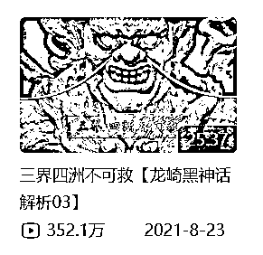

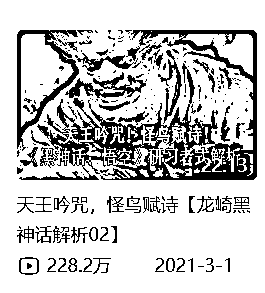

但奇怪的是，站在旅行博主的视角看，我从2023年底到2024年上半年踩这个节奏，反而赶上了最好的节点。这个待会儿再展开。

（时间线二：取景地系列上线）

我最初只知道该做准备，却不知道从哪里下手。直到有人盘点黑神话的取景地，我才意识到，游戏里的许多场景是把中国古建筑实景扫描进去的。这不正适合我这个旅游号吗？于是决定做“取景地巡礼”系列。

刚起步没敢砸大成本，先小规模试水。第一站选了河北张家口蔚县的玉皇阁，原因很简单：离我最近，路费最少。手里正好有京津冀年票，就把蔚县一带包含的收费景点都转了一圈，顺路还扫了一遍周边几个县城的景区。说实话，当时心里完全没底，但视频发出来后，数据比想象中好很多，游戏迷们也给面子。于是，我决定把这个系列继续做下去。

2023年11月，我临时起意跑了一趟川渝贵，特意去看了重庆大足石刻、醴峰观、安岳石窟等取景地。结果走到半路崴了脚，后半程只能一瘸一拐地坚持完整段旅程。因为时间太长，回来就累倒了。但我不敢耽误更新，病中录完第二、三期音频，做成视频发了出来。

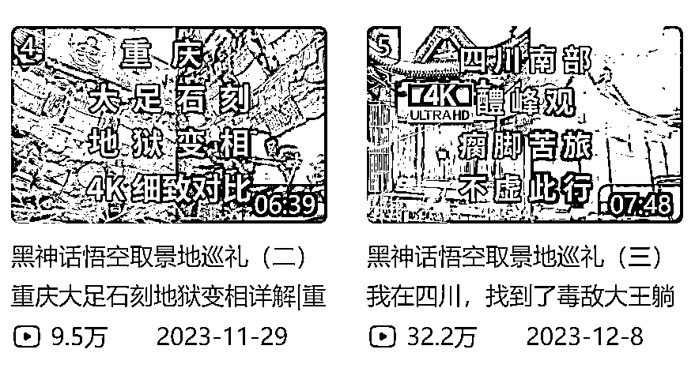

现在回看那两期，声音明显发闷，像生病时鼻子堵着说话的感觉；可流量却炸得厉害。原因有两点，一是当时这类内容在平台太少，二是运气极好：第三期发出的时候，刚好赶上官方在2023年12月8日发布发售预告，直接搭了一波顺风车。趁着势头，我又赶紧把后续相关视频全更了出来。

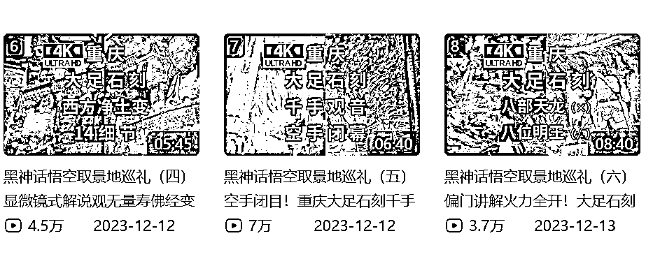

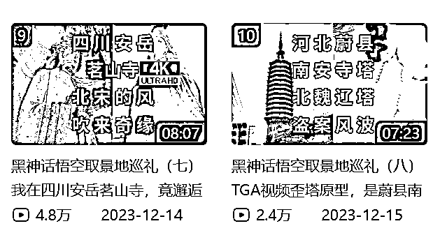

那些内容连续爆过后，我的流量也回归了正常温度。那时候我不停地提醒老学员，一定要蹭这波热点，但最后真正行动的恐怕没几个。从我当时的粉丝基数看，黑猴粉可能觉得我的视频值得更高流量；但关起门说真心话，我已经很知足了。一个没名没气的旅行up主，能做出一两期破圈内容，还有什么不满足？

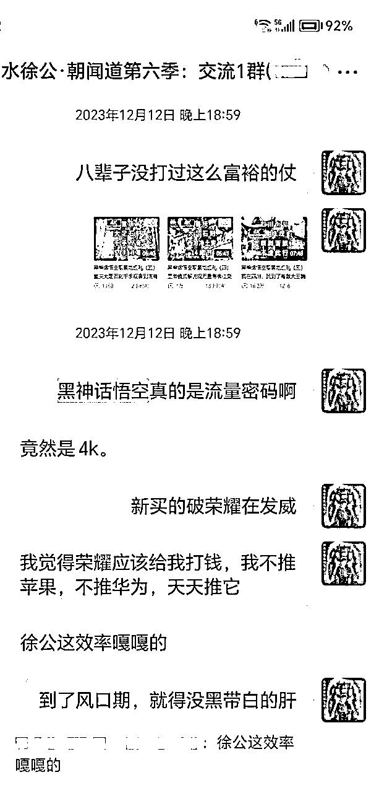

（时间线三：春节前的顺路拍摄与意外爆款）

2024年1月本来打算不出门，靠着手里川渝、北京、山东囤的素材过冬。但家人要去福建玩，重点是福州和厦门。这两个城市本身没有我非拍不可的东西，可泉州就在不远处，浙江丽水的时思寺也顺路。于是借着家庭旅行，我拍下了时思寺和梅氏宗祠——梅氏宗祠本来就是时思寺景区的一部分——又去泉州拍了开元寺双塔。

我的习惯是外面拍完，回家再慢慢写稿剪片。如果你是其他赛道的作者，完全可以更快，在家对着素材就能起号。这几期本来想卡在春节前发，蹭游科官方每年拜年视频的流量，结果时间点没卡准，只有开元寺双塔的数据稍好。

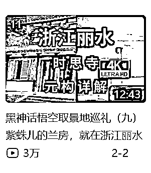

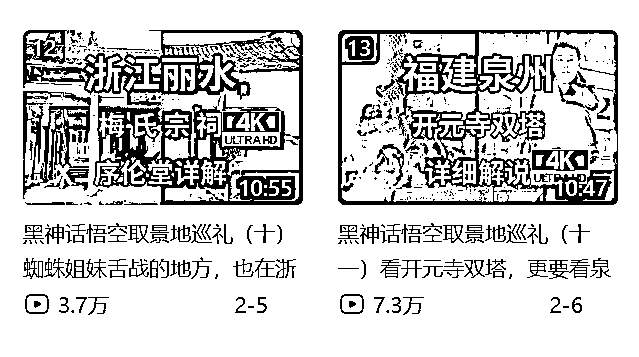

万万没想到，到了8月20日前夕，游戏科学官方和B站运营一起点名，让我给时思寺再做一期。我已经没有太多新素材，只好拿剩下边角料拼了一期，专门讲之前没仔细说的三清殿。这期“炒冷饭”的视频反倒成了大爆款，我自己没想到，运营也没想到，大家都有点懵。这件事让我彻底明白：平时多囤点东西，总没有坏处，因为你永远不会知道，哪块“废素材”会在关键时刻变成“金素材”。

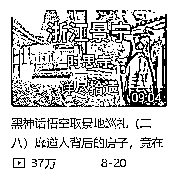

（时间线四：大同商单与历史窗口）

到了2月，人已经很累，按道理该在家好好过个年。但百家号在春节期间给创作者发了定额商单，每人5000块钱，就差明说“去个近点的地方”了。相当于白给钱，不挣白不挣。我选择去山西大同，先交掉社火宣传的官方任务，顺手拍了华严寺、善化寺的素材。真正的重头戏在大同周边：任务完成后我租了辆车，初七云冈石窟，初九应县木塔，初十悬空寺，绕着大同刷了一大圈取景地，每处都做了视频。

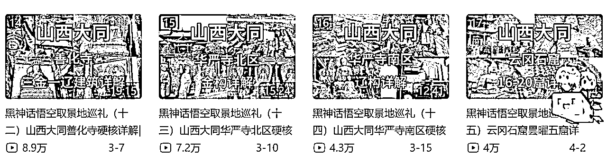

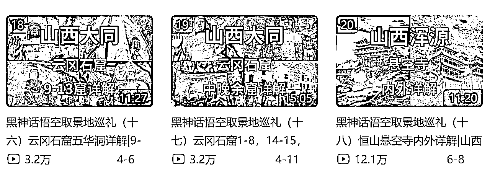

唯独应县木塔，以我当时的知识储备还写不了解说，就一直压着，直到游戏发售前夕才终于把视频做出来，虽然有广告植入，流量却很不错。

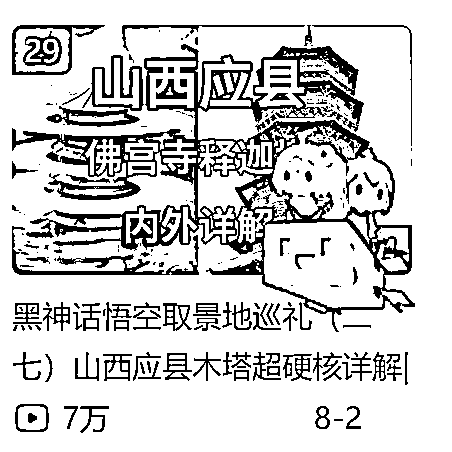

为什么我反复说，2023到2024年是我的黄金期？因为山西的古建筑以前完全禁止拍摄，2023年下半年起内部拍照才逐步放开。我恰好站在放开口子上，做成了全网第一批完整的山西古建筑视频。这种机遇，过这村就没这店。当时在大同，我和一位当地姐姐吃饭——她同时也是我的终身会员。她以前在华严寺附近开店，我劝她搞一个活动：任意消费就送黑神话天命人盖章。只要章做得好看，自然会有人拍照打卡、口口相传，店铺名气一下就能起来，那才真是天降大运。可惜她最后没抓住，这件事我至今都觉得遗憾，有点像预测到了未来，却无力改变。

（时间线五：春夏的四处奔走）

春节大同之旅在正月十一前后戛然而止，因为突然大幅降温，我先在应县木塔差点冻死，更别提再往朔州、忻州跑，只能先回天津休整。3月我又去了山西，把晋北其它点扫了一遍，发出来的视频数据依旧吊打普通选题。

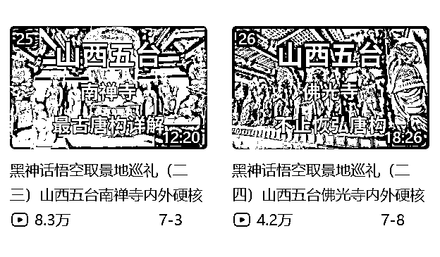

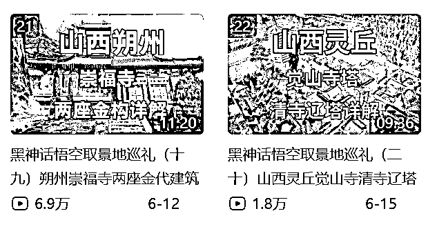

紧接着天水热度爆发，我一边在社群里让大家赶紧跟上，一边从山西赶回天津，再打飞的前往天水。也正是在这个节点，我的抖音账号也正式入了流量池。意外的是，在天水博物馆里，我发现一件藏品很像黑神话里黄眉的人种袋，便临时做了一期特别节目，反响不错。

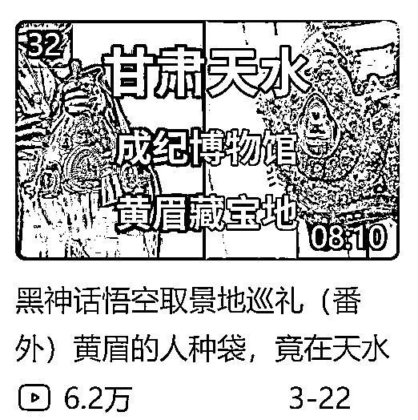

到了夏天，我集中跑了晋南和晋中，晋南主要运城、临汾，晋中则覆盖太原、晋中、吕梁。晋南的视频拍得早，后来陆续更新；晋中的素材还压在手里，暂时没剪。

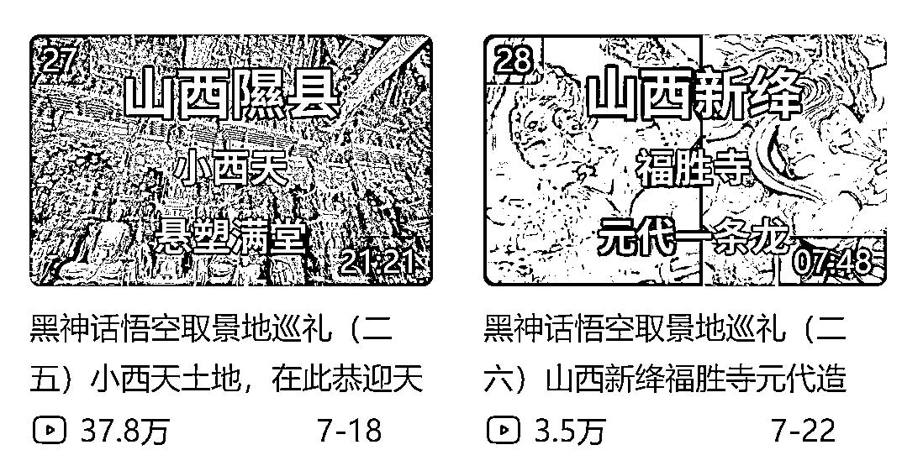

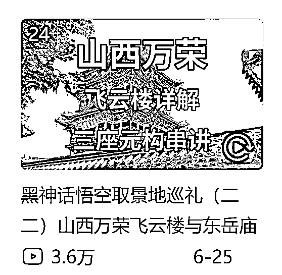

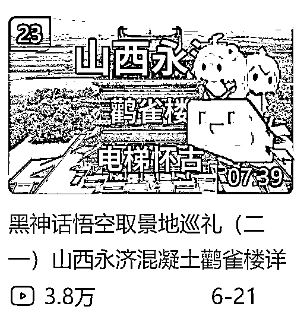

其中小西天那期，我认为是系列的巅峰，放在B站也够格成为经典。我打算今年秋冬季把这些存货陆续剪出来，到时又能吃一波持续流量。那时候我已经非常确定，黑神话只要正式发售，一定会是8月最大的热点——毕竟游戏还没发售，我每次发相关内容数据就已经不错了。所以我不慌不忙地提前把所有内容铺开，等热度来了，存货正好派上用场。事实也证明，后续流量我没有错过，而且肉眼可见还能再吃一阵子，躺着涨粉、赚钱不是梦。

（时间线六：发售日正式起风）

临近8月20日，B站运营主动来约稿，希望我定制几期视频。于是我做了一期川渝取景地汇总、一期山西取景地汇总，以及前面提到的时思寺拾遗。官方合作给的待遇确实不一样，这三期都跑成了爆款，涨粉速度相当可观。

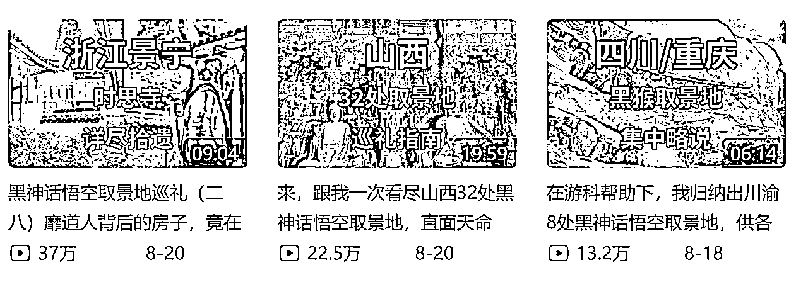

另外，很多评论区朋友建议我做个通关解析，一边玩，一边查沿途的建筑和文物原型。这个专栏也出人意料地爆了。昨天我在公众号晒了一下，播放量是71万，写这篇文案时已经爬到74万多，一夜之间又翻了一批数据。

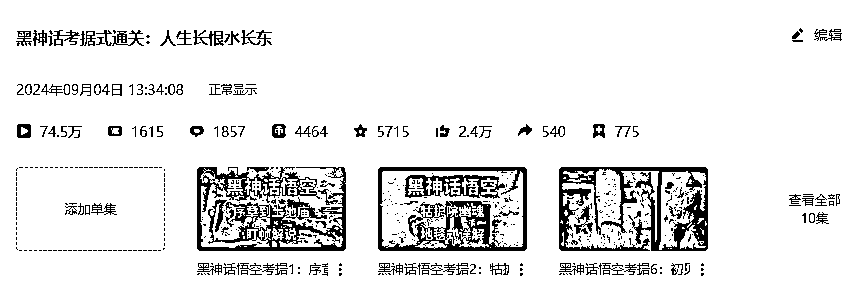

当这些内容全部集中释放后，我的粉丝数终于冲到10万，在B站也算迈过一道重要的门槛。

（最后：热点的正确打开方式）

回头想，持续创作讲究的是文武之道、一张一弛。热点没来的时候，把速度放慢，一边做视频一边补充知识，用创作倒逼自己吸收；热点来了之后，你根本没有时间临时学习，只能靠现有的功力去迎战；等浪潮退去，再放慢节奏，继续积累，等待下一个大热点。周而复始，循环不息。

所以，如果想在热点来临时接得住，靠的从来不是临时抱佛脚，而是长期的思考与沉淀。平时不积累、不思考，哪怕天降大运，也只能眼睁睁看它溜走。种一棵树最好的时间是十年前，其次就是现在。与其羡慕别人踩中风口，不如从今天就开始积累内容、打磨技能，慢慢把自己的赛道摸透——说不定，你也能找到一条可以吃上很多年的路。