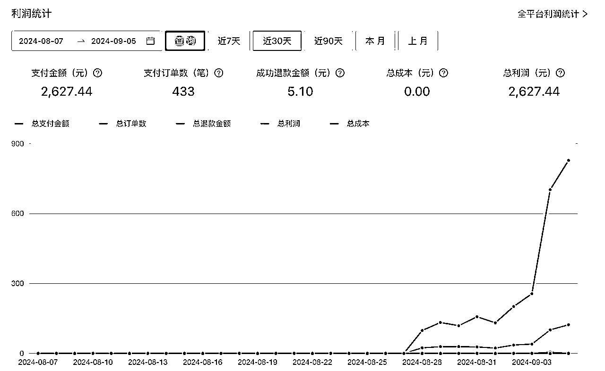
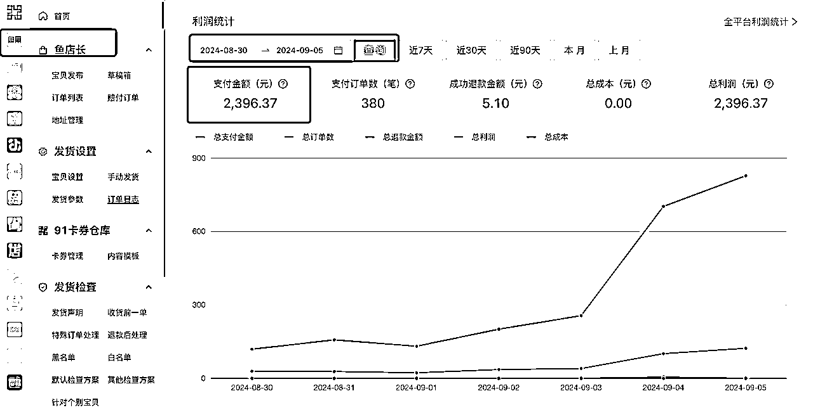
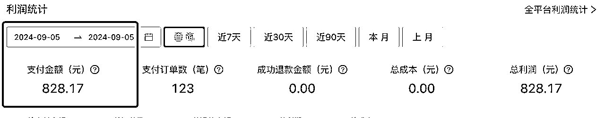

# 一条风向标，一篇精华帖，咸鱼虚拟资料也能日入800+

前几天刷到一条风向标，又碰巧读了一篇精华帖，我这个小号居然把闲鱼虚拟资料真正做起来了。昨天一天到手828元，这周累计快2400元，平均每单能卖到6块上下，而且全靠同一个链接在出单。

整个过程拆开看其实不复杂，分享给还在观望的圈友。

先说第一步，信息差来自风向标。有位圈友提到“校招信息整合售卖”，我第一反应不是纠结这个项目能不能成，而是判断：成本低不低？能不能马上试？我自己做不做得来？三点都满足，就上。于是去闲鱼搜“校招”“秋招”，发现有几个链接的想要数已经破千，浏览数是想要数的十倍往上，数据确实漂亮。我直接用自己的号上架测试，上架方法也很粗暴：把对标的文案和主图拿过来，标题换个顺序，图片裁剪一下再稍微旋转角度，当天就能发出去。闲鱼查重松到什么程度？后来有人直接带我的账号水印做图，我举报盗图居然都不通过，确实离谱。

刚上架那阵子曝光很一般，我也没怎么管，继续弄别的品。大约过了一周，突然开始有单了，我赶紧去对标卖家那里买了一份资料转手发给顾客。那几天就是每天几十块的节奏。

真正的转折，来自大钟老师的一篇精华帖，大意是一个账号也能把收入放大五倍，根本不用做矩阵。我把内容总结成一句话：搭着卖。买校招表的都是马上毕业的大学生，他们除了招聘信息，还需要简历模板、内推码、笔试题库，甚至面经。这些东西怎么找？不需要冥思苦想，去各大电商平台搜“校招”“秋招”，关联商品自己就冒出来。我把这些品全部塞回同一个链接，开通鱼小铺后挂上多SKU：校招表+内推码、校招表+简历模板、校招表+大厂笔试题库，或者直接“全都要”。定价也调整过，单买校招表2.88元，单项搭配5.5元，全都要8.8元。结果卖出第一天开始就有人选8.8，后面统计了一下，超过一半的顾客直接下单“全都要”，平均客单价被顶到6.7左右。要知道，闲鱼上很多卖校招表的只标1块钱，但依然有一堆人跑来找我买。

跑通之后，我又顺着这个方向继续深挖。那段时间经常去闲鱼搜相关关键词，刷推荐页时看到不少数据不错的链接，像京东笔试题库、银行笔试题库、银行面经这些，都有人单卖。而且询单的买家也会带来新需求，有一次有人问我有没有某个地方银行的笔试题，我一查还真没有，但马上去闲鱼搜，发现有人卖，当场买下来促成了这单，接着又单独上架了这个地方行的题库。这个品虽然没爆，也零零散散出了几单。账号出单多，权重自然提上来，再测新品时搜索排名会靠前，出单就更容易。

最后说说避坑经验。

第一，别和墨迹的用户较劲。虚拟资料边际成本基本为零，买完找各种理由退款的，只要不是特别离谱，我都直接退。有时候还会让对方先确认收货给个好评，再通过闲鱼转账把钱退回去。这个品我卖了几百单，一共只遇到四五个退款，真没必要因为这几单消耗情绪。

第二，爆单后的链接不要频繁编辑。我那个链接前后改了大概五六次，虽然前几次流量都还能拉回来，但风险很大，编辑次数多了容易降权重，这一点航海手册里也专门提醒过。

风向标负责找信息差，精华帖负责把客单价拉起来，这两个东西里真的藏着宝藏。现在我就靠同一个链接做到了日入800+，后面还会继续挖关联品。这一波拆解就到这儿，完结撒花！