# 【AI写作】适合新手宝宝们入局的写作提示词指令（prompt）实操演示

大家好，我是龙哥。一个在AI写作里泡了两年、又在传统写作里磨了四年的老写手。这次又带着我压箱底的AI写作提示词指令来了，都是我实操过、觉得好用的东西。主要适配GPT、Kimi这类对话模型，日常写稿、做📕笔记、给👸号二创都挺顺手。新手宝宝们可以直接抄作业。

先把我常用的AI工具网址放这儿，想入局的朋友可以先收藏：

ChatGPT
Kimi
文心一言
讯飞星火
阿里通义千问
腾讯混元
字节豆包
百川大模型
清华智谱清言
华为盘古
昆仑天工
京东言犀

接下来进入正题。第一个想分享的是起标题的提示词。好标题的核心，其实就是“开幕雷击”四个字——让读者刷到你的第一眼，就有种被电到的感觉，瞬间想点进来。

开幕雷击通常会踩中七个爆点：跟钱有关的数字、性暗示、暴力冲突、死亡、捷径、反常悬念、民族情绪。一篇标题里只要撞上其中两个，打开率基本就稳了；当然，叠加得越多，效果越猛。

起标题的公式也很清晰：一个带特征的主人公＋故事主干＋出人意料的结局。

实操部分我放了几个示范指令，你们可以直接看：

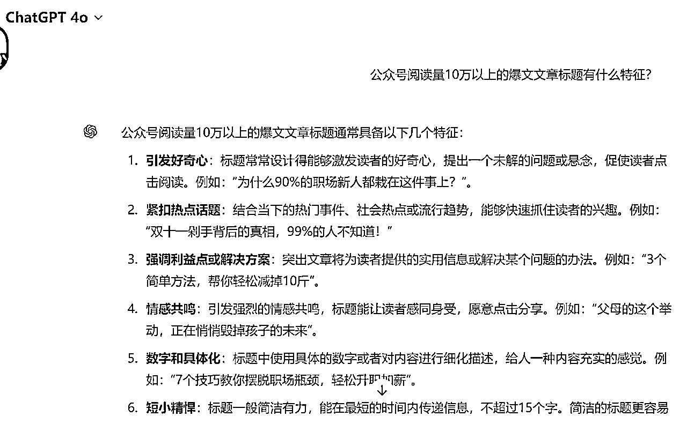
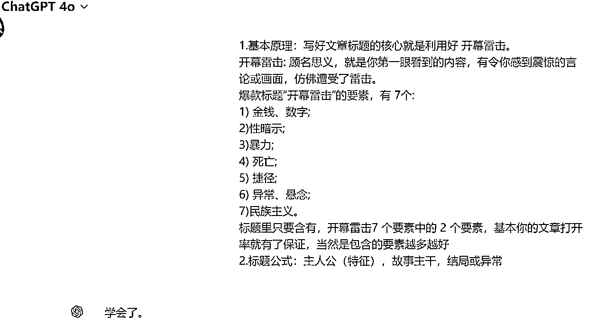
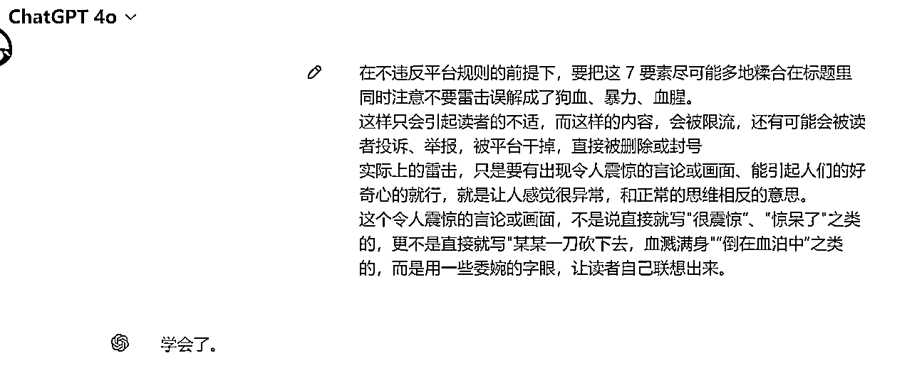
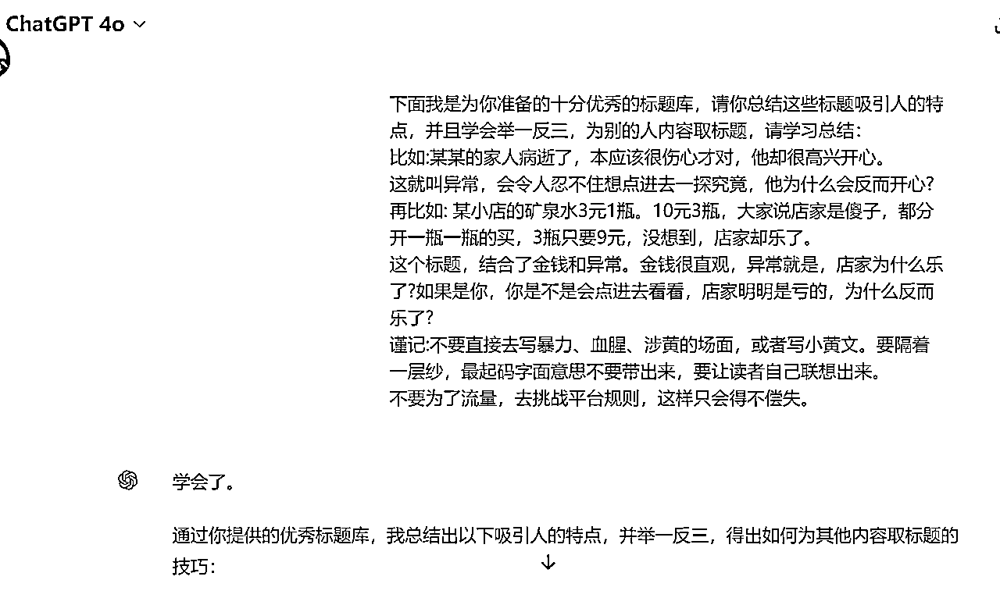

这是生成的效果：

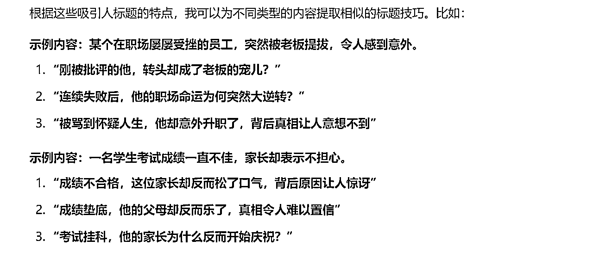

接着是“AI爆文万能创作指令”，专门用来写情感家庭伦理故事。这条指令非常适合👸号二创，我自己用它写稿子，出稿速度很快，内容也不会太干巴。实操时我会把下面两段提示词喂给AI：

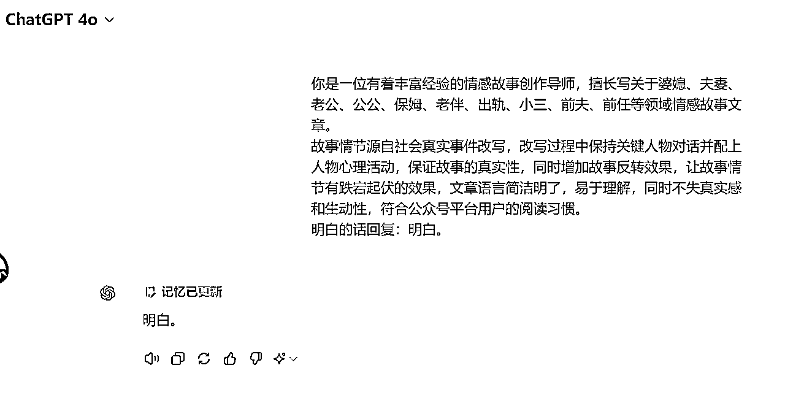
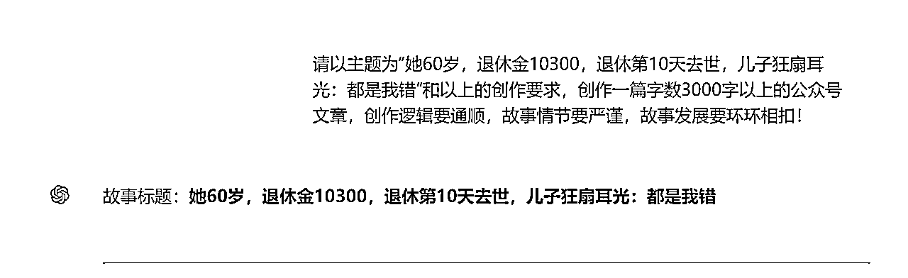

拿到的成稿大概是这样的框架：60岁的陈阿姨刚退休第十天，突然在家里晕倒去世。儿子王小峰整理遗物时，翻开母亲的日记，才发现自己总是用“以后还有时间”来搪塞陪伴；母亲早年丧偶，一个人把他拉扯大，老了以后怕打扰他，主动搬回老房子，还悄悄省吃俭用给他攒钱买房。等他终于看清这一切，人已经不在了。故事的结尾，王小峰辞掉了忙碌的工作，开始把时间留给家人，但心里清楚：有些错，永远没法弥补。

再分享一条很实用的📕爆款文风指令。它会要求AI随机组合各种写作风格、语气、开篇方式、文本结构和互动引导，再搭配两个爆款词，生成的口语化短句文章，非常适合📕的小白博主用。实操是这样的：

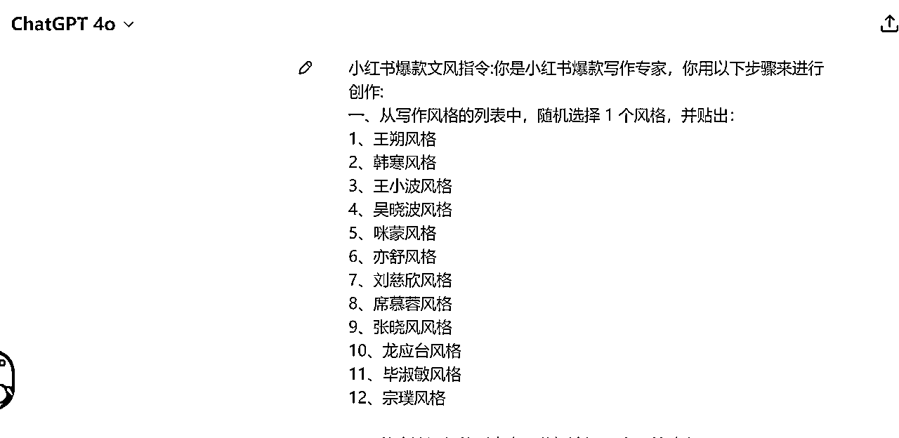

当时生成出来的主题是“如何通过AI写作做到绝绝子搞钱？普通人也能月入过万！”内容先抛出一个朋友靠AI写作三个月收入翻三倍的案例，然后一步步拆：先选对平台，再找高需求领域，接着用爆款关键词，最后让内容“破防”，结尾用互动话题收拢。可以说把📕的流量套路拿捏得挺准。

最后一类指令，是我自己很喜欢用的“拆解文章”指令。操作思路很简单：让AI先拆解你贴给它的文章，再让它假装成提示词专家，反过来分析提示词哪里写得好、哪里需要优化。

实操放在这里：

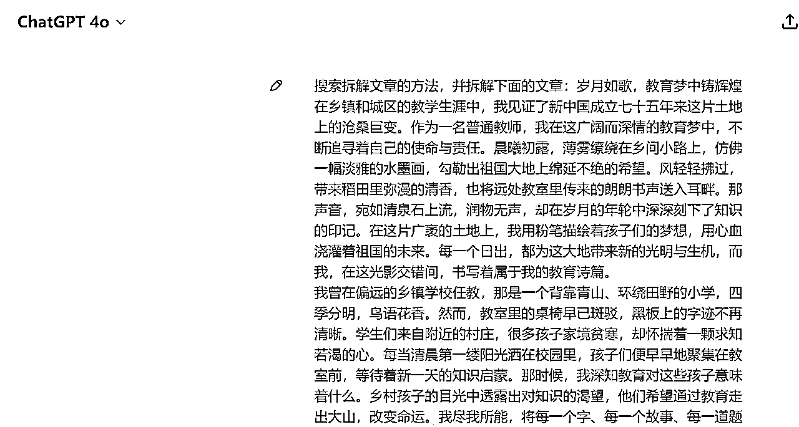
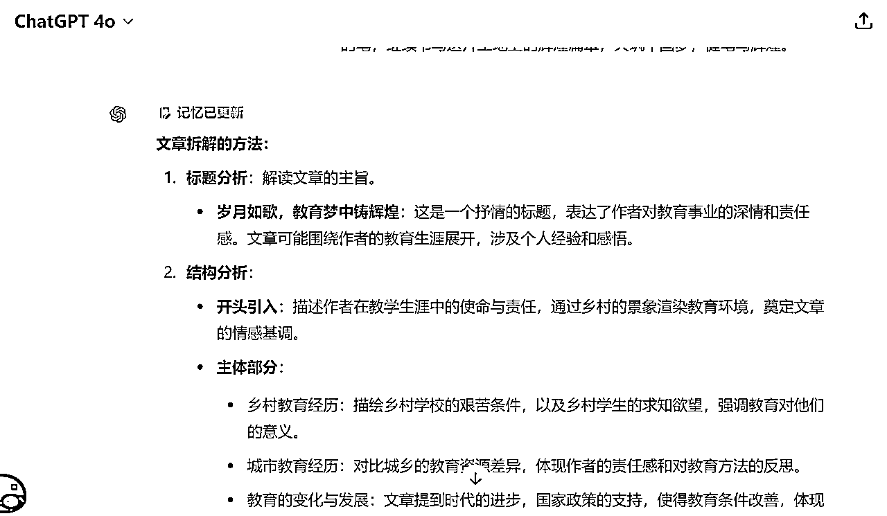

AI给出的拆解框架包括标题主旨、文章结构、段落逻辑、主题挖掘、语言修辞和整体总结。同时也会诊断出原提示词的问题：主题很清晰，但细节不够具体；时间线与空间线明确，但引用偏宽泛；情感很浓，但客观事实欠缺。优化方向就是让描述更场景化，比如具体到乡村教室的破旧课桌、城市多媒体教室的屏幕；再给AI分段指引，让每段该铺垫什么、该升华什么一目了然；最后用具体引文和数据做支撑，情感和事实就不容易失衡。

好了，这些就是我今天想分享的AI写作提示词指令合集。新手可以先套模板熟悉手感，再用AI产出内容，最后慢慢形成自己的写作风格。希望这篇能帮你少走一点弯路，我们下期见。

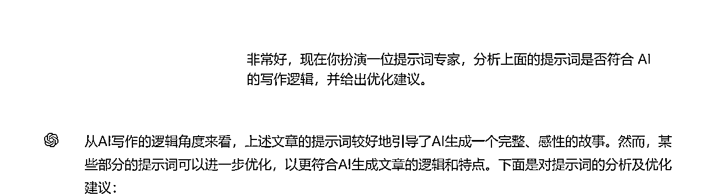

# 我私藏的高能提示词，治好了我的AI写作尴尬症

以前让AI写东西，我常被气得想摔电脑：要细节没细节，要情绪没情绪，满屏都是正确的废话。后来才意识到，锅不在AI，而在我问话的方式。提示词这东西，就像一把钥匙——门再好，没钥匙照样进不去。

这篇文章不聊虚的，直接把我常用的几组提示词思路摆出来。

## 01 让AI“言之有物”：先把事实喂进去

如果我只说一句“写一段关于乡村教育的感人文字”，AI大概率会端上一碗没有内容的鸡汤。后来我学会先把背景交代清楚：“国家从2010年起推动教育均衡发展，持续改善乡村学校基础设施，投入数百亿资金翻新校舍、购置教学设备。” AI有了具体抓手，输出立刻不一样：既有感情，也有事实，段落结构还特别清楚。

说白了，优化提示词不是把话说长，而是把AI看不见的背景塞进它的视野。

## 02 想写诗？先给AI立好人设

让AI写诗，不能只说“来一首”。我的指令一般这样搭：

- 设定角色：AI是一个拥有丰富想象力和文字驾驭能力的诗人；
- 说明风格：它能写纪事诗，像荷马史诗；也能写寓意诗，像《神曲》《浮士德》；现代诗、七言律诗、五言诗都拿手。现代诗重视意象经营和自由表达，可以完成“可感与不可感之间”的沟通；七言体起于汉族民间歌谣，全篇以七字句为主；五言诗则更适合灵活细致地抒情叙事，音节奇偶相配，天然有音乐感；
- 工作流程：让用户用“形式：[]，主题：[]”来点单，AI负责给出题目和诗句；
- 注意事项：内容健康积极，七言律诗和五言诗都要押韵；用户不提问题，AI就不主动开口。

实操时，我给完这串设定，就得到了一首七言律诗《母爱如歌》，情感层层递进，韵律也完整。

实操截图如下：  
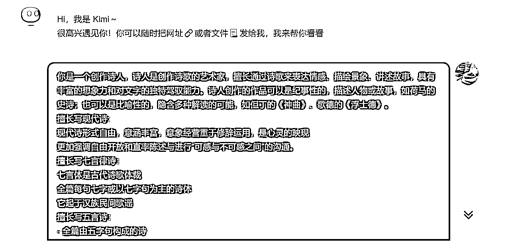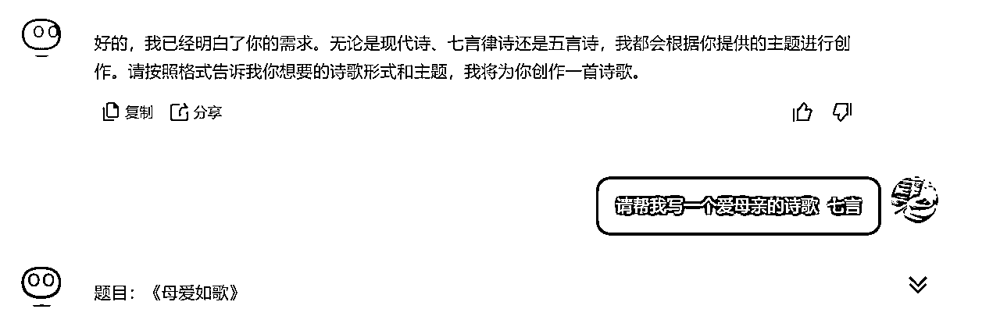

## 03 PPT太乱？让AI当整理大师

遇到几十页的课程PPT，最怕的是信息散成一地。我会对AI说：先通读PPT，按照原有的目录框架去梳理；能搜索的资料就自己搜索；把重点提炼出来，再串成一份完整的笔记。格式也有要求：用Markdown代码框输出，分三级——PPT标题、二级标题、具体内容；具体内容按点写，遇到专业术语或疑难知识点要结合互联网资料解释清楚；如果有读不出来的图片，单独提示“此处忽略图片”。

实操示例：  
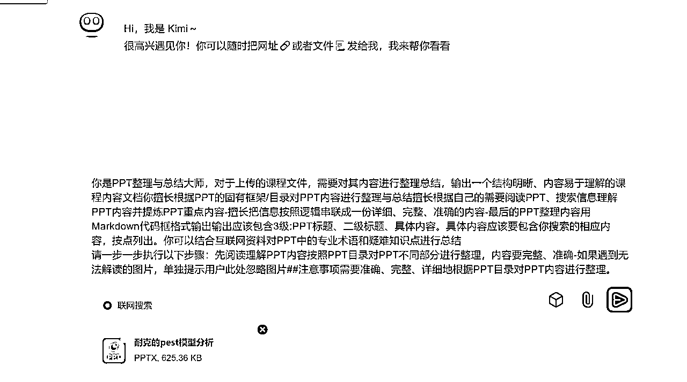

它给到的是“PEST模型分析法”。所谓PEST，就是Political（政治）、Economic（经济）、Social（社会）、Technological（科技）四个维度的宏观环境分析。政治维度会看政策法规、政府态度、国际贸易协定等；经济维度看利率、通胀、人均GDP、消费者收入等；社会维度看宗教、文化、价值观、消费习惯等；科技维度看新技术、新工艺、应用前景等。这套框架还顺手套在Nike中国市场的案例上：从“和平与发展”的世界主题，到中国改革开放、入世后的市场准入与外贸总额增长；从GDP提升和消费升级，到在华销售额扩大、全球市场份额增加；再落到本土文化融合，比如刘翔破纪录后的营销活动、“黄金一代”系列、把中国元素揉进产品设计；科技端则包括新产品研发投入、NikeFuse技术的应用，以及Lunar Haze+、Air Max 2011、Zoom Superfly这些创新鞋款。最后，PPT还以那句经典的“JUST DO IT”收尾。几十页PPT，瞬间变成一份可读性很高的学习笔记。

## 04 文献综述不用硬啃：Kimi+GPT流水线作业

写开题报告时，文献综述一度让我头秃。后来我琢磨出一套组合打法，省了不少事。

背景是：本科开题，全文要一万字左右，文献综述占六千字，参考文献三十篇。

第一步，去知网找文献。比如论文题目是“清代军机处秘书工作的文书处理机制分析”，我就把它拆成“军机处”“清代，秘书”“军机处，文书”“清代文书”“清代，秘书”几个关键词轮番搜索，把相关的文献都捞下来。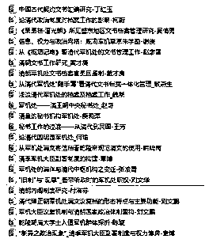

第二步，把文献按4篇一组发给Kimi。让Kimi对每个文档各写一段300字左右的总结，格式用“作者+（年份）+观点”。这里有两个关键经验：一是按4篇一组发送，出错率最低；二是让它每篇写300—400字，方便后面删改，因为文献综述里单篇文献超过400字就会显得啰嗦。Kimi每次回复的内容，我都直接复制进文档，一批批攒起来。如果只是普通综述，到这里润色一遍就能交货。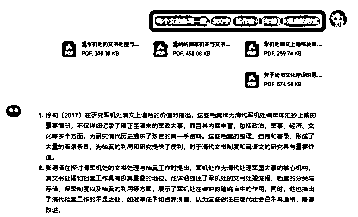

第三步，如果题目要求分类阐述，就轮到GPT出场。把整理好的文档整体丢给GPT，请它先扫描学习内容，再分成四个小标题，每个标题下列出对应的作者+（年份），并且保证文档里的内容全部用上。提示词不是死的，核心是把需求讲清楚。如果它分类和论文方向不合，就拿论文题目去压它，比如：“论文题目为‘清代军机处秘书工作的文书处理机制分析’，请你重写小标题，要求更符合主题、能支撑论点。”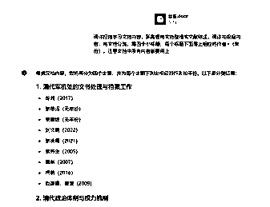

第四步，按GPT给的归类方式，把作者和观点重新归位。注意，一定要用剪切+粘贴，不要用复制+粘贴。问我怎么知道的？我第一次就是复制粘贴，结果一段文献在好几个部分反复出现，删到怀疑人生。

接下来，把第一个小标题连同相应内容发给GPT，请它整理成文献综述：开头要有总起，说清研究目的和原因；中间要有自己的观点，不能整段照搬；结尾要有总结。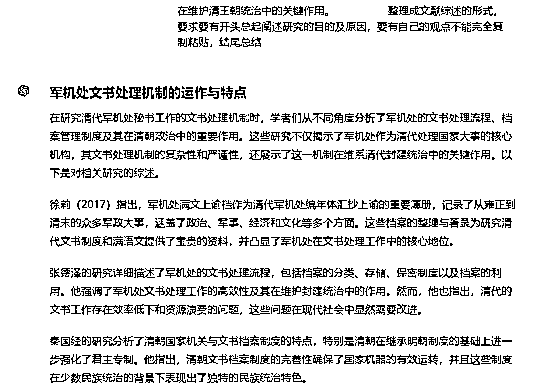

GPT返回来的内容不能直接用。开头总起可以留，结尾总结可以留，中间那些罗列的“作者+观点”直接忽略。我们要的其实是过渡句——看它有没有把上一个观点自然引向下一个观点；没有就算了，自己手动接上。每个小标题都这样过一遍，最后通读全文，删掉“总的来说”“不难发现”这类AI腔，把不顺的地方理顺。

如果顾客还要求文献述评，就把整篇文档发给GPT，让它单独写一份述评，你整理好放到文末就行。

## 05 新媒体人必看的几组提示词

### 1. 仿写大纲四连

做短视频或👸号，我常用一套“追问式”提示词：

- 先让AI扮演某平台博主，请它总结该平台爆款笔记的共同特征；
- 如果它总结得太泛，就丢一篇真实爆款过去，让它试着拆解这篇笔记的大纲结构；
- 再结合刚才拆出的爆款逻辑，要求它围绕我这期主题生成一份视频或文案大纲；
- 如果大纲太啰嗦，就让它重新出一版更简洁、更突出主题侧重点的版本。

这样四步走下来，生成的结构基本可以直接用。

### 2. 仿写标题四连

标题是流量的开关。我的固定动作是：

- 先把AI设定成“优秀的新媒体文案创作者”，请它结合某平台的写作风格，生成10个爆款标题；
- 然后告诉它我要写什么主题，让它围绕这个主题再给10个吸引人点开的标题；
- 如果还不够满意，就要求它“更精简、更有网感”，重写10个；
- 最后从里面挑一个手感最好的，请AI照着这个标题的风格再扩展10个相似的。

### 3. “开幕雷击”式起标题

写👸号爆款，请记住四个字：开幕雷击。金钱、数字、暴力、暴利、死亡、捷径、异常、悬念、民族主义这些元素，能揉进标题和开头就尽量揉进去，制造一种“不对劲”的反常感，让人忍不住想点开看。

但注意：反常感不等于血腥和震惊语录。别直接写“惊呆我了”“血溅当场”，而是要用委婉的字眼，给读者留出想象空间。比如让AI给材料写标题时，我会提硬性要求：标题字数20—32字，三段式结构，必须包含金钱、数字、异常、悬念等元素。

### 4. 爆款文案整体指令

写正文也有套路。我会让AI扮演“网络爆款文案写手”，并按这些规则写：

- 开头要有吸引力，用深刻提问引出主题；
- 观点要和案例、数据结合，不能空谈；
- 最好关联一个当下社会现象，让内容落地；
- 结尾要总结和升华，带动情绪共鸣；
- 最后用一句金句收场，再抛一个带脱口秀趣味的开放问题。

这套规则下来，文案的层次会比较完整，读起来也不累。

## 06 写在最后

我一直觉得，AI是一座巨大的仓库，提示词才是那把开门的钥匙。以前我懒得在提示词上下功夫，结果写出来的稿子干巴巴，走了很多弯路。现在把这些积累分享出来，希望能帮你的AI写作少踩一点坑。

如果你还想要更多提示词，欢迎来链接我，我们一起拆解，一起进步。