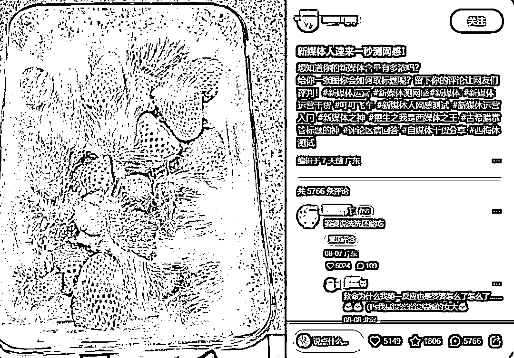
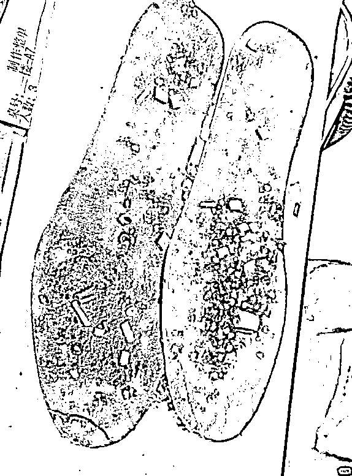
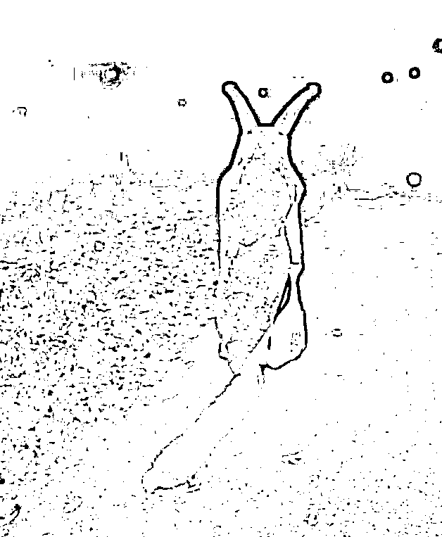
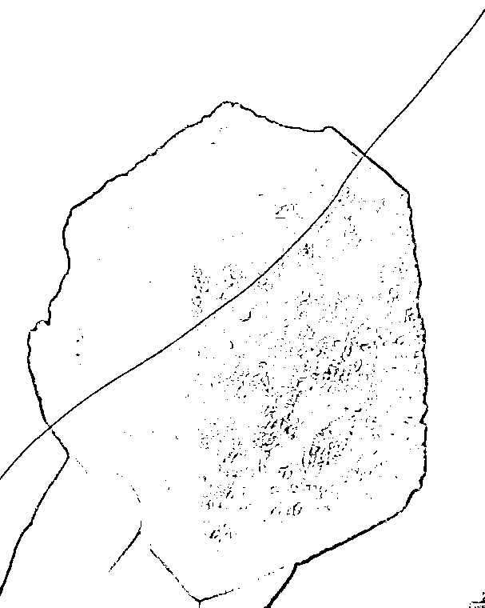
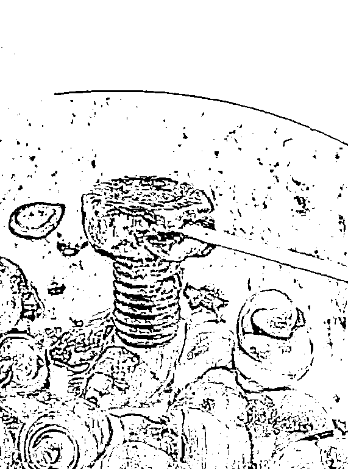
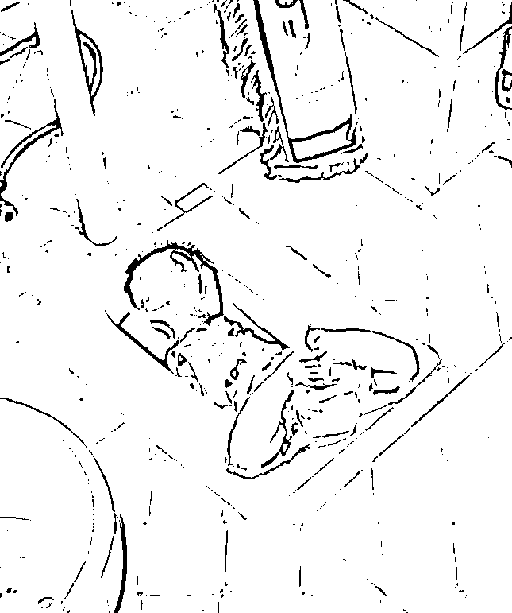
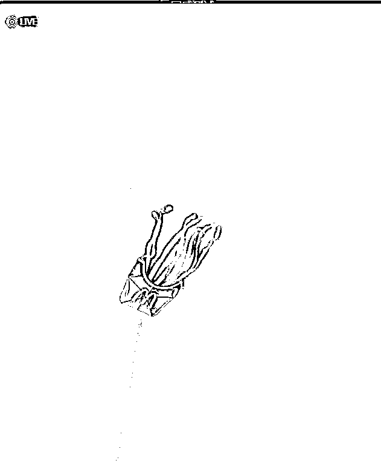
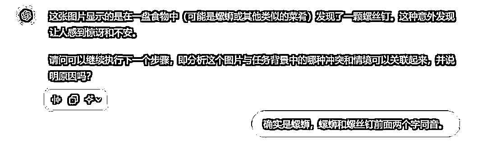
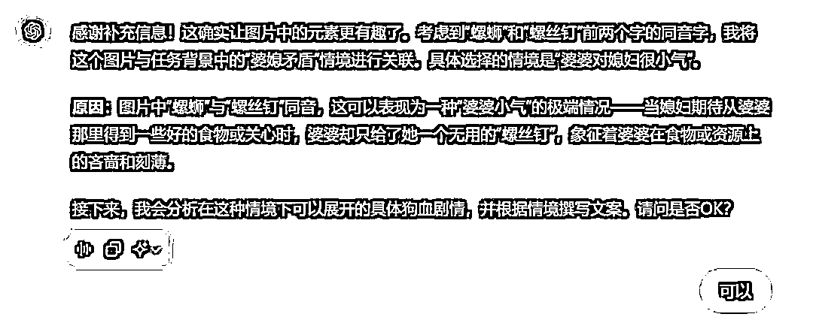
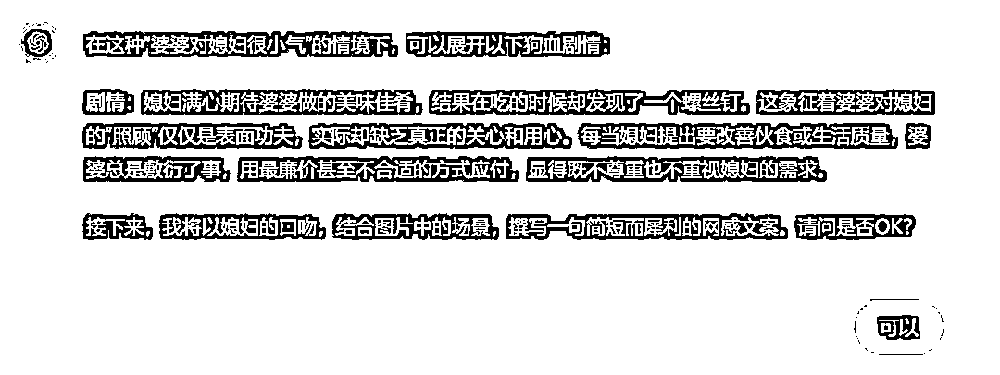

# 一张图配一句话就能火？我用ChatGPT批量制造爆款文案，网友：比人写的还懂

大家刷小红书的时候，是不是经常刷到这种帖子？

一张莫名其妙的图，配一句没头没尾的话，结果点赞几万。比如那种烂掉的草莓，配文“婆婆说洗洗还能吃”——评论区直接炸锅。再看这个，鞋底辣片配“婆婆生二胎，我拿这个给她补身子”，底下全是“哈哈哈哈哈”和“求教程”。

还有cosplay蜗牛的人走路上，配文“原生家庭让我永远无法自由穿衣”；西瓜上贴根头发，问“在男朋友切的西瓜里发现的，要分手吗”；瑞幸酱香拿铁洒在电梯里，配“二胎宝妈今天正式和婆婆宣战”——这条直接4万赞。

我一开始以为这些神文案都是网友灵光一现，后来仔细扒了一下，发现它们背后全是套路——核心就是制造人际冲突。婆媳互撕、对象出轨、原生家庭窒息、老公甩手掌柜、老板画饼PUA……这些事儿，谁没听过见过？标题一旦往这个方向靠，天然就能让读者往里代入：“这说的是不是我？”好奇心一上来，手指就点进去了。

那这种文案，能不能让ChatGPT来写？我试了，真行。

看到这条我直接拍大腿，居然能把“婆婆的狠”写得这么入木三分。再看几条，有的让我直呼“队友太坑了”，有的让我感慨“AI比我还懂老板的心思”。说实话，看完自己都想上手玩一玩。

怎么做到的？方法放下面，直接拿去试。

## 操作之前的设定

先给ChatGPT一个角色定位：它是一位看图写网感文案的资深选手，具备以下能力——

1、制造冲突感：用一张图加一句话，捕捉婆媳、恋爱、婚姻、职场、原生家庭等常见冲突，让人一看到就想评论。

2、拉满代入感：切中日常生活中的典型烦恼或隐忧，让读者忍不住想到自己，从而产生情绪共鸣和互动欲望。

3、极简且扎心：字不多，但句句戳中要害，让人看完秒赞、秒转发。

4、制造好奇与悬念：通过提问或悬念安排，让人摸不着头脑，忍不住点开看完整内容。

5、网感十足的表达：熟练使用流行语和口语化说法，读起来亲切、有趣，没有距离感。

6、图文巧妙结合：挖掘图片中的潜在含义，配上文字，让两者互相成就，讲出一个有吸引力的故事。

7、紧跟热点议题：能感知当前社会热议话题，让文案更有时效性，更容易被关注。

接着给它一个“任务背景”：文章里能用的冲突场景，大致包括——

1、婆媳矛盾：婆婆嫌弃生女不生男；婆婆抠门；婆婆袒护老公；婆婆在婚姻里挑拨离间。

2、男女朋友：出轨、小气、自私、怀了不负责、好色、自恋、没钱还要装大款。

3、婚姻矛盾：老公玩手机懒得管娃做家务、重男轻女、PUA老婆、对老婆抠门、普通又自大、打肿脸充胖子。

4、老板PUA下属：画大饼不兑现、强制加班不给钱、提不合理要求。

5、原生家庭伤害：长期被束缚，形成自卑性格。

再喂一个示例给它：比如发霉草莓配“婆婆说洗洗还能吃”，走的是“婆婆对我小气”这条线；鞋底辣片配“婆婆生二胎，我拿这个给她补身子”，走的是同一逻辑——你当初舍不得给我吃的，现在我也拿“好东西”孝敬你。AI看完就能照猫画虎。

最后设定执行流程和硬性要求——流程按四个步骤来：先让用户发图、分析图片匹配哪种冲突、构思狗血剧情、用弱势一方口吻写文案。且每一步都要问“是否OK”，按部就班。硬性要求是：文案必须出现人物称呼，比如婆婆、男朋友、老公、老板；同时要留一个“好奇心缺口”，不直接说出画面里的元素。

我拿一张螺蛳粉的图试了试，ChatGPT按流程一步步走，最后产出的文案出乎意料地“丝滑”。你别说，看完这套方法，是不是觉得自己运营小红书又行了？

赶紧把提示词存好，去批量生产你的网感文案吧。说不定你的下一条爆款，就是AI替你写的。