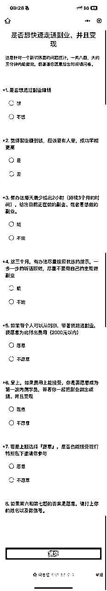
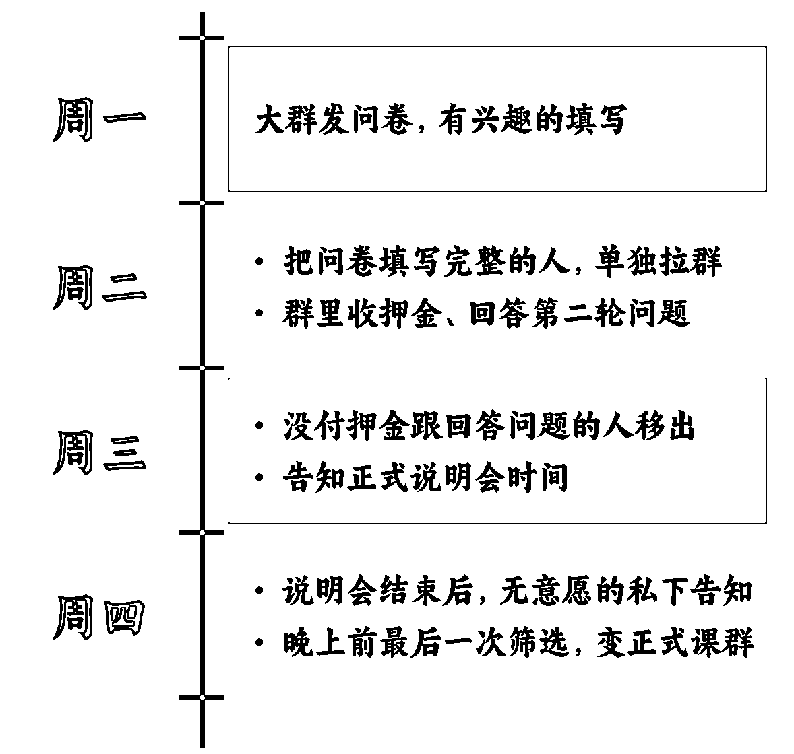
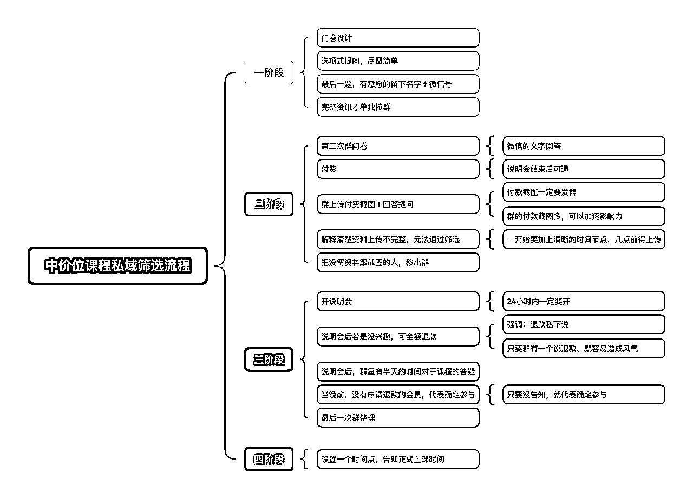

# 单价破千的新课，我把私域成交做到了四成
作者：龙哥

圈友们好，我是龙哥。

在知识付费和私域运营这条路上，我走了两年半。这段时间和明白老师、陈雪美女搭伙做俱乐部，成绩一直算稳定，会员净增长和复购表现都不错。

前两篇聊的是“如何选人”，今天换个角度接着聊：**怎么从存量私域里，把真正想买的人挑出来。**

契机是最近准备推一门新课，我趁机重新设计了一套筛选机制，想试试能不能把意向客户认得再准一点，把成交比例拉高一点。

结果比我预期的好，整体报名率差不多冲到了40%。

这篇文章会把完整的操作链路拆开给你看，每个环节我做了什么都写清楚，希望能给正在看的人一点启发。

也欢迎读完来和我交流。

## 公域和私域，本质上是两种逻辑

我越来越觉得，在已有的私域池子里做二次成交，难度其实比很多人想的高。

当然你也可以说，二次成交其实是老学员专属的福利——买过初阶课的人，才有资格提前摸到进阶课的门。但换个角度看，这毕竟是在向别人收钱，操作起来必须小心，做不好也容易伤感情。

在我看来，公域和私域的运营思路，应当有所区隔。

公域里鱼龙混杂，什么人都可能刷到你的内容。其中也许藏着一些我们想招的人，但你能做的，只有最粗糙的漏斗筛选，把范围划到最大。

私域则完全不同。私域的本质是**从自己认识的人里，找出那些更适合被交付的对象**。

而且私域讲究你情我愿——不光是你喜欢我、认可我，我也要觉得你不错，愿意和你建立更深的关系。

这和谈恋爱是一个道理，只有双向奔赴，关系才走得稳。

之前我在老社群里试过很多二次成交的方法。

比如开免费宣讲，但只面向内部人；对外部的人就收一点门槛费，比如99元，听完不感兴趣或者当下用不上，钱原路退回去。

又比如最简单粗暴的：群里发公告，@所有人说“新课上线，感兴趣私聊报名”。

但说实话，这些方式都比较单薄。

我内心一直有个坚持：**私域里的会员是自己人，有新产品一定要先让他们知道。**他们明白了、消化了，我再对外公开。

对外人来说，想提前看到这些内容，通常得付出额外的代价。

这个原则我觉得应该被放大，就像——你是我更高级的会员，所以所有好处和资讯你都应该优先拿到。如果你还不知道，我宁可不把这个消息放出去。

这是我理解中私域运营很重要的一点：**越资深的会员，理应享受越多的福利，包括第一时间看到我们的新品。**

## 为什么要内测：试市场真假，也磨课程成色

按价格来分，我的课程一般有低价、中价、高价三档。低价的大概在199到399之间。

低价课没什么好犹豫的，直接推就行。价格门槛低，给老会员一点优惠券，或者推广时多放点返佣，就足够有吸引力了。

但中价位的课，比如单价破千的产品，就一定要刻意筛选。

这次我做了一个实验：我手头有一门中价位的内测课，我自己觉得内容不错，但说不准市场会不会买账。所以我没对外招生，选择在内部拉一个小班。

拉小班有两个好处。

一是可以让老会员提前帮你判断，这个内容到底有没有真实需求；二是大家一边上课一边反馈，我就能顺势调整讲课节奏、内容密度和互动方式，把课打磨得更顺手。

换句话说，这一套筛选玩法，特别适合**新课试水、迭代发售和小范围跑通**的场景。

## 四轮筛选，我到底是怎么跑的

因为中价位的课目标很明确——筛选，我要确保每个进来的人，既清楚课程是什么，也确实有对应的需求。

所以我直接把动作放在会员群里。

目前我们一共有三个会员大群，每群大约260人，总计600多人（第三群还没拉满）。

### 第一轮：用一条群公告，筛掉不活跃的人

我直接用群提醒功能@了所有人，发了一段话：

“@所有人 大家早上好，不好意思突然打断，想请大家花两分钟填一个问卷。这两年赚钱越来越难，我相信不少人都有搞副业的念头。俱乐部平时的内容，其实和‘带人赚钱’关系不大。但我在自己做副业、带学员做副业这方面，经验一直不少。所以我打算做个统计——俱乐部升级后，我们准备推一个新训练营。这个训练营很实在，你可以把它理解成副业陪跑。三个月内，大概率能跑通一条路，并且真的见到钱。如果你对我说的这些有兴趣，就填一下下面的问卷。”

这段发出去后，我顺手丢出一个表单。

问卷问题不多，全部是二选一。

这轮我管它叫**“活跃度筛选”**。一个群超过200人以后，聊天记录刷得飞快，每天真正会点开看的人一定是少数人。愿意停下来看的，大概率是**对社群认同度比较高的人**。

### 第二轮：用表单完整度，筛掉不认真的人

问卷里有个小心机：我会把课程的大致价格写在上面，同时也会问：这是不是你需要的？

最后一个问题是开放式的——如果你觉得这个价格能接受、意愿很强烈、课程也确实是你想要的，请在下方写下你的名字和🛰️号。

之所以把前面所有问题都设成二选一，只有一个原因：**快**。浏览的人能在几秒内完成选择。

假如我设了七道题，有人只回答到第六题，哪怕他最后留了资料，这个人我也不会要。

表单最后一题需要手动打字，有人就写个昵称，有人会把姓名和🛰️号写全。

我在筛选时，只圈定那些**所有题目都答完、最后信息也填完整的人**。只有这样的人，才配进我的内测名单。

结果出来了：600多人里，89人提交了表单；其中把题目全部答完、资料也完整的，是58人。

这58个名字，我一个一个手动私聊，把他们拉进了一个临时的讲解群。

### 第三轮：用一笔“可退的押金”，筛掉犹豫的人

问卷只是第二关。进群之后，我直接摊牌：

“这门课比较特殊，学员必须对我有足够的信任，同时确实需要这门课，才能真正学出效果。所以，在讲解群里，我会再做一次筛选。”

然后我告诉他们，这是第三次筛选，要做的事有两件。

第一，先交一笔锁定费。我发了一个付款链接，并说明这笔费用是参加宣讲的占位金。如果听完宣讲，你发现这个课不适合你，不是你现在需要的东西，我会全额退还。换句话说，这笔钱其实已经是课程的正价费用，不只是押金。

第二，再做一份提问。我问了几个问题：

1、姓名是什么？
2、🛰️名叫什么？
3、目前有没有正在做的副业？
4、你认不认同：副业初期听话照做，成功率会更高？
5、一年之内，你希望通过副业达成的月收入是多少？

这同样是一层意愿度的测试。

收齐之后，我设定了一个截止时间，比如当晚十点，或者第二天早上七点，然后做结算。到点后，没有发付款截图、没有回答问题的，一律算不过关。

时间一到，我就在群里提醒：

“第三轮筛选到此告一段落。非常感谢每一位愿意考虑、愿意信任我的人。目前我收到了40位伙伴的截图和回答。接下来我会做最后一遍清理，没有交截图和答复的朋友，我会先移除出群。这个群会保留，成为副业起跑的正式宣讲群。被移出的人，提前说声抱歉——这门训练营比较特殊，所以筛选门槛稍微高一些。”

### 第四轮：24小时内开讲，用宣讲做最后检验

把人清完之后，我紧接着安排宣讲时间，通常放在第二天某个整点。

宣讲用纯文字进行，开场我会告诉大家大概要花多久。

时间一到，我就开始正式讲解。宣讲结束后，决定报名的人留在群里，想要退款的人会被移出去。原来的宣讲群，也顺势变成课程群。

这一轮本身不复杂，最怕的是**间隔太久**。

也就是说，当第三轮没交钱的人被移走之后，正式宣讲必须在24小时内开幕。

## 两个随时会翻车的细节

### 细节一：节奏必须压得极紧

这是整条链路里最核心的一条：**动作要快。**

第一天发问卷，第二天或第三天就得把群拉好、把钱收上来、把宣讲时间定下来。

比如：周一发问卷，周三必须完成拉群和邀请；周三在群里做二次过滤、收钱、收提问；周四就必须把宣讲讲完；当晚就要让大家表态，想退的赶紧退。

因为时间一拖长，热情就凉了。

原本兴致勃勃的人，隔了几天可能会想：算了，好像也没那么需要。

所以核心原则是：**全程压缩在三四天内，绝不多耗一天。**

还有一个小技巧：交完钱的人，付款截图一定要发进群里。

这是故意为之——当大家看到有人已经付款，会不自觉地想：“他付了，那我也试试也无妨。”更何况我们一开始就说了可以全额退。

### 细节二：想退款的人，必须私聊

第四轮宣讲结束后，我会明确告诉大家：

“晚上八点，是你们做最终决定的时刻。听完之后，如果你发现这门课不适合你，这个训练营暂时不是你需要的，欢迎你私下跟我说。”

为什么要加“私下”两个字？

因为如果退款行为发生在群里，很容易产生连锁反应。只要有一个人跳出来说退，其他人就会想——“他能退，我为什么不能退？”

这是一种群体的无形压力。

前面每一轮筛选，我都在群里公开操作，唯独最后这个退款环节，我反复强调：私聊找我。

第四轮结束，课就正式开跑了。你们付的钱，如果没有退，就是这门课的完整学费。

最后统计下来，私下找我退款的有4个人。

## 这套筛法，带给我什么

### 第一，客户画像更清楚了

先说结论：这次的转化成绩我很满意。

对于一个单价2000元上下的产品：

- 首轮在总群提交问卷的人：88人
- 次轮被拉进讲解群的人：58人
- 末轮真正报名的学员：33人

从问卷到拉群的转化率，接近38%。

这个数字相当能打，因为最后被筛出来的人，每一个都称得上精准。

当然，放到整个社群里看，人数占比并不高。但恰恰是单价高的产品，才更需要这种筛法——它能帮我们找出那些平时藏在群里、没被唤醒的潜力会员。

原因很简单：不同主题的课，吸引的是不同的人。

一个近千人的俱乐部里，不可能人人都爱沟通，也不可能人人都迷写作。这套机制最大的价值，就是让你一眼看清：眼下这个主题，到底有多少人是真的感兴趣。

### 第二，现金流给出正反馈

另一个实际的好处是：**哪怕人再少，课也能开。**

一门2000元左右的中价位课，招到5个人就是一万块。这是一个非常健康的现金流起点。

只要开得起来，就说明有市场；有市场，课程内容就能越做越厚。

## 附一张完整的操作地图

这次实验，本质上是一次“用筛选倒逼转化”的私域尝试。

整套路径并不复杂，但如果每个细节都执行到位，转化的提升会非常明显。

我把整个过程画成了一张思维导图，放在下面，供各位参考。

谢谢你们看到这里。

我是根源，第四期赚钱圈友。一个积累了两万多个实战案例的心理咨询师，有12年线下销售和团队管理经验，2022年转型线上，做起知识付费。

我过去的文章，大多围绕私域经营、成交技巧和副业变现这几个方向展开。如果你感兴趣，也欢迎翻翻历史记录，希望里面有些内容能帮到你。

下次再聊。