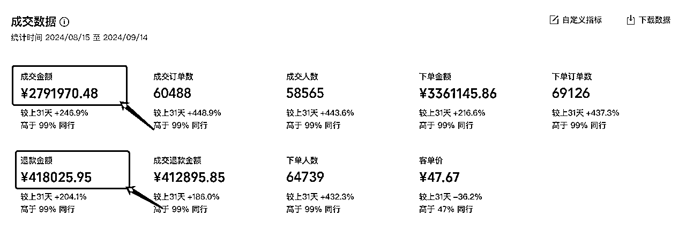
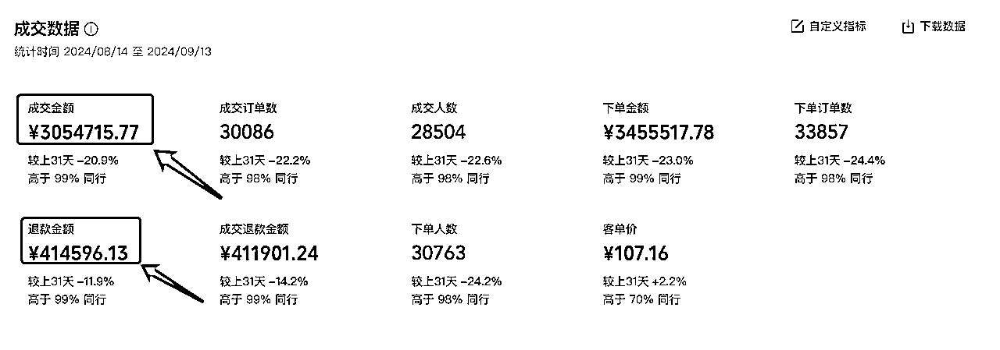
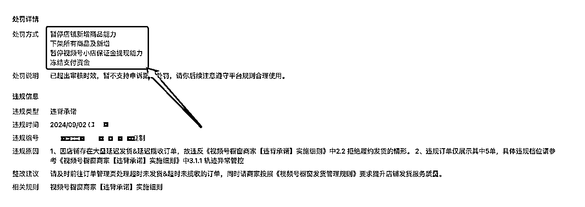
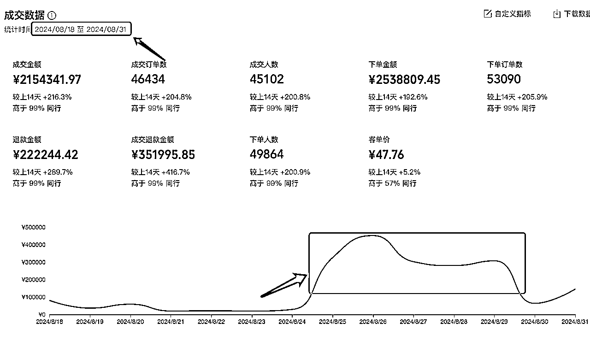
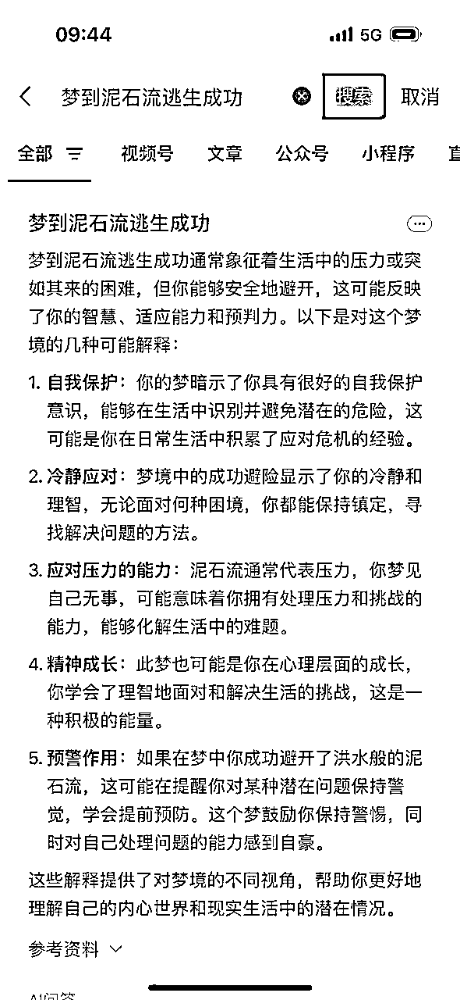
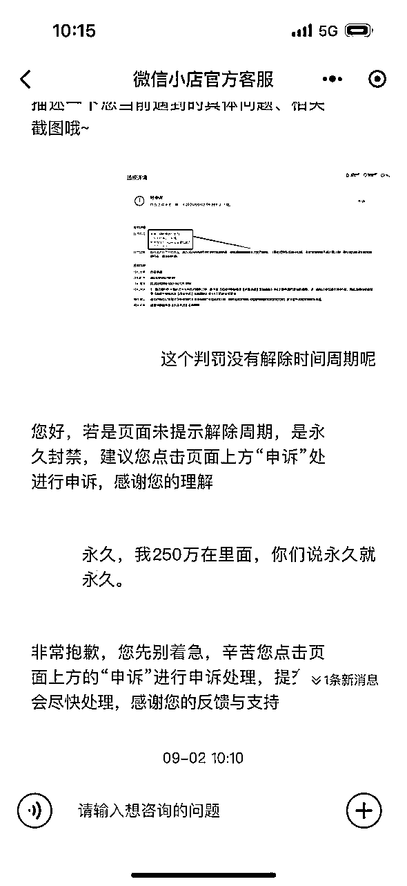
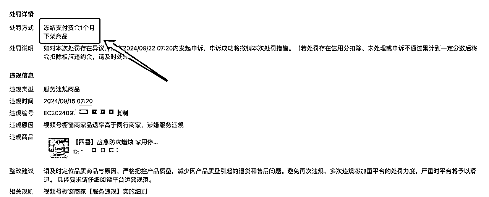
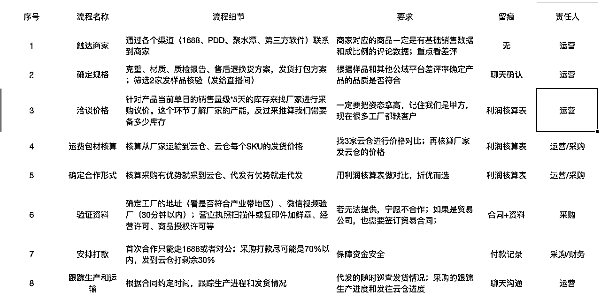
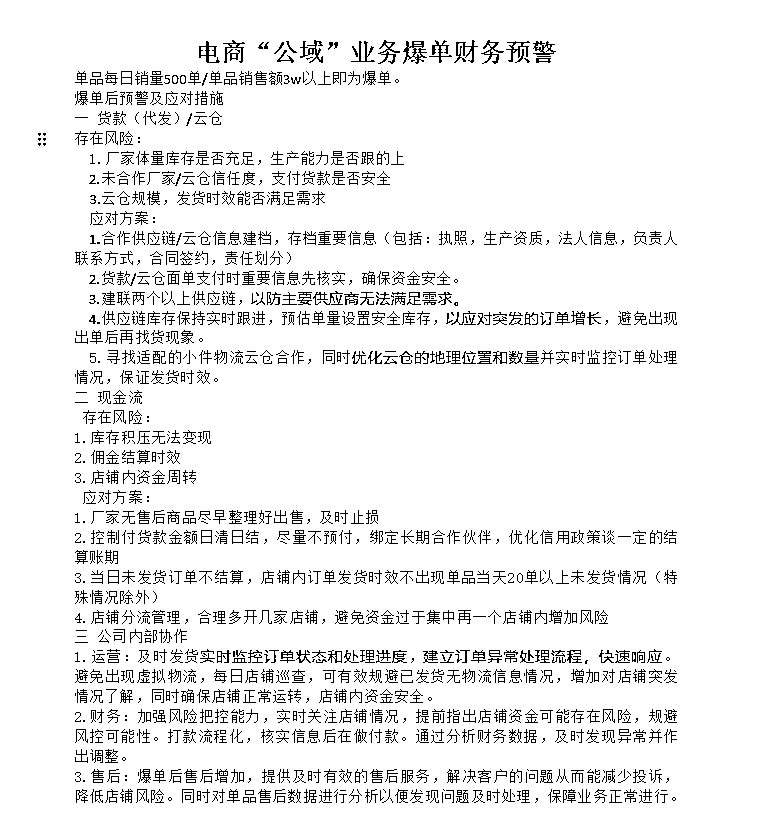

# 200万GMV，50万亏损：我在🛰️小店踩过的那颗最响的雷

五天，两百万销售额。最后算下来，倒亏了五十万。

这不是段子，而是我这个月亲身经历的一场真实事故。如果你也在🛰️生态里做电商，下面这篇内容，请你务必留出几分钟看完。该踩的坑我已经替你踩完了，只希望你不用再踩第二遍。

先交代一下我的背景：在视频号电商这个行当里摸爬滚打了三年多，目前主要做供应链后端和自营直播，🛰️豆月消耗超过350万，直播月GMV大约在800万上下。按说也算是见过风浪的老兵了，可这次的教训，差点让公司直接趴下。

事情开始前，先放三组图。前两组是我🛰️小店店群中两个店铺过去一个月的经营数据，重点看成交金额和退款金额；第三组是店铺遭到处罚后，250万流动资金被冻结的通知函。

看完图，你应该能感受到问题的分量。接下来，我把整件事的来龙去脉原原本本说清楚。

## 一、爆单的起点

一切要从8月25日说起。

在此之前，这家店铺每天也就五万到十万的流水。25号之后，数据像脱缰一样往上冲——一天三十万，四十万，后台的出单提示音响到几乎停不下来。引爆这条曲线的单品，是很多视频号玩家都听说过的应急蜡烛。

说句实在话，在这个行业待久了，爆单这种事我早就没了新鲜感，短暂兴奋之后第一反应反而是警惕：上游的货，到底能不能按时发出去？

当天我至少追着运营负责人问了三次：工厂产能跟不跟得上？发货有没有保障？对方每次的回复都一模一样：没问题。

之后的几天，我也一直在跟进这件事。中间虽然换过几个合作厂家，但传递回来的消息始终是：货在正常发。

直到28号晚上，厂家那边突然松口：没货了，全网都在抢，最快也要30号才能补到。

这时候，运营负责人面临一个选择：一边是销售指标的诱惑，一边是次日就要跟团长结算的现实压力。他咬咬牙，做了一个让上游“先打单、后发货”的决定——也就是业内常说的预发货。

这个决定，埋下了整场事故的引信。

后来铁罐装确实彻底断货，我们临时换成了玻璃罐，流量才慢慢降温。我当时以为这一关算是过去了，还宽慰团队说，接下来一周售后可能会忙一些，大家辛苦点。

我怎么也想不到，真正的噩梦才刚刚开了个头。

## 二、爆雷时刻

9月2日，星期一。凌晨，我被一个噩梦惊醒——梦里我一路被泥石流追赶，几乎无路可逃，最后拼了命爬上一块高地才活下来。醒来后心有余悸，特意查了查周公解梦，看到解语不错，这才又睡了过去。

早上到公司，刚坐下不到二十分钟，主管推门进来，一句话让我整个人当场愣住：“某某店铺被封了，资金全部冻结。”

开什么玩笑？

做后端供应链的，最怕的就是资金链断掉。钱一锁死，整个业务基本就是停摆状态。

我们立刻排查原因，初步锁定在8月29号那批订单上——这批单子全部卡在“预揽收”状态，之后物流信息就再没更新过。找到厂家追问发货情况，对方这才吞吞吐吐地告诉我们：这阵子产品涨价太猛，原来那个价格做不出来了，想要货，得加钱。

我听完火气直接顶到天灵盖：货拖着不发，现在还能坐地起价？这不是趁火打劫又是什么？

更让我后背发凉的是后头。我去问🛰️小店的人工客服：资金冻结有没有时间限制？对方冷冷回了一句：没有时间限制。

没有时间限制，那就是永久封禁。

250万资金锁在里面，对公司的打击几乎是致命的。

## 三、一波三折的解冻之路

有了人脉的帮忙，我们总算找到了解封的渠道。对方给的答复是：周四之前把所有异常订单处理干净，就能申请解冻。

这句话算是给我打了一针强心剂。

接下来几天，我们满世界找货，安排补发。好不容易熬到周四，29号的订单总算处理完毕，申请人提交上去。结果官方回复：仍有异常订单没有处理完成。

我隐隐觉得不对劲，让运营把跟应急蜡烛相关的所有订单，从头到尾用工具彻查了一遍。

不查还好，一查我整个人冷汗直冒：几万笔订单里，物流记录完整的，加起来不到5000单。换句话说，从25号爆单开始，中间只有一家工厂真正在发货，另外两家基本上等于没动过。

这里得先解释一下我们的结算方式——做的是线下T+1结算，不走平台担保交易。这意味着什么？我卖了200万，第二天要先垫付至少140万的佣金给渠道；产品成本30万；服务费、运费险加一起还要15万。如果这些货一单都发不出去，我的亏损会直接突破120万。

这还只是账面数字。真正处理起来，比这还要折磨人。

联系第一家供应商，对方给出的理由是：你们付款后第二天，产品涨价了。他想着等价格回落再发货，于是一拖再拖。说实话，听到这个解释，我心里已经不想骂人了，只觉得荒唐。

第二家供应商更离谱。问他们26、27号的订单为什么没发，对方自己都一脸茫然。反复逼问之下才承认：那批订单压根没走他们公司，包给外包了。

你能想象吗？我的货，被我的供应商外包出去了，而外包方有没有发货，他根本不知道。

最后期限是下周一。周五那天，我分别给两家供应商打了电话，加起来聊了三个小时，得到的回复依然都是“没问题”。可我已经一个字都不敢信了——那几天公司每天净亏三万以上，多拖一天都是烧钱。

当天下午，我直接买了机票飞义乌。找到两家供应商，让他们带我去工厂，一间一间看生产进度，亲眼盯着他们，确认周一之前能把货发完。

周一，货总算补齐了。申诉再次提交，官方依然说有不正常订单。我们索性把店铺八万多个订单翻了个底朝天，又翻出一批超过一个月以上的丢包和异常包裹。处理完这些，已经是周三。店铺终于解封。

账户里八十多万成功提现的那一刻，我才真正松了口气。

但事情到这里并没有结束。昨天，这家刚解封的店铺，又因为品退率严重超标，被冻结了30天。关于这一节，今天先按下不表。

## 四、五十万换来的复盘

财务把账算完：应急蜡烛这一仗，所有费用加在一起，整体亏损接近50万。

说实话，我心里早有预期。但当那个数字真的摆在面前的时候，还是忍不住沉默了很久——这是我做电商这么多年以来，最大的一次教训。

痛定思痛，团队坐在一起做了五个小时的深度复盘。以下这些总结，是我最想对同行们说的。

**第一，品控永远是先于一切的前提。**

店铺端必须把商品质量牢牢攥在自己手里。品质不好的品，尽量不要碰。跑出来的爆品，前期一定要采样回来亲自把关，同时去拉一圈这个商品在其他平台的差评数据。差评率偏高的，直接放弃，别犹豫。

尤其是我们这种以云仓代发、代采为主的模式，对仓储端的实际掌控本来就弱，品控更要前置再前置。

**第二，库存和产能，必须亲眼确认。**

确认库存最靠谱的方式，就是视频连线实地看厂，让对方带你看原料、看产线、看囤货。从外面采购到自家云仓的，一定要签购销合同；让工厂直接代发的，签一件代发合同。

采购数量也要克制。兴趣电商的周期很短，按三到五天的销量备货就够了，别贪多。跑单过程中要随时盯着销售数据，根据实时趋势去调整生产和库存计划。

说白了，事故初期我们最大的失误，就是太把希望寄托在第三方身上，没有第一时间亲自下场核验，这个教训极其深刻。

**第三，要有数据意识，更要盯紧平台规则的变化。**

视频号平台有一个特别容易让人忽略的地方：很多新规并不会单独发公告，而是直接在原有规则页面里更新。所以每周至少抽出一到两个小时，去规则中心翻一翻最新变动。去年年底我吃过一次“服务违规”的亏，同样是消息滞后导致的。

这里可以存一下《视频号橱窗细则》的文档链接：https://docs.qq.com/doc/DTnVBdlZYRFJKTXJi

商家重点看“2.8商家违规管理”，达人重点看“3.2管理规则”，根据规则及时调整自己的操作。

数据方面，要盯住DSR评分中最核心的三个指标，同时特别留神“服务违规”“违背承诺”“虚假交易”“骚扰他人”这四个最容易导致资金冻结的雷区。

现在我们内部已经开发了一套物流监控工具，每天自动检查所有店铺的订单物流状态，发现异常直接告警到对应负责人。品退数据的监控功能也已经在规划中，目的就是尽量把风险提前拦在门外。

**第四，量力而行，学会做减法。**

这个原则体现在两个层面。

一个是品类。店铺经营不要铺太杂，专注三个以内的类目，供应链才稳得住，才能在价格和品质上建立优势。不然运营每天光找产品就焦头烂额，哪还有精力做深做透。

另一个是合作边界。近期公域业务量涨得太快，我们团队的服务能力已经被严重透支。所以接下来的周期内，我们只对接团队和团长，暂时不对接个人玩家。

倒不是说个人玩家不重要，而是精力有限，把时间花在产出更高的地方，才符合商业规律。这趟去义乌，我也有深刻感受：那些商家一看你是散客，根本懒得搭理你；你要是能带来几十上百万的大客户，态度完全不一样。各司其职，效率才最高。

**第五，预警机制一定要提前建好。**

一个公司要稳步发展，业务端和财务端都必须设置预警机制。

比如，爆单时需要同步确认哪些信息？订单出现问题，怎么对接上游、运营怎么响应才能把损失压到最低？资金被冻结，业务该怎么调整、备用现金流从哪里来？

这些问题的答案，应该在风平浪静的时候就提前写好，而不是等到风浪打过来才手忙脚乱。我们为此专门做了一份财务预警方案，把所有关键指标量化成了表格。

**第六，看清平台的风向，顺势而为。**

最近官方的动作已经非常明确了：对商家的服务质量和产品品质，只会长期收紧，不会放松。平台就是要用规则逼着商家不敢上架品退率高的产品，不敢不把服务做好。一旦被抽查到，基本上反手就是一个资金冻结，很多中小商家根本扛不住。

我身边圈子里，被冻结过店铺的不在少数，最惨的一位直接被冻了二十多家店。

这种趋势传导到达人端也一样——商家不敢卖烂货了，达人自然也没法再带“韭菜产品”，只能转而去精选优质商品、寻找服务过硬的商家合作。短期看大家都会难受，但长期才能换来整个🛰️电商生态的良性循环。

总结就一句话：好好做内容，好好做产品，好好做服务，永远与平台站在同一边。

## 五、教训之外，还有几点人生感悟

这次的经历，除了业务层面的复盘，还逼着我往更深的地方想了想。有几个认知如果不改变，未来可能还会栽更大的跟头。

**第一，人情世故和合同契约，一个都不能少。**

以前我总认为，跟上游在线上保持联系，业务就能顺顺利利推进。但这次之后我彻底明白了，光有线上关系太薄了。线下见面、吃顿饭、多聊几句，有人在情分在，对方在做决策时就会多替你考虑一层。

人情之余，合同更是底线保障。该签的协议一定要签，该留的证据一定要留。虽然就算签了合同也拦不住老赖，但至少出事的时候，你还有一分挽回的余地。两个都缺一不可，才是行走生意场的完整铠甲。

**第二，要给合作方留足利润空间，他才会真正为你的生意着想。**

合作的底层逻辑永远是共赢。你让别人赚到钱，他才可能把你的事当成自己的事来做。这次我们给供应商的利润其实并不低，只不过运气不好碰上了不合格的合作方。反观其他业务线，凡是利润给到位、沟通透明的合作关系，都维持得相当稳固。

这让我想起早些年开手机店的经历：一个顾客让我赚够了钱，他下次再来，不用说，我自然会服务得无微不至。这就是人性，先有利益的绑定，才谈得上忠诚和服务。

**第三，商场如战场，任何时候都不要高估人性，更不要忽略人性。**

这次在义乌，听圈子里的朋友讲了不少真实的坑。有些厂家，别人每单多出一毛钱，就能把你的订单排到后面去；有些合作伙伴，一看原材料涨价，就压着货死活不发出，硬生生把你的现货拖成期货；还有些贸易商，连个像样的仓库都没有，只是1688上开了个店，为了拿下你的单子，什么假资质都敢P，视频验厂都敢骗。

人为财死，鸟为食亡。在利益面前，多长一个心眼永远不是坏事。

**第四，创业路上，任何阶段的“懒政”都可能致命。**

过去一年，我在公司里更多是掌舵者的角色，精力主要放在支付业务上，电商这一块基本交给了团队执行。坦白讲，这次主管跟我说“发货没问题”的时候，我没有再追问一句，就是最典型的懒政。我以为这是信任，但本质上是我脱离了一线。

小风险的事情可以给员工犯错的空间，但大资金、大决定，创始人必须冲在前面亲自把关。水能载舟亦能覆舟，好不容易拼下来的家业，千万不能因为一时松懈就退回起点。

**第五，兵马未动，粮草先行，永远给自己留足余量。**

人员的招聘一定要跑在业务扩张前面。不能等到全员超负荷运转、业务开始混乱了，才想起来补人。业务混乱造成的损失，大概率远大于多养几个人那点工资。

《贫穷的本质》里讲过圣约翰医疗中心的故事：手术排得太满，没有任何多余的手术间，结果事故率飙升、口碑崩盘。后来他们只做了一件事——专门留一间手术室待命，不排任何手术。整个局面就这样扭转了。

这就是“闲余”的力量。公司经营也是如此，手里有余量，心里才不慌。

---

最后，用尼采那句被无数人引用过的话收尾吧：那些杀不死我的，终将使我更强大。

创业十二年，大大小小的风浪经历了不少。有些坎轻松就迈过去了，有些劫却硬生生要褪一层皮。但每一次扛下来，团队的韧性就厚了一分，能走的路也会宽一分。

路漫漫其修远兮，吾将上下而求索。与所有还在路上的创业者共勉。