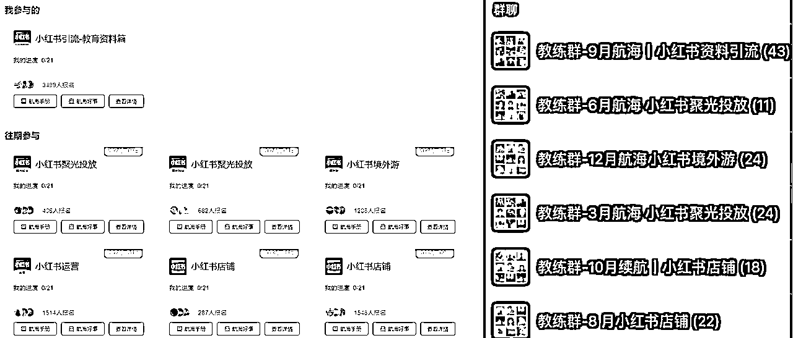
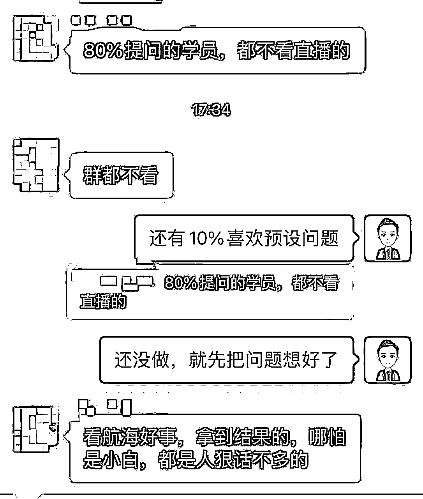

# 做了几次教练，总结了新手最容易放弃航海的 5 个原因

哈喽，我是叁斤，第七期加入赚钱，同年8月第一次担任📕相关项目的航海教练，之后就一直有跟📕项目的航海

带过这么多趟航海，我发现一个特别有意思的现象：开船前大家个个热血沸腾，恨不得立刻上手操练；真到了破冰结束的第一天，群里举手提问的密度达到顶峰；再往后，提问的人一天比一天少，到了航行中后期，很多人干脆彻底沉默。说白了，大部分船员已经悄悄放弃了。

这次虚拟资料航海尤其明显，因为船上人实在太多，问题被放大了好几倍。我们几个教练在群里复盘时，也聊到了很多学员的共性问题。

说实话，项目做到一半才发现不适合自己，这可以理解。但最可惜的是，有相当多的人连起步都没迈过去——第一天劲头十足地问东问西，第二天、第三天就再也见不到人影了。

我先后跟了5次航海，最近特地整理了最容易让人中途放弃的5个行为习惯。想在这条船上拿到结果，真心建议对照看看。

# 新手航海，最容易栽在这5个坑里

## 坑一：手册不看，问题全靠群里问

这次虚拟资料航海报名接近4000人，目前还在船上的大概3200左右。刚开船那一两天，群里提问刷得飞快，但我们翻了一圈发现，绝大多数问题手册里写得明明白白。

比如怎么建资料库、二手手机选什么型号、爆款选题怎么挖、引流怎么做……这些答案手册里都有，可很多人还是习惯性往群里抛。教练虽然有义务答疑，但要是群里全被这种“已知答案”的问题淹没，人就会疲掉，慢慢地就不太想点开群聊了——真正有价值的问题反而没人理，或者直接被刷过去。

不读手册、指望教练全程喂饭，这类人大概率会倒在准备期。我后来翻了翻记录，有几个问“怎么搭建资料库”的，现在早就退出群聊了。

## 坑二：想太多，做得太少

不少学员属于“高敏感体质”，号还没起，就开始脑补灾难：会不会被封？连着Wi-Fi会不会连带封号？资料万一有版权问题怎么办？——这些担忧等于亲手给自己砌了一堵墙，也是给自己找好了不干的借口。

还有一类人特别喜欢预设问题，实操一步没做，先把养号、网络、举报、封号等一长串问题列出来等着教练解答，但就是不打开软件动手做。

可真相是，真去做了，你会发现大部分担心根本不存在。没专门养号，账号照样能跑起来；没有干净网络，连Wi-Fi也能完成起号，照样不会限流。实际上，只要你真上手，预想的问题里80%都不会发生。

我们教练群里@希平 说过一句特别戳心的话：“认真看手册拿到结果的，哪怕是小白，也都是人狠话不多。”我验证了一下，还真是。那些真正埋头实操的人，基本不在群里冒泡，只有遇到真问题才出来问，比如真的限流、真的违规了。相反，还没开跑就各种焦虑的人，基本都报废在起步阶段了。

## 坑三：预期高得离谱

有一批船员对自己的要求有点过于严苛了：第一篇笔记就想着爆，没爆就不想干了；或者给第一篇定了个很高的数据目标，没达到就大失所望。

这时候，群里有人提到赚钱的“1块钱思维”，我觉得特别受用。新手航海，别一上来就盘算着赚个大的。先赚1块钱——把产品找对，把低价资料卖出去，跑通闭环，再想后端高价产品的事。

还有人觉得：我也没有后端产品啊，光靠资料一份卖几块钱，赚着真没意思……说实话，这种想法多半是眼高手低。别小看一份几块钱的虚拟资料，只要跑通流程，赚到第一块钱，后面放大去做，一样可能做到月入几万甚至几十万——很多教练就是这么走过来的。可要是第一块钱始终赚不到，后面的几万几十万又从哪里来？

退一万步讲，就算你最后没放大，每个月只赚几百块，那又怎么样？你亏了吗？没有——你学到了运营技巧、引流技巧，这套方法搬到别的项目里，你的起跑线已经领先别人一大截了。

所以别想那么多，既然报了航海，就先干起来，先把那1块钱赚到手。

## 坑四：什么都想干，结果什么都干不成

以前航海里，一次性报好几个项目的人真不少。我记得有个圈友在群里说，自己一口气报了9个航海——我当场就惊了，这哪做得过来啊？

这一期航海优化了，每人最多报2个，我觉得很赞。但说句实话，2个还是偏多。真正有精力跑通的，通常只有一个项目。事情一多，精力就散，结果自然更难出来。

还有的船员，在同一个项目里也想铺太多方向。比如这次虚拟资料航海可以附带网盘拉新，于是不少人在资料库都没搭起来的时候，就开始琢磨网盘拉新怎么搞了……能做吗？能做。但你总得先学会走，再学跑吧？先把虚拟资料这条线路走顺了，再谈网盘拉新也不迟。

## 坑五：想等万事俱备再动手

我一直主张用最小阻力去推进项目，但跟了几次航海后发现，很多圈友有个执念：必须把所有准备都做足了再开始。

虚拟资料航海需要两三部手机，自己只有一部，那就先去买新设备，等设备到了再开工；或者非得把资料库搭得完整、后端找好、社群备好，才肯去运营账号。

其实每个项目最关键的步骤就那么一点点，拿虚拟资料来说，核心就是做笔记、引流。这两件事没做好，后端搭得再漂亮又有什么用呢？做笔记和引流，一部手机照样能跑，真不一定非要一堆账号同时运作。

# 想在航海里跑出正反馈？就两招

## 第一招：死磕手册

航海手册是每次开船前，赚钱团队和教练们吭哧吭哧写了好久的成果，内容很全，而且非常照顾新手。

我知道有些人一看到手册就觉得太多、看不下去。这里得说清楚：手册是写给全船所有人的，教练写的时候必须考虑大而全、系统性，确保对每个人都有用。但每个船员的底子、条件、方向都不同，所以不必从头啃到尾——挑你最需要的部分看就行。比如私域、矩阵、AI、投流、差异化资料，暂时用不上的，可以先跳过。

把最重要的步骤拎出来。以虚拟资料航海为例，最核心的流程就三步：

1. 确定赛道
2. 找资料
3. 做笔记，卖它！

就挑这三部分仔细看，其他的先放下，先做起来。

还有一类人，觉得自己懂一点就不看手册了，“我知道怎么做的，没必要看”，然后有什么问题直接往群里抛。别这样。别小看教练写手册的功力，也别小看赚钱团队整理资料的用心。手册能帮你从0到1跑通整个项目，而你脑子里那点认知可能只停留在“买资料发📕”的粗流程上。手册连怎么找资料、怎么避开版权坑、怎么做账号这些细枝末节都写了，而且写得很细。

所以，一定要看手册，不管你会不会这个项目，都要看！

## 第二招：在事上练

看完手册，就去干。遇到问题再来群里问，不要预设问题，不要自己吓自己。你脑子里那些“疑难杂症”，实操下来80%根本不会发生。

把关键步骤提炼出来，然后直接开始。所有项目的关键步骤也就两三步，先起步再说。运营中遇到任何卡点，随时来群里喊，志愿者、领队、教练都会帮你。

真的，别想辣么多，先干！

# 给赚钱团队的两点小建议

前几天赚钱团队打电话过来，聊了聊我做教练的一些感受，我也提了两条建议。

## 建议一：建一个问答库

航海里的小白太多了，真的一点概念都没有，光甩一本人手册给她，肯定也会有一堆疑问。比如📕运营里的“一卡一机一号”，这是风控手段，但要是船员总共就两三个号，根本不需要特意规避。这类问题就可以整理成问答库，让他们直接查。

另外，可以把以往所有📕系列航海的学员提问，去重后汇总起来，下一次航海遇到简单问题，直接引导船员去问答库搜答案就好。

## 建议二：提高点评频率

现在作业点评是每周1、3、5，三次。如果有了问答库，点评频率也可以提上去，教练和船员的连接会更深。单个教练时间有限，不能做到每天点评也没关系，可以让不同教练错开——1、3、5一组，2、4一组，换着来。

带航海的过程中，我确实发现有些船员会在日志里提问，但不来群里说话，所以增加点评频次还是很有必要的。

——

以上。祝所有船员都能在航海中，顺利赚到那1块钱。