# 用微信豆把广告素材导进视频号直播间的实操打法

> 来源：[https://gjoli5kpqu.feishu.cn/docx/KiAbdwt1yosVSMxDhsecCWkynbh](https://gjoli5kpqu.feishu.cn/docx/KiAbdwt1yosVSMxDhsecCWkynbh)

大家好，我是牛公子。

我是视频号早期的一线操盘者，累计投放花费破亿，单次播放曾冲到4亿级别，单月GMV站上千万，主攻生鲜赛道。目前旗下三家公司，业务覆盖直播带货、IP孵化、达人专场操盘。

今天跟大家聊聊，我在视频号用微信豆做素材投进直播间的实战方法论。

做投素材这条线起家，公司一步步做成了类目头部，也搬进了微信广州总部。第一次操盘达人专场，单场成交409万；最近一次口播单品投流19天，成交破百万，投产稳定在3以上。

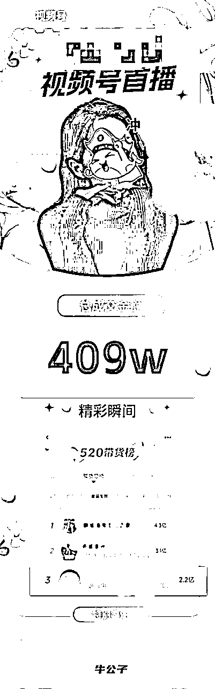

今天恰好是我团队在广州微信总部开业的日子，心情很复杂，一句话概括：感谢这个时代，感谢生财有术！我把这篇文章写给生财有术陪伴我的四年创业时光。

刚进入视频号时，圈内前辈的经验帮我避开不少坑。借这个有纪念意义的日子，也想把心得留给生财的伙伴们，为考虑在视频号做付费的同学提供一些参考和启发。

# 一、视频号直播正在发生的转变

视频号直播从2020年起步，到现在已经历数次大的变化。

表面上看，它像抖音直播、淘宝直播那样独立存在。但实际上它在加速与微信融合，依托13亿月活的国民级App。视频号直播已不再是孤立的直播场景，而是微信生态里连接用户关系的重要触点。

因此研究视频号，必须用整个微信链路的视角来看。未来视频号会进一步打通公众号、小程序、社群、朋友圈、1V1私聊、搜一搜、听一听、看一看等生态入口。直播由此成为撬动微信生态、让用户多维触达的形态。

我看好视频号，正是因为这点。

目前微信豆触达的人群基本等于视频号人群。但当视频号与微信生态全面打通后，流量盘子会大幅变大。届时在小程序下单的用户、公众号下单的用户标签都能被读懂，精准可 explorable 的人群会更多，池子也会更深。

把直播放进微信生态去看，可操作的空间很大，放大机会也很多。

## 1. 我是怎么捕捉到投素材这条路的

我从2022年开始做视频号。一开始做短视频混剪，后来试过无人/半无人直播。平台打压后，我把半无人直播一比一复刻成纯自然流直播间，当时月GMV也能做到300万左右。

到2023年，自然流的不可控开始显现，太依赖主播人货场，复用和放大困难，于是转向付费。起初打直投，几个月下来，好的日子一天也就十几万的量级，扩不起来。

随后我们尝试素材投放，磨了几十个素材后才打爆第一个爆款，又花了一个月把投素材的打法系统化。

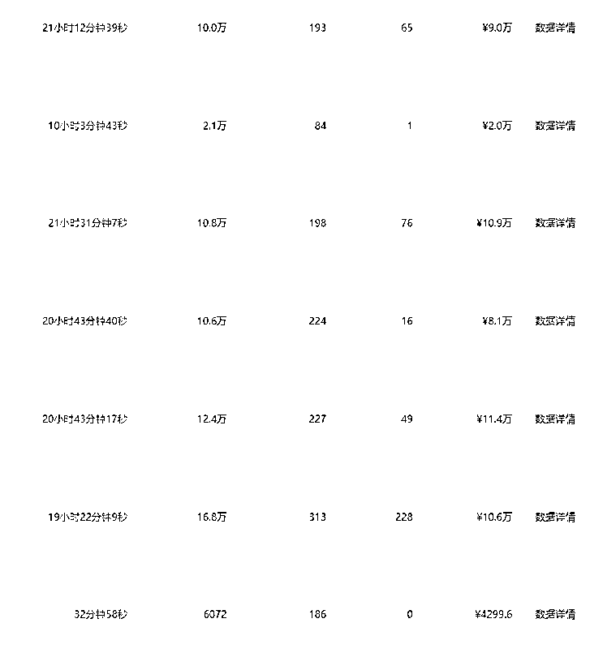

方法论跑通后，第三场直接爆了。

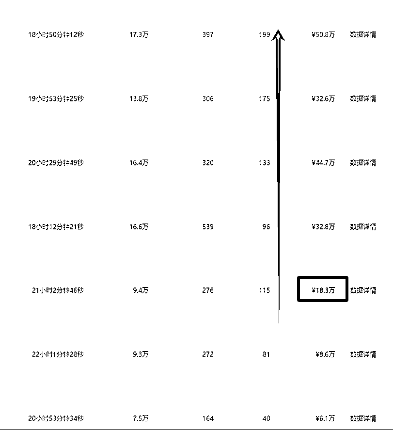

这套打法在不同账号上都被验证过，新号也能快速拉起。

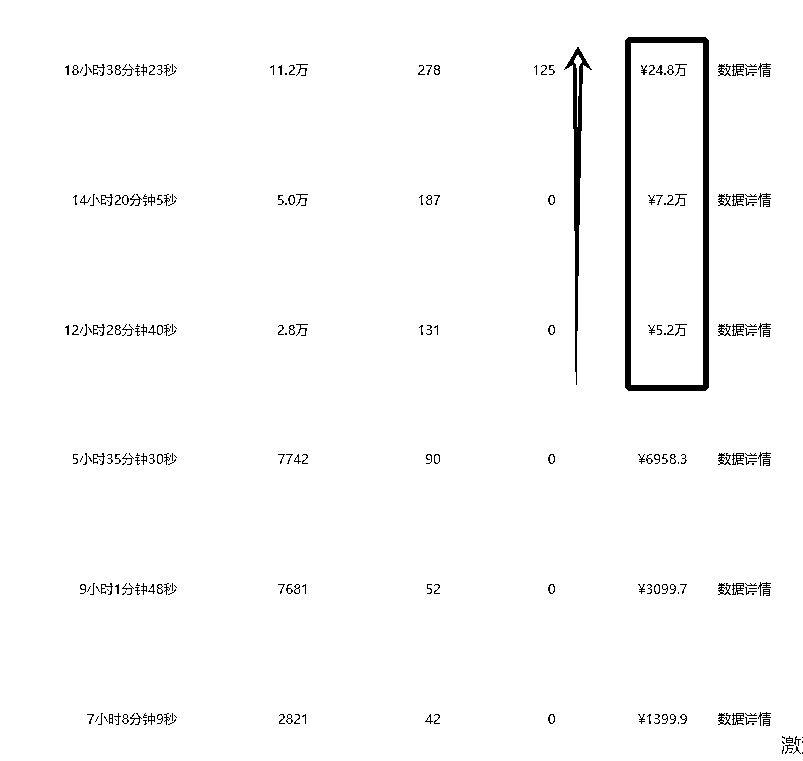

靠这套路径，我们把一个单品推到了月销破千万。

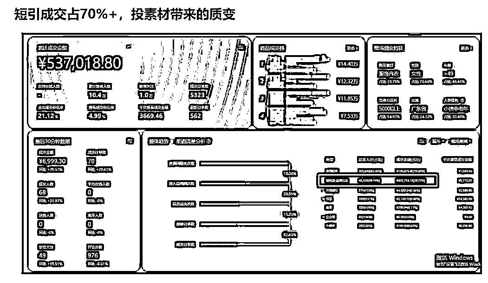

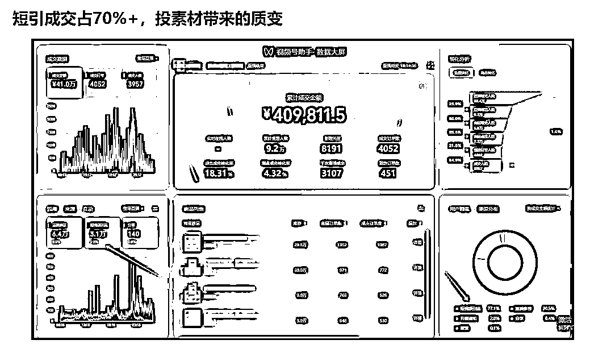

## 2. 新趋势：素材投放

现在视频号付费仍以直投为主，微信豆投素材正处于红利窗口。

为什么我更偏爱投素材？

简单对比一下两种玩法。

| 投放方式 | 优势 | 劣势 | 适合对象 |
| 直投 | 对内容要求相对宽松 | 目前阶段扩量天花板低 | 直投与投素材并没有人设限制 |
| 投素材 | 门槛相对低，对人货场依赖小 | 重内容，对内容能力要求高 |  |

投素材确实更香，只要直投遇到瓶颈，很值得尝试。现阶段我们通常是素材为主、直投为辅，素材跑起来后，直投的投产也会被带动。😂

# 二、投素材与投直播间的底层逻辑

## 1. 直播端的现状

目前视频号直播的人群购买标签很粗，不够精细，进直播间的人购买意向不强，人群不够准。而且付费流量和自然流在同一个池子，今年大家都发现自然流有时比付费更准，你买的流量本质也是在买自然流池子的份子。

这时候需要直播间做“憋单”来洗标签、教育用户，再完成转化。结合平台推流节奏，直播脚本要控制在10-15分钟内。主播需要强感知和控场能力，在流量节点及时补充数据，保持直播间流量稳定。

1）主播吸引力决定停留
人货场在视频号极重要，人设尤其吃香。解决信任问题的方式很难不靠人。视频号里播得好的主播，多是朴实风格，所谓“国泰民安脸”，三十多岁女性比二十多岁女性信任感更强，人物突出更有说服力。

2）场景是爆场的第二引擎
直播间的点击进入率直接反映场景好坏。点击越高流量越泛，平台考核的是外层曝光3秒停留和内层曝光3秒停留。要让人愿意点进来，需要场景+人；要让人留下来，需要场景+货。好场景本身就是一个钩子。

## 2. 短视频端的优势

相比直播，短视频流量更精准。能进到直播间的流量，基本已被短视频洗过一轮，转化率相对更高。

短视频和直播的流量洼地是分开的。短视频走赛马池，播放量越高赛马池竞争越小。利用底层逻辑，可以通过计划投放快速打穿流量池。

好的人货场能让素材生命周期更长，投产更稳。直播与短视频双频共振，才能把流量最大化，快速拿到量级。

合格的爆款素材，直播间点击进入率要达到2%以上。

## 3. 投素材成功的关键

平台不完善，不确定性大，很多玩家靠运气。唯一的破局点是：多测，放大基数，提高命中率。

1. 测素材大于剪素材
① 多组素材多组计划轮番上，筛出能爆的。
② 讲故事的素材转化更高，混剪可把多条故事线植入产品。

2. 爆款裂变更讲概率
① 一旦出现爆款，立刻用同脚本裂变，多条素材吃透流量。
② 爆过的脚本隔段时间还能再爆。平台处于增量期，新流量持续进来，我们的一个爆款素材打了一年还在持续出量。

# 三、投放流程拆解

投放前先算清产品ROI盈亏平衡点，保本ROI是多少。

## 1. 测素材阶段

A. 先用观众放量计划筛有消耗素材，再用成交计划测出爆款。
观众放量流量泛，会拉低转化，但便宜，目的就是用最便宜的流量筛出有消耗的素材。
观众放量计划：
预算：200-500
时长：2-3小时
性别：按品类定
年龄：31岁+
兴趣：不锁
测素材同时测出价，出价每天会浮动。

B. 预算有限或利润低想快的话：直接用成交计划分出价小额多笔测试。观众放量有消耗不代表成交计划就有消耗，跑播放量先建模更稳。看直播间进入率、消耗度和ROI，能行的单独拎出或合并投。
成交出价计划：
预算：500-800
时长：2-3小时
性别：不限
年龄：31岁+
兴趣：不锁
有消耗但ROI低，可尝试锁性别/兴趣再测。早期新素材需要建模，前期ROI可能低，有成交标签后投产会逐步提升。

## 2. 测价与压价阶段

① 新号
前期高举高打，可按客单价50%-70%测价。消耗率80-100%时，可逐步下调1-2块，持续下调至利润70%-80%再放量。计划铺太多会抢量拥堵，导致全部不烧。可测试几条计划的最佳预算与消耗速度，再统一放量。

② 老号
用老户压价周期较长，可用2-3小时短时计划，猛消耗投产低时及时压价。猛消耗有两种：出价过高提示；计划跑飞。可对照历史计划的消耗金额与进人量判断成本是否异常。
新户轮换法快速降价：从最低出价开始测，出价会逐步上升，上升过高换新户继续。

## 3. 放量阶段

把优质素材拎出来，深层计划+浅层计划混合打，多计划测试。冲量计划出价高保本，利润计划压价或锁定向，达到最优产出比，需不断测试。

1）投放深层计划：拉转化
低利润、低客单价选成交ROI。按测试出价提高单条预算，短时+长时混打。ROI出价可低于保本ROI，跑顺的计划最终能达到目标ROI。
注意：卡赔付会亏；ROI跑一半停是常态。不要放弃，多测。出价高于保本ROI不代表投产低，过高可切ROI计划。
时长：4-12小时

2）投放浅层计划：拉曝光
浅层计划：点赞、互动为主，1-2条即可。目的是提高素材曝光，破流量层级，同时带动成交计划消耗。

## 4. 实操技巧

1）同素材建3-5条计划组，可分户投。太多会互相抢量不消耗。按基数挑优计划。场中补单建议在计划结束前1-1.5小时补。长时打底稳全场，短时补流速。盘好时效果佳，盘差时长时易不消耗，易跑飞，改短时控预算控出价提投产。

2）同素材建2-4条预约计划。打底可提前布局，预约计划基本都有消耗，出价参考近三天均价。叠投计划根据消耗比例与大盘实时调价。
消耗70-80%甚至100%说明出价高或素材能打，可压价；大盘好的时段出价会低，可提前准备；素材一般半小时开始消耗，补计划建议在结束前30分钟-1小时补。

4）直投可勾选短视频。按直投出价勾选，短视频出价通常更高，有概率只烧短视频，是优质投放方式。

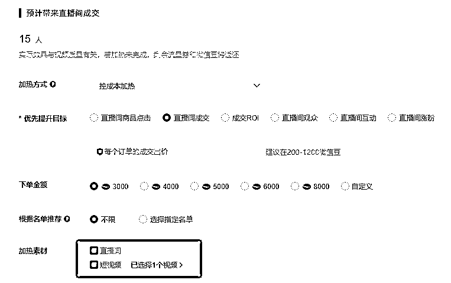

5）ROI消耗快但不稳，成交更稳。ROI转化差会立刻停，卡赔付难，但放量必备。

6）直投配合素材双频共振。短视频爆量可带动直投，流量更准，消耗更快，可适当压价。

7）素材播放量与审核机制。流量池：50w概率小—100w概率大—500w—1000w—1500w。投流不过审不会弹违规。达播放阈值后消耗会变慢，有起量素材要立刻裂变。若爆款未衰退，可养素材或打一波便宜流量突破层级。

8）裂变方法
① 同脚本换视频音频，混剪替换；
② 套用他品类爆款脚本，翻拍混剪。

# 四、直播微付费撬动自然流的方法

团队实操验证后分享一个提升系统推荐精准度、撬动自然流的做法。

## 底层逻辑

流量曲线决定投放方式。
纯付费模型轻内容重产品，用素材洗A5人群，只看投产，这类曲线跑不出自然流。
自然流模型重内容轻产品，用内容力获取人群，先用浅层计划破层级撬动自然流，再用成交计划拉精准人群，用深层数据压出价持续拉A5人群，反馈系统后系统会推荐相关标签人群。浅层破层级后自然流进来，进来的就是系统推荐的精准人群。
纯付费打投产未必能打正，最终逻辑是通过自然流拉高整体投产。

## 流量层级判断

观察流量指标模型

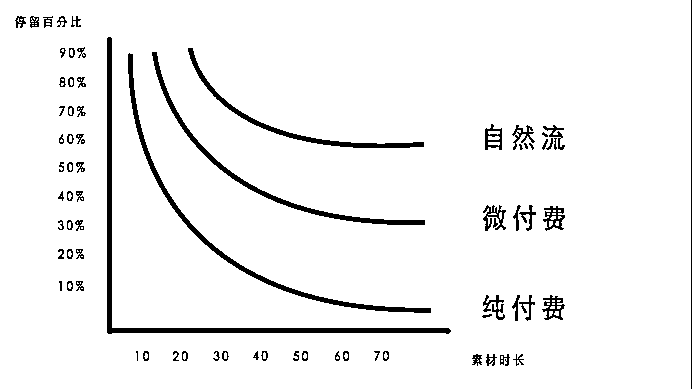

要求：
观看留存符合微付费模型
带货素材需有内容
垂直单品号
素材曝光进入率≥2%
撬动自然流素材需具备30单成交模型，通过成交计划建模

先看留存是否符合微付费模型，再判断是否可用微付费。

素材分两类：
1.软广，偏内容，内容线好，广告植入，留存更符合微付费/自然流曲线，看浅层数据可做微付费。
2.硬广，围绕产品，基本无自然流，留存符合纯付费曲线，只看投产。

操作：
1.测素材阶段
观众放量：便宜，十条一起测，筛优质有消耗素材，再用成交计划建模
预算100-200，时长2-3小时，性别按品类，年龄31+，兴趣不锁
成交计划：贵，十条一起测，筛优质有消耗素材，易建模
预算500-1000，时长2-3小时，性别不限，年龄31+，兴趣不锁

2.撬动自然流
方式1：短视频端投点赞/关注/播放撬动自然流，智能出价跑，实时看数据大屏渠道流量分析的短视频引流与引流短视频，判断直播间曝光与进入率是否被撬动。
方式2：直播间端高价短时2-3小时猛消耗，顶出自然流，可高于利润出价。同样看数据大屏指标，优点是撬不动时还能卡赔付，少亏。

养素材与破层级逻辑
养素材提升曝光进入率，利用赛马机制提升竞争力，突破流量层级。
发10条同品类不同文案素材，1个计划中5条新素材+5条爆款一起投，每天养。
视频号流量池：10w、50w、100w。池子越小赛马越激烈。很多人卡在低池消耗不动。此时硬推，把流量打进去进入下一池就能破瓶颈。

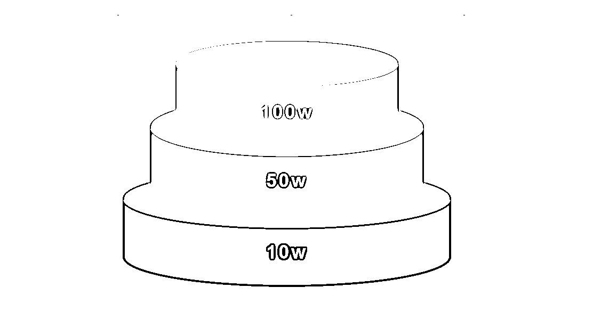

计划跑不动怎么办：5条新素材+5条爆款打乱顺序重开计划
素材超3个月投不了：发布时建计划后停止，超3个月后点“再来一单”

# 五、常见问题

## （一）爆款如何高效复制
复制也讲概率。计划搭建10条素材，老带新筛优。养素材硬推逻辑，新素材靠老素材带动均速消耗，后期可能成爆款。

## （二）单条素材能否瞬爆
挑出高消耗爆款，单独开计划怼。起量后迅速补2-3条，持续往下补。一条素材3条计划为宜，太多会压制。3小时高出价低预算，一般2小时消耗完，提前补两条高预算计划，可快速起量。

## （三）如何高效测素材
每日发布条数+测新爆款+平台审核时段+发布时间
发布次数：每天10条，间隔1小时。违规边缘素材不建议定时发，发后当天别投，大概率被提醒。若播放异常千万别投，投了必违规。
测新爆款：3-5条老素材带新素材。
平台审核：审核分4班倒，时段不同审核人与标准不同。

先聊发布时间：容易打擦边球的内容，别随便发，找平台审核相对宽松的时间段再发布，能提高通过率。

一、怎么应对违规？
日常养号很重要：每天发一些“过水”视频，或者不碰边界的优质内容，持续养权重。
新号要多做筛选，把底子好的账号挑出来；老号消耗起来可以比新号更猛。
尽量少发平台不喜欢推荐的内容，否则账号容易变敏感，违规次数一多，权重肯定会受影响。
同样的内容，成熟老号违规可能只是被减少推荐，但新号一旦违规，严重时会被封禁。
而且素材违规本身是概率事件：同一个内容，有的号毫发无损，有的号就会中招。
产品介绍别太硬，用“种草”的口气讲，过审率明显更高。
真人出镜也是个加分项；视频时长越长，转化越稳，过审也越容易。素人口播IP类内容通常都会做到4分钟以上。
平台判断硬广或违规，一般重点看前10到15秒，所以这个时间段千万别放敏感信息，基本就能过审。

二、账户消耗不动怎么办？
原因通常集中在几方面：账户权重、出价、投放时段、账号权重、计划投放、素材内容和转化。
逐个拆解：
- 账户权重不够明确时，就多开几个账户一起跑、一起测。
- 出价上，前期可以出高一点，先把消耗拉起来，配合放量测内容，之后再慢慢压价。
- 时段很关键，有些账号只在固定时间段才有消耗。
- 账号权重方面，新号和老号不一样，新号和新号之间也千差万别。

三、直播预约有没有用？
有用。用直播预约能快速破开播冷启动，帮我们拿到更大利润。
开场若打得漂亮，爆单基本就成了一半。
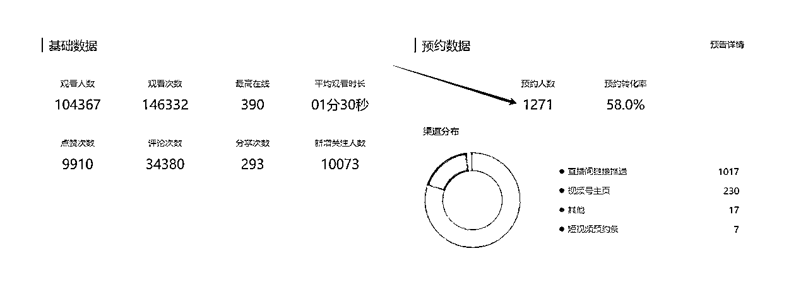
预约引流进来的第一批用户，是精准的开场流量，能明显提升开场转化。
同时，预约能让计划快速烧起来，把冷启动时间缩短。

四、卡赔付规则
成交出价类计划：加热时长1小时、成交3单、超成本比例120%触发赔付。
举例：出价50元时，系统单笔最高按50元算，3单=150元。当消耗到50×3×120%=180元时，系统赔付180-150=30元。订单量是变量，其他条件不变。
ROI出价类计划：加热时长1小时、成交10单、超成本比例125%。
比如目标ROI是2，实际ROI跌到2÷1.25=1.6时触发赔付；系统会补足金额，让这条计划的ROI回归到目标2。

五、投放工具怎么选？
我们起步时用的是诸葛智投，性价比不错，操作顺手，所以一直沿用到现在。链接：https://sourl.cn/HyjfYE
搭建计划大致分几步：
第一步，新建计划。
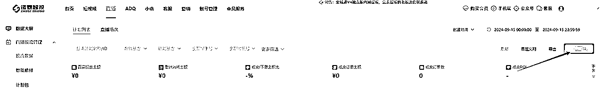
第二步，配置基本信息：选投放号，数量一般填1，按实际情况写计划名称，再选择要投放的直播间。
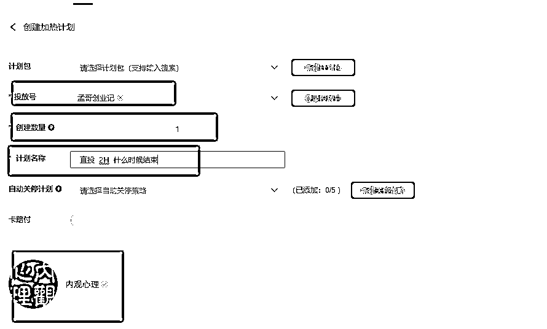
第三步，搭建计划细节：加热方式默认选“控成本加热”；设置成交出价，按客单价和利润来定，新号前期可以把利润先让出来，跑不动再加，跑太猛就降；选择要投放的内容素材；计划时长一般设为2-3小时；年龄锁定在31岁以上，因为视频号的主流人群就是这样。
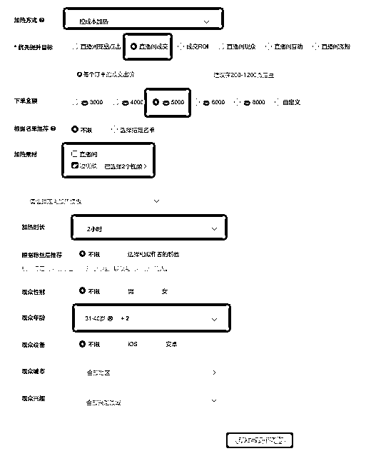
第四步，盯计划：先看消耗速度和ROI是否成正比；ROI不对时，判断计划还能不能跑、能不能卡到赔付；点进详情看加热情况和阶段消耗，如果消耗不动，就重建计划。
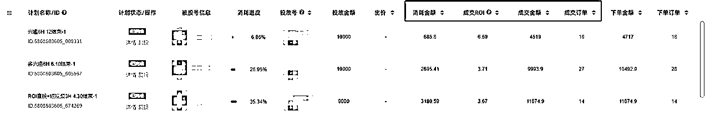
点开详情，能看到消耗金额、曝光总人数、进入总人数，用消耗除以进入人数就是人均进入成本，再对照自己数据大屏上的转化表现。
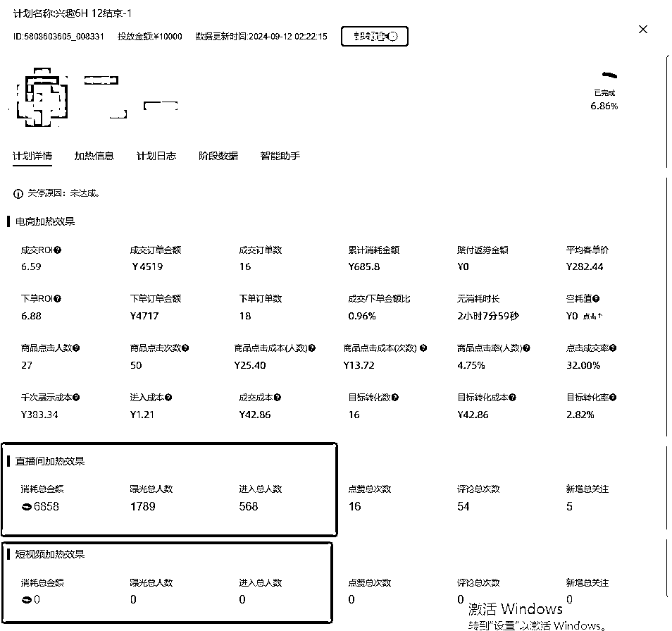
计划日志可以看到计划是什么时候创建的，记住加热时间要从“开始加热”那一刻计算。
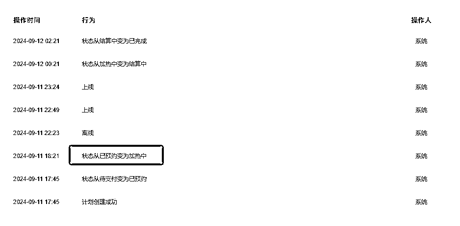
阶段数据里，重点看消耗曲线、阶段消耗、每分钟消耗和阶段点击，再结合直播间数据大屏流量，判断计划是否正常；表现不好或者没有消耗，就及时关停。
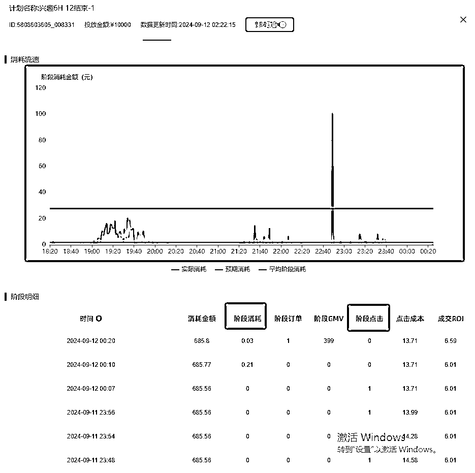

最后说几句实在话。
付费是放大器，不是地基。千万不要一上来就重投付费，先把人货场跑通，付费才有意义。可以先靠自然流量或小额付费测试直播间的承接能力，再根据数据不断优化人货场，等转化指标达到行业水平，再放大投放。
去测出价、测预算，找到最适合自己的计划模型。比较理想的状态是：出价控制在利润的80%以下，又能持续放量，再配合卡赔付，只要人货场不太拉胯，通常能跑出不错的投产。
抬高出价很容易，想压下来就难了。不要一味靠加价来拉量，内容和人货场做到位，计划照样能消耗起来。
视频号确实玄学，账户也有好坏。多测几个号，留下投放效果好的。微信豆没有模型，每一条计划都是一次新探索，计划与计划之间也是概率游戏。多条计划同时跑，然后筛出主力计划。
投放经验不是看会的，是烧出来的。大量实战、反复复盘，才能慢慢形成自己的打法。平台每天都在变，计划投放也必须跟着优化。
最后分享一句：人永远没办法和时代对抗。时代的势能在哪里，你就该靠近哪里。与势同在，顺势而为。
视频号，也许就是当下的时代势能。
大家一起精耕细作，生财有术！
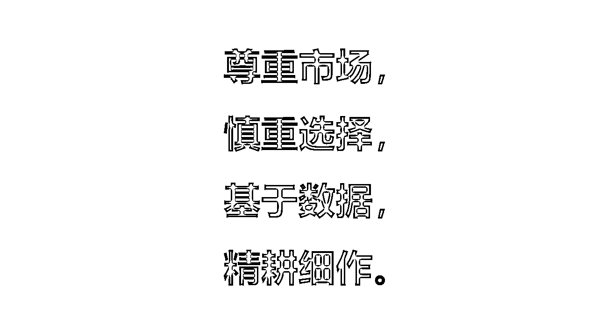