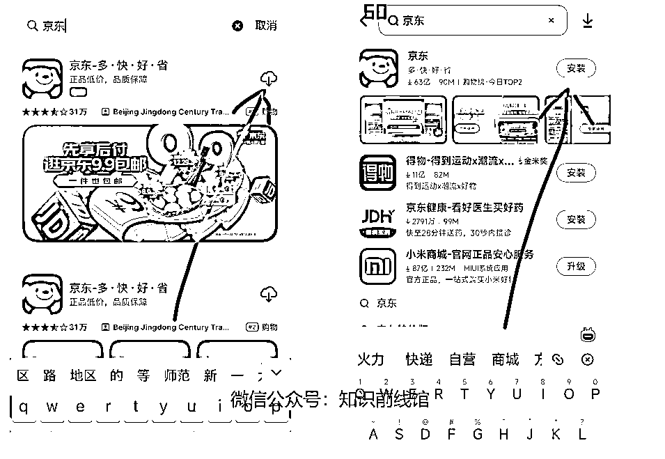
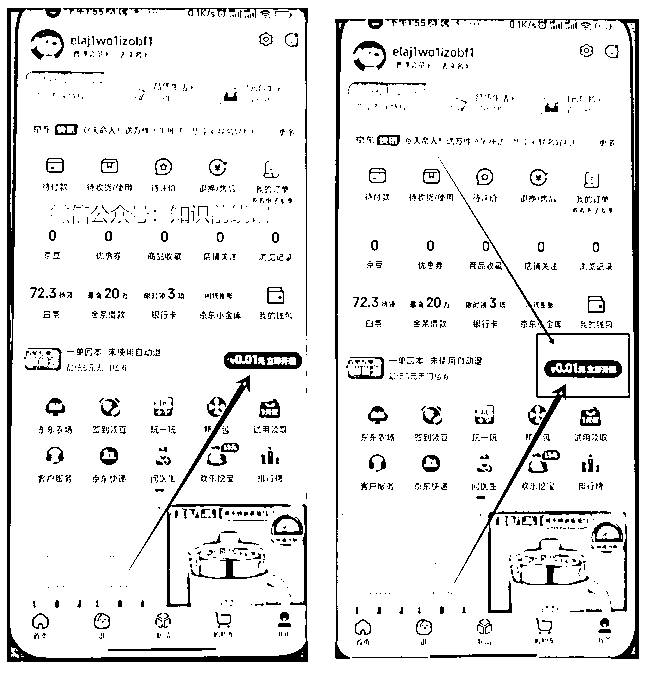
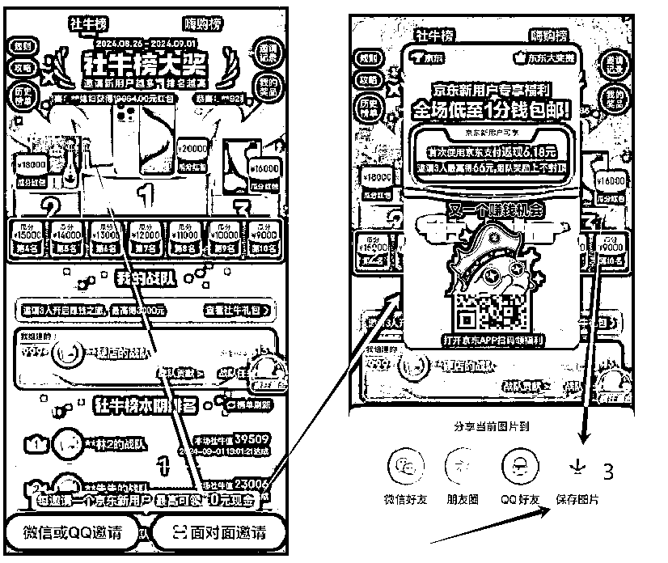
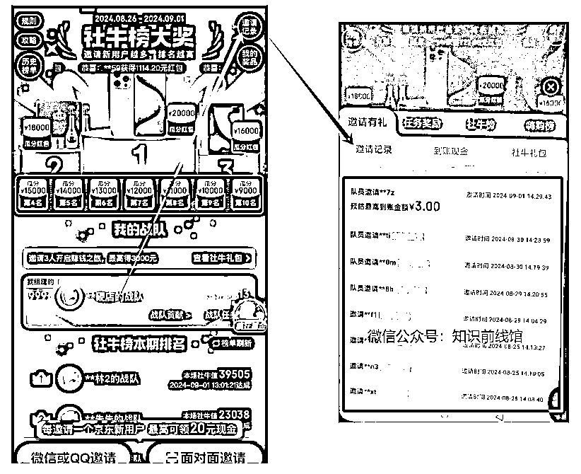
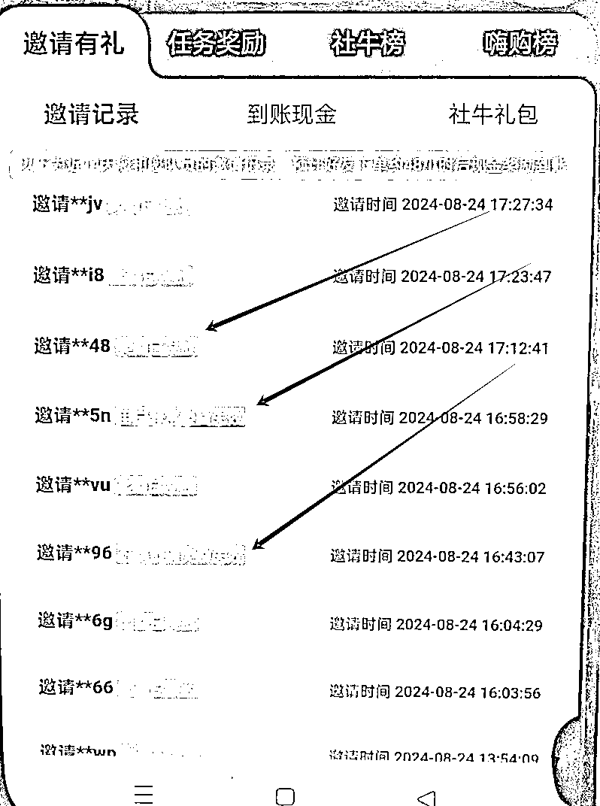
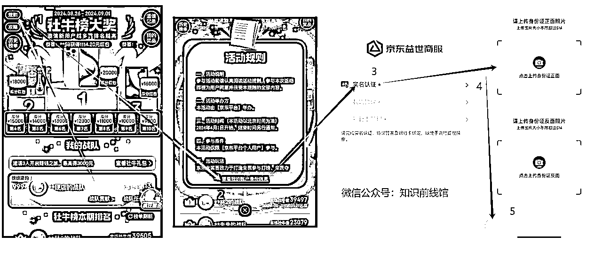

最近很多朋友问我副业怎么选，今天干脆把我在做的京东官方拉新玩法掰开揉碎讲清楚。这项目不是走什么第三方平台，全程都在京东App里完成推广和提现，你不用担心中间商抽成或者权限被卡，所有流程都由自己掌控。

先说下这个“东东大赛”是啥：说白了就是通过线下地推，邀请那些从没注册过京东、或者过去365天都没在京东下过单的人，扫你的专属码去花一分钱买个东西，每成功一单你就能拿9到20块佣金。跟市面上那些付费课程讲的京东拉新逻辑一样，区别就在于这个是京东自己搞的官方活动，更稳。

我当初就是看生财有术里有相关课程，但那个后台流程太绕，所以直接选了官方入口。现在每天下班抽两小时出去转一圈，入账200到1000块轻轻松松。下面我从零开始，把怎么操作一步步告诉大家。

**第一步：装好京东App**  
安卓用户打开应用商店，苹果用户去App Store，搜“京东”下载即可。手机里已经有的直接跳过。

**第二步：搞定推广后台（核心门槛）**  
官方规定，开通推广员权限必须用一个“新用户”身份来做启动账号。听起来麻烦，其实不难——很多人手上都有双卡吧？把你当前京东账号退出，换上另一张从没注册过京东、或者超过365天没下过单的手机号登录就行。之前实不实名都没关系，因为一张身份证最多能绑定三个京东账号。

关键怎么判断对方是不是新用户？这个一定要学会，后面每次推广都要用：  
登录新账号后，点底部“我的”，看页面里有没有“省省卡0.01元”这几个字。有，就说明是新用户，准没错。

**第三步：开通后台的入口**  
回到首页，点右上角的“扫一扫”，扫描指定二维码进入活动页，然后完成一笔一分钱购物。这里不能直接放码，需要的朋友评论区留言联系我，我发你入口。

**第四步：后台实操指南**

1. **生成本人推广海报**  
进入后台后，点右下角“面对面邀请”，系统会生成你的专属推广海报，点“保存图片”，之后把这张图发给别人或打印出来地推就行。

2. **查看邀请列表**  
想知道自己拉了多少人，点右上角“要求记录”，就能看到目前邀请的人数。

3. **结算规则要记牢**  
用户当天下单，佣金不能立刻到账，要等48小时后台审核。审核期内，用户不能取消订单，也不能拒收快递。订单状态分三种：奖励已发放、用户异常奖励失效、订单取消奖励失效。

4. **提现前先实名**  
点右上角“规则”，找到“查看我的账号身份信息”，然后上传身份证完成实名认证。注意：这个实名信息必须跟当前登录京东的实名一致，否则钱提不出来。

5. **佣金提现操作**  
在“我的奖品”里能看到待结算佣金，点“提现”就能到京东钱包。再从京东钱包提现到银行卡，具体操作我录了视频演示，需要的朋友私我拿。

**关于社牛礼包，这波福利很实在**  
这是一个阶梯式额外奖励机制，按邀请人数给你补贴：

- 邀请满3人，额外给30块  
- 邀请满10人，再给60块（加上前面30，共90）  
- 邀请满80人，再给400块（加上前面90，共490）  
- 邀请满800人，再给3000块（加上前面490，共3490）

需要注意的是，这个奖励是按每个结算周期内的邀请人数来算的。比如你这个周期邀请了10人，触发第一、二阶礼包；下个周期又清零重来。也就是说，一个月内你可以做四轮奖励。

我的经验是：一个后台最多拉到80人就够了。7天能拉80人已经是很强的个人能力，如果你拉到90人，第四阶段（800人）根本没戏，白白浪费了这10个名额。不如另开一个新后台，把这10个人放到新后台里，又能解锁第一、二阶的礼包。

给大家算笔账：  
假设一个后台拉了80人，按保守的单人佣金8元算，就是640元；加上四阶中的前三阶礼包490元，总计1130元。一个月如果做四轮，那就是1130×4=4520元。如果你手上有两三个甚至四个后台，同时操作，月入过万真不是梦。

**最小可行性执行方案**  
1. 准备一张没注册过京东的手机号（或365天未下单的号）  
2. 按上面方法开通推广后台，有困难找我要入口  
3. 保存自己的推广码，先从身边熟人开始试验  
4. 判断对方京东是否为新用户，是的话让他扫你的码  
5. 完成一分钱下单（这单是真发货的，别薅羊毛，地址和手机号不能重复）  
6. 等48小时审核，通过后提现

**别再问怎么拉人了，靠嘴说没用，得用方法**  
第一招：先把身边的亲戚朋友同事全拉一遍。现在谁手里没有几部手机、几张电话卡？这些人信任你，转化率极高。

第二招：去小区门口找大爷大妈聊。推一个准一个，因为很多老年人根本不会网购。花两百块买一百把扇子，折合两块钱一把，送给那些扫码成功的大爷大妈，他们开心，你也赚钱，双赢。

好了，今天就把这些干货全盘托出。学完你就可以自己去赚外快了，这个副业真的不难。如果你想往团队化方向做，也欢迎随时联系我。感谢观看，祝大家早日暴富！