# 续篇｜30个让微信成交率翻5倍的实战心法（51-80）

各位圈友，我是根源。

在线下做过几年销售，也带过团队，后来成了一名实战经验还算丰富的心理谘询师。去年，我正式转向线上知识付费和私域运营。

这个系列已经写过两篇，阅读量和点赞的口碑都还不错。这一篇是续集，接着聊微信成交这个话题，从第51条开始，一条条往下过。选这个主题，一来是它正踩在当下的趋势上，二来是我自己确实偏爱它——微信，大概是这个时代里跟每个人照面打得最多的场景。谁能把微信玩明白，谁就能在这个时代多分到一些机会：更强的信任、更好的人缘，还有更实在的收入。

趁着这几天，我把这些技巧重新整理了一轮。坦白讲，「微信成交」算是我的舒适区，去年它帮我拿下了七位数的转型收入；更难得的是，这件事我也是近一年才真正接触，并且做到的擅长。那是我第一次从线下转到线上，转完之后才发现：销售、关系维护、成交，几乎所有的环节都搬进了微信。

这背后藏着一条很关键的底层逻辑：线上说白了，就是线下场景挪了个地方。在微信里谈成交，不过是把线下的场子换了一换，地基始终一样——先把信任处到位，成交就像水到渠成那样自然。

我也一直认定，所有私域流量，最终都会汇聚到微信这个终点站。手里若有一些能让微信沟通更顺滑的小技巧，不管是维护关系，还是把产品卖出去，都会省力很多。借着这个主题，我把去年一整年在微信上聊单的成交心得，连同过去十二年的销售经验，一并做了梳理。这些招数都不重，读一遍就能直接上手。

为了读起来更顺，我按主题重新分了类。

## 01｜先养关系，再谈生意

### 技巧51：一句解释，换来客户的「被尊重感」

在微信上给客户介绍产品，难免会遇到这种情况：内容一看就是复制粘贴，或者直接合并转发了一大段资料。遇到这类消息，我发出去之后必定会补一句说明：这么做不是不尊重，只是想提高效率。

为什么要多这一嘴？因为很多人收到大段文字，或者一眼就看出是模板消息时，心里很容易冒出一种「你对我不尊重」的感觉。当然，不是所有人都这样，但多说一句总归没有坏处，能让对方多感到一分被尊重。

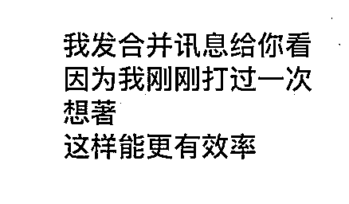

### 技巧54：朋友圈这样经营，时间会帮你累积成交

我本人很少发「商业味」十足的朋友圈，一个月能有一两条跟课程相关的动态，就算很频繁了。后来我发现，大多数人真正想要的，并不是「一堂课」或「一次机会」，而是一种看得见的『未来生活愿景』。

朋友圈越不端着、越丰富、越多彩，收到的爱心就越多；爱心多，说明围观的人多、关注的人多。以前我也觉得这些爱心没什么用，后来才承认那是错的。很多时候，正是那些默默围观的人攒得够多，某天你偶然发一条跟商业或课程沾边的动态，反而会勾起他们的好奇：「原来你也有课？」「原来人生可以这样？」——下面的对话，就是一位朋友看了朋友圈之后，主动来找我成交的。

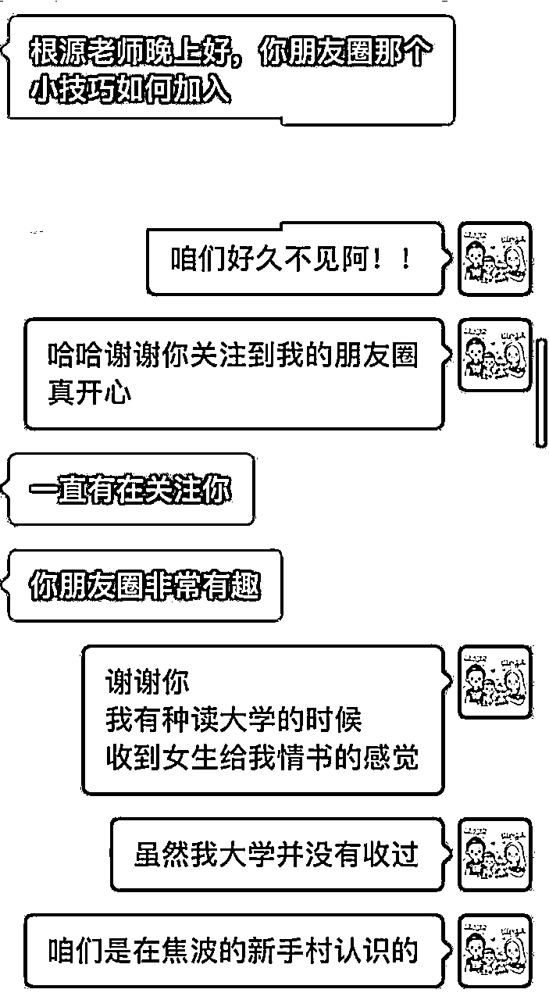

### 技巧55：成交不是句点，而是关系的新起点

这是一位老朋友主动来找我成交的案例。

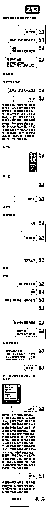

当对方主动出现，尤其是一见面就直接打钱的时候，一定要多说两句：用夸奖，或者干脆带点自夸，去肯定对方的「决定」。这事很重要，也是一种表达尊重的方式。虽然此刻成交已经完成，但交情还在继续往前走；正因为这些看似随意的闲聊，信任感才会一点点加厚。将来某天出了新课，对方恰好有需求，成交就会因为这份信任，自然而然地再次发生。

### 技巧71：让客户愿意聊下去的顶级开场（一）

信任感一定是用时间养出来的，而微信聊天，就是成本最低的养法。聊天的难点，常常不在于找话题，而在于找一个合适的理由开口。

我常用的一个开场是这样：发完一条朋友圈，有位朋友点了赞，我便私信过去，专程说声谢谢。

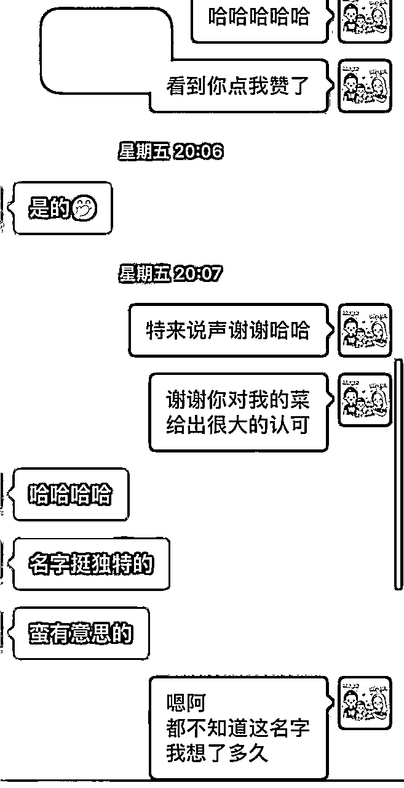

这是非常柔和的开场——理由现成，还能让对方有种被惦记的小惊喜。毕竟，随手一个赞居然收到一句道谢，这种事不常碰到。开场之后，再顺口问一句「好久不见，最近一切都顺利吗」，一个舒服的聊天场子就搭起来了，后面什么话题都接得住。这招用来触达私域，特别好使。

### 技巧72：让客户愿意聊下去的顶级开场（二）

最好用也最实在的开场方式，就四个字：承袭上段。上次聊到哪儿，这次就从哪儿接起。比如上次话说到一半，这次开口就顺着那个茬儿走：

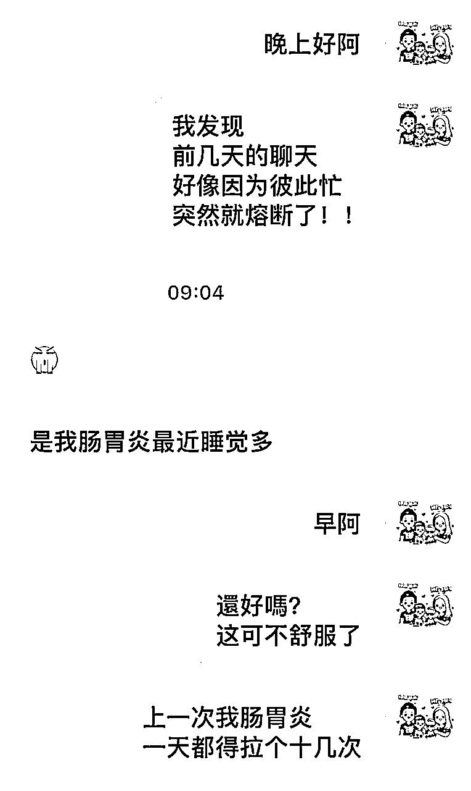

要是上次压根没聊过呢？那也有办法，用一句「抱歉，上次突然就消失啦」，或者「才发现前几天一直忙，话题就这么断了」轻轻带过。这类开场最大的优点是轻松。只要对方回了话，而上一次聊得不算差，这次就能接着上次的好能量，继续往下聊。

### 技巧67：这个销售大忌，千万别犯

有位朋友在微信上向我推销，手法粗糙到我忍不住叹气：很多人明明想达成某个目的，用的方式却让目标离自己越来越远。

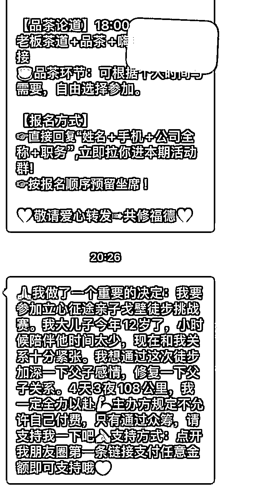

为什么那么多人反感微商？就是因为有太多人，一句招呼都不打，上来就发广告。这就像伴侣想亲热，连前戏都省了，直接硬着来——谁受得了？这条技巧，其实是拿反面教材当镜子。经营关系这件事，只要不犯大错，慢慢攒下好印象，说不定哪天，一单生意就这么突然成了。

## 02｜让产品和需求，体面亮相

### 技巧52：一个增加产品曝光的开场方式

想曝光自己，路数很多。聊天时不经意带到，不刻意强调、简单带过，反而是一种极好的曝光。

比如对方刚换了新手机，你可以顺口说：「这手机也太好看了，我原本也想买一台。」然后轻描淡写补一句：「对了，下次你有需要，可以问问我，我有个朋友专门做这个，说不定能拿到便宜价。」说完，马上跳到下一个话题。

这一系列动作，只为在对方心里种下一个『新印象』。只要印象种下了，哪天他有需求，那个朋友就会自动浮现出来，然后跑来找你。

### 技巧56：一个动作，帮你「释放」客户的需求

一般情况下，只要我感觉到对方的意愿，就会做一个动作——『释出需求』。这其实也是一种产品曝光：借着曝光，进一步确认对方的需求到底是真的还是假的。

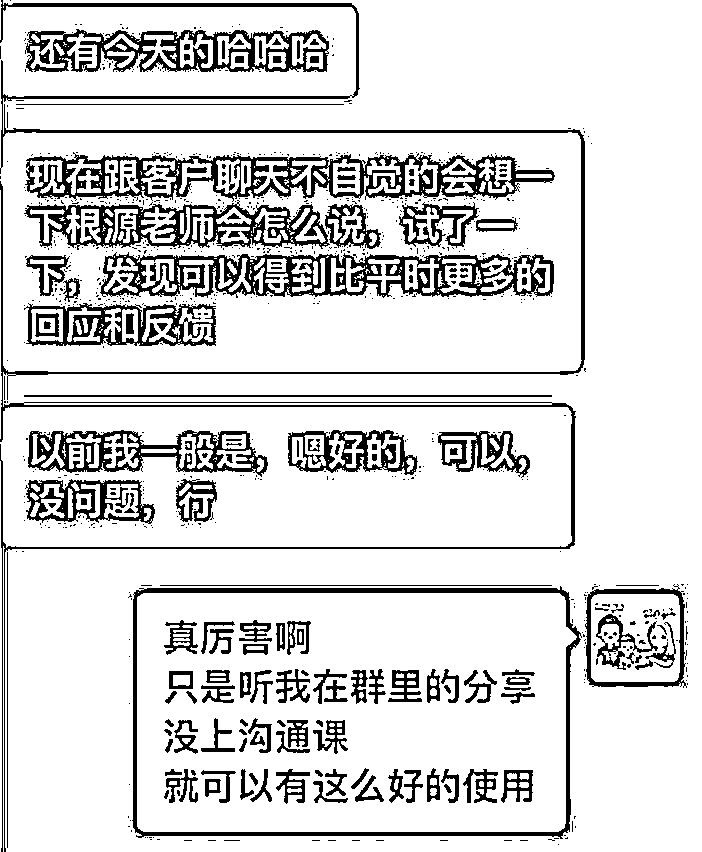

那段对话里，我特意说了一句「没上过沟通课，就能用得这么好」。这句话更深的意思其实是：「我这儿有沟通课，你要是来了，还能更精进。」要是把这套话术打磨一下，它就成了一枚标准的『小钩子』。

### 技巧65：在对话里，为产品埋下钩子

这一条，聊的是如何在对话里给产品留钩子。

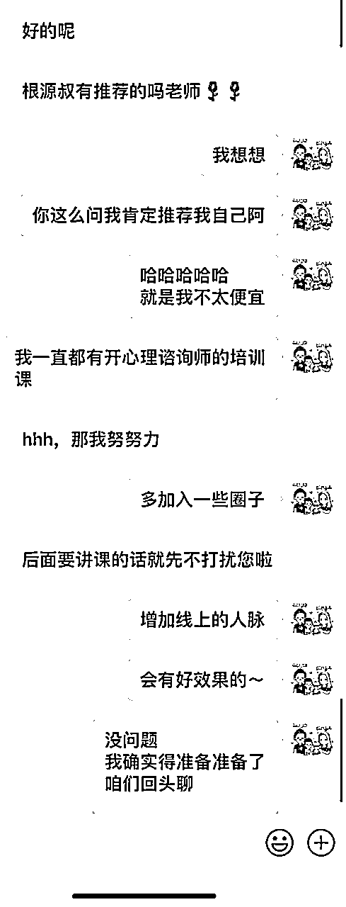

当时没有谈成交，主要是我手上正忙，想着不急，以后总有机会。但钩子得先埋下——那句话等于在告诉她：你想要的东西，我这儿有。这条技巧的重点在于：怎样在沟通里，为将来可能发生的深聊埋下一个自然的伏笔，同时又把产品展示得不露痕迹。

### 技巧68：做好销售，必须先练好的基本功

我一直认为，做销售必须具备一种能力：随时能介绍自己的产品，张口就能说出自己的优势。因为你永远不知道，客人会在哪个瞬间上门。

拿我自己举例，我的课程很少直接甩海报，总是先做解释——海报说到底只是辅助。下面这段对话，就是和朋友闲聊时，对方突然提起咨询师课程；我是怎么介绍产品、怎么展示自己的，细节都在截图里。

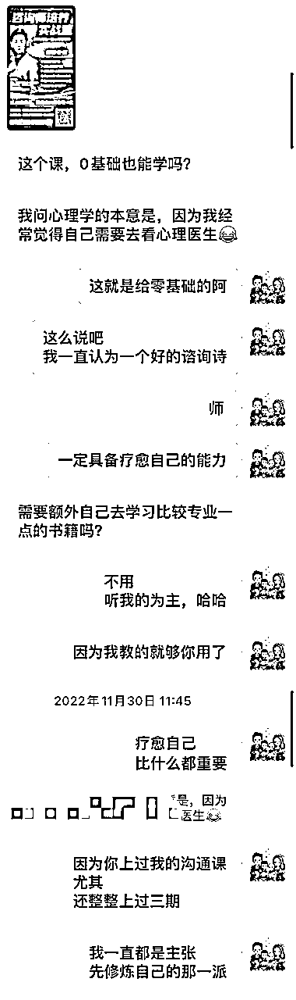

### 技巧69：这样的开场，成交率更高

先看一个学员的案例。

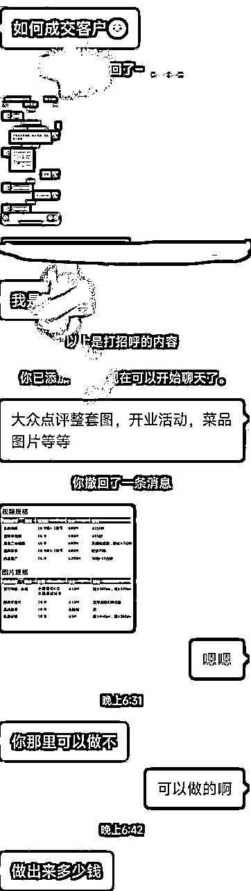

单看这段对话，开场就出了大问题。我讲过很多次：跟新朋友谈成交之前，一定要先『寒暄』——先聊聊客户怎么称呼、是从哪里加过来的、这名字真特别……总之，得先找几个话题暖暖场；最不济，也要先礼貌地打个招呼。可这段对话里，连开场都没有，劈头就讲产品。

再看客户，其实挺干脆：发了需求图，直接问价钱。这种时候，比较合适的回应是先问预算，再报价格，能对上就顺便成交。但问题是信任感没到位，这种单子就算成了，也多半是运气。想提高成交率，正确的做法是：重新打个招呼，闲扯几句，再谈产品。

## 03｜需求没摸透，先别急着收钱

### 技巧59：没确认真实需求，这件事千万别做

闲聊时，对方突然抛来一个提问，乍一看，正好可以顺势切入产品。

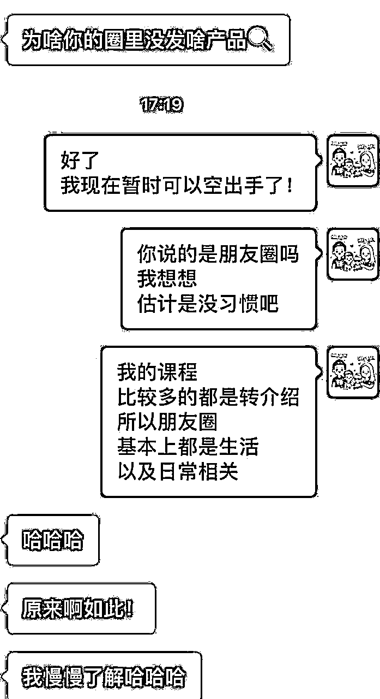

有人可能会想：这不就等到了吗？但我没有这么做。因为对方虽然问了，这句话却不一定是「真话」。在不清楚需求真假的情况下，急着介绍产品，反而显得有点失礼。所以我依然只做了基本的自我介绍；他想问，自然会继续问。要是对方不再搭腔，或者没有刻意打听产品的种类，我就继续聊别的。

这件事想说的是：跟新朋友打交道，尽量不要一上来就卖东西。钩子丢出去了，对方没接，那就先放下，别追着问——这种情况，成交率不高，还可能惹人反感。

### 技巧60：没谈钱之前，客户的「感兴趣」别当真

销售这件事，只要没聊到『收钱』，对方打的任何一行字，都别抱太大预期。

比如下面这段对话。

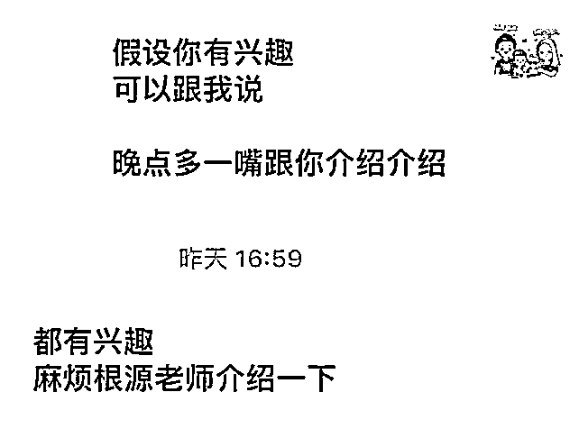

看到这样的回应，普通业务员可能已经在心里想「成了」，因为这字面上全是兴趣。但老手都明白，这充其量就是一句『说词』。只要没谈到价格、没谈到付款，这些话听听就好。所以，在收钱之前，别对任何语言抱太大期待——期待越高，失望越容易。不如把心思花在闲聊上，多积累一点是一点信任感。

### 技巧64：成交之前，这个环节一定要做扎实

成交前有个环节叫：重复确认需求。这事极重要，因为它决定了对方嘴上说「付钱」之后，到底会不会真的掏钱。

有位转介绍来的新朋友，聊天时提到一句「想跟我学沟通」。

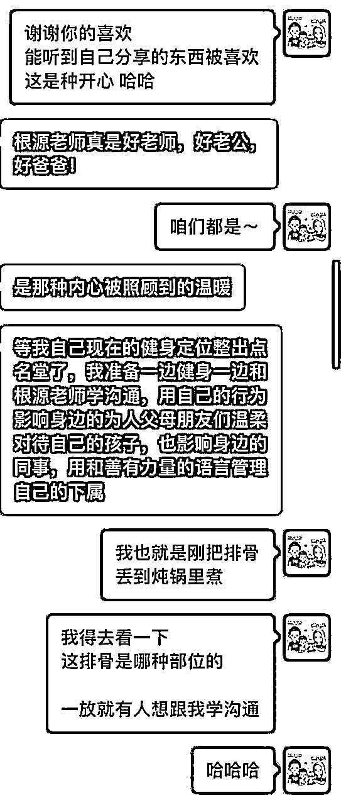

如果他接下来专门追问「你有什么课」，那就说明这个意愿是真的。但他没有追问，我也就没有特意多提。其实，确认意愿不一定只有提问这一种方式，所有的细节，都藏在对方的回复里。正因为对方没再接着聊「学沟通」的话题，我也就没去谈成交——这都是基于对「需求真假」的判断。

### 技巧57：成交之前，有件事一定要说清楚

成交前，有一件事必须摊开讲。

先看一段对话。

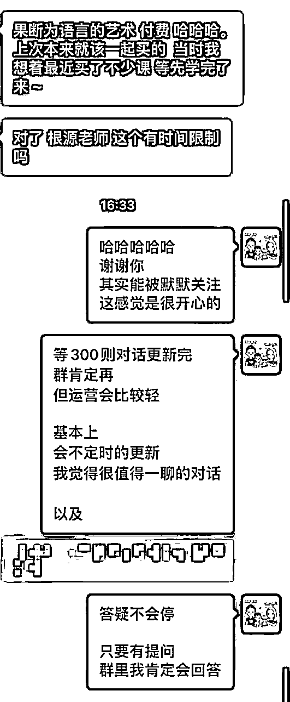

这是一位上过沟通课的老学员，主动来找我成交，中间问了这样一个问题：

这个问题，坦白说我琢磨了很久。最早做课程时，我的心态是「能给多少就给多少」；为了收钱，恨不得什么都敢应承——你提什么需求我都先答应，做不做到另说。后来我发现，交付这件事，与其收了钱再解释，不如收钱之前就说清楚：做得到的才说，做不到的别夸。这么做有两个目的：一是逼着自己把产品规则和交付内容想明白；二是给客户一个合理的预期。预期清楚了，退费这些麻烦事自然就少了。

## 04｜产品布局与复购升级

### 技巧63：别只做一款产品，至少备两个以上

从2021年转型线上知识付费，我有一个很深的体会：别让自己只有单一产品，至少要有两个以上，这样对方才有得挑。

之前的技巧提过，每个人都要有一个低价引流款和一个高价款。这里再延伸一点：产品更多，除了让对方挑选之外，还能在他对某个产品不感兴趣时，多几个选项去匹配他的需求。下面的案例，就是因为我给了对方两个选项，他多了一个需求匹配的机会。

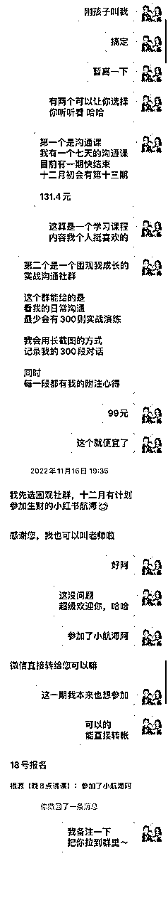

### 技巧66：产品定价，记住这条原则

从去年起，我给自己立了条规矩：价格越低的课，越不打折、不搞特惠。一两百块的东西，优惠又能优惠到哪去？但要是对方愿意继续来上新课程，那我就能给出一两百（甚至以上）的折扣——算下来，那门便宜课基本等于送了。

为什么这么设定？因为我发现一个很有趣的现象：只要在钱上松口，就很容易让人形成一种印象——这东西的价值，是可以随意调整的。

所以我的大原则是：新产品不优惠，老学员复购给足好处，或者给到金额上的特惠。做出这个区别，一方面能让自己立住「高价值」的人设；另一方面，也会让老学员多一种「被照顾」的感受。这恰恰是提升复购率很重要的一个细节。

### 技巧70：让老客户复购更高客单产品的三个流程

想从小金额升级到超大金额——比如几百块转到几万块，或者几千块转到几万块——光靠私信可不够。以我自己几百块转到几万块的经验，我会走这样一套流程：

**第一步：先有两到三位数的付费课程**
第一次付费是必须的。正因为对方已付了钱，上课过程就成了老师单方面的『筛选』过程。我通常会在这种课上招募『主编』——也就是帮我整理课件的学员；这同时也是一种对私教学生的筛选。

**第二步：至少要有一次四位数付款**
只要我觉得这个人不错，在他第二次、第三次付费之后，我就会开始跟进：多跟他聊天，积累好的私交。聊天的过程里，还得评估对方的『预算』——他到底扛不扛得起这笔钱。

**第三步：直接开口邀请**
前两步走完，最少要超过三个月，然后我会直接问：「你一直这么挺我，我也注意到你做事细心、能力又强。我总觉得，以后要是有机会共事，会是件挺开心的事。我想跟你聊聊一个私教课程，不知道你介不介意听我说说？」

接下来就看产品属性了。只要前面的交情够深，这又是他的刚需，这三阶段走下来，不敢说一定成交，但成交率一定会好看不少。

## 05｜成交的底层心法

### 技巧53：想提高成交率，一定要练的这个能力

销售里有一个特别难啃的环节，叫做『开口成交』——用大白话讲，就是跟客户『开口要钱』。这是一项需要花大把时间去练的本事。

甚至可以说，销售中所有的反对问题，只有在你开口要钱之后，才会变成真正的反对问题。之前什么都好，一开口收钱，对方的理由就全来了：我要问问我老公、我要问问父母、家里的钱不归我管……

### 技巧58：一个超级重要的销售思维

以前做销售，我很容易犯一个错：一感觉到对方有成交意向，就开始翻来覆去地追，一心只想快点把钱收进来。经验攒得越多，我才越明白，这是个很严重的问题——会让对方觉得，你浑身散发着『利益』的味道。

当时出这问题，原因有两个。

第一，太急躁。收钱这件事，本来就急不得；信任感够了，成交自然就来了。

第二，名单太少。客户名单就那么点，好不容易冒出一个有意向的，简直像天上掉下来的大礼，于是追、追、追；其他关系一概不经营，只盯着这条有意向的名单死磕。

也因为那些年的教训，我养成了个习惯：经营关系、经营客户、经营某些群。只有持续做这件事，才能让自己拥有源源不绝的客户。老师曾送过我一句话：量大人潇洒。

### 技巧61：产品销售，一条非常重要的原则

销售里有一条很重要的原则：尽量不要在同一次沟通里，让客户花一次以上的钱——除非时机真的很好。

之前介绍过一个小技巧：给对方两个以上的选项。就拿一位从👸号加过来的新朋友来说吧。

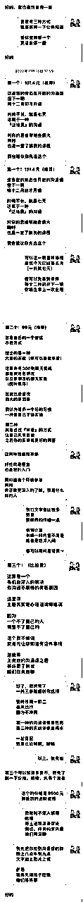

那次对话的最后，我给了对方三个选项；排列的顺序，也正是我希望他报名的顺序。这是一种更好的顺序——对方已经报了其中一个，我就没有继续往下推。

为什么要这样？因为当我们和客户的信任度还不够深时，一个劲儿地推销，只会给对方一种很糟的感受：你跟我聊天，就是想让我掏钱。这会把好不容易建立起来的信任感破坏掉。所以，这条原则一定要留意。

### 技巧62：谈成交，这个情绪一定要迈过去

这是一位沟通课老学员的案例。

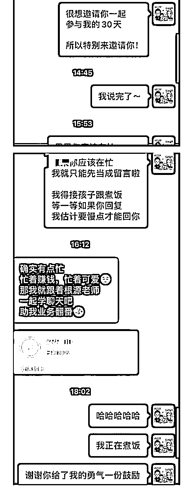

那次对话有个小插曲。我发现，人心里都藏着一种『恐惧』：当我介绍完产品之后，对方消失了好一阵子。虽然我心里明白，她多半是去忙了，但还是忍不住冒出一种莫名的『害怕』——她会不会其实觉得不舒服？

但我一直跟自己说：所有的恐惧，都是想象出来的。当下这一刻，一定没有恐惧。只要能迈过这个情绪，谈成交之后，人就能多几分洒脱。

### 技巧73：让客户「不愿意被你成交」的秘籍（一）

换个角度说：如果你就是不想成交这个客户，那太简单了——只要持续做一件事：不停地向对方推销产品。

看到这儿，肯定有人疑惑：做销售的，不就应该推销吗？各位别急，不妨先把自己放进「客户」的位置，模拟模拟——

你有没有过这种瞬间？走在人行道上，忽然有位打扮不错的男生朝你走来，你还没来得及把“艳遇”两个字消化完，他已经递出一张卡片：“美女，健身了解一下？”

在地铁里碰到一个笑容甜甜的女生主动搭话，你正琢磨是不是自己今天特别有魅力，她下一秒就开口：“最近开了家小店，欢迎来坐坐。”

那一秒，你的大脑彻底清醒：这不是缘分，是销售。

其实，几乎所有人心里都有一道闸门：一闻到推销的气味，就会自动落下。

那如果暂时没有产品要推，能跟对方聊什么？

答案往往不是话术，而是闲聊。

在信任还没建立之前，最能卸下防备的，就是把话题落到对方身上。

原则只有一条：把关注点放在对方身上，别老围着自己转。

很多做业务的人不是输在专业上，而是输在沟通上。

下面这七个动作，只要中了一个，对方就会下意识想逃。

满嘴都是“我的看法”

有一种人，不管聊什么，都能把天聊成自己的单人脱口秀。

对方刚说一句话，他立刻接：“我有不同看法。”

对方讲完一个烦恼，他马上点评：“我的判断是……”

客户真正需要的，不是你的观点有多精准，而是你能听懂他的情绪、看见他的处境。

他需要的只是倾听和接纳，是那种“你在认真陪我”的感觉；哪怕只是安抚一句，也好过给一堆结论。

如果每一次交流都变成你的观点发布会，关系自然越来越远。

独角戏一演到底

还有一种人，见面之后就成了单口相声演员。

先是公司优势，再是产品参数，接着制度、场地一路讲下来，越讲越兴奋，根本不给人插话的空隙。

你想问个问题？抱歉，找不到接缝。

好的沟通，讲究的是有来有往；一个人把话都说完了，另一个人连呼吸的空间都没有。

真把客户聊困了，这场对话基本就报废了。

习惯性唱反调

你说股市要调整，他马上驳回，仿佛只有他的判断才算数；

你说这波流感应该能撑过冬天，他连连摆手，断言你肯定想错了；

你说天色这么沉，多半会下雨，他笃定地回答：绝对晴。

一次两次还好，次次都要争赢，对方心里只剩一个念头：跟你说话太累了。

人和人之间的亲近感，是从“被认可”开始的；你习惯性反驳，等于亲手把门关上。

人口普查式连环问

线上才认识五分钟，就连环抛出“老家哪儿”“什么学校”“结婚没有”“孩子几个”“今天吃了吗”……

这种对话不像交朋友，更像入职背调。

对方嘴上礼貌回应，心里已经在想：你管得着吗？

问句一旦连发，距离感立刻拉满，好感就越来越难建立。

交情没到，别急着指点

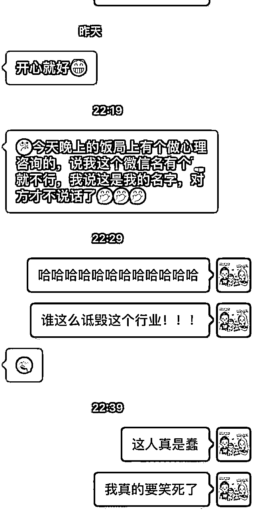

有位朋友在饭局上认识了一个做心理工作的新朋友。

两人刚加上聊天方式，对方就来了一句：“你这名字里的‘x’不好。”

朋友当场愣住，只能接一句：“可这是我身份证上的名字。”

气氛瞬间掉到冰点。

这种对话，既不礼貌，也很没分寸。

尤其当关系还不够深时，“我提醒你一句”“这事不该这么办”都属于高风险发言。

真正会聊天的人，不会在还不太熟的时候，急着教别人怎么活。

开场白就是账单

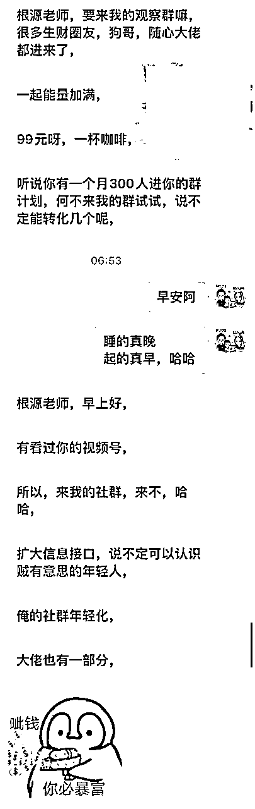

这种场景我见过太多：刚打完招呼，就甩来一张产品图，紧接着开始报价。

不谈需求，不聊感受，不给人缓冲，直奔转账。

不是说不能高效推进，但关系没到那个份上时，急着聊钱就是透支信任。

你也可以开门见山，但要做好两种准备：一是碰钉子，二是关系打折扣。

所以我提到钱之前，习惯先铺垫几句。

哪怕只是多聊几句近况、多问一句需求，也会让“价格”两个字显得没那么突兀。

一键广播式“关怀”

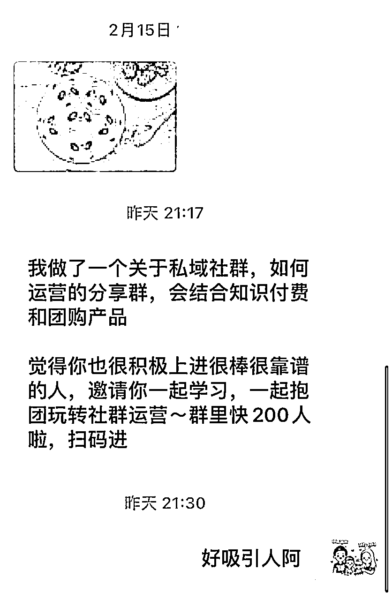

微信里有一个“批量发送”的功能，以前很多人拿它当推广利器：

一次勾选九个人，连点十次，九十个人就都收到了。

省钱、省事，还能铺量。

可在收消息的人看来，这只有一种感觉：“我被放进了一个群发名单。”

批量发送四个字，就是“我没有为你认真准备”的潜台词。

尤其是邀请对方加入社群，如果走的是这种模板化路径，对方不会觉得自己被当回事，只会觉得自己被覆盖掉。

关系运营里，温暖永远排在效率前面。

我希望被怎样对待，就先怎样对待别人。

这七个动作，表面上是沟通技巧的问题，底层其实是：你有没有真正看见对方。

客户难搞从来不是问题的真相；真相是，他觉得自己只是你的成交目标。

好的销售，不是把话说得漂亮，而是让人愿意在你面前多说几句。

我，根源，做过十二年线下销售和团队管理，后来转做心理方向的工作，积累了两万多个案例；同时也是龙哥盟的圈友。

二〇二二年之后，慢慢转向线上，专注付费内容。

更多关于成交和关系的实战思考，都在我的历史文章里。