# 从伸手要钱的全职宝妈，到月入20万的运动康复师

从伸手要钱到月入20万，这个全职妈妈只用了一年

曾经的我，是和无数全职妈妈一样的“伸手党”。但只用了一年，我重新杀回职场，从业绩挂零的崩溃边缘，做到销售冠军，再自己单干，月入二十万。这一路，改变的不只是收入，还有我的心性——我重新掌控了人生。别说什么“太晚了”，全职妈妈又怎样，35岁又怎样？只要你真的想醒，什么时候都来得及。

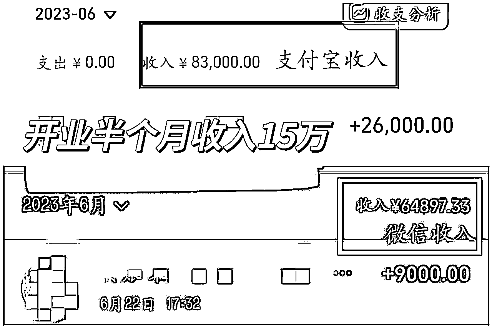

# 一 为什么我走上了运动康复这条路？

在遇见瑜伽之前，我的世界就是孩子和灶台。住在农村，两三个月都难得上一次街，产后还胖了三十多斤。因为一个人带娃，没办法去健身房，就趁宝宝睡着时，在床边原地跑。他睡两三个小时，我就跑两三个小时。靠运动和管住嘴，100天减掉三十多斤。

2017年，合肥那场“MO瑜伽艺术生活节”，彻底改变了我的人生。台上的老师身材紧致、动作漂亮，我亲自试了一下，那种从未有过的畅快和轻松，让我立刻爱上了瑜伽。从那一刻起，我给自己定了一个长期目标——做运动康复。

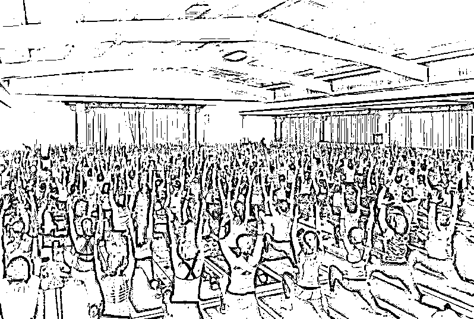

接着，我开始了连续365天不间断的瑜伽打卡。冬天凌晨四点起来，练到早上八点。不懂原理就上网课、翻经典书、画骨骼肌肉图，练卷腹和深蹲提升力量，趴青蛙、压腿提升柔韧。

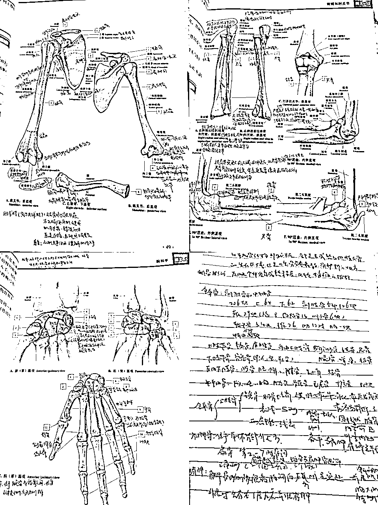

对零基础的人来说，运动解剖简直像天书。我没有捷径，只有死磕。一遍听不懂，就五遍、十几遍。把老师讲的音频逐字逐句整理成文字，觉得每句话都是关键。坚持打卡三个月，体能明显好了很多。

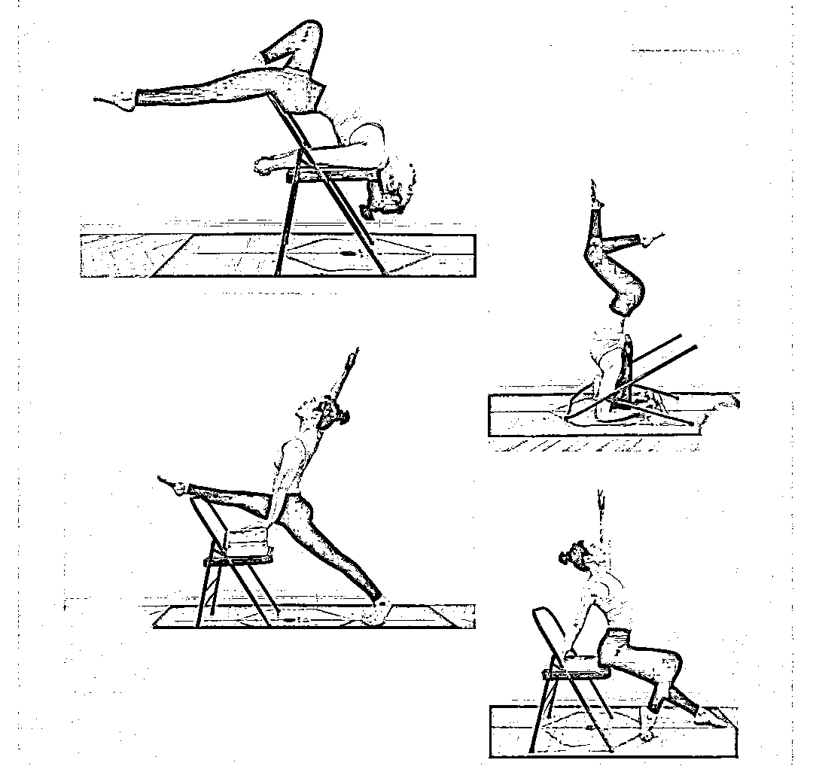

2018年，为了更系统地学习瑜伽和康复知识，大年初几我就拖着箱子到了济南，整整学了40天。白天上7小时的教练课，我额外又加4小时的会员跟练课，就想多学老师的排课和授课方法。再加上一堆课后作业，每天只能睡5小时。吃饭只考虑两件事：省时间、能扛饿。

从济南回来一个多月，我怀了二宝，但学习没停。孕期四个月时去合肥上了运动康复课，一直坚持到临产，每节课我都要排练、反馈、精进，会员都叫我“偶像”。产后为了尽快恢复，刚两个月我又去济南复训。回武汉第二天就找工作，第三天就上班，当时就想着先站稳脚跟，再把孩子和家人都接来。那时候身体还没完全恢复，肩颈难受得坐着超不过30分钟，走路超不过一公里，脖子无力得连头都撑不住，躺着也没用。后来我用自己学的运动康复知识处理了大概30分钟，症状彻底消失，到现在也没复发。

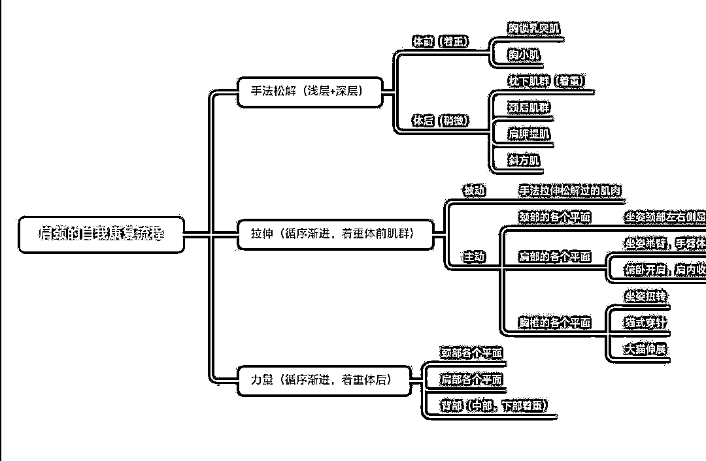

有了这次亲身经历，我开始在同事和会员身上练手，也经常和私教老师交流经验，收到很多正面反馈，自信心一下子起来了。

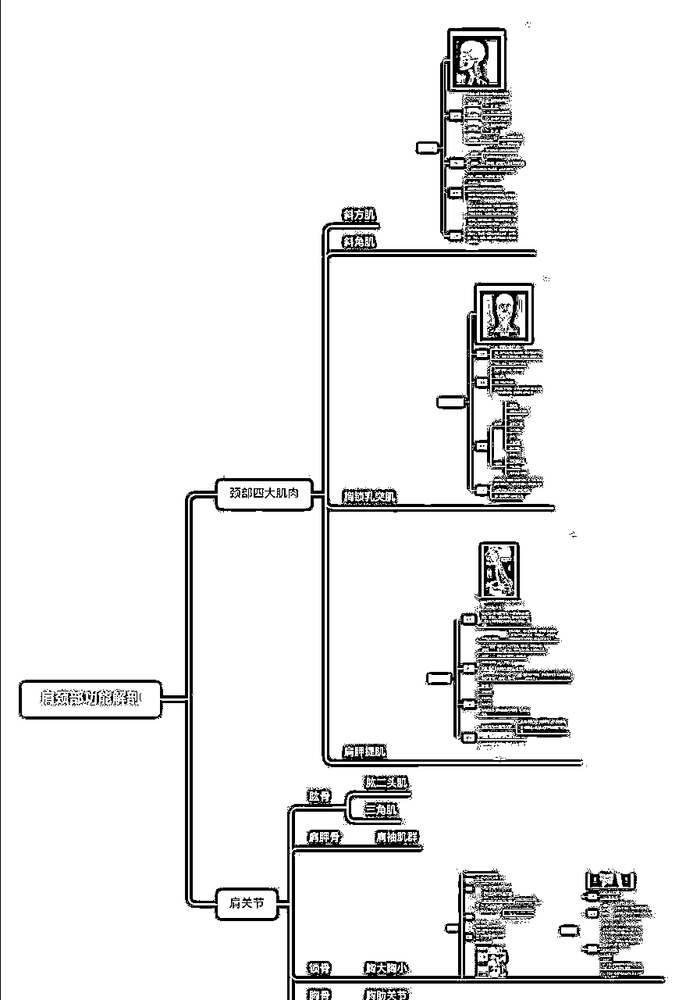

2022年，我的事业有了新突破：给公司同事做肩颈理疗、教椅子瑜伽，在抖音、小红书、视频号做直播，录短视频分享康复知识。私教会员好评如潮，收入翻到之前的5倍，一家人在武汉定居下来。

下一步，我打算在精力允许的情况下，把自己学的东西做成线上课程，帮更多被慢性疼痛困扰的人找到出路。

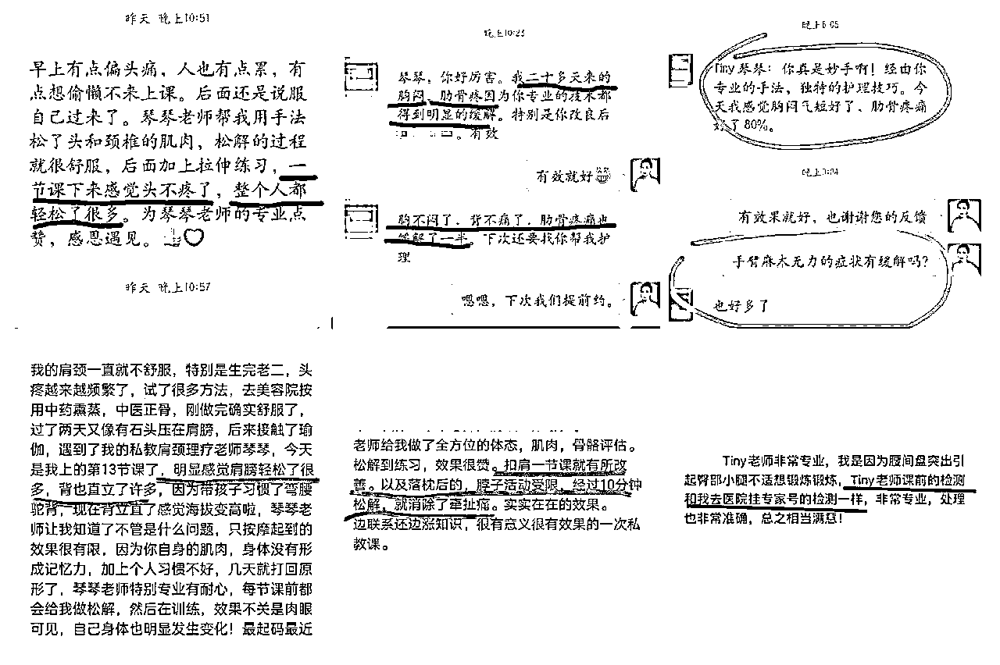

# 二 从业绩为0到销售冠军

刚开始在瑜伽馆，我特别抵触销售，经常连续三四个月业绩挂零。那时总在心里问自己：天天起早贪黑，拿这点工资，到底为什么？两个孩子也没时间陪。不如辞职回家带娃算了，反正做这一切也是为了孩子。我无数次想走，但每次都被领导和同事劝住。我有个习惯：要么不做，要么拼到底。既然大家这么信任我，我就暗下决心，必须改变现状，去跟高手学习，提升自己的专业和能量。我不能辜负自己跑出农村的勇气，不能辜负家人支持，更不能辜负会员和同事的信任。

不过出去学习，经济压力非常大。本来就入不敷出，没积蓄，请学习假还没工资，学费、差旅费都是上万。更惨的是学完回来，得没日没夜地补业绩、补课时，不然领导怎么可能一次次批假？有一次我两个多月没休息一天。最折磨人的是，学的时候完全不知道能不能得到回报。迷茫的时候，我就选最难的那条路，不管多难，死磕。后来，我先后去了武汉、合肥、成都、杭州、北京、上海，多次向运动康复领域的大佬学习精准评估、肌筋膜链运动康复、内脏调理。

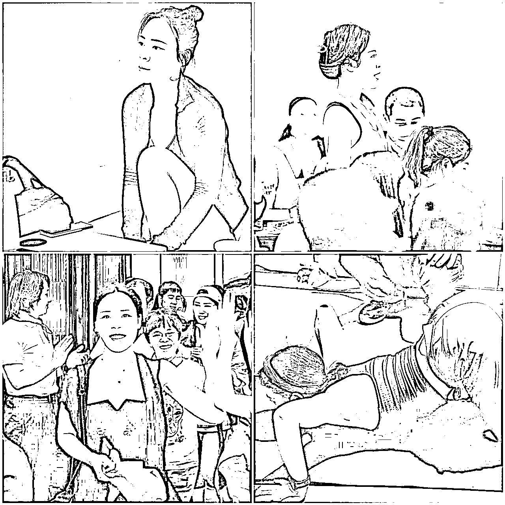

还专门去深圳、武汉学了产后修复和大肚修复。

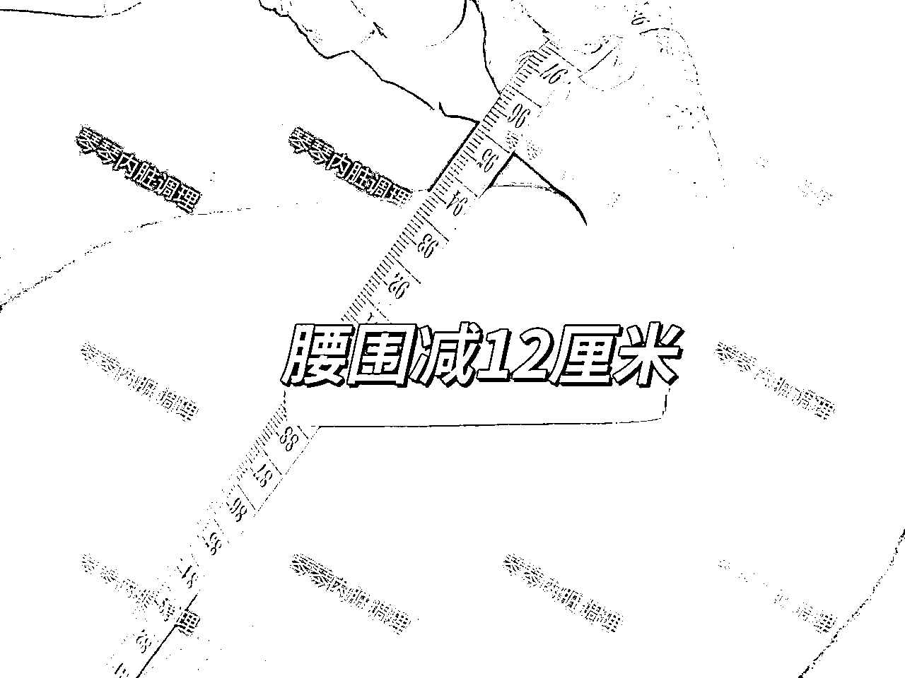

又到杭州学了软组织损伤徒手疗法。因为我把运动康复当成终身事业，也为了更好服务会员，圈内大多数大佬的线下课我几乎都跟着学了一遍。

# 三 我是怎么签下10万大单的

随着专业能力越来越强，我慢慢从同事中冒出头来，业绩从0冲到月销10万、20万，甚至30多万。

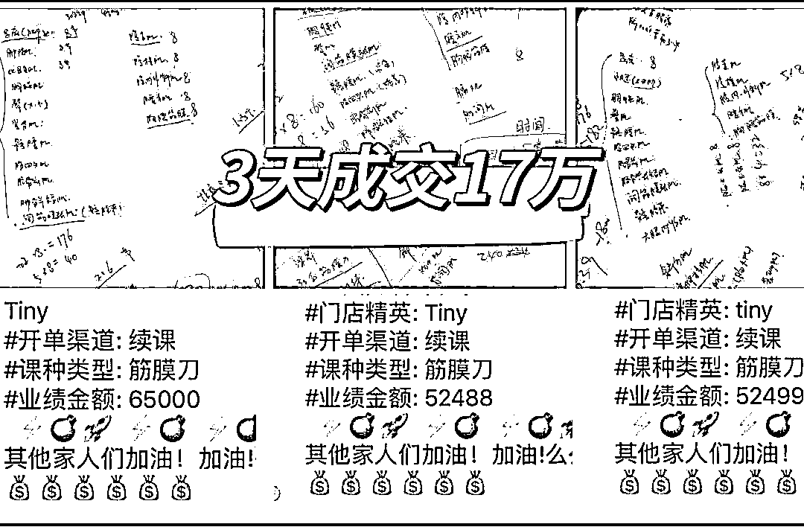

这个10万大单的客户，是位四十多岁的女高管。她原本是另一个老师的会员，因为那段时间我几乎天天成单，而且金额不小，那个老师就让我进去帮忙成交。她的主要问题是多年的肩颈痛加左侧臀部周围疼痛，尤其屁股疼，久坐和睡觉都受不了。针灸、推拿、大医院跑了无数趟，就是不见好。

“无评估不康复”是我的原则。我先问清她的背景，再做局部和整体的精准评估，把所有可能和症状相关的原因列出来，一条条讲给她听，回答她的疑问，彻底打消了她的顾虑。

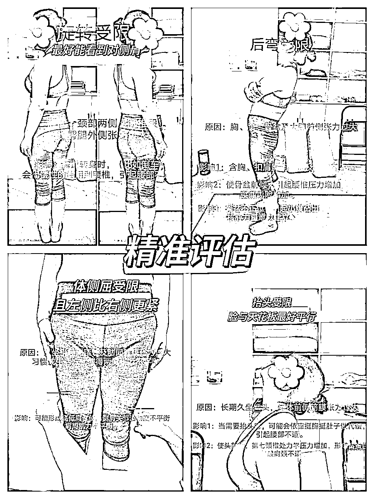

上课时，我先处理她最想解决的肩颈问题。不到半个小时，她感觉整个人放松了。这个客户当场就签了合同，回去后也兑现了转十万的承诺。当时我们馆里一共9个老师，为什么只有我拿下这么大的单？因为我从2016年就开始学运动解剖和肌筋膜原理，能清楚讲明疼痛的来源；因为我的评估和手法让她当场感受到效果；因为我把未来一年300节核心方案直接摆在了她面前。

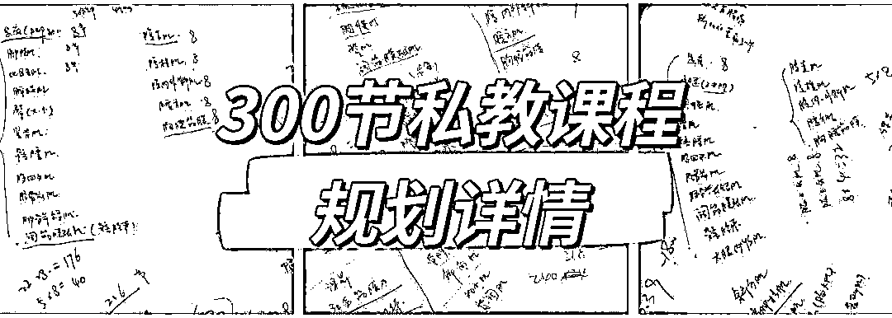

# 四 我的独家成长心法

其实不管运动康复还是其他行业，收入就是一个公式：营收=客户数×客单价×成交率×复购率×推荐率。篇幅有限，今天重点分享获客、提客单价、提成交转化率三件事。

## 1 单干之后怎么获客？

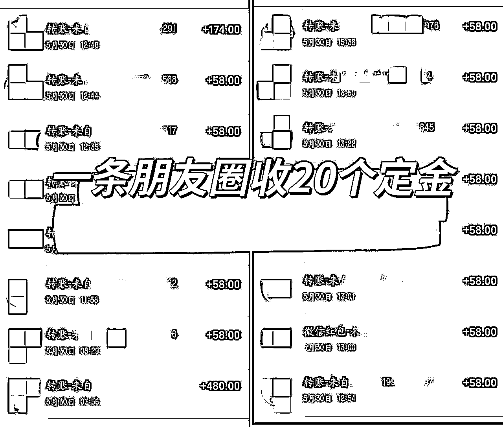

在馆里时，我们的营销特别土——跟同事出去发传单，就是最古老那种。说实话成交率低到可怜，比电话销售还招人烦。但就是这种笨办法，攒下来的潜在客户，在我自己单干后大多数都成交了。因为我比别的教练和销售多做了一个动作——分享。我持续在视频号和朋友圈发学习心得、服务会员的案例。

慢慢地，潜在客户对我的看法完全变了：不再当我是销售，而是当我是老师和朋友。这里重点说说我怎么发朋友圈：每天发3到5条，包括1到2条个人积极生活方式，1到2条会员服务心得，1条干货知识。

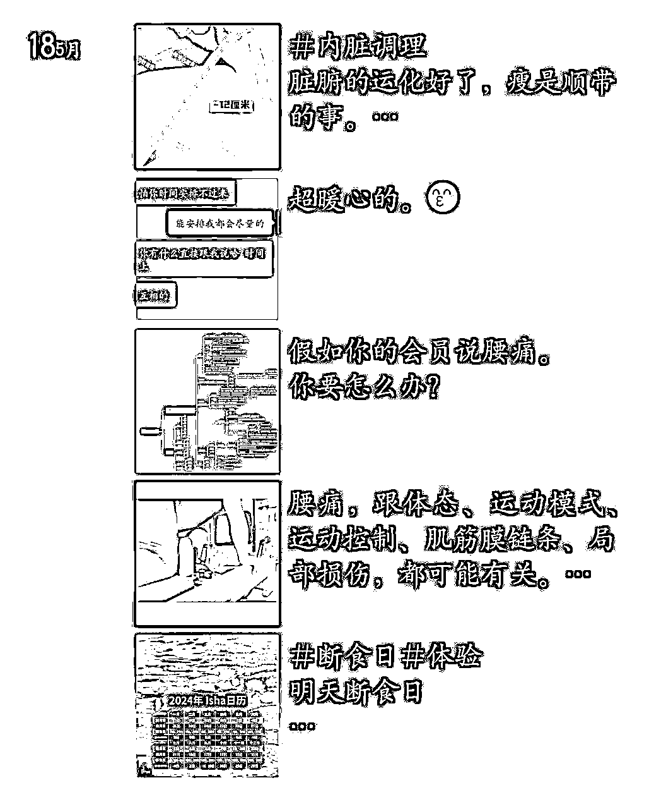

很多同行和前同事来问我，我总说他们太懒了：白白浪费了朋友圈这个营销机会，只会复制粘贴、疯狂刷屏广告。

## 2 怎么把客单价提高8倍？

我的秘诀是提高耗课率。别人一次上一节课，我的会员一次上8节；别人一年的私教课，我两个月服务完——这就相当于原来8倍的客单价。

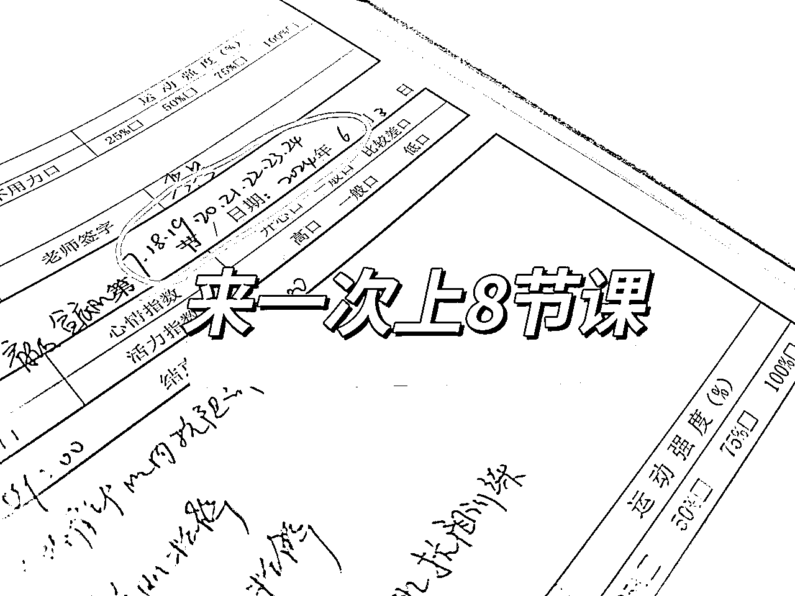

为什么别人的会员要哄着来，我的会员却主动约，还一次上这么多课？第一，建立专业信任。当你的专业度足够高，你说什么会员都信。

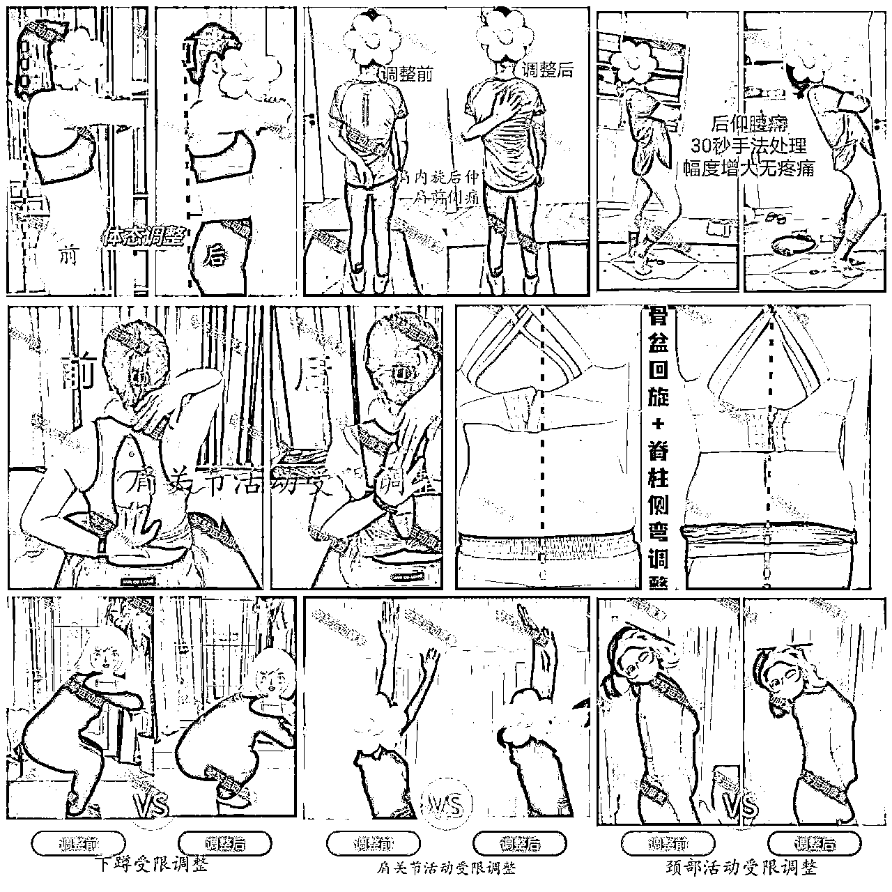

第二，降低会员的参与难度。很多成年人学习（健身、减肥也一样）往往因为得不到及时反馈就放弃了。我在常规运动康复之外，加入了软组织损伤徒手疗法（简称手法），会员只需要躺在那，就能轻松感受到效果。

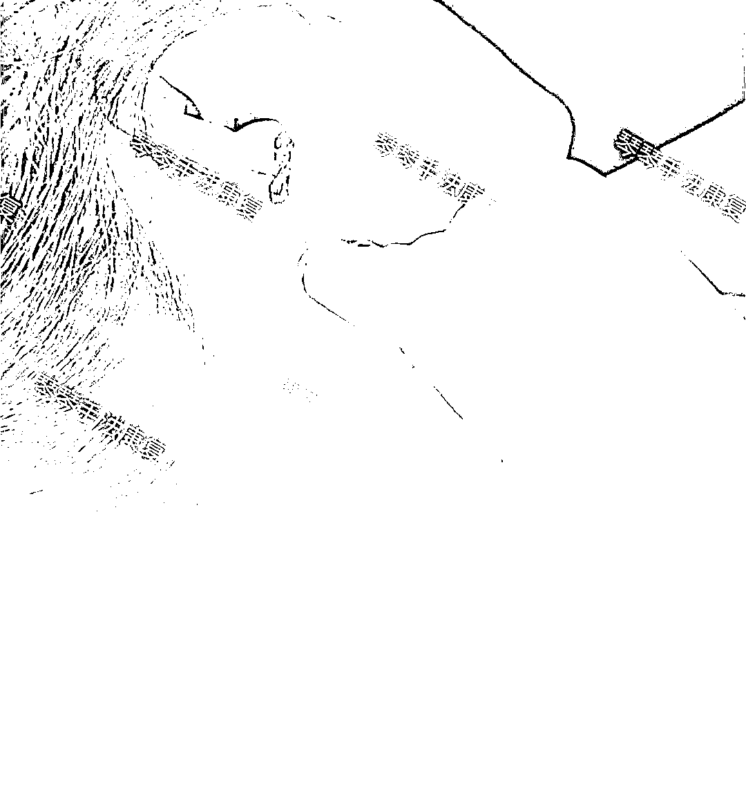

而且，我帮她们解决一个身体问题，她们就会主动追着续费，还想解决其他问题，更会介绍七大姑八大姨一起来。

## 3 怎么做到99%的进店成交率？

99%的高成交率，核心就四个字：不销而销。我的会员都是冲我来的。说白了就是专业+口碑+客户至上的服务。

**专业**：给每个会员做个性化课程设计，而且不换教练。根据会员的能力和症状安排合适的强度，既有练习又有拉伸，动作难度也因人而异。以前在馆里，教练流动大、水平参差不齐，很难有人对学员情况特别熟，持续跟进。自己开馆后，我对每个会员的情况都了如指掌。

**口碑**：百分百好评。把事情做到超预期，客户才会有印象、有动力。我的课程口碑是100%，很多会员都和我成了生活中的好朋友。

**客户至上**：从不硬推课。如果会员上课时间临时有变化，我永远先顺着她们。情绪价值也给足——很多小白学员动作完成度不高，但我每次都能看到她们的进步，找到点来夸。

# 五 运动康复行业的未来

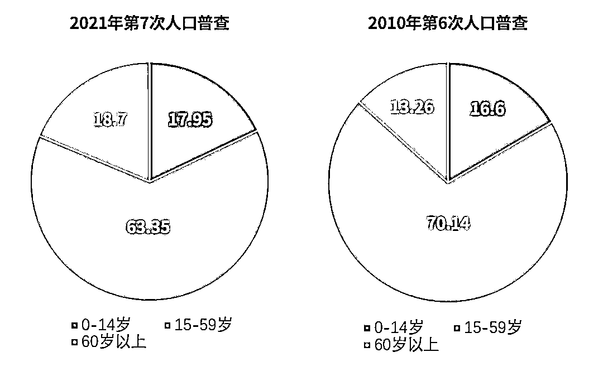

老龄化是全球不可逆的大趋势，国内尤其明显。联合国定的标准是，65岁以上人口占比超过7%，就算老龄化社会。中国2021年第七次人口普查的数据：60岁以上占比18.7%，65岁以上占比13.5%。邻国日本是全球老龄化比例最高的国家，那也是我们将来的样子。日本总务省数据显示，截至2021年10月，日本65岁以上老人占总人口的28.6%。照这趋势，到2025年（也就一年多后），日本65岁以上老人比例会超过30%。

运动康复主要服务的，就是有钱有闲的中老年人。欧美发达国家运动康复已经很成熟，就像我们现在随处能见到的健身房一样，甚至被纳入了医保体系。但国内还在行业萌芽期。看一个行业的前景，不能只看宏观政策和趋势，也不能只看某个人赚了多少钱，更要看中观层面的行业结构。这里有个公式：行业规模=覆盖人群×客单价×复购率×推荐系数。

**痛点大**：经济不景气时大家会节衣缩食，大额消费更慎重，但对身体疼痛，花钱绝不犹豫。

**推荐率高**：大健康行业天然有高推荐率，谁都愿意给亲友送健康，聚会聊天最后都会聊到健康。不像内卷行业，学习者是竞争关系。

**客单价高**：一对一私教收费，每小时500到5000不等，而且没有天花板。

**红利期刚开始**：一边是大量网约车司机、外卖员在纯靠体力赚钱，另一边是老龄化社会需要服务。国家已经多次提出要引导劳动力转型到这块。围绕老龄化去做事，真的事半功倍。

**最重要的是很难被AI替代**：在AI时代，做任何事业决策都要多考虑一条：会不会被取代。运动康复对专业和服务要求非常高，评估、处理、沟通这些核心工作，AI可以提效，但很难完全替代。

想和我交流的朋友，可以加微信：tanqinqin01。