# 从0到20万：我在📕卖虚拟资料的完整复盘
作者：龙哥

全文约9300字，下面组件点击可以直接跳转：

# 写在前面

各位圈友大家好，我是龙哥，第一次来赚钱做分享。我会尽量把操作细节摊开来讲，大家有不同意见欢迎在评论区聊。今年4月我正式加入了赚钱，不过在整理旧文档时才发现，21年或22年我就已经大量阅读过赚钱的内容，算是老编外了。这次多亏@郑韩 韩哥把我带进来，真心感激。

这个项目是从2023年9月开始筹备的，10月才挂出第一条商品链接。截止到2024年元宵节前后，五个多月的时间做到了差不多20万收入，最高峰的一个月有4.9万。因为这个赛道属于教育类虚拟资料，最大的支出是平台服务费，最开始抽5%，万元以内免抽。后来查后台发现我们类目的抽成已经降到2%了。（2024年11月15日补充更新，最近开了一家新店，同款产品做到稳定出单花了大概四周，目前单店月销最高做到了6.7w）

# 第一部分：我为什么做起这个副业

先交代一下背景。我一直在文娱行业，先后在影视公司和经纪公司做过制片人和经纪人。刚入行时主要做的是宣传和品牌这类营销工作，所以对新媒体不算陌生。21年底我决定走出文娱圈，转行做直播带货，一直做到现在。2022年还赶过早班车，尝试做过小程序短剧，不忙的时候拍了几部，不过没赚到什么大钱。

做📕号的契机很直白——在直播电商公司闲得慌。一般早上6点开播，到中午12点或者下午两点收工，下午整段时间空着，觉得不利用起来太浪费。我本身就爱折腾，之前和朋友试着做过号，没搞起来，心里始终有点不甘，想着再试一次，万一翻身了呢。就这么入了📕的局。

最开始账号发的内容是“教人怎么做📕号”。当时刷了大量课程，从中提炼出一个基础方法：对标模仿。我的做法是先确定选题，再去找爆款内容照着做，用PPT把内容重新编排一遍。那时候想法很简单，只要数据能跑起来、粉能涨起来就行，等有了粉丝基础，也许还能接点商单。

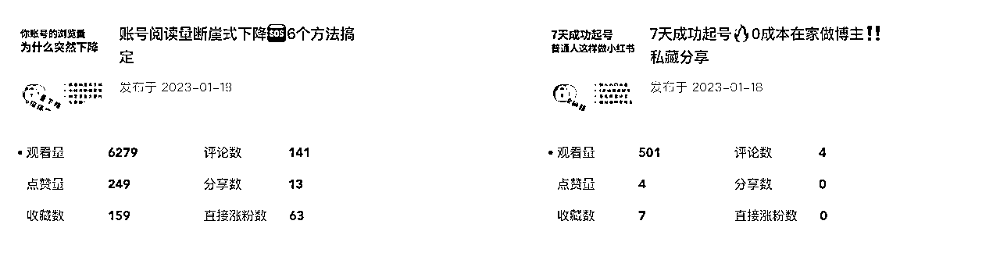

因为没有原创底子，所有内容都是比着别人做的，产出效率很低。账号撑了7天就不想做了。但恰恰是这7天的数据让我意外。虽然号停了，我却因此认定📕值得深耕。相比其他平台，📕对新人也更友好。停更后我不断反思调整，最后确定的方向是：锁定某一类人群，做他们真正需要的内容，然后根据这些需要去打造产品。

那个账号搁置了很久，直到23年9月中旬，我又发了一条笔记，数据居然还行，于是把所有旧笔记都藏了起来。那段时间不断有人留言、私信找我要资料，我才觉得这个方向可能选对了。同时也开始准备产品，说实话当时心底也没底，不知道卖不卖得动，但想着先跑起来，最坏的结果不过是搭上点时间。

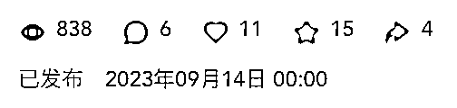

接下来就是一边写笔记一边做产品。23年10月8日，我发了第一条挂产品链接的笔记，下面这条就是当时的数据截图。当时数据并不亮眼，大部分流量都是后来被搜索带起来的。关于搜索流量后面会专门展开，因为我们店铺后期将近六成的成交都来自搜索。现在在📕搜我们这行的关键词，每10篇文章里能有7篇左右是我们的。

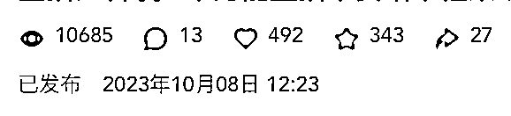

学习资料那篇笔记是中午发的，当天晚上就出了一个单。

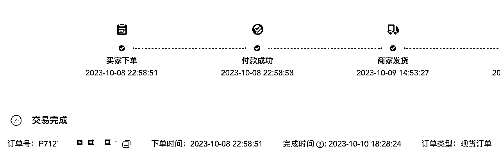

项目从9月一直做到现在。去年12月我找了朋友合伙，两人总共运营4个号。到目前，单店30天最高销售额一度冲到4.9万，粉丝也涨了8000多。那段时间恰逢过年前后，大家普遍焦虑，所以出单速度格外快，这一点我也提前预判到了。

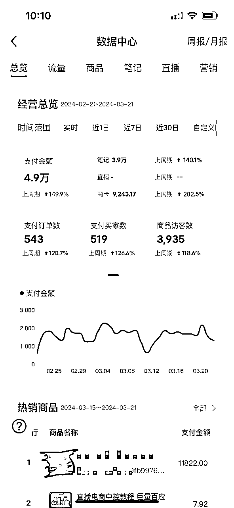

2024年11月15日补充更新，近期开了个新店，同款产品起店稳定销量花了将近四周时间，现在单个店单月最高卖了6.7w。下图是10月份单店gmv截图。

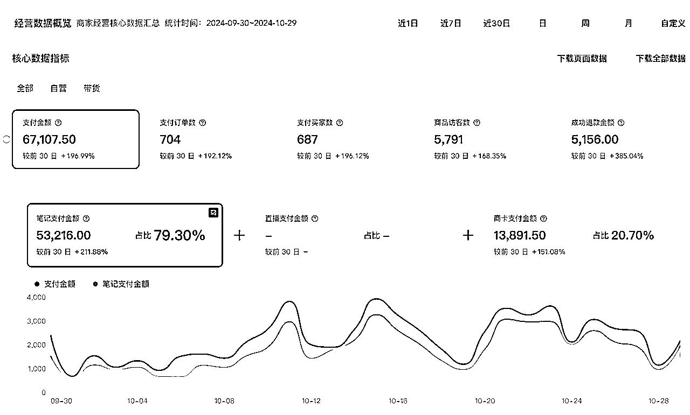

以上大概就是我做这个副业的时间脉络，可能线头比较多，大家就着时间线往下看干货就好。目前我们还在沿着最初选定的产品线做延伸，开发新东西。现在只有两三个同行在模仿我们，但他们只看到表面，搞不清我们的关键优势在哪。他们从去年年底就跟进，笔记数据看起来也还可以，客单价却只有我们的一半，最高销量不过是220多单。

# 第二部分：全流程操作拆解

## 1.怎么选品

### 1）选品的基本逻辑

第一，品类必须垂直。拿国考来说，这是一个大领域，能往下拆成行测、申论、面试；艺考也能拆成面试、文史常识、专业课。想快速见效，就得从这些具体的分支切入。原因是用户的搜索习惯是精准的，他们会直接搜“国考面试”“公务员面试”“文艺常识”“北电面试”“浙传艺考面试”这些词。只要我们在笔记里埋好对应的词，当笔记数量和账号数量足够庞大时，搜索结果自然就被我们包围了。

第二，看平台上的关联笔记数。拿我第一次做的垂直品类举例，如果关联笔记能到几万条，就说明📕上这个方向的用户盘子足够大。具体操作是搜索框输入“xxx内容/产品关键词xxx”，关联笔记的多少就是市场体量的标尺。几万条说明有搞头。几千几百条的也能做，只是出单会慢一些，数据相对平淡。我们后来延展新品就碰到了这种情况，虽然偶尔能出单，但速度偏慢。

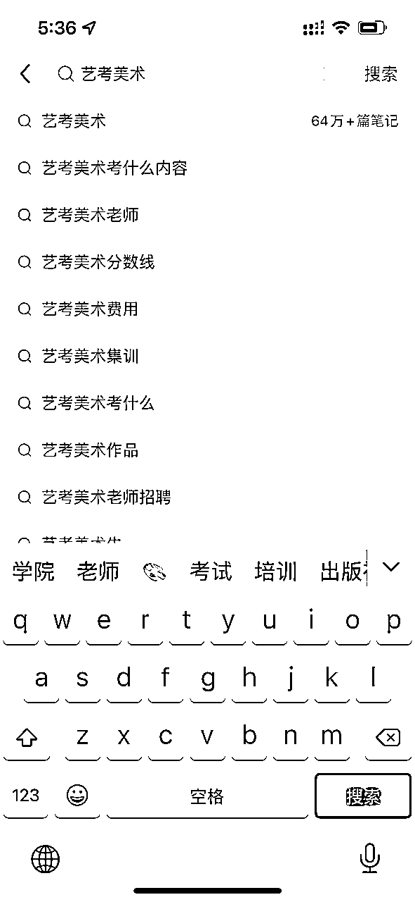

第三，借助联想词选品。在📕搜索框输入想进入的大领域，比如国考、小升初、专升本，然后看系统弹出的下拉联想词，这些词本身就是用户需求的信号。按照我的经验，联想词在第一次搜索时排得越靠前，市场需求就越大。我们做产品时就沿着这些高频联想词去开发。

### 2）产品从哪里弄

这是被问得最多的一个问题。

做初期的时候，我们的产品源头其实就是同行。📕上有很多博主做引流产品，甚至直接卖付费资料，我们拿钱买过来就行。为了避免资料重叠，最好多找几家买，下单之前务必让对方先发一份目录过来核对。

另外闲鱼、拼多多、淘宝这些平台也能作为来源。不过在我看来，这几处的资料在内容和排版上都相对粗糙。📕上的产品起码被打磨了一遍，但同样有质量堪忧的。反过来说，他们做得越差，我们的发挥空间反而越大。

毕竟资料这东西人人都能搞到手，像市面上热门的国考、省考、经济师资料，到处都是。如果同行的产品做得不行，用户会在评论区给出负面评价，一看到差评很多人都不会下单。所以我们在自己操作时也要格外留意评价的积累，这直接关系到转化率。

拿到手以后，要花心思重新整理、排版、归类、融合，把它做成一份真正拿得出手的学习资料。碰到缺的内容，如果不是自己熟悉的领域，就去网页、🛰️文章里找补。想要更高效地找到匹配的链接，建议用百度的文心一言来提问，它每次回答后会自动附上来源链接。如果没带，就在指令后面加一句“你基于你的知识库和全网进行搜索”。最后出来的成品，如果你本人看了都觉得超值，那用户大概率也会愿意买单。

### 3）版权上怎么规避

大多数资料其实是没版权的，真正有版权问题的是课程。所以我一向不建议去做盗版课程。退一步讲，可以用AI工具把资料重新消化一遍，调整结构、换一种说法，这样很大程度上能绕开版权风险。

如果自己没有后端承接，但又想用一些可能有版权争议的资料，而且这些资料已经攒了一些销量和热度，那可以试着联系版权所有者或讲师本人谈合作。这样一来合规性更强，也能给项目增加专业背书。

### 4）为什么选择挂店铺而不是引流私域

不少人做虚拟资料会想方设法往私域导，目的是后续推高客单价或者减少退款。但我的做法从一开始就是反过来的——不管商品是1块还是1毛，一律挂在店铺里。

这么做有几个实实在在的好处。

第一，现在很多人不愿意私聊、不愿意后台说话、更不愿意加🛰️，硬聊的话这单可能就跑了。但是让他直接到店铺拍下，哪怕只是几块钱的东西，他心里也没什么负担，这样我们就快速赚到了“第一块钱”。而且下单后我们能拿到用户的手机号和收货地址，顺势就能去加🛰️。根据我们统计的数据，这种主动添加的好友申请通过率大概在80%。至于加上以后怎么聊怎么做，赚钱星球里关于私域运营的存货已经很多了。

第二，保护账号。频繁私信很容易触发限制，我们也试过直接发🛰️号，结果就是不断换号、不断换引流手法，身心俱疲。但在店铺客服这个场景里，沟通方式可以做得更柔和更隐蔽，目前没有出过任何状况。客服窗口可以直接发链接，用户拍下后还能自动发送短信，短信里塞个🛰️二维码也很安全，一条短信几分钱而已。

第三，商品链接弥补了笔记写不了太多信息的短板。我们可以把资料内容、附带服务在商品详情里写清楚，用户看得明白了，下单更爽快，也更容易接受进私域。

### 5）产品资质和类目怎么弄

0828更新补充：

关于资质，常有人问需不需要许可证。答案是：不需要。大家可以去看拼多多、淘宝，很多人在卖自己打印的资料，暂时也没遇到什么问题。当然风险是存在的，主要来自同行举报。我们提前做了预防：不管是电子版还是纸质版，对外统一说是“赠品”，这样一来产品本身的合规性就提升了。在📕上，可以挂俱乐部或者社群的链接，笔记内容仍然围绕资料来写，但对外说法是加入社群之后免费送内部学习资料。另外也可以挂视频课程，视频本身没有硬性质量要求，大家真正要的是资料。

关于📕店铺的类目选择，初期我们的电子版挂的是“艺术潮玩-艺术品及周边-艺术定制-虚拟定制”，后来换成“笔记本”“文具”“教育培训”等。“虚拟定制”“笔记本”“文具”这些类目基本不需要资质，后台提交就能过。不过建议在商品标题中带上类目相关词，举个例子：“2025国考/考公/公务员 政策解读定制笔记本”，这样过审会更顺。如果审核没通过，多半是链接文案里提到了“书”或者其他违禁词，只要有“书”字基本就很难过（至少我们是这个情况）。要是你手上有资格证、毕业证这类证照，那就可以选“文具/文化/文创/宠物 > 教育培训 > 技能培训-xxxx”这些类目，有证就能过，文案创作空间更大，只是同样不能出现“书”字。

如果既想稳妥又没有证书，个人店就别考虑了，蓝V店才能操作。我们最近琢磨出一个方法，可以叫“借花献佛”，具体有两种玩法：

a. 在📕发笔记，找有证的人买。一般200-500块就能搞定，因为只需要对方提供一张照片，合同自己补一份就行。

b. 不想花钱的话，去Boss直聘发招聘信息，把持有证书当成第一项要求，工资标高一点，来咨询的人自然多。简单聊几句后，直接问对方有没有证书，能不能看一下照片，绝大多数人都会直接发过来，而且基本不打码。

## 2.内容怎么做

### 1）爆款笔记怎么写

第一步是对标模仿

这类笔记要的就是数量，如果每一篇都从零开始原创，效率会非常低。去年到今年上半年，📕的规则还很宽松，我们主要以“模仿+微调”为主。举个例子，别人的标题是“考公，面试官最反感什么”，我们就改成“考公，面试官最不喜欢什么”，再延伸成“考公面试官最讨厌的行为”或“考公面试千万别这样做，面试官特反感”。大方向不变，措辞换着来。

正文部分我们通常不写太多，最多提一下资料的要点和标签。因为学习资料这行，真正要让用户看见的是产品本身，产品就是图，图就是学习资料的内容。封面字越多，点击和互动的意愿越强，很多人扫一眼就点赞收藏了。即便他们不买，这些互动也能帮笔记获得更多曝光。

第二步是找爆款笔记

方法不复杂，搜索和产品相关的关键词，按热度排序。把热度排名靠前的那一两篇调出来，照着它的选题和风格做。我们目前数据最好的那些笔记，选题和标题基本都源自超级爆款，只是在图片和内容上做了差异化处理。而且特别火的选题是可以反复发的，比如一周一次，爆过的内容大概率还能再爆。

第三步是原创选题：做赛道延伸

现在已经不是完全照搬别人笔记的阶段了，更多是参考选题方向。具体做法是把现有的产品或赛道做进一步的细化和延伸，这些延伸出来的点就能当选题当标题。同时还要考虑应季性：小初阶段的内容跟着寒暑假走；考公的内容则结合当下的时政议题，比如某某会议、某项政策，甚至最近大热的黑神话悟空，影响力这么大，没准就会出现在考题里。

### 2）封面怎么做

学习资料笔记的封面，我没做过精细统计，但根据感觉，两类封面效果最稳：一是“文字很多很干货”的风格，一眼看过去全是重点；二是“干净背景+关键词”的极简风格，主题一目了然。字体和颜色越醒目越好，没必要太花哨。具体可以参考下面的图。

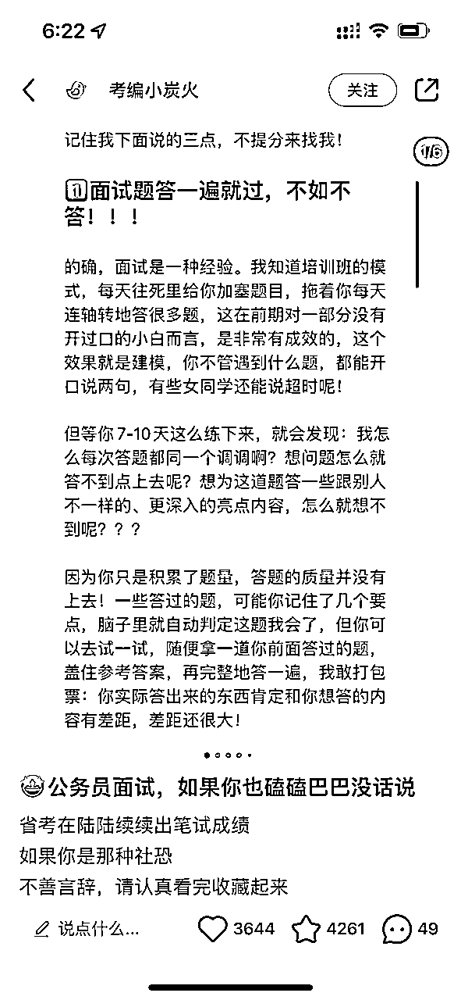

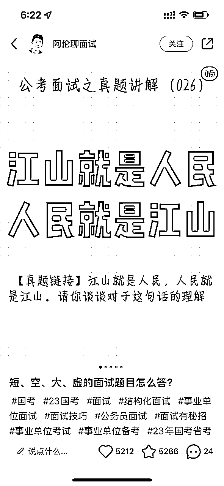

### 3）新规之后，低质笔记怎么调整

📕近期发布了《针对大量发布重复/低质交易笔记行为的治理公告》，8月15日正式生效，做📕的应该很多人看到了。公告点名了“账号多次剪辑影视作品或者翻拍书籍内容，没有二次创作解读，挂书本或者课程商品的交易笔记”。这不就是给我们量身定做的吗？

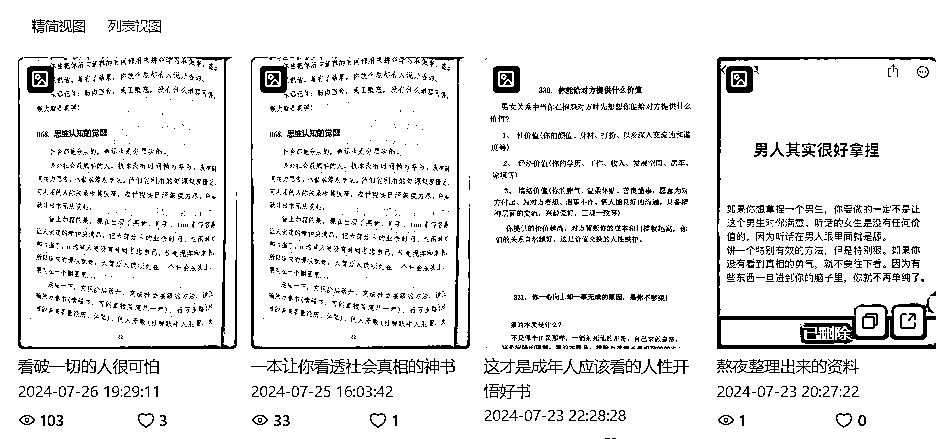

本来我们以为影响不大，结果发了几条就发现数据掉了不少。于是开始调整，调整完数据又慢慢回血了。我们主要做了三种改变：

第一种，保留原来的产品图片，在笔记正文里加至少200字的文案。文案可以从自己的产品描述里扒，也可以借鉴同行的几篇笔记，用AI工具重新组织成一段新内容。

第二种，拍vlog，把资料融入生活场景。如果大家看过“女生一个人在家做电商月入10万”“一个人下班做跨境赚到5万”这类视频，就能理解我说的形式。简单说就是混剪生活素材——上班、通勤、吃喝、逛街、风景，再配上语音讲解。文案围绕产品解决用户痛点的方向来写。对于资料号来说，视频时长最好控制在90秒内。这种笔记的缺点是制作费时、文案难写，但优点也很明显，现阶段就是比纯资料图数据好，更容易爆，而且长尾效应更好。

第三种，纸质资料实拍加手写标注。这是我们目前找到的最省力的模式。先把文案准备好，然后在不同场景里拍资料，只有手出镜，基本一条就过。如果是验证过的爆款文案，还能换场景反复拍，数据表现依旧不错。

## 3.搜索流量怎么做

前面说了，搜索词是整个环节里的命脉。在我们这个领域搜索关键词时，出来的基本都是我们的笔记。后面的大量订单也都是靠搜索带来的。给你看个例子：3月份我们卖了3万多，其中67%的金额来自搜索成交。更极端的是，最近发现某个账号的观众来源里，搜索占比居然到96%。说实话我也说不清这是好事还是坏事。

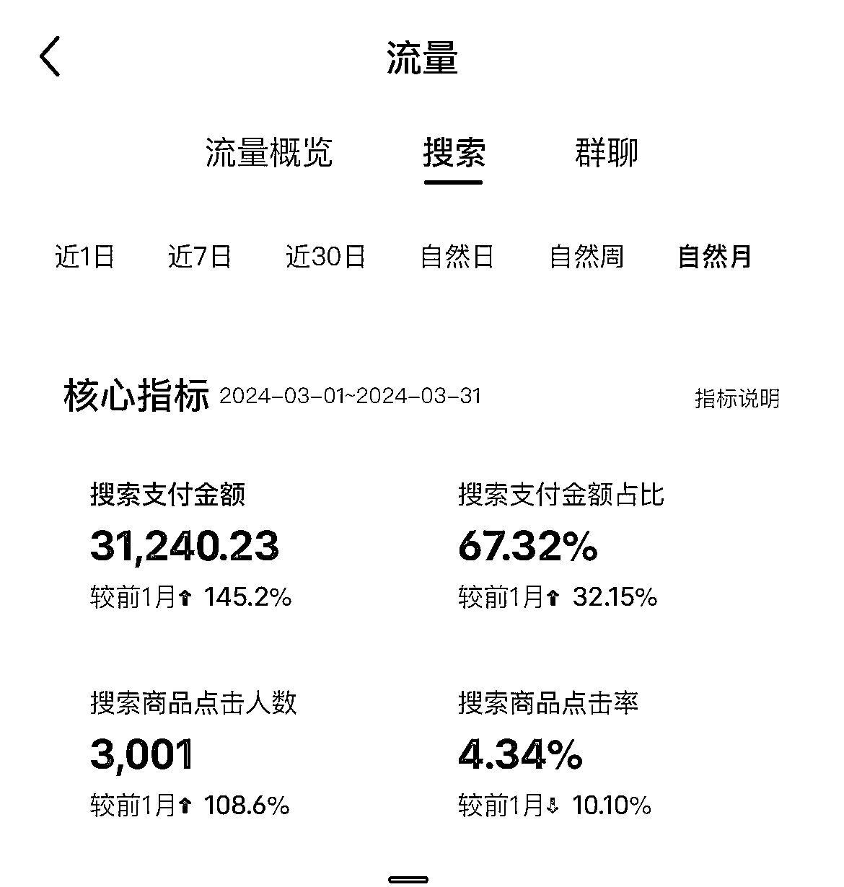

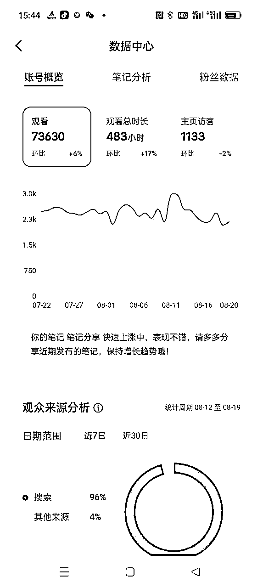

### 1）搜索词怎么找

赛道基础词：国考、艺考、吉他、直播、面试；
目标用户搜索词：在搜索框输入基础词，看下拉联想词，联想出来的都可以拿来用；

笔记内容关键词：私域转化实操、引流资料变现、产品附加值设计、赛道选择方法论

在做内容的过程中，我慢慢摸清楚了平台的关键词逻辑。之前在课程里也听人聊过权重分配的问题，这里仅代表我个人的理解。整体来看，关键词的重要性大概是这样的：标题最关键，其次是正文内容，再往后是标签，最后是评论区。

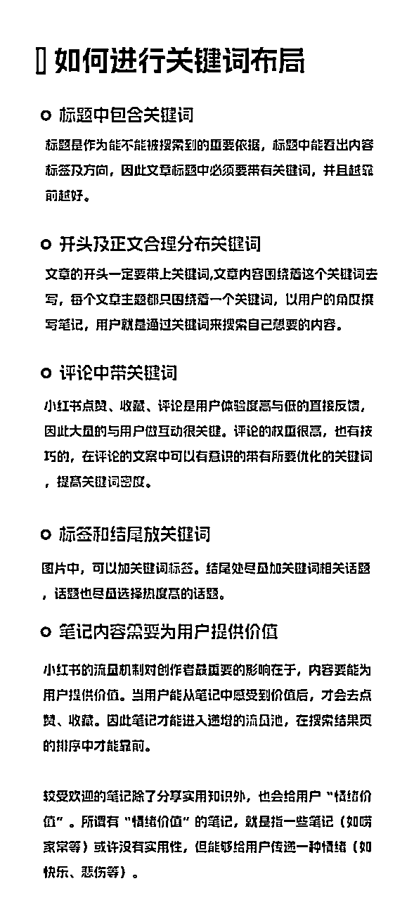

# 第三部分：从虚拟到实体，价值升级

## 1.升级的契机

刚起步的两个月左右，第一个同行出现了。她先是默默点赞收藏我的笔记，后来又把我的商品加进购物车却迟迟不付款。那一刻我意识到，自己的打法已经暴露了，赛道要从独享变成共享，利润空间必然被压缩。于是我开始翻回去看赚钱里早期的方法论文章，把当时的笔记关键词重新梳理一遍，目的就是为了应对竞争，并把流量往私域里引。

我开始做的改变主要集中在引流路径上：

=私域成交要占到整体的90%左右；
=短视频、图文结尾以及评论区都要设置资料领取点，最好是实体打印的纸质资料，手感更让人有付费欲望；
=评论区用发关键词或简单钩子引导，引导用户@小号或点进粉丝群链接；
=进群后由助理承接，顺势把人拉到一对一私域，并承诺送资料；
=私聊回复可以灵活处理，用语音、表情包、笔记链接或带🛰️号的小号主页都可以。

这篇笔记就是我复盘后专门用来做私域沉淀的总结，里面提到的每一个动作我都实操过。尤其是“纸质资料比电子版更有吸引力”这一点，给了我很大启发，于是我直接采用了“店铺售卖+纸质资料”的组合，转化效果非常可观。

纸质版最难被复制的地方在于门槛。前面我花了大量时间做资料收集和整理，又持续输出内容沉淀了专业度。做产品时我加进了很多自己的理解和组合方式，虽然不是原创信息，但我学会了如何筛选、重组，形成自己的独家壁垒。

过程中也有人私信想要电子版，我全部拒绝了。虽然拒绝会损失一部分短期订单，但换来的是账号和店铺的长久生命力。好在主业是公司直播带货，有稳定收入兜底，能扛住这段空窗期。而对于全职做副业的人来说，如果没有准备好下一款产品，同行一涌入就很容易陷入无收入的焦虑期。我坚持下来的选择，时间证明是正确的。

## 2.提升粘性与后端承接

### 1）附加值带来90%的🛰️添加率

先说我的产品定位：它一直都是引流款，从来不是主打的高利润品。即使是引流款，我的定价也没有低于70元。

我更看重的是，用一个有门槛的商品筛选出高意愿的私域用户。虽然比不上免费引流来得快，但进来的用户质量和后续的大额转化率远高于免费渠道。换个角度想：连几十块的学习资料都不愿意付费的人，后续你怎么可能让他买几百上千的课程？这和我的做事风格一致，我要的是优质客户，而不是海量低质粉丝。

即便设了门槛，还是有一部分人犹豫要不要加🛰️。于是我给产品加了两项服务：持续更新资料+售后答疑。加上这层承诺后，加🛰️的比例直接提升到90%左右。

有人担心这么便宜的产品配上咨询服务会不会太卷。其实服务本质上就是利用碎片时间，相当于把玩手机的时间变成了增收环节。如果创作者实在忙不过来，可以花2000-3000元/月招一个兼职，把FAQ整理好让他们去回，复杂问题再汇总到我这里晚上统一回复即可。

### 2）后端课程的承接思路

加进来的🛰️用户，本质上都是精准且具备付费能力的潜在客户。中间我有过迷茫，本想自己研发后端课程，但时间和成本投入都太高。

当时我刚搬到广州，已经在@郑韩 韩哥的星球里。于是我向韩哥请教，他的一句话点醒了我：“你负责前端获客，后端交付找团队合作，分成即可。”

我之前一直卡在要自己包揽全部流程的思维里，听完才明白可以把引流和交付解耦。之后我找到了合适的后端交付团队，在朋友圈重点推他们不同价位的课程产品。团队自带私域答疑人员，服务闭环完整。值得注意的是，我们私域使用的都是个人🛰️，并没有用企业🛰️。

## 3.产品线的延展

今年我们又做了一次更垂直的延展，选择了一个更细分的小赛道深耕。新品上线一个月，数据反馈稳定，方向是可行的。

# 第四部分：怎么选赛道才能走得更久

给还在选赛道的人几个实战建议：

a. 越垂直细分越容易形成壁垒。参与的人少，精品更少，如果赛道目前整体质量不高，你进来就能定义标准赚钱。

b. 优先挑长周期需求。市场会变，但某些刚需会一直存在。找到能做三年五年甚至更久的赛道，目的不是追求稳定，而是给你足够的时间去培养团队、迭代产品，然后抽身去开新项目。比如国考面试、艺考培训、澳洲留学、专升本等，看似大品类，里面细分方向足够深耕多年。

c. 个人和小团队做小而美的生意更稳。我的项目即便没有后端，后端也仅靠前端引流款，按照每人每月1万成本计算，一个月也能养3-4人。实际上前期是我一个人全做，后期朋友加入，总共两人。体量小意味着决策快、迭代快。

d. 2024年11月15日补充：有信息敏感度的人可以关注两个方向。一个是文旅相关的图文内容类产品，比如能做成文字或书籍形态的文旅IP；另一个是下沉市场的公务员学习资料，聚焦乡镇县级公务员的需求，具体分类可以在📕深挖。文旅方向有专业壁垒，如果有人想做，可以通过鱼丸联系我，我可以做分销并提供产品建议。我们原计划下半年启动，因电商业务耽搁，可能会推到明年。

# 结语

这是我第一次在赚钱输出完整的复盘思路，如果有表述不清或遗漏的地方，欢迎大家指正。关于整体结构和逻辑，如果有建议我也会根据反馈持续优化。祝大家都能赚钱有道！