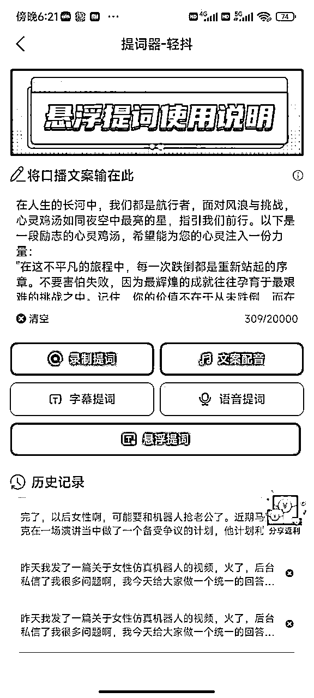
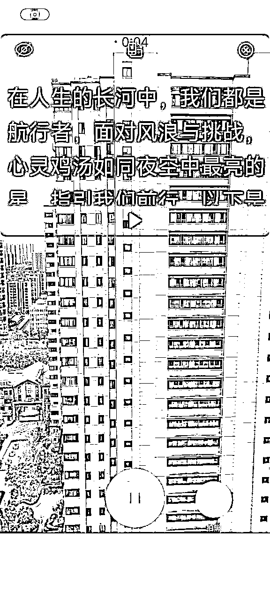
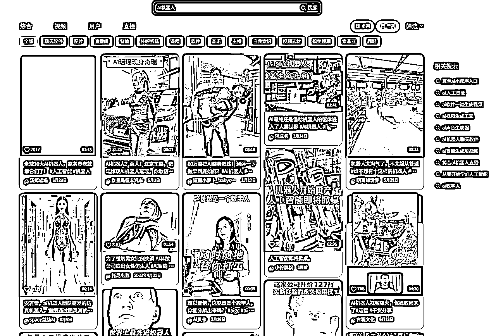
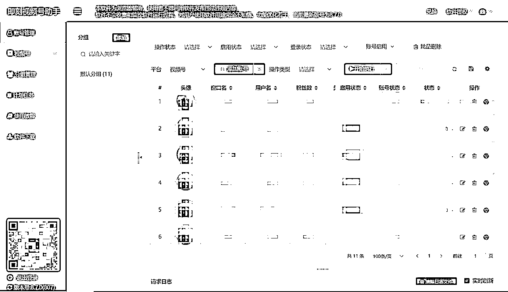

# 视频号做知识付费，如何在周期里做成一门稳定生意

大家好，我是耿一凡，苏州在做项目的98年创业者。

今年4月我正式入局视频号，和女友两人组队做一个面向都市银发的AI入门课。到9月为止，课程卖出800多套，全矩阵账号涨粉超10万，累计营收13万。

最近常有人说视频号红利没了，变现变慢了。我想说的是，任何平台都有从爆发到内卷的周期，像抖音快手当年的商业化，视频号现在也在走相似的路。入局的人越多，竞争越激烈，这是必然趋势。但垂直赛道受周期影响有限，依然能做得很好，甚至在红海里切出一块小蓝海。下面分享下我们的实际收益情况：

上图是课程销售的流水，下面的几张图是视频号直播的数据

我之前做过软件赛道的操盘，擅长SEO、SEM，也带团队做过知+投放、私域社群、软件知识付费和ToB线索获取。但后来公司空降了一个擅长向上管理的领导，开始搞形式主义，团队效率骤降，大家都浮躁，数据长期停滞，我自己也内耗严重。

正是在那段时间，我加入了龙哥盟。里面很多内容很扎实、很落地、很利他，正是我喜欢的创业者气质。我看了上百个赚钱的实操拆解，发现不少项目不需要重资源、不用大团队，个人都能跑起来。离职创业的念头就这样出来了。反正年轻，试试看，最差也就是失败后回去上班。

说走就走，当月就离职了。起初我也想做知识付费，因为利润高。第一站选了抖音，结果做了三个月没起色，宣告失败。后来加入航海项目，接触了抖音直播教育、视频号中老年知识付费、视频号带货、视频号口播带货，在不断试错中找准了方向。

7月我参加视频号口播带货航海，结营后在星球分享，吸引来一批志同道合的朋友。历经三个月的深耕，航海的经验沉淀成了我现在的主项目——视频号知识付费。今天就把这个项目完整拆解出来，有兴趣的朋友可以在评论区聊聊。

# 一、为什么锁定这个赛道

1. 先找到产品和人群

最初选方向时很迷茫，赚钱的项目太多，不知道抓哪个。无意间刷到抖音上几位大V在卖AI课，去年AI明显爆发，ChatGPT出来后，文心一言、讯飞星火、通义千问、华为盘古等国产大模型相继出现。直觉告诉我，这就是风口。

2. 再找到适合自己的渠道

但冷静一看，这些大V粉丝都是百万千万级，直接复制不现实。抖音知识付费又重投流，一场直播投十几万，完全不是我的体量能玩的。

视频号起步晚，还没有形成绝对头部，新人依然能做出结果。而且我发现视频号上已经有人靠自然流在卖AI课了，并且用户画像很清晰——以中老年人为主，一二线城市的银发群体对新事物接受度高，付费意愿也不错。

于是方向就定了：在视频号给都市银发卖人工智能入门课。

# 二、项目落地拆解

方向定了之后就是一步步执行。录课、引流、直播、交付，顺序走。

### 一、课程制作

1. 先把内容吃透

我自己早在半年前就用ChatGPT办公，Midjourney和Stable Diffusion也会用。我把市面上几家自媒体的AI课都买了，付费免费的都看过，大概看了4套，发现内容高度同质化。用我现有的认知完全能出一套30-40节的课。大纲按AI文本、AI绘画、AI视频、AI数字人四个板块来排。

2. 重准备：逐字稿+配套资料

定稿后开始逐节录制。每节课我都写好逐字稿，因为不擅长即兴发挥。文案是口播的写法，边写边整理本节要点和提示词，最后汇总成一份教材文档，和课程一起打包送给学员，也是直播时的重要卖点。

3. 坚持低成本

整套课花了3周，38节。工具全用免费版，坚持能不花钱就不花钱。免费赠送工具包，也是直播时的福利点。

### 二、搭建文案库

课做好了，产品问题就解决了。下一步是视频号引流。

1. 全平台搜爆款

我的目标用户是都市银发，内容必须贴合他们。在抖音、视频号、📕上搜关键词，比如养老、保姆机器人、人工智能、AI机器人、机器人传宗接代等，一个个扒账号和作品。我做真人口播，所以只收口播类。把1万+播放的爆款全部收藏，最后语音转文字整理成自己的文案库。

2. 改写成原创

视频号目前不查重，但为了后续多平台分发，我会做改写。核心是保留经过市场验证的爆点，换表述再发，依然有爆的概率。

3. 多维度测试

对标最好选近期爆的，新手不要一上来就学大V。同一篇文案、同一场景，不同的人出镜效果可能天差地别。数据不好不要急着停，更换文案、更换场景持续测试。前期尽量一比一复刻，先模仿再超越。

### 三、真人出镜口播

1. 形象准备

文案有了就准备拍摄。知识博主形象要正式，衬衫、领带、西装都可以备好，服装是快速传递身份感的手段。

2. 熟悉稿子

一定要把文案读熟，保证口播流畅。多读几遍再上镜，磨刀不误砍柴工。肢体语言和表情也尽量向对标视频学习。

3. 提词器设置

我用的是轻抖提词器，把文案放进去录制时半透明悬浮显示。常用参数：字体30，速度1.6，倒计时5秒。

4. 拍摄设备

必备：手机支架、手机、领夹麦克风。美颜相机APP用于拍摄。

支架只要能稳定固定就行，建议买长杆。

手机最好是苹果，安卓也可以配合美颜相机。

麦克风选200-300元价位，猛犸不错，注意区分苹果和Type-C接口。

开美颜相机选苹果模式，在光线充足的自然光下拍，美颜按需开启。

5. 机位调整

人物与镜头的距离很关键。参考对标视频一比一复刻。一般面部占横向屏幕1/3左右，上方留标题区，下方留字幕区，具体还是按对标号微调。

拍摄要点：保证朗读流畅，尽量抑扬顿挫、有情绪，像跟朋友聊天一样自然。刚开始会紧张，拍个3条基本就进入状态了。拍摄前活动嘴巴、眨眨眼，能缓解僵硬。

### 四、剪辑成片

录完后用剪映做后期，分两步：口播剪辑+画中画素材。

口播剪辑主要是删减卡顿、走神、口误等片段。分割和裁剪按钮配合音量波形就能快速定位无声段落，剪掉后保持整体通顺。

画中画是提升视频质感和爆款率的关键。提前建一个素材库，抖音视频号快手里搜关键词就能找到，后续直接调用。

### 五、直播转化

1. 预约直播

视频发布后在后台设置直播预约。短视频负责导流预约，直播开播时平台会主动提醒用户进入，转化率更高。

2. 商品上架

直播前要把课程挂上去。可以自己开视频号小店，需要ICP备案和保证金；也可以入驻第三方课程平台，操作简单但会抽成10%左右。

3. 话术逐字稿

我参考了三个卖AI课的直播间，取精华。前半段演示操作种草，后半段推课做营销，用特价、赠品、限时、价格锚定等手段。把两段话术融合改成自己顺口的逐字稿。刚开始直播难免紧张、念错，后面随着场次增加会越来越顺。

4. 直播间搭建

需要电脑、摄像头、麦克风、背景。整体风格明亮文艺。设备200-400元档位就够，背景布淘宝搜知识主播背景布约100元。

预约人数200以上就可以开播。新手先做到完整走一遍流程。直播要重点突出：永久回看+免费AI工具终身使用+150个案例资料包+1对1终身答疑。

### 六、课程交付

1. 发放短信

下单后给用户发一条短信，里面有H5链接，点进去能看课程并添加我的🛰️，学习中随时沟通。

2. 🛰️跟进

用户加🛰️后要及时响应。退款高峰是购买后2天内，过了基本稳定。问题大多是基础操作，解答即可。

3. 补加未加🛰️的用户

有些年纪大的用户买了课不会加🛰️，这部分很容易退款。下播后2小时内要核对名单，手动搜索手机号补加。我就是靠这一步把退款率从15%降到8%。

这个模式边际成本极低，卖1套和卖100套成本几乎不变，非常适合复制。

# 三、如何放大

跑通0-1后就做矩阵。

1. 实名账号

一人可实名2个视频号，这是启动的卡点。视频号实名要线下人脸识别，和🛰️实名规则不同。账号不用了可以注销释放名额。

2. 原创授权

视频号支持原创授权，主号可授权5个子号，子号发同样内容不算搬运。矩阵里总有账号跑起来，优质号继续做，差的号注销重来。

3. 工具提效

账号多了靠人工发布很慢。我用的是即刻矩阵工具，可以批量改描述、时间、地点和一键分发。

# 番外：我的一些心法

创业没想象中容易，需要的能力太多。新手期动作会变形-回正-再变形-再回正，持续迭代。心态上要稳定，不要被日数据波动带跑情绪。

我既经历过一觉醒来100万播放的高光，也经历过作品0赞的低谷。把周期拉长看，创业是长跑，靠耐力、体力、心力。找到方向后反复执行，拆解流程不断优化。从0到1最难，缺什么补什么，去学去请教，打通闭环，把赚钱的碎片拼完整，神龙自然会出现。

多链接高手，向高手学习，才能走得更快。

创业陷入瓶颈那阵子，我有幸在圈子里链接到了陈锦奕这位大佬，跟他请教了不少视频号自然流的门道，很多想不通的卡点一下子就被点透了。后面航海中又遇上了汪淼教练，他做视频号知识付费做得不错，我在业务上的细节问题，他也都知无不言，分享得非常彻底。说实话，赚钱这个圈子真心藏龙卧虎，能跟一位高手深度聊上一次，很多业务里反复踩的坑，都能提前避开，省下的时间和精力，真的无法用钱衡量。

其实任何项目都逃不开自己的生命轨迹——刚起来时是一片蓝海，流量疯涨，随后进入稳定期，最后慢慢淡出。眼下视频号口播就正处在那个“稳”的阶段。相比七月份那个黄金井喷期，现在想跑出一条百万级的大爆款，难度陡然上升，爆发式增长的风口确实已经翻篇了。但如果你指望着靠一条爆款吃一辈子，那注定走不远。真正值得长期耕耘的，是那种能稳定产出的项目。它现在虽然不“爆”，却依然能打，我自己就招了一个全职运营来打理，工资成本不仅完全覆盖得住，每个月还能留下不少纯利——这就是实打实的“躺赚”体验。

做短视频，尤其是自然流，心里一定要有底：不爆才是家常便饭，偶尔爆一次，那才是反常。你必须接受自己前期的无名无声，沉下心来把前面100条作品认认真真打磨完，剩下的一切交给时间。做口播，不要嫌麻烦，逐帧去拉片，把对标的视频还原到骨子里，核心动作反复练、反复磨。初期阶段，别总想着搞什么创新，就盯着对标来，对方怎么做，你就怎么做，不然动作一飘，方向就偏了。我之前跟一位拿过大结果的前辈聊天，他说过一句话让我印象深刻：新手创业，别一上来就想着年入百万、千万，目标定得越高，内耗越重。创业其实分三步走——第一次赚够一年的生活费，第二次赚够十年的，第三次，才是够一百年的。步子小一点、跑得快一点，先让生意转起来，再说其他。

以上就是我关于这个项目的全部心得了。相信你亲自动手跑一遍，每个环节都能打通，最终拿到属于你的结果。[PRE*]